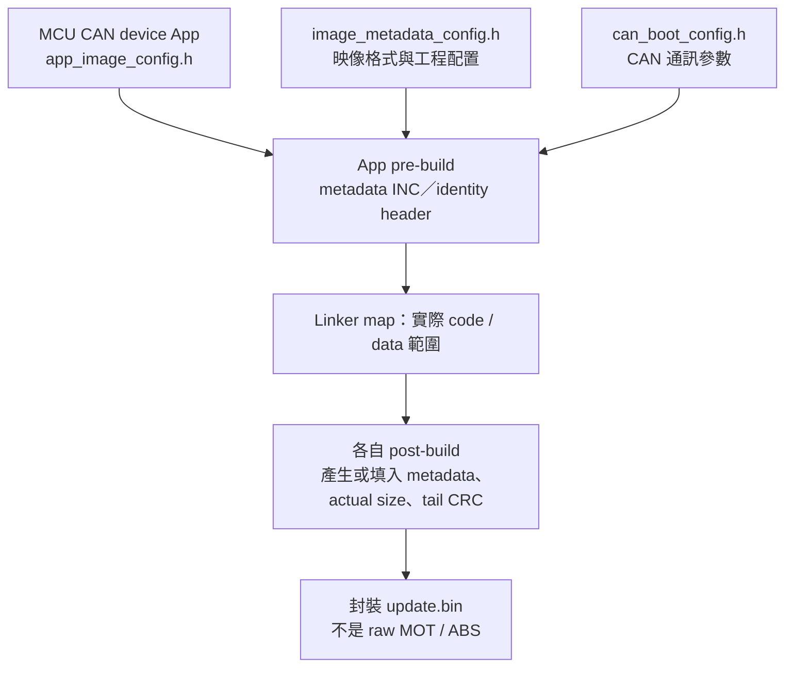
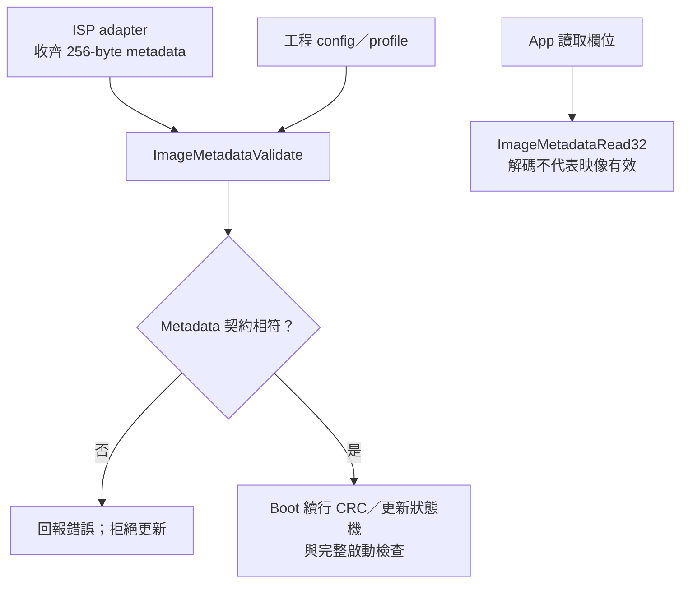
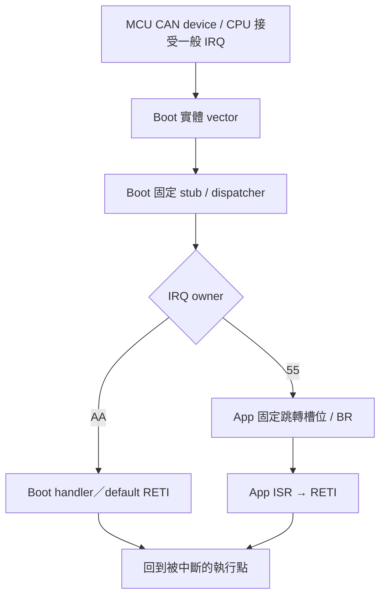
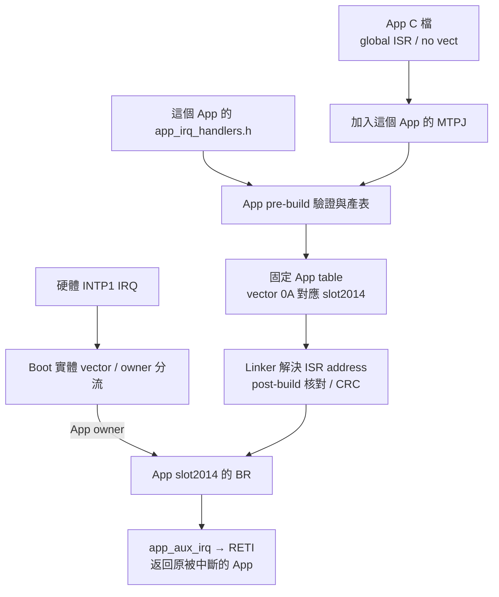
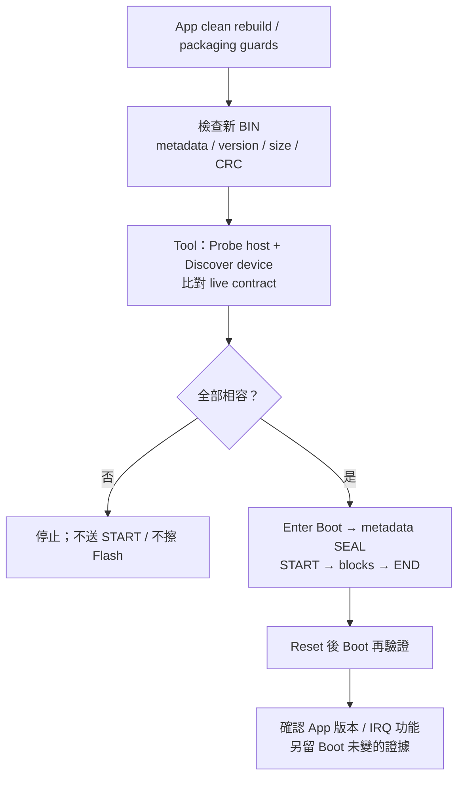
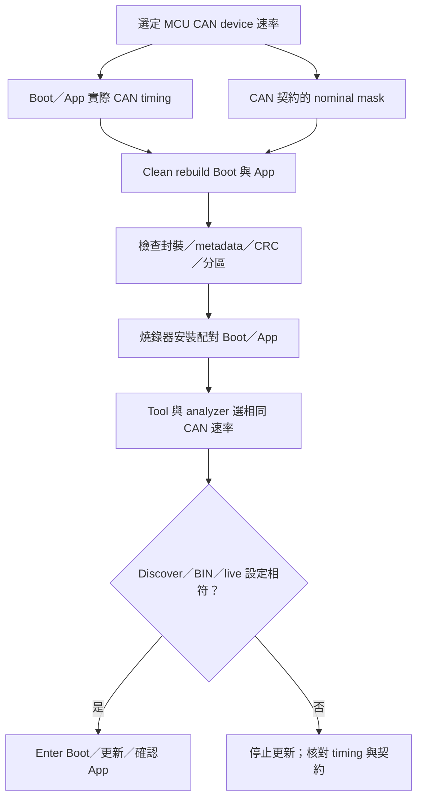

[知識庫首頁](https://released.github.io/) · [RL78 Bootloader 實作指南](index.html)

<a id="article_top"></a>

# App Metadata 與 IRQ 編輯

C header 編輯、產表、App 建置、驗證、CAN 速率與更新耗時。

<!-- DEVICE_WORKSHOP_BEGIN -->
<a id="device-metadata-vector-workshop"></a>

## Device 開發實作：編輯 Metadata、增加 IRQ、產生並驗證 App

本章整理 **F13 (MCU CAN device)** 與 **F24 (MCU CAN device)** 的 App 設定與建置流程。
兩者皆透過 CAN 更新 App，由 pre-build／post-build 將專案設定轉成映像。
兩份工程共同作為後續 MCU 的 [golden sample](https://github.com/released/simple_renesas_isp_tool/blob/main/docs/DEVICE_GOLDEN_SAMPLE_zh-TW.md)。
編輯與建置使用 C header、Windows PowerShell／.NET 與 CS+；不需要 Python。

### A. 專案配置與共用介面

| 項目 | F13 (MCU CAN device) | F24 (MCU CAN device) |
| --- | --- | --- |
| Boot／App | `RL78_F13_Boot_loader_CAN`／`RL78_F13_Boot_loader_CAN_app` | `RL78_F24_Boot_loader_CAN`／`RL78_F24_Boot_loader_CAN_app` |
| MCU／Flash driver | R5F10BMG／FSL | R7F124FPJ5xFB／RFD，忙碌期間必要程式在 RAM |
| Target／IRQ ABI | `0xF13B`／F1V1 | `0xF24B`／F2V1 |
| Boot／App 起點 | 8 KiB／`0x2000` | 8 KiB／`0x2000` |
| App capacity | `0x1DC00`，119 KiB；最後 1 KiB 保護 | `0x3DC00`，247 KiB；最後 1 KiB 保護 |
| 更新契約 | App image format 6、CAN protocol 5、Classical 500K | 同樣格式／協定，但身分與 geometry 不同 |
| 版本／build 編輯來源 | App `app_image_config.h` | App `app_image_config.h` |
| IRQ 編輯來源 | 各 App 的 `app_irq_handlers.h`＋已註冊 ISR C 檔 | 同左 |

App 與 matching Boot 以原名稱放在同一父目錄；保留相鄰 Boot 提供的腳本／共用來源。
F13 可由 [Boot](https://github.com/released/RL78_F13_Boot_loader_CAN)／[App](https://github.com/released/RL78_F13_Boot_loader_CAN_app) 取得。
F24 device 的板端設定與建置方式見 [F24 CAN device 工程配置](https://released.github.io/slide_boot_loader_for_RL78/#f24-can-device)。
獨立 Transfer 專案是通訊測試整機映像，不是可載入的 App 更新 BIN。

#### A1. 設定檔與產物分工

| 檔案 | 內容 | 編輯方式 |
| --- | --- | --- |
| `app_image_config.h` | App 版本、build 與映像身分核對值 | 使用者設定 |
| Boot `image_metadata_config.h` | 格式、MCU／Flash、IRQ ABI、更新政策與 Boot 版本 | 共用映像契約；變動時核對 Boot／App、linker、封裝及 Tool |
| Boot `can_boot_config.h` | CAN ID、速率宣告、命令與接收規則 | CAN 通訊設定；搭配實際 clock／timing 修改 |
| Boot `boot_app_handoff.h` | 共用 RAM、IRQ owner 與一次性交接標記 | 啟動交接契約；與 linker／startup／向量產生器對應 |
| `image_metadata.c/.h` | 執行時欄位解碼與完整 metadata 驗證 | 共用 C90 模組；Boot／App 分別編譯引用 |
| `image_metadata_profile.c` | 工程接受的 32-word metadata core | 結合映像契約與 ISP 設定；不操作 driver register |
| `app_irq_handlers.h` | 實體 vector → ISR 函式名稱 | 使用者設定，搭配 App 的 ISR C 檔 |
| `.inc`、identity header、向量表 | 編譯與封裝所需資料 | 產生器輸出；檔名見 [建置產物](#device-app-build) |
| `DefaultBuild/app_build_report.html` | 實際 BIN 的 metadata、位址、CRC、向量表 | post-build 輸出；以瀏覽器開啟，見 [編譯摘要](#device-app-build-report) |

兩個 device 使用相同的 C header 欄位，產生器依各自的 Boot 契約輸出對應檔案。

Metadata 的共用宣告採 `IMAGE_*` 名稱，放在獨立 header；不引用 CAN driver。
CAN 參數仍會被記錄到 BIN，產生器及驗證端在組合欄位時讀取 `can_boot_config.h`，
因此不需要在 metadata header 再維護一份 CAN ID／速率。

日常 App 發行編輯 `app_image_config.h`；改 MCU／分區／格式時核對 `image_metadata_config.h`；
改 CAN 通訊參數時核對 `can_boot_config.h` 與驅動。
CS+ 專案樹已列入這些設定 header。F13 App 的同名 metadata header 只引用相鄰 Boot 契約，
不另存一份可獨立修改的共用數值。

<a id="device-app-json"></a>
<a id="device-app-config"></a>

### B. Metadata 設定與產生來源

| 分類／欄位 | 編輯或產生位置 | 只更新 App？ |
| --- | --- | --- |
| App version／build | 兩者都編輯 `app_image_config.h` 的 `APP_IMAGE_VERSION`／`APP_IMAGE_BUILD` | 是，仍須符合既有契約 |
| 版本管制 | `APP_IMAGE_VERSION_CONTROL`；`0U` 預設允許任意版本，`1U` 僅允許同版／新版 | 是；成功更新後採用映像設定 |
| image_size／CRC 地址／CRC32 | 由 linker map 與 post-build 封裝決定 | 自動產生，不填預估大小、不用 hex editor 改 |
| Target、MCU part／family、Flash geometry、CAN IDs／rate | Boot 契約、App producer、linker／backend、封裝與 live INFO 必須一致 | Boot／App 共同契約 |
| Role／transport／IRQ ABI／minimum Boot | matching Boot config／producer 產生；Boot／Tool 均驗證 | 由 Boot／Tool 核對 |
| Metadata reserved `0x80..0xFF` | Producer 固定填 `FF` | 新增欄位時同步 producer 與 validator |
| `APP_IMAGE_TARGET_ID`／`APP_IMAGE_ROLE`／`APP_IMAGE_UPDATE_TRANSPORTS` | App 與 Boot 的契約核對值 | Target：F13 `0xF13B`、F24 `0xF24B`；role `1U`＝DEVICE_APP、transport `0x01U`＝CAN |

Packed version 採 `(major << 16) | (minor << 8) | patch`；每部分一個 byte。
以下版本／日期用於展示設定差異。
build 使用十進位整數。
App 版本、Boot 版本與 minimum Boot 為不同欄位。

| Define | 功能與用途 | 範例／其他值的處理 |
| --- | --- | --- |
| `APP_IMAGE_VERSION` | App 自己的 major／minor／patch；作版本比較 | `0x00020103UL`＝2.1.3；不要求等於 Boot 版本 |
| `APP_IMAGE_BUILD` | App 建置識別；不參與版本排序 | `20261018UL`；與 Boot build 不必一致；相同版本換 build 仍視為同版 |
| `APP_IMAGE_TARGET_ID` | 與 paired Boot 核對映像身分，不是 MCU 選擇器 | F13 `0xF13BU`／F24 `0xF24BU`；只改成 `0xF33BU` 會在 pre-build 被拒絕 |
| `APP_IMAGE_ROLE` | 更新目的地角色 | 協定 `1U`＝DEVICE_APP、`2U`＝HOST_BRIDGE_APP；本工程要求 `1U`，改 `2U` 或未定義的 `5U` 都拒絕產生 |
| `APP_IMAGE_UPDATE_TRANSPORTS` | 允許的更新介面 bitmask，不是 App 執行時使用的周邊 | 協定 `0x01U`＝CAN、`0x02U`＝I2C、`0x04U`＝UART，`0x03U`＝CAN＋I2C；本 CAN 工程僅接受 `0x01U`，其他值不會啟用另一種更新流程 |
| `APP_IMAGE_VERSION_CONTROL` | 已安裝有效 App 的版本政策 | `0U`＝任意版本、`1U`＝同版／新版；其他值拒絕產生；維護操作見 [force 降版](https://released.github.io/slide_isp_tool_for_RL78/#force-old-version) |

Boot 自身的版本／build 位於 `image_metadata_config.h` 的 `IMAGE_BOOT_VERSION`／`IMAGE_BOOT_BUILD`。
App producer 將該 Boot 版本寫成 metadata 的 minimum Boot；板上 Boot 版本須不低於此值。
例如 Boot 1.7.0 與 App 2.1.3 可以搭配；App 版本與 Boot 版本不做相等比較。
只更新相容的 App 時，保留 Boot 設定即可。

#### B1. F13：編輯 app_image_config.h

修改前：

```c
#ifndef APP_IMAGE_CONFIG_H
#define APP_IMAGE_CONFIG_H

#define APP_IMAGE_VERSION           (0x00010500UL)
#define APP_IMAGE_BUILD             (20261015UL)
#define APP_IMAGE_TARGET_ID         (0xF13BU)
#define APP_IMAGE_ROLE              (1U)    /* DEVICE_APP */
#define APP_IMAGE_UPDATE_TRANSPORTS (0x01U) /* CAN */
#define APP_IMAGE_VERSION_CONTROL   (0U)    /* 0=any; 1=same/newer */

#endif
```

修改後（僅示範 App 資訊變更）：

```c
#ifndef APP_IMAGE_CONFIG_H
#define APP_IMAGE_CONFIG_H

#define APP_IMAGE_VERSION           (0x00010501UL)
#define APP_IMAGE_BUILD             (20261016UL)
#define APP_IMAGE_TARGET_ID         (0xF13BU)
#define APP_IMAGE_ROLE              (1U)    /* DEVICE_APP */
#define APP_IMAGE_UPDATE_TRANSPORTS (0x01U) /* CAN */
#define APP_IMAGE_VERSION_CONTROL   (0U)    /* 0=any; 1=same/newer */

#endif
```

App pre-build 讀 App C header、Boot 的 `image_metadata_config.h` 及 CAN 設定，產生 `ftable.inc`／`app_identity.h`；
`ftable_RL78_F13.asm` 依生成常數排列 App metadata，讓 App INFO 與 BIN 使用同一版本／build。
`IMAGE_SIZE_POST_BUILD = 0xFFFFFFFF` 是封裝前的長度預留值，post-build 會填入實際大小。

#### B2. F24 device：編輯 app_image_config.h

修改前：

```c
#ifndef APP_IMAGE_CONFIG_H
#define APP_IMAGE_CONFIG_H

#define APP_IMAGE_VERSION           (0x00010000UL)
#define APP_IMAGE_BUILD             (20261015UL)
#define APP_IMAGE_TARGET_ID         (0xF24BU)
#define APP_IMAGE_ROLE              (1U)    /* DEVICE_APP */
#define APP_IMAGE_UPDATE_TRANSPORTS (0x01U) /* CAN */
#define APP_IMAGE_VERSION_CONTROL   (0U)    /* 0=any; 1=same/newer */

#endif
```

修改後（保留契約欄位）：

```c
#ifndef APP_IMAGE_CONFIG_H
#define APP_IMAGE_CONFIG_H

#define APP_IMAGE_VERSION           (0x00010001UL)
#define APP_IMAGE_BUILD             (20261016UL)
#define APP_IMAGE_TARGET_ID         (0xF24BU)
#define APP_IMAGE_ROLE              (1U)    /* DEVICE_APP */
#define APP_IMAGE_UPDATE_TRANSPORTS (0x01U) /* CAN */
#define APP_IMAGE_VERSION_CONTROL   (0U)    /* 0=any; 1=same/newer */

#endif
```

`prepare_projects.ps1` 核對 C header，產生 `app_identity.h`、`ftable.inc`
與其組語 wrapper；linker 將該 256-byte metadata 放到 `0x2100`。
`package_images.ps1` 比對已編譯 metadata 與同一 C header／Boot contract，再填實際長度與尾端 CRC。
geometry、IRQ ABI、CAN routing 等欄位由 Boot 契約提供。
更新目的地與介面的核對規則見 [更新政策](https://released.github.io/slide_isp_tool_for_RL78/#image-update-policy)。

`app_image_config.h` 使用上述六個 `APP_IMAGE_*` define 與固定 include guard。
數值採 C 的十六進位或十進位整數，可加 `U`／`UL` 及一層括號；version 為 `0x00000000..0x00FFFFFF`，build 為 `0..4294967294`。
設定以 literal 表示，不使用條件編譯、其他 include 或運算式；C90 `/* ... */` 註解可保留。
產生器會拒絕缺少／重複／未知 define、契約不符或非整數設定。

工程內的 header 在每個欄位旁標示用途、編碼與修改條件。
version／build 是 App 身分設定；target／role／transport 是與 Boot 核對的契約值。
完整 Flash／CAN／IRQ ABI 資料由 Boot 契約產生，不需要在 App header 重複填寫。

#### B3. 用 address 與 byte 核對結果

兩個 device 的 App 起點相同，以下 address 相同；**欄位值與 image capacity 仍不同**。
完整欄位見 [Flash／Metadata byte 對照](https://released.github.io/slide_boot_loader_for_RL78/#flash-metadata-can-reference)；
兩個工程的欄位值由各自的 App 設定及 Boot 契約產生。

| 欄位 | Metadata offset | BIN offset | 絕對 Flash address | 本例預期 |
| --- | --- | --- | --- | --- |
| App version | `0x10..0x13` | `0x110..0x113` | `0x2110..0x2113` | F13：`01 05 01 00`；F24：`01 00 01 00` |
| App build | `0x14..0x17` | `0x114..0x117` | `0x2114..0x2117` | 20261016，LE32 |
| Actual image size | `0x18..0x1B` | `0x118..0x11B` | `0x2118..0x211B` | 必須等於 BIN 檔案長度，不是 capacity |
| Policy／IRQ ABI | `0x60..0x6F` | `0x160..0x16F` | `0x2160..0x216F` | DEVICE_APP、允許 CAN、各自 ABI 與 minimum Boot |
| Version control | `0x74..0x77` | `0x174..0x177` | `0x2174..0x2177` | `0U`／`1U`，LE32；Boot 在一般 START 比較已安裝版本 |
| Reserved FF | `0x80..0xFF` | `0x180..0x1FF` | `0x2180..0x21FF` | 128 bytes 全 `FF` |
| Tail CRC32 | 不在 metadata 裡 | `actual size - 4` | `0x2000 + actual size - 4` | 前面全部 BIN bytes 的 CRC32，LE32 |

#### B4. Metadata 產生路徑



<a id="device-metadata-parser"></a>

#### B5. Metadata C 模組與移植入口

兩個 device 的 Boot／App 分別編譯 `image_metadata.c`，介面由 `image_metadata.h` 宣告。
模組不包含 CAN driver、Flash 擦寫或 reset 操作。
App 的 INFO 欄位讀取與 Boot 的 metadata 驗證使用同一組介面。
`image_metadata_profile.c` 定義工程的 `g_image_metadata_contract[32]`，
由映像契約及 ISP 設定組合預期 core；CAN 分包暫存、順序／重送與 SEAL 留在 adapter。

| API | 輸入與結果 | 驗證範圍 |
| --- | --- | --- |
| `ImageMetadataRead32(data, length, offset, &value)` | data 指向 metadata byte0；可用長度至少 256 bytes，offset 為 0..252；成功回傳 1，失敗回傳 0 並清除輸出值 | 讀取任意 LE32 window，支援未對齊 byte buffer；不代表身分或 CRC 已通過 |
| `ImageMetadataValidate(words)` | 完整 64 個對齊的 native 32-bit words；成功為 `IMAGE_METADATA_OK` | 128-byte core、128-byte reserved FF、大小、版本編碼、build、版控值、minimum Boot、分區、身分、ISP 參數與 IRQ ABI |

C90 模組要求 `unsigned long` 為 32 bits，header 會檢查寬度。
直接映射 Flash 為 word pointer 適用於對齊的 little-endian CPU。
Byte-oriented 或 big-endian backend 先用 `ImageMetadataRead32` 將 64 words 解碼至對齊的 native word array，再執行完整 metadata 驗證。
長度、來源範圍及對齊由呼叫端確認；範例的 Flash metadata 與 RAM staging buffer 已依此配置。

完整 metadata 驗證不包含全映像 CRC，也不取代 START 的已安裝 App 版控判斷。
「欄位可讀」「映像契約相符」與「完整映像可啟動」分別核對。



`IMAGE_METADATA_DETAILED_STATUS` 是編譯時診斷選項，不寫入 BIN metadata。
`1U` 回報 field／policy／IRQ ABI／layout 等原因；`0U` 統一回報 BAD_IMAGE。
兩種設定執行相同的接受／拒絕條件，並由工程的 ROM 餘裕檢查核對容量。

#### 模組移植步驟

1. 保留 `image_metadata.c/.h`，依實際 MCU／分區修改 `image_metadata_config.h`。
2. 在 `image_metadata_profile.c` 組合工程接受的身分、格式與 ISP 參數。
   換介面時對應其設定與 adapter；共用解析模組不處理通訊命令或 register。
3. 在 Boot／App 的 CS+ 專案樹註冊 C 來源與 header；C 來源各編譯一次，不以 include 合併 C 檔。
   範例已完成註冊，App 引用相鄰 Boot 的本機來源。
4. Boot 在 metadata staging、已安裝映像判斷與 END 使用共用驗證；
   CRC、向量檢查及 Flash 保護維持在 Boot 流程。
   App 讀欄位時呼叫 `ImageMetadataRead32`，不另行複製 byte shift 或直接套用未對齊 struct。
5. Clean rebuild 後核對 Boot map／餘裕、App metadata／CRC／向量及 HTML 編譯摘要。
   檢查正常映像、錯誤身分／分區／IRQ、保留 bytes、短資料與更新中斷等情況。

共用原稿位於 Tool repository 的 `firmware/common/device_metadata`。
兩份 Boot repository 各自攜帶相同 C／header，日常 MCU 建置不依賴 Tool checkout。
維護共用模組時，在 Tool repository 使用
`scripts/sync_device_metadata.ps1 -F13Boot <Boot checkout> -F24Boot <Boot checkout>` 同步，
加上 `-CheckOnly` 可唯讀核對；各工程 config／profile 不由此腳本覆寫。

<a id="device-app-irq"></a>

### C. App Vector Table：新增 IRQ 範例

本例使用兩個 device header 都定義的 `INTP1 = 0x0A`。
其他 IRQ 的 vector 位址依各 MCU 的 device header 決定。
Vector 位址是**實體 vector byte address**，不是 IRQ 序號、App slot 或周邊 pin。
本例對應 App slot `0x2014`，即 BIN offset `0x14`；換算方式見 [槽位位址](#device-irq-slot)。

<a id="device-irq-ownership"></a>

#### C0. Boot／App 中斷所有權與向量轉送

本節的 RL78 工程由固定 Boot 持有實體 vector，再由軟體 dispatcher 轉送到 App。
App 不寫入實體 vector，而是在固定位置提供跳轉表；表內的 `BR` 指向該 App 的實際 ISR。

Boot 與 App 是分開編譯、連結的映像。兩份映像可以使用相同 C ISR 名稱，
也可以各自命名；函式名稱不決定硬體 vector 的所有權。
同一個映像內，每個函式只能有一份定義，每個已使用 vector 對應一個 handler。

| 項目 | Boot | App |
| --- | --- | --- |
| 實體 vector | 固定完整普通向量轉送介面，管理 `.VECTOR` | 使用 `app_irq_handlers.h` 產生的 App BR table，不宣告實體 `vect=` |
| IRQ owner | `0xAA`：執行 Boot handler；未配置來源走 default RETI | `0x55`：由 Boot 轉送至 App slot，再進入該 App ISR |
| ISR 名稱 | 在 Boot 映像內解析為 Boot 程式位址 | 在 App 映像內解析為 App 程式位址；可與 Boot 同名 |
| 中斷啟用 | Boot 初始化及啟用自己需要的來源 | 交接後由 App 初始化、清 pending flag、設定 priority／mask，再啟用 |

Classical CAN 範例的兩份 Boot 都使用 1 ms timer，CAN 收發與診斷 UART 採 polling。
CAN FD 的接收中斷配置見 [接收與中斷](https://released.github.io/slide_boot_loader_for_RL78/#can-fd-device-rx)。

| Device | 實體 vector／來源 | Boot ISR | App ISR |
| --- | --- | --- | --- |
| F13 | `0x1E`／INTTRJ0 | `f13_boot_timer_isr` | `r_tmr_rj0_interrupt` |
| F24 | `0x2E`／INTTM01 | `Device_TimerIsr` | `Device_TimerIsr`，兩個專案各自編譯 |

App handler 使用 global、非 static、無 `vect=` 的 interrupt pragma，並由編譯器產生 RETI。
新增一般 IRQ 時，修改 App ISR、MTPJ 來源登錄及 `app_irq_handlers.h`，重新產表並建置 App；
App 同時完成周邊初始化、priority／mask 設定與中斷旗標處理。
在 MCU、分區與 IRQ ABI 不變時，App 使用不同 IRQ 或與 Boot 同名的 ISR，不需修改或重燒 Boot。
新增來源的操作接續 [C1](#device-app-irq-source)；實體地址來源與產表結果見下方 C2～C4。



一般 IRQ 的轉送槽位涵蓋 `0x04..0x7C`，未使用來源保持 mask。
Reset 由 Boot startup 接手，再經驗證及交接進入 App startup。
保留的 `0x02` 與實體 BRK `0x7E` 不走一般 IRQ 轉送；App table 的 BRK 保留槽使用 RETB，與一般 ISR 的 RETI 區分。

<a id="device-irq-slot"></a>

##### 槽位位址與實際 ISR

RL78 的實體 vector 每項為 16-bit 入口位址，直接目的地位於低 64 KiB。
本架構將入口指向 Boot stub，再以 App table 的 far `BR` 連到實際 ISR，將硬體入口與 ISR 位置解耦。
硬體入口的位址寬度與跳轉表用途可對照 [Renesas RL78 ISR 說明](https://www.renesas.com/en/document/apn/rl78-dual-image-bootloader-example)。

實體 vector 每格 2 bytes，App table 為 64 格、每格 4-byte `BR`，共 256 bytes。
以實體 vector 的 byte address 換算：

```text
App slot = App start + (physical vector byte address / 2) * 4
         = App start + physical vector byte address * 2

0x2000 + (0x002E / 2) * 4 = 0x205C
```

以下是 F24 device timer 的具體例子；共通 IRQ 路徑使用上方流程。

| 步驟 | 位址／動作 | 對應位置 |
| --- | --- | --- |
| CPU 讀取實體 vector | `0x002E`，進入 Boot 固定 stub／dispatcher | App `iodefine.h` 的 `INTTM01`；Boot `f24_boot_vectors.asm` |
| owner 選擇 App | `0x55`，轉送至 App slot `0x205C` | Boot dispatcher；槽位為 BIN offset `0x5C` |
| 跳轉至 ISR | 該 slot 的 `BR !!_Device_TimerIsr` | App `app_irq_table.inc`；由 `X(0x2E, Device_TimerIsr)` 產生 |
| ISR 返回 | `Device_TimerIsr` 執行後以 RETI 返回 | App 的 `common/device_board.c` |

`0x205C` 是跳轉槽位，不是 ISR 本體的固定程式位址。
產生器與 linker 依 App 的 mapping 及實際連結結果填入 `BR` 目的地，無需手動指定 ISR 位址。

<a id="device-irq-dispatch-cost"></a>

##### 轉送延遲、CPU 負載與 stack

RL78 每次**實際接受、並進入這套一般 IRQ 入口**時，都會執行 stub／dispatcher。
這項成本會出現在 timer、外部中斷或 CAN RX 等已啟用的來源，不只發生在 Boot→App 交接。
未啟用的 IRQ 不執行 dispatcher；同一來源的多個事件若合併為一次 pending，也不是逐事件各執行一次。
相較實體 vector 直達相同 ISR，額外工作包含 CALL、PUSH／POP、owner／slot 計算及 App BR。

時間以 **CPU clock** 換算，不是 CAN bitrate 或 UART baud rate。
32 MHz 的一個 clock 為31.25 ns，40 MHz 為25 ns；一條指令可能需要多個 clocks。
完整轉送路徑累計後，本工程的 RL78 額外延遲約為 **1 µs 等級**。

以下是來源組語與原廠指令表的**名義時脈估算，尚非實板量測或最差延遲保證**。
條件為 RL78-S3、指令在 Code Flash 執行、stack／owner 在 RAM，採用
[RL78 Software Manual](https://www.renesas.com/en/document/mah/rl78-family-users-manual-software-rev230)
§5.5.3 Table5-7 的對應 clocks；ROM 資料讀取使用該表的 Code Flash 欄。
來源為各 Boot 的 `f13_boot_vectors.asm`／`f24_boot_vectors.asm` 與 App 的 `app_irq_table.inc`。

owner=`0x55` 的 App 路徑在三個 RL78 工程相同，執行22條指令：

| 階段 | 計算內容 | CPU clocks |
| --- | --- | --- |
| Boot stub | `CALL !dispatcher` | 3 |
| 暫存器保存 | 三次 PUSH，加上 `MOV A,ES` | 4 |
| 讀取 vector、換算 slot | 設定 ES、讀取 return address、讀取 ROM literal、換算 App slot | 12 |
| owner 分流 | RAM owner 的 CMP，加上成立的 BZ | 5 |
| 還原並進入 slot | 寫回 return address、POP／還原 ES、RET | 11 |
| App slot | `BR !!App_ISR` | 3 |
| 合計 | `3 + 4 + 12 + 5 + 11 + 3` | **38** |

其中 `MOV A,ES:[HL]` 讀取 Code Flash 中的 vector literal，計為5 clocks；
成立的 BZ 為4 clocks。`.DB` 是供讀取的資料，不是執行指令。
以上不包含 CPU 原本的硬體 IRQ 進入、編譯器 ISR 前言／結尾、ISR 本體及最後的 RETI。
App ISR 直接以 RETI 回到被中斷的位置，不會再回 Boot dispatcher 執行第二次轉送。

```text
Extra dispatch time (us) = dispatch CPU clocks / CPU frequency (MHz)
```

| Device／執行狀態 | 採用的路徑 | 名義 clocks | 額外轉送時間估算 |
| --- | --- | --- | --- |
| F13，CPU32 MHz | App owner | 38 | 1.1875 µs（1187.5 ns） |
| F24 Classical／FD，CPU40 MHz | App owner | 38 | 0.950 µs（950 ns） |
| F13，CPU32 MHz | Boot owner，timer | 43 | 1.34375 µs |
| F24 Classical／FD，CPU40 MHz | Boot owner，timer | 40 | 1.000 µs |
| F24 FD，CPU40 MHz | Boot owner，CAN RX | 45 | 1.125 µs |

這些路徑由 owner 與來源決定，不是逐一搜尋全部 IRQ。
單純增加 App IRQ mapping 數量、App BIN 長度或 metadata 內容，不會讓每次轉送多跑一輪 table 搜尋。
更改 dispatcher、MCU、時脈、記憶體配置或等待條件時，重新依組譯結果與量測核對。

**範例：F24 App 的 `Device_TimerIsr`。**
timer 的實體 vector `0x2E` 經 App slot `0x205C` 進入 ISR，路徑見 [槽位例子](#device-irq-slot)。
目前1 ms tick 為每秒1000次 IRQ，僅轉送部分約使用每秒0.95 ms CPU，即0.095%。
若同一類 IRQ 改成較高頻率，估算如下；這些頻率是負載試算，不代表已設定或測過。

| 實際 IRQ 進入頻率 | 平均間隔 | 每秒額外轉送時間 | 僅 dispatch 的 CPU 比例 |
| --- | --- | --- | --- |
| 1000次／秒 | 1 ms | 0.95 ms | 0.095% |
| 10000次／秒 | 100 µs | 9.5 ms | 0.95% |
| 100000次／秒 | 10 µs | 95 ms | 9.5% |

CPU 比例為 `IRQ entries/second × extra dispatch seconds × 100%`。
例如 ISR 的前言／本體／結尾（含 RETI）合計另需2 µs，1 ms tick 的合計軟體時間約為2.95 µs；
硬體 IRQ 接受時間與其他阻塞仍另外計算。
CAN FIFO 一次 IRQ 可處理多幀，估算時採用實際 IRQ 次數，不直接以 CAN frame 數代入。

**反應延遲與量測。**
外部事件到 App ISR 動作的時間，包含 IRQ mask／高優先來源等待、當前指令完成、硬體 IRQ 接受、dispatcher、
編譯器保存與 ISR 在該動作之前的指令。
dispatcher 期間沒有開啟 IE，因此這段時間也納入中斷可接受時機的預算。
固定路徑的名義成本與系統阻塞造成的 jitter 分別記錄。

可在獨立量測工程使用同一個外部週期訊號，於 ISR 第一個可觀察位置切換 GPIO，
比較「實體 vector 直達相同 ISR」與「Boot dispatcher→App slot→相同 ISR」兩組波形。
兩組使用相同 CPU clock、priority、GPIO 動作及負載，記錄多次樣本的最小／最大值。
事件到 GPIO 是整體反應延遲；兩組差值近似額外轉送成本，另核對 GPIO、前言與取指配置的差異。
只量 ISR 內 GPIO pulse 的寬度，涵蓋的是 pulse 之間的程式，不包含進入 ISR 前的 dispatcher。

**Stack。**
轉送階段額外暫用10 bytes：CALL return address 4 bytes，加三次 PUSH 共6 bytes。
這10 bytes 在進入 App ISR 前已釋放；硬體 IRQ frame、ISR 自身保存／區域變數與巢狀 IRQ 另計，
整體 stack 依各執行階段的最大使用量核對。

##### 移植範圍

此轉送架構不依賴硬體 boot swap，可作為其他 RL78 工程的移植基準。
共用的是設計與產表流程；各 MCU 的向量、Flash、startup 與 RAM 配置仍需建立對應的 Boot／App。
跨 MCU 與 Flash 擦寫期間的中斷條件集中於 [移植核對表](https://released.github.io/slide_boot_loader_for_RL78/#device-irq-porting)。

<a id="device-app-irq-source"></a>

#### C1. 加入一般 ISR，並在 App MTPJ 註冊來源

在自己的 App 新增 `app_extra_irq.c`，透過 CS+ 將它加入該 App 的編譯來源。
以下函式只清旗標並記錄事件；**不會初始化或啟用 INTP1**。

```c
#include "r_cg_macrodriver.h"

volatile unsigned char g_app_aux_irq_count;

#pragma interrupt app_aux_irq
void __near app_aux_irq(void)
{
    /* Clear the source flag and capture bounded state only. */
    PIF1 = 0U;
    g_app_aux_irq_count++;
}
```

ISR 宣告與返回規則沿用 [中斷所有權](#device-irq-ownership)。
啟用中斷之前，另依實際板子完成 pin／edge／priority／pending flag／mask 初始化；
範例未提供可直接接線使用的 INTP1 pin 設定。未用 IRQ 應保持 mask。
SC／Code Generator 重產後，核對 ISR pragma 並移除 App 的 `vect=`，保留 Boot 的實體向量所有權。

#### C2. F13 mapping：保留原有項目，新增 0x0A

Vector 位址的來源是此 App 的 [iodefine.h](https://github.com/released/RL78_F13_Boot_loader_CAN_app/blob/main/iodefine.h) 中的中斷定義。
硬體規格可對照 RL78/F13 硬體手冊「Interrupt functions」章節的中斷來源／向量表。

| Vector 位址 | header 定義 | ISR 名稱 | 函式來源 |
| --- | --- | --- | --- |
| `0x08` | `INTP0 = 0x0008` | `r_intc0_interrupt` | [r_cg_intc_user.c](https://github.com/released/RL78_F13_Boot_loader_CAN_app/blob/main/src/code_gen/r_cg_intc_user.c) |
| `0x0A` | `INTP1 = 0x000A` | `app_aux_irq` | 本章 C1 的 `app_extra_irq.c` |
| `0x16` | `INTST0 = 0x0016` | `r_uart0_interrupt_send` | [r_cg_serial_user.c](https://github.com/released/RL78_F13_Boot_loader_CAN_app/blob/main/src/code_gen/r_cg_serial_user.c) |
| `0x18` | `INTSR0 = 0x0018` | `r_uart0_interrupt_receive` | 同一份 `r_cg_serial_user.c` |
| `0x1E` | `INTTRJ0 = 0x001E` | `r_tmr_rj0_interrupt` | [r_cg_timer_user.c](https://github.com/released/RL78_F13_Boot_loader_CAN_app/blob/main/src/code_gen/r_cg_timer_user.c) |

查找時可先在 header 搜尋周邊中斷名稱，再於 ISR C 檔確認 `#pragma interrupt` 與函式定義。
同一向量可能列有 CSI／IIC／UART 別名，實際來源由本專案啟用的周邊模式決定。
`APP_IRQ_HANDLERS(X)` 的每一筆採 `X(vector, handler)`：第一個參數為實體向量位址，第二個為 App 的 C ISR 名稱。
清單使用 C 巨集續行，除最後一筆外，每行尾端保留 `\`；無使用項目時可保留空的巨集定義。

修改前：

```c
#ifndef APP_IRQ_HANDLERS_H
#define APP_IRQ_HANDLERS_H

#define APP_IRQ_HANDLERS(X) \
    X(0x08, r_intc0_interrupt) \
    X(0x16, r_uart0_interrupt_send) \
    X(0x18, r_uart0_interrupt_receive) \
    X(0x1E, r_tmr_rj0_interrupt)

#endif
```

修改後：

```c
#ifndef APP_IRQ_HANDLERS_H
#define APP_IRQ_HANDLERS_H

#define APP_IRQ_HANDLERS(X) \
    X(0x08, r_intc0_interrupt) \
    X(0x0A, app_aux_irq) \
    X(0x16, r_uart0_interrupt_send) \
    X(0x18, r_uart0_interrupt_receive) \
    X(0x1E, r_tmr_rj0_interrupt)

#endif
```

#### C3. F24 device mapping：保留自己的 timer

F24 App 的 `iodefine.h` 定義 `INTTM01 = 0x002E`。
本工程的 timer ISR 為 `common/device_board.c` 中的 `Device_TimerIsr`，因此使用 `X(0x2E, Device_TimerIsr)`。
`0x0A` 對應此 App header 中的 `INTP1 = 0x000A`，搭配 C1 的 `app_aux_irq` 範例。

修改前：

```c
#ifndef APP_IRQ_HANDLERS_H
#define APP_IRQ_HANDLERS_H

#define APP_IRQ_HANDLERS(X) \
    X(0x2E, Device_TimerIsr)

#endif
```

修改後：

```c
#ifndef APP_IRQ_HANDLERS_H
#define APP_IRQ_HANDLERS_H

#define APP_IRQ_HANDLERS(X) \
    X(0x0A, app_aux_irq) \
    X(0x2E, Device_TimerIsr)

#endif
```

各 App 的 C header 保存該專案使用的 IRQ 清單，新增項目時保留既有 mapping。
函式改名會同步反映於 C pragma、函式定義與 C header。
移除 mapping 時，對應周邊的 IRQ 也一併停用。

#### C4. 產生結果與核對欄位

| 檢查位置 | 修改前 | 修改後 |
| --- | --- | --- |
| F13 `app_irq_table.inc` 的 vector `0x0A` | `BR !!f13_app_default_isr` | `BR !!_app_aux_irq`，slot `0x2014` |
| F24 device `app_irq_table.inc` 的 vector `0x0A` | `BR !!device_default_isr` | `BR !!_app_aux_irq`；table start `0x2000` |
| App map | 沒有新 ISR symbol | `_app_aux_irq` 有有效 code address；應為 interrupt ISR |
| 最終 BIN 的 offset `0x14..0x17` | 指向原 default ISR | `EC`＋新 ISR 的 3-byte little-endian 絕對 address |
| Boot 的實體 vector／來源 | 固定轉送介面 | 不因 App 函式名或使用清單改變 |

Assembler symbol 前綴 `_` 由 generator 加入，C header 使用 C 函式原名 `app_aux_irq`。
表有固定 64 個 4-byte slot，不是每增加一個 IRQ 就把後面的 entry 往後推。
App reset slot 進 `_start`，不是直接進 `main`；`0x02` 仍是保留位置，不能加入 C header。
F13 此 slot 填 `FF`，F24 device 產生 default branch；兩者都不代表可啟用 reserved IRQ。
physical BRK `0x7E` 不由 Boot 轉送；App 的保留 BRK slot 使用 RETB，不是一般 IRQ 的 RETI。

#### C5. IRQ 的產生與執行路徑



<a id="device-app-build"></a>

### D. 產生與建置

下列是相鄰工程的相對路徑；在自己的 App 根目錄執行。先備份／記錄 matching Boot image 雜湊。
範例只變動 App 資訊及一般 IRQ，**不應呼叫 Boot 產表或 Boot rebuild**。
兩個 device 都使用 Windows PowerShell 與工程對應的 CS+／CC-RL。
CS+ 開啟自己的 App `.mtpj`，建置組態為 `DefaultBuild`。
下方 PowerShell 腳本以單次 `-ExecutionPolicy Bypass` 執行，不需永久更改系統執行原則。

#### D0. 第一次操作：逐步完成一次 App 變更

1. 選定 F13 或 F24 **device** 的 matching Boot/App，按原名稱放在同一父目錄；確認工程可建置。
2. 保存 Boot HEX、App 更新 BIN 與兩份 C header，記錄 Boot image 雜湊。
3. 開啟 App 的 `app_image_config.h`，修改 `APP_IMAGE_VERSION`／`APP_IMAGE_BUILD`；對照 B1 或 B2，保留 target／role／transport。使用 UTF-8，程式註解採英文 C90 寫法。
4. 若只升版本，跳到第6步。若新增 IRQ，依 C1 新增正常 ISR C 檔，並在 CS+ **此 App** 的 MTPJ 加入來源；還不要啟用硬體 IRQ。
5. 編輯這個 App 的 `app_irq_handlers.h`，保留既有清單，再加入 `0x0A` 範例或已核對的合法 vector／handler。
6. 從 App 根目錄執行 D1 或 D2 的產生命令，再執行 CheckOnly。錯誤先修正 C header／MTPJ／ISR，不手改 `.inc`、identity 或 table。
7. Clean Rebuild **App**，確認 pre-build 與 post-build 都成功。對照下方產物表，確認新 table、version／build、實際 BIN 長度與 CRC；使用此次成功建置的產物。
8. 在 Tool CAN TAB 載入該 App 的 `*_update.bin`，依 E 節核對映像版本、Metadata VALID 與 CRC MATCH；這一步不寫 MCU。
9. Open + Probe host、Discover **device**，核對 live target／layout／CAN／IRQ ABI／minimum Boot；相容才 Enter Boot 並開始更新，不以離線 BIN 取代 live 身分。
10. END／reset 後另外確認 App 版本 INFO／UART、既有 IRQ 與新 IRQ；最後比較 Boot 區／映像未變。硬體 IRQ 啟用前的初始化與故障測試仍需另作。

只升 App 版本時不必新增 ISR；只新增 IRQ 時也不必更改 target 或 Boot 版本。

#### D1. F13 device

```powershell
# Generate this App's metadata INC, IRQ table and identity; never Boot.
powershell.exe -NoProfile -ExecutionPolicy Bypass `
  -File "..\RL78_F13_Boot_loader_CAN\generate_irq_contract.ps1" `
  -Mode App -AppProject "."

# Read-only freshness check; run after generating, not instead of generating.
powershell.exe -NoProfile -ExecutionPolicy Bypass `
  -File "..\RL78_F13_Boot_loader_CAN\generate_irq_contract.ps1" `
  -Mode App -AppProject "." -CheckOnly
```

然後在 CS+ **Clean Rebuild 此 App**。原有 pre-build 保留上述 App-mode 命令，
post-build 保留 `generate_update_image.ps1`；該腳本依 map／App HEX 封裝，並非只產表就有新 BIN。
Tool 的 `scripts/verify_f13_artifacts.ps1` 可作後續檢查，需指定正確 Boot／App project。
F13 目前仍保留參考 MTPJ／map／輸出檔名與 sibling Boot 假設；若改專案名／搬目錄，
必須另外對齊 source／include／hook、`-MapFile`、輸出命名、checker 及 Boot HEX 來源。

#### D2. F24 device

```powershell
# Update this App's projections / registered project settings, never Boot.
powershell.exe -NoProfile -ExecutionPolicy Bypass `
  -File "..\RL78_F24_Boot_loader_CAN\tools\prepare_projects.ps1" `
  -Kind app -Project "."

# Read-only freshness / registration check.
powershell.exe -NoProfile -ExecutionPolicy Bypass `
  -File "..\RL78_F24_Boot_loader_CAN\tools\prepare_projects.ps1" `
  -Kind app -Project "." -CheckOnly

# Clean rebuild and mandatory map / image packaging checks.
powershell.exe -NoProfile -ExecutionPolicy Bypass `
  -File "..\RL78_F24_Boot_loader_CAN\build.ps1" `
  -Kind app -AppProject "."
```

CS+ pre-build 使用 `prepare_projects.ps1 -Kind app -Project . -ArtifactsOnly`；
post-build 使用 `package_images.ps1 -Kind app -Project .`。`-ArtifactsOnly` 僅產生編譯所需檔案。
只改一般 App 功能，不用省略 kind 的 all-mode prepare／build；SC 重產後先重新 prepare **app**。
若改名或搬移，仍須修正相對 source／include／hook 路徑；不是任意 standalone App 加 C header 即可。
F24 device prepare 使用同一磁碟內的相對路徑。

| 產物 | F13 device | F24 device |
| --- | --- | --- |
| Metadata `.inc`（不可手改） | `ftable.inc` | `ftable.inc` |
| App pre-build identity | `app_identity.h` | `app_identity.h` |
| App vector table | `app_irq_table.inc` | `app_irq_table.inc` |
| 瀏覽器編譯摘要 | `DefaultBuild/app_build_report.html` | `DefaultBuild/app_build_report.html` |
| 後續 CAN 更新 | `DefaultBuild/RL78_F13_Boot_loader_CAN_app_update.bin` | `DefaultBuild/<MTPJ stem>_update.bin` |
| 燒錄器初裝 App | `DefaultBuild/flash_app_variable_CRC.hex` | `DefaultBuild/flash_app_variable_CRC.hex` |
| matching Boot 初裝 | 先核對 `boot_app.hex` 的來源／產生時間；或 matching Boot＋App HEX | matching `boot0000_1FFF.hex`＋封裝 App HEX，依燒錄器設定核對擦除範圍 |

F13 若找不到 sibling Boot HEX，post-build 不會產生新的合併檔；先前的 `boot_app.hex` 可能仍留著。
任何 build／guard 失敗，先前 BIN 仍可能保留，使用前核對此次建置結果。
raw App MOT／ABS 可能包含低位實體記錄，不應代替已封裝的 App HEX 或 update BIN。
post-build 會拒絕 C header 與已編譯 metadata／IRQ 表不同的編譯輸出；C header 修改後進行 clean rebuild。
F13 也直接比對 App map、實際 BR 目的地與 mapped ISR 的 RETI，不依賴 Boot map 才能執行這項 App 檢查。
CheckOnly 發現手改／過期生成檔時只報錯、不修復；先重產，再 clean rebuild。

<a id="device-app-build-report"></a>

#### D3. 以瀏覽器核對編譯摘要

App post-build 通過 C header、已編譯 metadata、linker map 與 BR／ISR 檢查，完成 BIN 封裝後，
會在相同的 `DefaultBuild` 目錄產生 `app_build_report.html`。
兩個 device 使用相同的 PowerShell／.NET 報告程式，不需安裝額外軟體；HTML 可離線開啟。

| 區塊 | 可以對照的內容 |
| --- | --- |
| Packaged image | MCU part、App version／build、BIN 檔名與實際長度 |
| CRC32／SHA-256 | 重新計算的 CRC32 與尾端儲存值、整份 BIN 的 SHA-256 |
| Flash 配置 | Boot、App 向量表、metadata、code 起點、實際尾端 CRC 位址 |
| Metadata field summary | 欄位 offset、解碼值與 C header／Boot contract／post-build 來源 |
| App vector table | 全部 64 個 slot、`iodefine.h` 中斷名稱、App slot 位址、實際 BR bytes／目的地、設定 handler |
| Metadata byte addresses | 展開後列出全部 256 bytes 的 metadata offset、BIN offset、Flash address、值與欄位索引 |

在 App 根目錄可執行：

```powershell
Start-Process '.\DefaultBuild\app_build_report.html'
Get-FileHash '.\DefaultBuild\RL78_F13_Boot_loader_CAN_app_update.bin' -Algorithm SHA256
```

F24 device 的 hash 命令使用 `RL78_F24_Boot_loader_CAN_app_update.bin`。
以此次 CS+ 建置成功結果為前提，再比對報告日期與 BIN SHA-256。
建置失敗時，先前的報告與 BIN 可能仍在目錄內；報告只描述其對應產物，不表示目前原始碼已成功建置。

| 報告種類 | 產生時機與用途 |
| --- | --- |
| `app_build_report.html` | MCU App 編譯／封裝完成；核對映像、metadata、vector 與程式設定 |
| Tool `reports/update_*.json` | 一次實際更新操作結束；記錄結果、分階段耗時、重試、counter 差值與錯誤，見 [更新報告](https://released.github.io/slide_isp_tool_for_RL78/#update-confirmation) |

編譯摘要不連接 MCU，不代表 Flash 已寫入或 App 已啟動。
Tool 的更新報告也不取代編譯產物檢查；板上啟動與 IRQ 行為另外依 [驗證步驟](#device-app-validation) 核對。

<a id="device-test-images"></a>

#### 由現有 App BIN 產生 FF 填充測試映像

F13 Classical CAN、F24 Classical CAN 與 F24 CAN FD 的 App 根目錄皆提供
`generate_test_bins.bat`／`generate_test_bins.ps1`。
先完成一般 App 建置，再雙擊 batch，或在該 App 根目錄執行：

```powershell
powershell.exe -NoProfile -ExecutionPolicy Bypass -File .\generate_test_bins.ps1
```

腳本使用 Windows PowerShell／.NET 及相鄰配對 Boot 的 `app_config.ps1`，
讀取 `DefaultBuild/*_update.bin`，不重新編譯或修改 Boot／App 原始碼。
來源的 metadata、CRC、向量範圍與 App C header 身分先通過檢查，才建立測試檔。

| 產物／處理 | 內容 |
| --- | --- |
| `test_bins/<batch>/*.bin` | 每次建立新批次；檔名同時標示 Boot＋App 的 Flash 級距與實際 App BIN 大小 |
| 預設 Flash 級距 | 16／32／64／128／256／512 KiB；扣除來源 metadata 的 Boot reserve，並限制於 App capacity |
| `0xFF` 填充 | 保留原本可執行 App 與向量表；從原 CRC 位置填到新 CRC 前，不截短程式 |
| 長度與 CRC | 更新 BIN `0x118..0x11B` 的 image_size；最後 4 bytes 為重新計算的 little-endian CRC32 |
| `manifest.csv` | 實際 bytes、CRC、SHA-256、來源雜湊、版本、build、CAN mode 與填充值 |
| `skipped.csv` | 說明超出實體 Flash 或現有 App 放不下的級距 |

1 KiB 為 1024 bytes。F13 App 上限 119 KiB；F24 兩種 CAN 模式均為 247 KiB，保留末端 1 KiB。
需要完整 120／248 KiB 時，工程設定與 RFP 安裝限制見 [Flash 尾端保護的重要事項](https://released.github.io/slide_boot_loader_for_RL78/#device-debug-monitor)。
既有 App 若變大，放不下的級距會略過；其他有效檔案仍可產生。
輸出目錄由 Git 排除，腳本隨專案分享，來源 App 更新後可再次產生對應測試檔。

版本、build、minimum Boot 與更新政策沿用來源，Tool 仍依板上資訊執行原有檢查。
測試檔依其 CAN mode 使用既有 [Device 更新操作](https://released.github.io/slide_isp_tool_for_RL78/#mcu-can-device)，
實際結果保留在 [Tool JSON 更新報告](https://released.github.io/slide_isp_tool_for_RL78/#update-confirmation)。
`0xFF` 填充描述這一種資料內容；離線檢查不代表實板更新或任意資料的寫入效能已驗證。

<a id="device-update-timing"></a>

#### App BIN 更新耗時參考

以下為單次實板更新的粗略等待時間參考，以 Tool 報告的 `elapsed_ms` 換算為秒，顯示至小數一位。
總時間包含更新流程的檢查、傳輸與 Flash 擦寫、END CRC、App 啟動確認及收尾，不是純 Flash 寫入速度。
實際時間也會受 Host Link UART、電腦與通訊狀態影響。

Classical CAN 使用 **500 kbit/s**。
CAN FD 欄位使用 **nominal 500 kbit/s／data 2 Mbit/s／BRS 開啟**，不是全程以 500 kbit/s 傳輸。

| App BIN | F13 device：Classical CAN 500K | F24 device：Classical CAN 500K | F24 device：CAN FD 500K／2M、BRS |
| --- | --- | --- | --- |
| 原始 App（未填充） | 20,308 bytes／— | 4,224 bytes／約 5.2 秒 | 4,756 bytes／約 5.5 秒 |
| 8 KiB（8,192 bytes） | 不適用 | 約 7.3 秒 | 約 7.2 秒 |
| 24 KiB（24,576 bytes） | 約 15.8 秒 | 約 15.6 秒 | 約 15.6 秒 |
| 56 KiB（57,344 bytes） | 約 32.3 秒 | 約 32.2 秒 | 約 32.2 秒 |
| 119 KiB（121,856 bytes） | 約 65.8 秒 | — | — |
| 120 KiB（122,880 bytes） | 不適用 | 約 65.5 秒 | 約 65.5 秒 |
| 247 KiB（252,928 bytes） | 不適用 | 約 136.2 秒 | 約 134.2 秒 |

「—」表示沒有該欄對應的量測資料，不代表更新失敗；原始 App 列分別列出 BIN 大小與已有的量測時間。
「不適用」表示測試映像小於來源 App，或超過目前預設 App 容量。
各列均指實際 App BIN 長度，包含向量表、metadata、程式／填充與 CRC；1 KiB＝1024 bytes。

##### F13 量測條件與來源

| 項目 | 本表使用的實測條件 |
| --- | --- |
| 日期／MCU | 2026-10-22／RL78/F13 R5F10BMG |
| Host Link UART／CAN | 115200 baud／Classical CAN 500 kbit/s |
| Detailed trace | 關閉 |
| Tool／Host firmware | 0.1.0.0097／1.7.0，Host build 20261019 |
| Device Boot／App | Boot 1.7.2、build 20261022／App 1.6.1、build 20261017 |
| 測試映像內容 | 由原始 App BIN 延伸，以 `0xFF` 填充並更新長度與 CRC32 |
| 更新結果 | 三份均 PASS，END CRC 通過、APP_READY 與 live image 比對通過 |
| 重試／已記錄的 Host 錯誤 | 三份 `link_retries=0`；UART overflow、CAN lost／warning／passive／bus-off／recovery／TX failure 差值均為 0 |

來源為 Tool 的 JSON／HTML 更新報告；下表報告識別前加 `update_20261022_`，副檔名為 `.json`／`.html`。
對應 Log 為 `firmware_upgrade_tool_20261022_172301.log`。

| 報告識別 | App BIN | elapsed_ms | Image CRC32 |
| --- | --- | --- | --- |
| `092335_621_54044_695182765_1` | 24 KiB | 15845 | `0xCA0DE29D` |
| `092427_590_54044_695234734_2` | 56 KiB | 32281 | `0x8BF223B3` |
| `092553_622_54044_695320765_3` | 119 KiB | 65793 | `0x7A2A9624` |

##### F24 Classical CAN 量測條件與來源

| 項目 | 本表使用的實測條件 |
| --- | --- |
| 日期／MCU | 2026-10-22／RL78/F24 R7F124FPJ5xFB |
| Host Link UART／CAN | 115200 baud／Classical CAN 500 kbit/s |
| 逐幀記錄 | 對應 Log 未包含 `TRACE UART`／`TRACE CAN` 記錄 |
| Tool／Host firmware | 0.1.0.0098／1.7.0，Host build 20261019 |
| Device Boot／App | Boot 1.1.1、build 20261022／App 1.0.3、build 20261019 |
| 測試映像內容 | 原始 App，以及由其延伸、以 `0xFF` 填充並更新長度與 CRC32 的測試 BIN |
| 更新完成條件 | 六次均完成 END CRC、APP_READY／live image 比對及 CAN_STOP 確認 |

來源為 Tool 的 JSON／HTML 更新報告；下表報告識別前加 `update_20261022_`，副檔名為 `.json`／`.html`。
對應 Log 為 `firmware_upgrade_tool_20261022_180801.log`；表格列出整次操作的實際耗時，診斷細節保留於原始報告。

| 報告識別 | App BIN | elapsed_ms | Image CRC32 |
| --- | --- | --- | --- |
| `100929_089_55528_697936171_1` | 原始 App，4,224 bytes | 5222 | `0x4837111E` |
| `101010_155_55528_697977234_2` | 8 KiB | 7272 | `0x04D5ED74` |
| `101047_098_55528_698014187_3` | 24 KiB | 15556 | `0xBF72D477` |
| `101148_050_55528_698075140_4` | 56 KiB | 32198 | `0x9A0D4CAA` |
| `101320_919_55528_698168000_5` | 120 KiB | 65453 | `0x1F248CFA` |
| `101601_871_55528_698328953_6` | 247 KiB | 136242 | `0x3274CC2A` |

##### F24 CAN FD 量測條件與來源

2026-10-22，RL78/F24 R7F124FPJ5xFB；Host Link UART 115200 baud，CAN FD nominal 500 kbit/s、data 2 Mbit/s、BRS 開啟。
Tool 0.1.0.0099，Host firmware 1.7.0／build 20261019，Device Boot 1.2.1／App 1.0.4。

測試映像為原始 App，以及由其延伸、以 `0xFF` 填充並更新長度與 CRC32 的 BIN。
六次均完成 END CRC、APP_READY／live image 比對及 CAN_STOP 確認；對應 Log 未包含 `TRACE UART`／`TRACE CAN` 逐幀記錄。

來源為 Tool 的 JSON／HTML 更新報告；下表報告識別前加 `update_20261022_`，副檔名為 `.json`／`.html`。
對應 Log 為 `firmware_upgrade_tool_20261022_182748.log`。
表格保留各次操作的實際總時間，包含重試與收尾；結果分類與 counter 細節保留於原始報告。
量測條件以上述 Tool 與 firmware 為準；不同設定需各自量測。

| 報告識別 | App BIN | elapsed_ms | Image CRC32 |
| --- | --- | --- | --- |
| `102840_499_88416_699087546_1` | 原始 App，4,756 bytes | 5516 | `0x2244D36A` |
| `102911_331_88416_699118375_2` | 8 KiB | 7240 | `0x3FCC99E2` |
| `102956_261_88416_699163312_3` | 24 KiB | 15559 | `0x688C8587` |
| `103045_317_88416_699212359_4` | 56 KiB | 32188 | `0x5ED8A374` |
| `103238_863_88416_699325906_5` | 120 KiB | 65515 | `0x2B5ADB06` |
| `103540_647_88416_699507687_6` | 247 KiB | 134185 | `0x325DBF76` |

##### 相關說明

- [CAN 更新協定與逐 byte 封包格式](https://released.github.io/slide_boot_loader_for_RL78/#flash-metadata-can-reference)
- [Boot 完整 IRQ table 與 App software dispatch](https://released.github.io/slide_boot_loader_for_RL78/#device-irq-ownership)
- [Software dispatch 的時間與 stack 成本](https://released.github.io/slide_boot_loader_for_RL78/#device-irq-dispatch-cost)
- [Boot 燒錄方式與 Flash 尾端保護](https://released.github.io/slide_boot_loader_for_RL78/#device-debug-monitor)：CS+ 安裝 Boot 時，App 上限為 119／247 KiB，最後 1 KiB 保留給 debug monitor 所在的擦除區塊。需要完整 120／248 KiB 時，須調整配對工程，且 **Boot 只能由 RFP 安裝**。

<a id="device-app-runtime-log"></a>

#### D4. App 執行標籤與每秒 counter

診斷 UART 使用 115200。兩個 App 都在主迴圈輸出每秒遞增 counter，
timer ISR 僅提供時基／事件；不在 ISR 內格式化或傳送文字。

| Device | 可編輯位置 | 用途 |
| --- | --- | --- |
| F13 | App `custom_func.h` 的 `APP_RUNTIME_LOG_TAG` | 選擇 `"V1"`／`"V2"` 等觀察標籤；`custom_func.c` 的主迴圈輸出 counter |
| F24 | App `app_runtime_log.h` 的 `APP_RUNTIME_LOG_TAG` | 同樣選擇觀察標籤；`app_main.c` 每秒呼叫 App 專用 counter formatter，再經 UART 輸出 |

```text
app image tag: V1
log(timer)-V1: 0
log(timer)-V1: 1
log(timer)-V1: 2
```

counter 從 App 啟動後的零開始，以十進位遞增；空白對齊不影響其數值。
標籤獨立於 metadata 的 `APP_IMAGE_VERSION`；只改標籤不會改變 Tool 的版本比較。
編輯後依 [App-only 建置](#device-app-build) 重新封裝、載入更新 BIN，
更新後同時核對 Tool 的 App 啟動確認與 UART 輸出。

<a id="device-app-validation"></a>

### E. BIN 與向量驗證

| 步驟 | 要檢查的結果 | 未通過時 |
| --- | --- | --- |
| 產表 | 新 C header entry 對應到正確 slot；source 有且僅有對應的正常 ISR | 不手改生成檔，修 source／MTPJ／C header |
| map／向量 bytes | table 在 `0x2000`，metadata 不佔 code；BR 指向 App code，ISR 應有 RETI | 不更新 MCU；先查 linker／pragma／註冊 |
| BIN offline | size 等於檔長、metadata reserved FF、CRC match、role／CAN／ABI 正確 | 不用修改 Tool 欄位繞過 |
| Tool Load Update Image | Metadata VALID、CRC MATCH、新 version／build；這仍只是 offline 資訊 | 重查 producer／封裝及實際載入檔案 |
| Discover live device | MCU／target／geometry／CAN／IRQ ABI／minimum Boot 相容 | 不送 START；不能把載入 BIN 身分當 live 身分 |
| 更新與 reset | END 成功後，確認 App INFO／UART 與載入映像一致、正常與新增 IRQ，Boot 區未變 | 保留 log／trace，分別記錄 END ACK 與 App 執行證據 |

#### E1. Tool 驗證與更新後 App 證據



INTP1 範例涵蓋來源登錄與產表；實際 IRQ 功能仍需搭配板端初始化與量測。
F13 與 F24 device 的正常 CAN App 更新及啟動皆已完成實板驗證；
F24 的報告與 UART counter 見 [更新結果](https://released.github.io/slide_isp_tool_for_RL78/#f24-device-update-example)。
不同速率、其他 IRQ、取消與斷電等條件分別驗證。
CRC 用於完整性檢查。
更新中斷後，Boot 於下次啟動重新驗證現有映像，驗證有效才進入 App。

### F. 常見錯誤與只換 App 的邊界

| 變更／錯誤 | 處理原則 |
| --- | --- |
| 只改 App version／build 或相容的一般 IRQ | 產表、重建與封裝 App；不因 ISR 名稱改動重燒 Boot |
| 改 MCU／App start／geometry／IRQ ABI／更新協定 | 屬於共同契約變更；同步 Boot、App、producer、Tool／validator 並重新驗證 |
| Vector 位址填入 `0x2014`、IRQ index 或保留／奇數 vector | 填寫合法實體 byte address，本例為 `0x0A`；以本工程 header 核對 |
| C 檔只複製進資料夾，沒有加入 MTPJ | generator 或 linker 應拒絕；先修正專案登錄 |
| ISR 帶 `vect=`／static／普通函式，或 symbol 拼錯 | 改成正常 global interrupt ISR，再核對 C header 與 generated table |
| 覆蓋原有 UART／timer mappings | 先恢復仍在用的清單；新增不是替換整份 C header |
| 手改 `.inc`、generated table、identity、BIN bytes／CRC | 由兩份 C header／ISR 來源修改並重建；CheckOnly 僅檢查，不更新產生檔 |

同一份 Boot 可搭配 App A／B 的不同 ISR 清單，前提是完整共同契約不變。
新增 IRQ 後，仍核對硬體初始化、stack、pending flag 與實際 IRQ 行為。

<a id="device-can-bitrate"></a>

### G. Device CAN 速率：250K／500K／1M

本節設定 MCU CAN device 的 Classical CAN 更新速率，單位為 kbit/s 或 Mbit/s。
Boot 與 App 的 INFO／ENTER／更新通訊使用相同速率；範例預設 500 kbit/s。
Tool 的 CAN Nominal 下拉選單設定 MCU CAN host 的 bus timing，不改寫 device register 或 metadata。
PC 與 host 之間的 Host Baud 仍是獨立的 UART 設定。

#### G1. 修改位置與計算來源

| Device | 實際 CAN timing 輸入 | Boot／App 的引用方式 | 目前時鐘／時序 |
| --- | --- | --- | --- |
| F13 | **Boot 與 App 各自**的 `RSCANconf/RSCANlite.h`：`CAN_CFG_C0_BAUDRATE_L` | 兩份工程各有 driver 設定，兩份 header 都修改；App 的 metadata CAN 契約引用相鄰 Boot | fCAN 16 MHz；SS／TSEG1／TSEG2＝1／11／4 TQ；sample point 75% |
| F24 | Boot `common/f24_device_config.h`：`CAN_CFG_NBRP` | Boot／App 的 CS+ preinclude 引用同一 header；保留此設定，不直接修改生成的 `smc_gen` | fCAN 40 MHz；SS／TSEG1／TSEG2＝1／15／4 TQ；sample point 80% |

兩者的計算式皆為 `bitrate = fCAN / ((BRP register + 1) × (1 + TSEG1 + TSEG2))`。
F13 寫入位置是 `r_rl78_can_drv.c` 的 `C0CFGL/C0CFGH`；
F24 是生成 driver `r_rscanfd_rl78.c` 的 `C0NCFGL/C0NCFGH`，
其 `CAN_CFG_NMNL_TSEG1/2` 由設定 header 轉成 register encoding。
可由各工程上述原始碼及 MCU 硬體手冊的 CAN bit timing／configuration register 核對。
F13 原始設定可直接開啟 [Boot RSCANlite.h](https://github.com/released/RL78_F13_Boot_loader_CAN/blob/main/RSCANconf/RSCANlite.h)
及 [App RSCANlite.h](https://github.com/released/RL78_F13_Boot_loader_CAN_app/blob/main/RSCANconf/RSCANlite.h)。

以下只調整 BRP，保留上述 clock、TSEG1／2 與現有 SJW；改 clock 或 TSEG 時需重新計算。

| 選定速率 | F13 `CAN_CFG_BAUDRATEL(...)` 參數 | F24 `CAN_CFG_NBRP` | nominal mask／單一 bit | Metadata LE32 bytes |
| --- | --- | --- | --- | --- |
| 250 kbit/s | `3U`，除 4 | `(7)`，除 8 | `0x00000002UL`／bit1 | `02 00 00 00` |
| 500 kbit/s | `1U`，除 2 | `(3)`，除 4 | `0x00000004UL`／bit2 | `04 00 00 00` |
| 1 Mbit/s | `0U`，除 1 | `(1)`，除 2 | `0x00000010UL`／bit4 | `10 00 00 00` |

速率宣告位於 Boot `can_boot_config.h` 的 `CAN_BOOT_NOMINAL_500K_MASK`，
數值使用表中的選定速率單一 bit。它提供 metadata 與 live INFO 比對值，不設定 CAN register。
固定單一速率的 device 不宣告多個速率 bit；例如 `0x16` 不會讓 Boot 自動辨識三種速率。
Classical 的 `CAN_BOOT_DATA_BITRATE_MASK` 保持零。
nominal mask 位於 metadata `0x30..0x33`，即 BIN offset `0x130..0x133`、本配置 Flash `0x2130..0x2133`。

#### G2. 以 250 kbit/s 完成一次配置

1. 保存目前 Boot HEX、App BIN 與設定檔；選定配對的 MCU CAN device Boot／App。
2. 修改實際 timing：F13 在 **兩份** `RSCANlite.h` 將 `CAN_CFG_BAUDRATEL(1U)` 改成 `CAN_CFG_BAUDRATEL(3U)`；
   F24 在共用 `f24_device_config.h` 將 `CAN_CFG_NBRP (3)` 改成 `(7)`。
3. 在該 device Boot 的 `can_boot_config.h`，將 `CAN_BOOT_NOMINAL_500K_MASK` 設為 `(0x00000002UL)`。
   App 的 metadata／INFO 由配對契約取得，保留其引用，不手改生成的 INC／BIN。
4. 核對 App 發行版本／build，clean rebuild **Boot 與 App**，執行原有 pre-build／post-build。
   F13 分別在 CS+ 對兩個 `.mtpj` 執行 Rebuild；也可在各工程根目錄以 PowerShell 呼叫 CS+ 安裝目錄的
   `CubeSuite+.exe /br .\<project>.mtpj`。F24 在 Boot 根目錄執行下列命令：

```powershell
# Rebuild the paired device Boot, then App; Transfer is independent.
powershell.exe -NoProfile -ExecutionPolicy Bypass -File .\build.ps1 -Kind boot
powershell.exe -NoProfile -ExecutionPolicy Bypass -File .\build.ps1 -Kind app
powershell.exe -NoProfile -ExecutionPolicy Bypass -File .\test.ps1
```

5. 核對成功建置結果、Boot 分區／512-byte 餘裕、App metadata、BR table 與 CRC。
   在 `app_build_report.html` 確認 nominal mask 為 `0x02`，並核對來源 timing；報告不是 bus 波形量測。
   本節範例改為 1 Mbit/s 時，使用表中的 BRP 與 mask `0x10`，其餘流程相同。
6. 使用燒錄器安裝新速率的 Boot 與封裝 App HEX，或工程產生的合併 `boot_app.hex`。
   保留分區／option bytes／保護範圍；檔案選擇見 [韌體下載與安裝](https://released.github.io/slide_isp_tool_for_RL78/#downloads)。
   CAN 更新只改 App，不能將已安裝的 500K Boot 一併換成 250K Boot。
7. Tool Open + Probe Host，在 CAN 頁選 Classical CAN／250K；analyzer 也設為 250K。
   載入此次 `*_update.bin`，確認 Interface / Rate、Metadata VALID、CRC MATCH。
8. Discover device，核對 live INFO 的 nominal mask 與 BIN／Tool 相符。
   若 App 正在執行，Enter Boot 後接續 Start Device Update；完成後核對 App 確認、UART counter 與下一次 Discover。



#### G3. 驗證與錯誤定位

| 現象／檢查 | 核對位置與結果 |
| --- | --- |
| Discover timeout | 先核對 device 真正的 Boot／App timing、Tool／analyzer 速率、clock、ACK、接線與終端；尚未收到 INFO 不能以 BIN 宣告證明板上設定 |
| BIN 或 live rate mismatch | 核對 nominal mask、App producer 與已安裝 Boot／App 是否來自同一次配對建置；只改 driver 或只改 mask 都不完整 |
| App 可探索，Enter Boot 後失聯 | 核對 Boot 與 App 的實際 timing 是否一致；F13 特別核對兩份 `RSCANlite.h` |
| 完成更新後的 App 驗證 | CRC／App INFO／UART counter 分別確認；以 analyzer 核對實際速率與 error frame |
| 速率驗證範圍 | 本節列出依現有 clock 計算的 presets；500K 有正常更新紀錄，250K／1M 的連續更新、重啟與故障復原需分別保留實板證據 |
<!-- DEVICE_WORKSHOP_END -->

---

[上一主題：Classical CAN／CAN FD device 工程](can-device.html) · [指南入口](index.html) · [下一主題：UART／Xmodem／I2C device 工程](serial-device.html)
