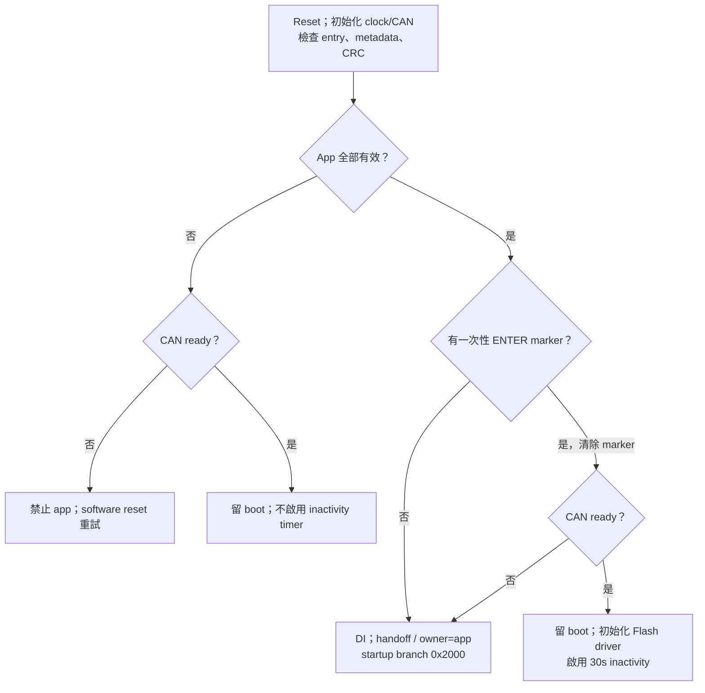
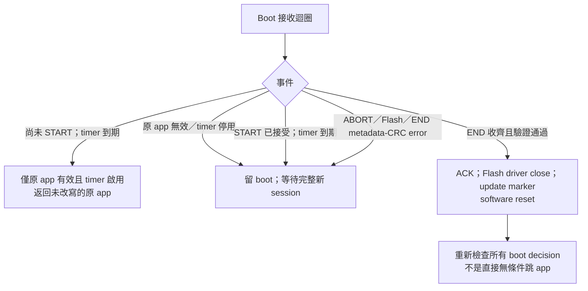
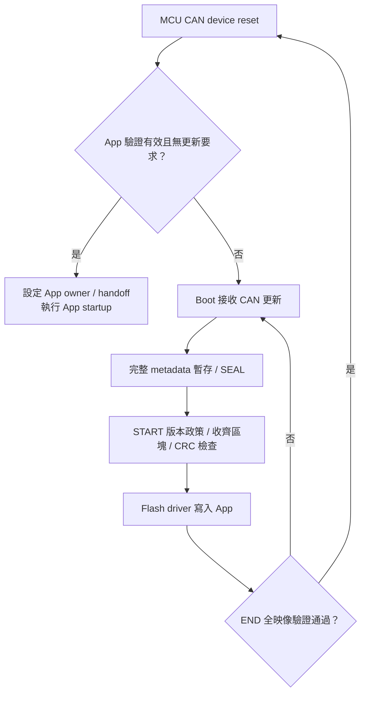
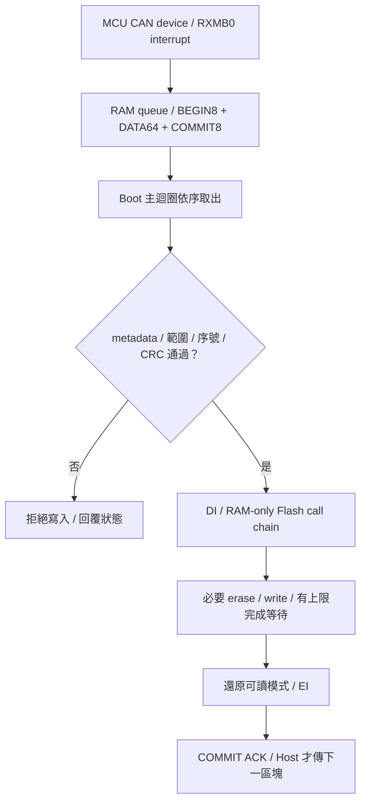

[知識庫首頁](https://released.github.io/) · [RL78 Bootloader 實作指南](index.html)

<a id="article_top"></a>

# Classical CAN／CAN FD device 工程

F13／F24 Classical CAN、F24 CAN FD 的 Boot／App 工程與啟動流程。

## F13 (MCU CAN device)：Boot 啟動與更新

<!-- F13_BOOT_DECISION_BEGIN -->
<a id="f13-boot-decision"></a>

本節整理 F13 (MCU CAN device) 的 Boot 啟動與更新狀態。
對應來源為 `r_main.c` 與 `can_boot_transport.c`。

#### A. 每次 reset 的 app 有效性檢查：全部通過才可啟動

| 檢查 | 目前 F13 build 必須符合 |
| --- | --- |
| Reset entry | `0x2000` 的第一個 DWORD 不為 `0xFFFFFFFF`；只檢查非 erased，沒有完整反組譯／驗證跳轉目的地 |
| Metadata header | `0x2100` magic=`0x004E4143`；format6、core length128、flags=`0x0003`；protocol ID1／version5、checksum type1（CRC32）、target=`0xF13B`、Classical CAN／standard ID 格式全部匹配 |
| Metadata reserved | 整區256 bytes 中後128 bytes（`0x2180..0x21FF`）全部為 `0xFF` |
| Metadata policy | UPD1 version3／size32、DEVICE_APP／CAN、F1V1 IRQ ABI；minimum Boot 不高於目前 Boot；`0x74..0x77` version control 為0或1，UART baud 與其餘保留欄位為0 |
| Image size | manifest size 含尾端 CRC4 bytes，介於516與121856 bytes，且4-byte aligned |
| App version | `0x00MMmmpp`；啟動時驗證欄位有效。更新版本比較在 START 執行，依目前有效 App 的 version control 判斷；build 不參與比較 |
| Flash layout | app start=`0x2000`、capacity=`0x1DC00`、code Flash=`0x20000`、boot reserve=`0x2000`、erase=`0x400`、minimum=`0x204`，均等於 boot 編譯設定 |
| CAN contract | nominal mask=`0x04`（500K）、data mask=0、request ID=`0x700`、response ID=`0x701`，均等於 boot 編譯設定 |
| CRC32 | 對 `[app_start, app_start + image_size - 4)` 計算 CRC32，等於該 image 最後4 bytes 的 LE32 stored CRC |

Boot 直接比對 MCU ASCII family／part，要求 build 已初始化，並檢查
UPD1更新政策、IRQ ABI與最低boot版本。PC仍須另作image/live device比對。
CRC是完整性，不是簽章或身分認證；最低boot版本不等於app防回滾。

#### B. ENTER marker 與啟動路徑

1. app 有效且沒有 ENTER marker：正常返回 startup，轉到 `0x2000` 的 app table。
2. app 收到 standard data ID=`0x700`、DLC1、data=`06` 的明確 ENTER request 時，
   先嘗試送 ACK（ID=`0x701`、DLC2、`06 00`），再將 `0xAA55AA55` 寫入
   no-init RAM `0xFF700`，最後 software reset。ACK 不是 reset 的可靠送達保證。
3. boot 看見 marker 後立即清除，表示本次先進入更新模式，不是永久鎖住 boot。
   P13.7／INTP0 不參與 boot decision，也不要求 tool 或 analyzer 必須在線才能正常開 app。
4. app 無效：禁止跳 app；CAN ready 時留 boot 等完整更新，clock／CAN 初始化失敗則
   software reset 重試，不能藉此放行無效 app。
5. app 有效但要求進 boot，而 clock／CAN 初始化失敗：目前實作會返回有效 app，
   不會永久卡 boot；CAN ready／FSL ready 不是所有正常啟動都必須通過的額外 gate。
6. 真正交接前關中斷，寫 `0xFF714` handoff signature、將 `0xFF710` ISR owner
   設為 app（`0x55`），startup 再 branch app table。這些是 boot 的輸出，不是額外外部啟動要求。



#### C. 30 秒 inactivity、START、失敗與更新成功

在 Tool 完成 Enter Boot 後，若停留在選檔或確認視窗而未開始更新，原有效 App 可能因 inactivity 到期而重新執行。
此時先 `Discover Target` 取得目前模式；若為 App，再 `Enter Boot`，確認 Boot Ready 後執行 `Start Device Update`。
操作圖集中於 [Device App 更新操作圖](https://released.github.io/slide_isp_tool_for_RL78/#device-update-example)。

| 事件 | boot 的實際結果 |
| --- | --- |
| 原 app 有效、ENTER 後尚未接受 START | 連續30秒沒有符合底層接收條件的 CAN request，關閉已初始化的 FSL 後返回原 app |
| 持續 INFO／HELLO／其他符合接收條件的 frame | 都會刷新 inactivity；不是上電後固定30秒，也不是只由 DATA 刷新；未知 command／錯誤 DLC 也可能刷新 |
| 原 app 無效 | 從一開始不啟用 inactivity timer，接受 START 後也不會自動啟用；失聯仍留 boot 等重試 |
| START 被拒絕（protocol／target／size／FSL not ready） | 沒有進入 started state；不能把這個拒絕當成 app 已被擦寫；原 app 有效且 timer 啟用時仍可 inactivity 返回 |
| START 已接受後 inactivity 到期 | 若本次 timer 原本啟用，回 session-timeout error、留 boot、關閉後續自動返回；不跳可能只有部分內容的 app |
| ABORT／erase-write error／END metadata 或 CRC error | error 返回主迴圈，關閉後續自動返回，留 boot 等新 session；ABORT 即使在 START 前也走這條留 boot 路徑 |
| END 長度／state 尚不完整 | 回錯誤但保留 session；不得先宣布成功或跳 app |
| END 收齊、metadata size 等於 START size、Flash metadata 與 CRC 正確 | ACK 成功，關閉 FSL，寫 `0xFF718` update-complete marker，再 software reset；下次 reset 重新通過 A 節與 ENTER 判斷才進 app |
| 擦寫中掉電 | 下次上電重新跑 A 節；若 image 仍有效且無 ENTER 則可啟動，否則留 boot；不是保證有雙映像回復 |

底層接收條件為standard／非RTR、ID700或720..727、DLC>0；通過即刷新timer，之後才
檢查 command。計時由1ms TMRJ0 IRQ 累加，Flash 操作關 IRQ 時不是嚴格的 wall-clock
30秒。timer 已停用或未啟用時，PC 失聯不能期待 target 自動 timeout／reset；tool 的
bounded wait／ABORT 不能取代供電、Flash、IRQ 與掉電的實板驗證。


#### App 工程設定

固定向量介面與 ISR 登錄方式見 [Device IRQ 設定](https://released.github.io/slide_boot_loader_for_RL78/#device-app-irq)。
Metadata 與 App-only 建置命令見 [Device App 建置](https://released.github.io/slide_boot_loader_for_RL78/#device-app-build)。

<!-- F13_BOOT_DECISION_END -->

<!-- F24_DEVICE_BEGIN -->
<a id="f24-can-device"></a>

## F24 (MCU CAN device)：Boot／App 工程配置

F24 CAN device 使用獨立的 Transfer、Boot 與 App 工程。
板端為 RL78/F24 Target Board R7F124FPJ5xFB。
正常 CAN App 更新已完成實板驗證，操作與 F13 device 相同：載入配對 BIN、Discover、必要時 Enter Boot、更新並確認 App。
完成報告與 UART counter 見 [F24 device 更新結果](https://released.github.io/slide_isp_tool_for_RL78/#f24-device-update-example)。

### 板端與更新設定

| 項目 | 設定 |
| --- | --- |
| X1／CPU／CAN clock | 4 MHz／40 MHz／40 MHz，PLL80 |
| CAN backend | RS-CANFD，Classical CAN 500K |
| CAN pins | P10 TX、P11 RX、P12 STB LOW |
| 診斷 UART | P15 TX、P16 RX、115200 |
| Flash driver | RFD Type02，programming-mode 路徑在 RAM 執行 |
| Target／IRQ ABI | `0xF24B`／F2V1 |
| IRQ owner | `0xAA`：Boot；`0x55`：App |
| CAN IDs | Control `0x700`、response `0x701`、raw `0x720..0x727` |
| 更新格式 | App image format6、CAN protocol5、64-byte blocks |

### Flash 配置

| 絕對 address | 用途 |
| --- | --- |
| `0x00000..0x01FFF` | 8 KiB Boot，含實體 vector／option |
| `0x02000..0x020FF` | App 64 組4-byte跳轉表 |
| `0x02100..0x0217F` | 128-byte metadata core |
| `0x02180..0x021FF` | 128-byte metadata reserved FF |
| `0x02200..` | App startup／code／far constants |
| `app_start + image_size - 4` | App CRC32 尾碼 |
| `0x3FC00..0x3FFFF` | 最後1 KiB保留，含 debug monitor |

最大 App 容量為 `0x3DC00`（247 KiB），擦除單位1 KiB，寫入單位4 bytes。
建置檢查保留至少512 bytes Boot ROM 餘裕，預設關閉 Boot UART log。
完整欄位說明見 [Device metadata 位址表](https://released.github.io/slide_boot_loader_for_RL78/#flash-metadata-can-reference)。

### Boot 啟動與更新

Boot 檢查 metadata、跳轉表與全映像 CRC。
SW1（P137 LOW）或 ENTER marker 進入更新模式；有效 App 的 ENTER session 使用30秒 inactivity。
Flash 操作透過 RAM 中的 RFD 執行路徑更新 App 範圍。



### 工程與建置

每個工程自備 `hal` API、設定 header、SC 與 MTPJ，可獨立建置。
目錄分工見 [工程目錄與程式入口](https://released.github.io/slide_boot_loader_for_RL78/#device-project-entry)。

在所選工程根目錄使用 PowerShell：

```powershell
# Rebuild this project and run its linked-image/package guards.
powershell.exe -NoProfile -ExecutionPolicy Bypass -File .\build.ps1

```

日常建置使用 Windows PowerShell、CS+／CC-RL。
CS+ hooks 依序執行產表與封裝；map、ROM／RAM、向量、metadata 與 CRC 由腳本核對。

C header 編輯、ISR 與 App-only 命令集中於 [Device App 設定與建置](https://released.github.io/slide_boot_loader_for_RL78/#device-app-build)。
初裝檔為 Boot `boot0000_1FFF.hex`＋App `flash_app_variable_CRC.hex`，核對兩者的地址範圍。
CAN 更新使用 App `*_update.bin`。App 產表為 `ftable.inc`、`app_identity.h`、`app_irq_table.inc`，
由 `ftable_RL78_F24.asm` 組譯；兩份 C header 仍是編輯入口。

### 驗證項目

軟體檢查涵蓋編譯、向量／RETI、IRQ stack、RFD RAM 路徑及 metadata／區塊處理。
正常 500K CAN App 寫入、END CRC、reset 後 APP_READY／live INFO 與 UART timer counter 已確認。
CAN 波形量測、250K／1M、其他 IRQ、長時間壓力、取消、斷線及斷電復原分項驗證，
見 [更新驗證矩陣](https://released.github.io/slide_isp_tool_for_RL78/#update-confirmation)。
<!-- F24_DEVICE_END -->

<!-- FD_DEVICE_BEGIN -->
<a id="can-fd-device-engineering"></a>

## MCU CAN FD device 工程設定

F24 device 使用獨立 `RL78_F24_Boot_loader_CAN_FD` 與
`RL78_F24_Boot_loader_CAN_FD_app` 工程，放在同一父目錄。
App 使用本工程的 `hal` API、metadata 設定與建置工具。
App 發行與 IRQ 編輯沿用 [C header 工作流程](https://released.github.io/slide_boot_loader_for_RL78/#device-metadata-vector-workshop)。

### 設定來源

| 可編輯來源 | 作用／此範例值 |
| --- | --- |
| App `app_image_config.h` | 版本、build、target、role、允許更新介面、版本政策 |
| App `app_irq_handlers.h` | App-local IRQ mapping；無 vect ISR |
| Boot `image_metadata_config.h` | Flash／metadata格式／IRQ ABI／最低Boot相容契約 |
| Boot `can_boot_config.h` | mode2、nominal mask4、data mask2及ID |
| Boot `hal/device/f24_device_config.h` | 實際40MHz CAN clock timing、FD模式、64-byte RXMB及中斷來源 |
| Boot `boot_app_handoff.h` | owner Boot=AA／App=55、no-init RAM |
| `image_metadata_profile.c` | 由獨立metadata parser比對的工程契約 |
| `tools/device_common.ps1` | 讀取上述C headers、產生metadata |

mode mask 的 bit1 表示 CAN FD；nominal mask 的 bit2 表示500K；data mask 的 bit1表示2M。
這些值描述已編譯的設定，不會重新設定周邊。
變更速率時，Boot／App 的實際 timing、metadata及Tool選項需一起對應。

| Timing輸入 | Nominal | Data |
| --- | --- | --- |
| fCAN | 40MHz | 40MHz |
| BRP register | 3 | 1 |
| 實際divider | 4 | 2 |
| TSEG1／TSEG2／SJW（時間單位數） | 15／4／1 | 7／2／1 |
| 計算 | 40M/(4×(1+15+4))=500K | 40M/(2×(1+7+2))=2M |
| Sample point | 80% | 80% |

preinclude 在SC header之後覆寫CLOE=0、FDOE=1與RXMB RMPLS=7（64bytes）。
SC重新產生後仍需執行工程prepare及clean build，核對實際linked產物。
硬體來源見 [Renesas F24 Target Board](https://www.renesas.com/en/design-resources/boards-kits/rtk7f124fpc01000bj)；
4MHz resonator與周邊接線依實際板本確認。

<a id="can-fd-device-rx"></a>

### 接收與中斷

Boot 與 App 各自連結 `hal/can/device_can.c`，使用精簡 RXMB0 ISR 與 8 筆 RAM queue。
主迴圈負責命令、metadata、CRC 及 Flash 流程；ISR 只核對幀的型態／長度並搬移資料，不解析更新命令、不輸出 UART，也不等待 TX。
主迴圈不直接輪詢 RXMB0；TX 完成狀態仍使用有上限的輪詢。

| 項目 | 設定與來源 |
| --- | --- |
| RXMB0 | `CAN_CFG_NRXMB=1`、`CAN_CFG_RMPLS=7`；RMNB=0x0701，保存完整 64-byte payload |
| 接收規則 | Boot 接收 standard 0x700 與 0x720；App 接收 0x700；exact mask 0x7FF，只存 RXMB0 |
| 硬體中斷 | RMIEC bit0=1；初始化完成後 RCANGRVCMK=0 |
| Driver ISR 設定 | `CAN_CFG_INTRCANGRVC_USE=0` 只停用 driver 自帶的 vect ISR；硬體 RXMB 中斷由 `Device_CanRxIsr` 處理 |
| 接收 FIFO | RF0／RF1 關閉，不與 RXMB0 重複存放 |
| 向量來源 | App `iodefine.h` 的 `INTRCANGRVC=0x004C`，對應此 MCU 的硬體手冊中斷表 |
| Boot owner=AA | Boot 的實體 vector 0x4C → 完整 dispatcher → Boot `Device_CanRxIsr` |
| App owner=55 | 同一實體 vector → App table 的 0x2098 槽位 → App `Device_CanRxIsr` |
| App 編輯來源 | `app_irq_handlers.h` 的 `X(0x4C, Device_CanRxIsr)`；函式使用 global、無 `vect=` 的 interrupt pragma，以 RETI 返回 |

槽位換算、Boot／App ISR 名稱及一般 IRQ 轉送規則見
[中斷所有權與向量轉送](https://released.github.io/slide_boot_loader_for_RL78/#device-irq-ownership)。
建置會檢查完整向量、實際 CAN ISR 槽位、RETI 及實體 vector 所有權。

queue 使用 9 個儲存槽提供 8 筆容量；producer 發布 head、consumer 釋放 tail 都在完成複製後進行。
queue 滿時丟棄新到訊息，保留原有順序。
ISR 確認 RMND 後讀取 RXMB0，保存／還原 CAN RAM window；讀取期間若再次收到訊息，該次副本不入列。

| 診斷 | 意義與取得方式 |
| --- | --- |
| `Device_CanRxFaults()` bit0 | queue 滿載或 CAN 尚未 ready 時的丟棄 |
| bit1 | 讀取 RXMB0 期間發生覆寫 |
| bit2 | 不符合 standard data／FD+BRS／支援長度的幀 |
| `Device_CanRxDrops()` | 丟棄觀察計數，累計到 255 後飽和；不是線上所有遺失幀的精確數量 |
| 觀察位置 | App 在 UART counter 旁顯示非零 faults／drops；Boot 可由 debugger 查看 `g_rx_faults`／`g_device_rx_drops`，位址由當次 map 查詢 |
| 重設範圍 | 上述值只在 CAN 初始化時歸零；正常一問一答應保持 0 |

### 更新區塊與 Flash 交接

一個區塊的 BEGIN8、DATA64、COMMIT8 可先入 queue，再由 Boot 主迴圈依序處理。
metadata、分區、版本政策、重送序號與區塊 CRC 檢查完成後，才允許 Flash 寫入。
Boot 的回覆由 HAL 固定為 standard response ID、FD+BRS、8-byte payload；不從收到的幀複製回覆路由或長度。



Flash 忙碌期間，RFD 呼叫鏈及必要資料位於 RAM，全域中斷關閉；恢復可讀模式後才重新開啟中斷。
8 筆 RAM queue 不代表 DI 期間硬體可額外保存 8 幀；RXMB0 仍只有一筆硬體容量。
Host 在 COMMIT ACK 前等待，不連續送下一個區塊；逾時與斷線結果保持有限重送與明確失敗，不以自動重置掩蓋。


### Flash與建置

`RL78_F24_Boot_loader_CAN_FD`、`RL78_F24_Boot_loader_CAN_FD_app` 與 `RL78_F24_CAN_FD_Transfer`
各自包含來源碼與 PowerShell helpers，可單獨建置；搭配安裝的 Boot／App 使用相容契約。
來源分工見 [工程目錄與程式入口](https://released.github.io/slide_boot_loader_for_RL78/#device-project-entry)。
詳細相依與生成路徑檢查見 [工程發佈說明](https://github.com/released/simple_renesas_isp_tool/blob/main/docs/GITHUB_PUBLISH_zh-TW.md#fd-publication-layout)。
SC 重新生成後使用同一建置入口；`-CheckOnly` 檢查相對路徑及生成檔狀態。

| 絕對address | 用途 |
| --- | --- |
| 0x0000..0x1FFF | 8KiB Boot與實體vectors |
| 0x2000..0x20FF | 完整64-slot App跳轉表 |
| 0x2100..0x217F |128-byte metadata core |
| 0x2180..0x21FF |128-byte reservedFF |
| 0x2200起 | App startup／code |
| App start + image_size -4 | 全映像 CRC32 tail |
| 0x3FC00..0x3FFFF | 保護區 |

在所選 FD Boot 或 App 工程根目錄執行：

```powershell
# Rebuild this project and run its linked-image/package guards.
powershell.exe -NoProfile -ExecutionPolicy Bypass -File .\build.ps1
```

MCU建置使用CS+ CC-RL、Windows PowerShell5.1／.NET，不需Python。
封裝維持至少512-byte Boot餘裕、完整IRQ表、RAM-only RFD與分區界線；
App-only建置不改Boot；操作見 [CAN FD更新](https://released.github.io/slide_isp_tool_for_RL78/#can-fd-update)。

| 產物 | 使用方式 |
| --- | --- |
| Boot `DefaultBuild/boot0000_1FFF.hex` | 燒錄器安裝 FD Boot |
| App `DefaultBuild/flash_app_variable_CRC.hex` | 燒錄器安裝含metadata／CRC的App |
| App `boot_app.hex` | 合併Boot/App初裝 |
| App `DefaultBuild/RL78_F24_Boot_loader_CAN_FD_app_update.bin` | Tool CAN FD更新 |
| App `DefaultBuild/app_build_report.html` | 實際BIN metadata／CRC／hash／IRQ報告 |

<!-- FD_DEVICE_END -->

---

[指南入口](index.html) · [下一主題：App Metadata 與 IRQ 編輯](app-development.html)
