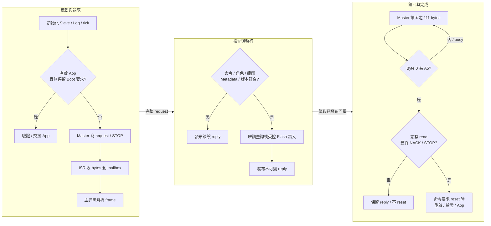

[知識庫首頁](https://released.github.io/) · [RL78 Bootloader](index.html)

<a id="article_top"></a>

# I2C Bootloader 與協定格式

I2C Slave、STOP mailbox、111-byte reply window 與更新完成條件。

<!-- BOOTLOADER_TOPICS_BEGIN -->
## 本頁主題

| 章節／規格 | 本頁 | 另一平台 |
| --- | --- | --- |
| 工程與接線 | [閱讀](#guide-i2c-device-1) | [RH850](../slide_boot_loader_for_RH850/i2c-device.html#guide-i2c-device-1) |
| 通訊設定 | [閱讀](#guide-i2c-device-2) | [RH850](../slide_boot_loader_for_RH850/i2c-device.html#guide-i2c-device-2) |
| Boot 執行流程 | [閱讀](#guide-i2c-device-3) | [RH850](../slide_boot_loader_for_RH850/i2c-device.html#guide-i2c-device-3) |
| Protocol Format | [閱讀](#guide-i2c-device-4) | [RH850](../slide_boot_loader_for_RH850/i2c-device.html#guide-i2c-device-4) |
| 異常與完成條件 | [閱讀](#guide-i2c-device-5) | [RH850](../slide_boot_loader_for_RH850/i2c-device.html#guide-i2c-device-5) |
| 程式對照與診斷 | [閱讀](#guide-i2c-device-6) | [RH850](../slide_boot_loader_for_RH850/i2c-device.html#guide-i2c-device-6) |
<!-- BOOTLOADER_TOPICS_END -->

<!-- I2C_DEVICE_BEGIN -->
<a id="i2c-bootloader"></a>


Device 使用 I2C Slave，bridge 使用 I2C Master。每份 Boot、App、Transfer 各自是獨立工程，
另保留獨立 UART 診斷文字。

<a id="guide-i2c-device-1"></a>

### 工程與接線

| 用途 | 工程或連線 | 詳細說明 |
| --- | --- | --- |
| Boot／App | 選擇名稱含 ISP_Boot_loader_I2C 的配對工程 | [平台工程與周邊](serial-device.html#guide-serial-device-1) |
| Custom Transfer | 名稱含 I2C_Slave_Transfer 的獨立診斷工程 | 透過相同 mailbox 驗證 PING／ECHO／計數，不擦 Flash |
| I2C 資料 | SCL、SDA、共地；核對上拉電壓、阻值與負載 | [Tool 接線與操作](https://released.github.io/slide_simple_renesas_isp_tool/serial-isp.html#uart-device-operation) |
| 診斷文字與產物 | 獨立 Log UART；Boot 安裝檔／App 更新 BIN 分開使用 | [編輯、產生與建置](serial-device.html#guide-serial-device-2) |

各工程包含自身建置來源，不需要其他工程 checkout 才能編譯。
燒錄後配對的 Boot／App 保持相同介面及映像契約。

<a id="guide-i2c-device-2"></a>

### 通訊設定

| 修改來源 | 作用 | 同步核對 |
| --- | --- | --- |
| `ISP_I2C_ADDRESS`／`ISP_LINK_PARAMETER_1` | 7-bit Slave address，範例 0x20 | Boot／App slave 初始化、BIN Metadata＋0x34 與 Tool 所選位址 |
| `ISP_BUS_RATE`／`ISP_LINK_PARAMETER_0` | 編譯 bus rate，範例 100000 Hz | Slave 時序、INFO、BIN Metadata＋0x30 與 Tool 100／400 kHz 能力 |
| `.scfg` 或各工程 board adapter | IICA、腳位、時脈與中斷 | [平台配置](serial-device.html#guide-serial-device-1)、[SC 設定](serial-device.html#guide-serial-device-4) |
| `ISP_BOOT_IDLE_TIMEOUT_MS` | 有效 App 進入 Boot 後、更新尚未開始時的閒置返回期限 | 範例 30000 ms；active 更新不套用此條件 |

Tool 輸入 7-bit 位址 0x20，不是 address byte 0x40。
完整設定條件集中於 [通訊設定與更新必要條件](https://released.github.io/slide_simple_renesas_isp_tool/serial-isp.html#serial-update-requirements)。
INFO 不含 Slave address；Tool 使用實際交易位址，並核對讀回的 Metadata。

<a id="guide-i2c-device-3"></a>
<a id="i2c-boot-flow"></a>

### Boot 執行流程



START 檢查完整 staged Metadata；WRITE 依序寫入，END 驗證完整映像。
I2C ACK 只代表 bus byte／交易的接收，更新結果仍以 framed reply status 與 App 確認判斷。

<a id="guide-i2c-device-4"></a>
<a id="i2c-protocol"></a>
<a id="guide-serial-device-7"></a>

### Protocol Format

I2C 先寫入一份以 STOP 分隔的完整 request，再讀取固定 111-byte reply window。
ISR 只處理 bytes 與 START／NACK／STOP；主迴圈才解析、執行 Flash 並發布不可變回覆。

| 交易／byte | 長度與內容 | 意義 |
| --- | --- | --- |
| Write | START ＋ address/W ＋完整 ISP frame ＋ STOP | Frame 為 10-byte header＋0..96 payload＋CRC32，最長 110 bytes |
| Read byte 0 | 00 busy 或 A5 ready | 只有 A5 後才解析 framed reply |
| Read byte 1..N | 完整 framed reply，14..110 bytes | sequence／command 對應 request，status 回報命令結果 |
| Read 剩餘 bytes | FF padding，直到總計 111 bytes | 由內層 frame length 決定有效資料，不把 padding 納入 frame CRC |
| Read 結尾 | Master 最終 NACK，接著 STOP | 與完整 read 一起作為回覆完成條件 |

完整 header、各命令 payload、INFO 與 status 定義見 [共用封包與命令表](serial-device.html#guide-serial-device-5)。
UART／I2C 使用相同命令格式，I2C 外層 mailbox byte 不屬於內層 CRC 範圍。

#### 位址與交易範例

7-bit address＝0x20 時，線上 address byte 為寫入 0x40、讀取 0x41。
以下以 INFO request 為例；`[]` 表示說明佔位，不是線上 bytes。

```text
S 40 49 53 01 00 01 00 01 00 00 00 F1 8D B0 75 P
S 41 00 [busy read window] NACK P
S 41 A5 [完整 INFO framed reply] [FF padding] NACK P
```

`S` 為 START，`P` 為 STOP；每次 read window 都讀取 111 bytes。
busy 後只重讀 mailbox，不重新送出前一個 Flash request。

#### 成功與錯誤回覆範例

I2C內層沿用 [UART完整request／reply範例](uart-device.html#uart-protocol)。
以PING為例，ready window為`A5`＋上述PING reply＋`FF` padding至111bytes；未知命令則為`A5`＋error reply＋padding。
`A5`只表示已有完整回覆；更新是否獲接受仍看內層status。
busy window的首byte為`00`，不是`BAD_STATE`或CRC錯誤回覆。


<a id="guide-i2c-device-5"></a>

### 異常與完成條件

| 觀察 | Device／Tool 行為 | 核對方向 |
| --- | --- | --- |
| 無 address ACK | 尚無有效 ISP 回覆 | 7-bit 位址、接線、電壓、上拉、Slave 初始化 |
| Byte 0＝00 | 唯讀 poll 等待 ready | 不因 busy 重送 Flash request |
| Short read | 保留 reply；不執行 pending reset | 固定 111-byte read、最終 NACK 與 STOP |
| CRC／sequence／命令錯誤 | 不以錯誤交易授權 Flash；可解碼命令回報對應 status | [共用狀態碼](serial-device.html#serial-status-codes) |
| 回覆已完整讀取 | 僅已接受命令的 pending action 可執行 | ENTER／END 的重啟條件與 Tool App 確認 |

mailbox 的交易 lease 為 2 秒；逾時清除 mailbox 狀態不表示恢復已擦寫的 App。
更新／取消與報告見 [Tool 串列操作](https://released.github.io/slide_simple_renesas_isp_tool/serial-isp.html)。
平台與實板驗證範圍見 [驗證範圍](serial-device.html#guide-serial-device-9)。

<a id="guide-i2c-device-6"></a>

### 程式對照與診斷

| 程式位置 | 入口或 API | 責任 |
| --- | --- | --- |
| `custom_func.c` | `hardware_init()`／`loop()` | 初始化、主迴圈命令處理與 pending action |
| `hal/isp/isp_i2c_mailbox.c` | `IspMailboxStart()`／`IspMailboxReceive()`／`IspMailboxNext()`／`IspMailboxNack()`／`IspMailboxStop()` | 有界交易資料與狀態，不解析 ISP 命令 |
| 同一 mailbox 模組 | `IspMailboxGet()`／`Publish()`／`Release()` | 主迴圈取 request、發布及釋放 reply |
| `hal/isp/isp_protocol.c`／`isp_device.c` | `IspStreamFeed()`／`IspDeviceProcess()` | 內層 frame 與更新命令 |
| `hal/device` 與各平台 I2C adapter | IICA ISR、reply-complete 判斷 | 暫存器、STOP／NACK／最後資料的完成邊界 |

各平台所用 peripheral、實體向量／EIINT 與 Flash API 集中於 [平台配置](serial-device.html#guide-serial-device-1)。
Metadata、IRQ 與 Flash 驗證維持各平台工程的契約。
<!-- I2C_DEVICE_END -->

---

[上一主題：UART Bootloader 與協定格式](uart-device.html) · [指南入口](index.html) · [下一主題：Xmodem Bootloader 與協定格式](xmodem-device.html)
