[回到知識庫總索引](https://released.github.io/)

<a id="article_top"></a>

# RL78 Bootloader 實作指南

> UART／I2C教材以 RL78/F24 為主要範例；CAN範例另區分 F24 (MCU CAN host) 與 F13 (MCU CAN device)。本頁說明 boot code 與 application code 的 Flash 配置、啟動流程、通訊更新、CRC 驗證與專案設定。實作前請先熟悉 RL78 專案建立、linker section 與 Flash library。

只想把 Boot/App 架構移植到自己的專案？先讀下方
[自訂 Bootloader／App 移植指南](#boot-app-porting)，不必先學 PC Tool。
內容包含UART／I2C教材，以及 F13 (MCU CAN device) 與 F24 (MCU CAN host) 的分工與移植方式。
此CAN角色標示只適用現行CAN範例，不能把舊UART／I2C教材中的F24一律當成CAN host。
各更新流程使用不同的映像與通訊契約，不能直接混用BIN、clock或Flash driver。

CAN更新採RAM區塊收齊／CRC驗證後寫入，每區塊只回一筆ACK；缺段或CRC錯誤先拒寫，
已提交區塊重送不重寫，END仍檢查全映像CRC，reset後再由Boot驗證。
精確版本、雜湊與單次實測數字請查閱所用交付套件的說明；效能量測方法見
[ISP Tool 操作指南](../slide_isp_tool_for_RL78/#can-upgrade-performance)。

<!-- F24_DEVICE_BEGIN -->
<a id="f24-can-device"></a>

## F24 (MCU CAN device)：獨立的 CAN Transfer／Boot／App

F24 除了擔任 **MCU CAN host**，也能在 CAN 另一端擔任 **MCU CAN device**。
兩者不是同一個 firmware：device 以板上的 4 MHz X1 運作，沿用 F13 的 CAN 更新架構，
但換成 F24 RS-CANFD 與 RFD driver。不能把 host 的 Misc 更新 BIN 當成 device App。

### 為什麼 F24 device 可以使用 8 KiB Boot？

Boot 大小取決於實作，不是 F24 必須預留 20 KiB。
此 device 版本使用固定 Classical CAN backend、移除未引用功能、預設關閉 Boot UART log，
保留 metadata／CRC／完整普通向量轉送／64-byte 區塊更新與 RFD RAM 執行鏈。
建置強制保留至少 512 bytes 餘裕；超限會失敗，不能靜默跨進 App。
新增 Boot 功能或開啟 log 時要重新量測；App／Transfer 仍保留獨立 UART log。

| 項目 | F24 (MCU CAN host) | F24 (MCU CAN device) |
| --- | --- | --- |
| 角色 | PC Host Link ↔ CAN 轉送 | CAN 接收、解碼、驗證及更新自身 App |
| 專案 | `RL78_F24_Bridge_boot`／`RL78_F24_Bridge_app` | `RL78_F24_CAN_Transfer`／`RL78_F24_Boot_loader_CAN`／`RL78_F24_Boot_loader_CAN_app` |
| 目前板上 X1 | 20 MHz | 4 MHz；Target Board R7F124FPJ5xFB |
| Boot／App 起點 | 20 KiB／`0x5000` | 8 KiB／`0x2000` |
| 更新自身 App | Misc／PC→host UART | CAN／host→device，Classical 500K |
| 映像／target／IRQ ABI | BUR1／host board ID／host ABI | CAN3／`0xF24B`／F2V1 |
| 實板證據 | 既有 host 測試紀錄 | 此 device 實作已建置及軟體模型驗證；實板驗證待執行 |

### F24 device Flash mapping

以下是 **F24 device**，不是 F24 host 的 BUR1 分區，也不是 F13 的容量。

| 絕對 address | 用途 | 產生／驗證位置 |
| --- | --- | --- |
| `0x00000..0x01FFF` | 唯讀 Boot、實體 vector／option；CAN 不可寫 | `can_boot_config.h`／`package_images.py` |
| `0x02000..0x020FF` | 64 組 4-byte BR：reset／普通 IRQ／default／BRK fallback | App 自有 `app_irq_handlers.json` → `device_vectors.asm` |
| `0x02100..0x0217F` | 128-byte metadata core；含 role、CAN permission、F2V1、min Boot | `app_image.json`＋Boot 契約 →生成 `.inc`／link／封裝；Boot `MetadataValid` |
| `0x02180..0x021FF` | 128 bytes 預留，固定 `FF` | 封裝／staging SEAL／Flash 驗證 |
| `0x02200..` | App code／startup／far constants | linker；不得侵入前面 metadata |
| `0x2000 + actual image size - 4` | CRC32 尾碼；actual size 隨建置決定 | 封裝／Tool offline／Boot END／reset launch |
| `0x3FC00..0x3FFFF` | 最後 1 KiB 整塊保護，含 debug monitor | RFD erase/write bounds／封裝 guard |

最大 App 容量 `0x3DC00`（247 KiB）；擦除單位 1 KiB，寫入單位 4 bytes。
metadata 每個欄位的格式沿用 [CAN3 byte 對照](https://released.github.io/slide_boot_loader_for_RL78/#flash-metadata-can-reference)，
但 target、MCU、geometry、IRQ ABI、版本與 CRC 必須取自此 F24 device 實際 BIN，
不可照抄 F13 的範例值。PC→host UART 速度不屬於 device CAN 映像的更新速度。

### 操作順序與資料路徑

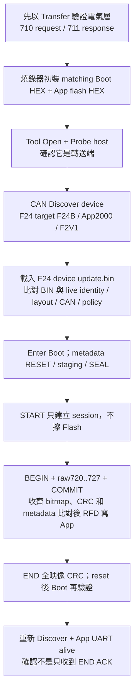

| 層級 | 處理內容 | 不應處理的內容 |
| --- | --- | --- |
| Tool | BIN checksum／metadata；對比 live device；送 CAN protocol | 不根據 COM 名稱猜 MCU；不可用 PC override 繞過 geometry |
| F24 (MCU CAN host) App | Host Link 解包、generic CAN burst、等待 response | 不解 F24/F13 device Flash address 或 Boot state |
| F24 (MCU CAN device) Boot | CAN decode、metadata staging、block／CRC／replay、RFD、launch | 不接受 host BUR1 或不相容 device 映像 |
| F24 device App | 自有完整 IRQ table、INFO／ENTER、正常功能 | 不取代 Boot 的最終 Flash 驗證 |

普通 vectors `0x04..0x7C` 的轉送介面在 Boot 一次固定。不同 App 可自行增加／更換 ISR，
只需將無 `vect=` 的普通中斷函式加入自己的 MTPJ 與 JSON，再編譯 App；
只要 MCU、更新協定、layout、IRQ ABI 與 min Boot 相容，就不必因 IRQ 使用清單改變重燒 Boot。
硬體 BRK 不轉送；App 表保留 RETB fallback。更換 CAN／I2C 等更新協定仍是另一項相容性設計。

### 工程與驗證界線

Metadata 的可編輯／自動產生欄位、JSON 修改前後與新增 ISR 的完整流程，請讀
[F13／F24 device 實作教學](https://released.github.io/slide_boot_loader_for_RL78/#device-metadata-vector-workshop)。

三個 F24 device 專案置於同一父目錄；Boot 的 `common` 提供共用 board／clock／CAN backend，
App 與 Transfer 各使用自己的 SC。Boot 內附 F24 RFD 來源，不依賴個人的工作區路徑。
在 Boot 目錄執行 `build.ps1 -Kind all`；之後只改 App 可用 `-Kind app`。
MTPJ pre-build 產生啟動／vector projections，post-build 強制 ROM／RAM／向量／封裝檢查。

初裝 Boot 使用 `boot0000_1FFF.hex`，App 使用 `*_flash.hex`；CAN 更新只用 `*_update.bin`。
**不可直接燒 App 原始 MOT**：它含 device file 自動產生的實體記錄，封裝後才會排除。
不要用 Transfer 整機映像作為 App BIN，也不要在 Misc 更新外部 device。

目前已完成三專案 clean rebuild、8 KiB／512-byte spare guard、實際 vector／RETI bytes、
RFD RAM 位址與 map-visible reference 檢查、IRQ stack model、production C RAM metadata／block fault model，
以及現有 Tool production parser 對實際 F24 BIN 的驗證。這不是整顆 MCU 模擬器或實板測試。
CAN backend 的 register-level model、波形／ACK、RFD 實際擦寫、reset 後 App、斷線及斷電矩陣仍待驗證。
現有公開下載區的 F24 firmware 是 **host**；本節的 **device** 工程不可與其互換。
<!-- F24_DEVICE_END -->

<!-- DEVICE_WORKSHOP_BEGIN -->
<a id="device-metadata-vector-workshop"></a>

## Device 開發實作：編輯 Metadata、增加 IRQ、產生並驗證 App

本章只處理 **F13 (MCU CAN device)** 與 **F24 (MCU CAN device)**，不調整 F24 host。
兩者都由 CAN 更新 App；不要套用 host 的 BUR1、`0x5000`、Misc 或 host 專用產表腳本。
這裡的「編輯」是修改 firmware 專案來源，再透過 pre-build／post-build 產生映像，
不是在 Tool 手動改 BIN。生成的表、identity header、size 與 CRC 不應手動修補。

### A. 先辨識專案與共用介面

| 項目 | F13 (MCU CAN device) | F24 (MCU CAN device) |
| --- | --- | --- |
| Boot／App | `RL78_F13_Boot_loader_CAN`／`RL78_F13_Boot_loader_CAN_app` | `RL78_F24_Boot_loader_CAN`／`RL78_F24_Boot_loader_CAN_app` |
| MCU／Flash driver | R5F10BMG／FSL | R7F124FPJ5xFB／RFD，忙碌期間必要程式在 RAM |
| Target／IRQ ABI | `0xF13B`／F1V1 | `0xF24B`／F2V1 |
| Boot／App 起點 | 8 KiB／`0x2000` | 8 KiB／`0x2000` |
| App capacity | `0x1E000`，120 KiB | `0x3DC00`，247 KiB；最後 1 KiB 保護 |
| 更新契約 | CAN3、image format 6、CAN protocol 5、Classical 500K | 同樣格式／協定，但身分與 geometry 不同 |
| 版本／build 編輯來源 | App `app_image.json` | App `app_image.json` |
| IRQ 編輯來源 | 各 App 的 `app_irq_handlers.json`＋已註冊 ISR C 檔 | 同左 |

App 與 matching Boot 以原名稱放在同一父目錄；保留相鄰 Boot 提供的腳本／共用來源。
F13 可由 [Boot](https://github.com/released/RL78_F13_Boot_loader_CAN)／[App](https://github.com/released/RL78_F13_Boot_loader_CAN_app) 取得。
F24 device 請使用配套的上述 CAN device 工程；Tool repository 的 `Bridge_app` 是 host，不能替代。
獨立 Transfer 專案是通訊測試整機映像，不是可載入的 App 更新 BIN。

#### A1. ftable.inc 與兩份 JSON，哪個較容易修改？

| 格式 | 一般使用者的閱讀／修改成本 | 現行用途與注意事項 |
| --- | --- | --- |
| `ftable.inc`／metadata `.inc` | 使用者不必理解 `.EQU` 或資料排列才可升版 | **生成檔，不再手改**；F13 為 `ftable.inc`，F24 device 為 `app_metadata.generated.inc` |
| `app_image.json` | 欄位少、可用名稱表達用途，日常版本／build 修改較直覺 | 兩個 device 都用相同五欄 schema；JSON 不接受裸 `0x` 數字，所以 version 使用 hex 字串，build 使用十進位整數；不可加註解 |
| `app_irq_handlers.json` | 直接列出 vector → handler，與 image 設定分開較不易誤動 metadata | 兩個 device 都使用；仍需核對硬體 vector、註冊 ISR 及保留原 mapping |

兩個 device 現在都統一為兩份 JSON 分工；`.inc`、identity header、向量表交給各自產生器。
不保留「沒有 JSON 就讀取手寫 ftable.inc」的 fallback。舊 App 專案須先新增 matching JSON，
保留原 version／build，然後執行 App-mode 產生與 clean rebuild；不能只改副檔名。

### B. Metadata：哪些可改、哪些不能手改？

| 分類／欄位 | 編輯或產生位置 | 只更新 App？ |
| --- | --- | --- |
| App version／build | 兩者都編輯 `app_image.json` 的 `version`／`build` | 是，仍須符合既有契約 |
| image_size／CRC 地址／CRC32 | 由 linker map 與 post-build 封裝決定 | 自動產生，不填預估大小、不用 hex editor 改 |
| Target、MCU part／family、Flash geometry、CAN IDs／rate | Boot 契約、App producer、linker／backend、封裝與 live INFO 必須一致 | 不能只改 App；須評估並安裝 matching Boot/App |
| Role／transport／IRQ ABI／minimum Boot | matching Boot config／producer 產生；Boot／Tool 均驗證 | 契約欄位；不能藉改字串或 JSON 繞過更新路徑 |
| Metadata reserved `0x80..0xFF` | Producer 固定填 `FF` | 不可直接填入新功能；需定義新版契約並同步所有驗證器 |
| JSON 的 `target`／`role`／`transport` | 是契約核對值，不是任意可選 MCU／介面 | F13 為 `0xF13B`，F24 為 `0xF24B`；兩者皆 `DEVICE_APP`／`CAN` |

Packed version 採 `(major << 16) | (minor << 8) | patch`；每部分一個 byte。
以下版本／日期是教學輸入，不是交付配套版本要求；build 是十進位整數，不能寫成 JSON 字串。
App 版本、Boot 版本與 minimum Boot 是不同欄位；App 升版不應順便修改 minimum Boot。

#### B1. F13：編輯 app_image.json

修改前：

```json
{
  "version": "0x00010500",
  "build": 20261015,
  "target": "0xF13B",
  "role": "DEVICE_APP",
  "transport": "CAN"
}
```

修改後（僅示範 App 資訊變更）：

```json
{
  "version": "0x00010501",
  "build": 20261016,
  "target": "0xF13B",
  "role": "DEVICE_APP",
  "transport": "CAN"
}
```

App pre-build 讀 JSON 與 matching Boot 的 `can_boot_config.h`，產生 `ftable.inc`／`app_identity.h`；
`ftable_RL78_F13.asm` 依生成常數排列 CAN3 metadata，讓 App INFO 與 BIN 使用同一版本／build。
`IMAGE_SIZE_POST_BUILD = 0xFFFFFFFF` 由產生器保留，封裝才填實際大小；不要手改 `.inc`。
改 target／分區等固定契約時，仍須另行同步 Boot config、linker、producer 與 validator。
不能只改 metadata 的某一個 byte，就把已 link 的程式搬到不同 address。

#### B2. F24 device：編輯 app_image.json

修改前：

```json
{
  "version": "0x00010000",
  "build": 20261015,
  "target": "0xF24B",
  "role": "DEVICE_APP",
  "transport": "CAN"
}
```

修改後（保留契約欄位）：

```json
{
  "version": "0x00010001",
  "build": 20261016,
  "target": "0xF24B",
  "role": "DEVICE_APP",
  "transport": "CAN"
}
```

`prepare_projects.py` 核對 JSON，產生 `app_identity.generated.h`、`app_metadata.generated.inc`
與其組語 wrapper；linker 將該 256-byte metadata 放到 `0x2100`。
`package_images.py` 比對已編譯 metadata 與同一 JSON／Boot contract，再填實際長度與尾端 CRC。
JSON 不是整份 metadata 編輯器；geometry、IRQ ABI、CAN routing 等由固定契約提供。
把 `transport` 改成 I2C、改 role 或改 target，不會自動變成另一種 bootloader，應被拒絕。

兩邊 JSON 必須剛好有 `version`／`build`／`target`／`role`／`transport` 五個欄位；
version 使用 `0x`＋8 位 hex 的字串，target 使用 `0x`＋4 位 hex 的字串。
build 必須為整數 `0..4294967294`，不能是字串、小數或布林值；version `0xFFFFFFFF` 不接受。
未知或缺少欄位也會拒絕。合法格式仍不代表 target／role／transport 可任意更改。

#### B3. 用 address 與 byte 核對結果

兩個 device 的 App 起點相同，以下 address 相同；**欄位值與 image capacity 仍不同**。
完整欄位見 [Flash／Metadata byte 對照](https://released.github.io/slide_boot_loader_for_RL78/#flash-metadata-can-reference)；
此處兩個 device 使用 CAN3，不可套用該參考頁中 F24 host 的 BUR1 欄位表。

| 欄位 | Metadata offset | BIN offset | 絕對 Flash address | 本例預期 |
| --- | --- | --- | --- | --- |
| App version | `0x10..0x13` | `0x110..0x113` | `0x2110..0x2113` | F13：`01 05 01 00`；F24：`01 00 01 00` |
| App build | `0x14..0x17` | `0x114..0x117` | `0x2114..0x2117` | 20261016，LE32 |
| Actual image size | `0x18..0x1B` | `0x118..0x11B` | `0x2118..0x211B` | 必須等於 BIN 檔案長度，不是 capacity |
| Policy／IRQ ABI | `0x60..0x6F` | `0x160..0x16F` | `0x2160..0x216F` | DEVICE_APP、允許 CAN、各自 ABI 與 minimum Boot |
| Reserved FF | `0x80..0xFF` | `0x180..0x1FF` | `0x2180..0x21FF` | 128 bytes 全 `FF` |
| Tail CRC32 | 不在 metadata 裡 | `actual size - 4` | `0x2000 + actual size - 4` | 前面全部 BIN bytes 的 CRC32，LE32 |

#### B4. Metadata 產生路徑

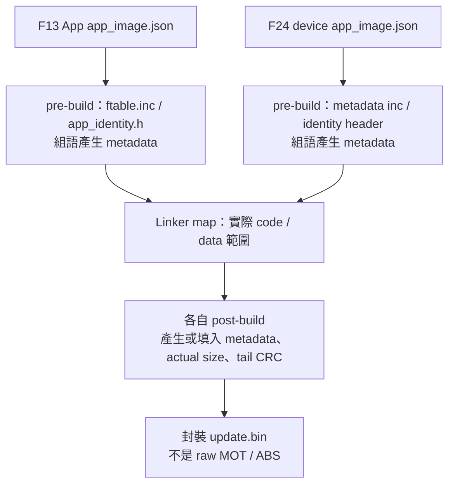

### C. App Vector Table：新增一個 IRQ 的完整範例

本例使用兩個 device header 都定義的 `INTP1 = 0x0A`；不是因為兩顆 MCU 的所有向量皆相同。
JSON key 是 **實體 vector byte address**，不是 IRQ 序號、App slot 或周邊 pin。
兩者的 App slot 計算為 `0x2000 + 0x0A × 2 = 0x2014`，即 BIN offset `0x14`。

#### C1. 加入一般 ISR，並在 App MTPJ 註冊來源

在自己的 App 新增 `app_extra_irq.c`，透過 CS+ 將它加入該 App 的編譯來源。
以下函式只清旗標並記錄事件；**不會初始化或啟用 INTP1**。

```c
#include "r_cg_macrodriver.h"

volatile unsigned char g_app_aux_irq_count;

#pragma interrupt app_aux_irq
void __near app_aux_irq(void)
{
    /* Clear the source flag and capture bounded state only. */
    PIF1 = 0U;
    g_app_aux_irq_count++;
}
```

ISR 必須 global、非 static、無 `vect=`，由編譯器產生 RETI；不要寫成普通 callback，
也不能另設實體 `.VECTOR` 或 `-VECTN` 與 Boot 競爭。
啟用中斷之前，另依實際板子完成 pin／edge／priority／pending flag／mask 初始化；
範例未提供可直接接線使用的 INTP1 pin 設定。未用 IRQ 應保持 mask。
SC／Code Generator 重產後也要核對：原始生成 ISR 若仍帶 `vect=`，不能直接照搬到 split App。

#### C2. F13 mapping：保留原有項目，新增 0x0A

修改前：

```json
{
  "0x08": "r_intc0_interrupt",
  "0x16": "r_uart0_interrupt_send",
  "0x18": "r_uart0_interrupt_receive",
  "0x1E": "r_tmr_rj0_interrupt"
}
```

修改後：

```json
{
  "0x08": "r_intc0_interrupt",
  "0x0A": "app_aux_irq",
  "0x16": "r_uart0_interrupt_send",
  "0x18": "r_uart0_interrupt_receive",
  "0x1E": "r_tmr_rj0_interrupt"
}
```

#### C3. F24 device mapping：保留自己的 timer

修改前：

```json
{
  "0x2E": "Device_TimerIsr"
}
```

修改後：

```json
{
  "0x0A": "app_aux_irq",
  "0x2E": "Device_TimerIsr"
}
```

不能把 F13 的 UART／timer mapping 整份複製給 F24；也不能用只有新 IRQ 的 JSON 覆蓋舊清單。
改函式名稱要同步 C pragma／定義與 JSON。移除 mapping 前先停用其周邊 IRQ，避免 default RETI 反覆觸發。

#### C4. 生成表中應看到什麼？

| 檢查位置 | 修改前 | 修改後 |
| --- | --- | --- |
| F13 `app_irq_table.inc` 的 vector `0x0A` | `BR !!f13_app_default_isr` | `BR !!_app_aux_irq`，slot `0x2014` |
| F24 device `device_vectors.asm` 的 vector `0x0A` | `BR !!device_default_isr` | `BR !!_app_aux_irq`；table start `0x2000` |
| App map | 沒有新 ISR symbol | `_app_aux_irq` 有有效 code address；應為 interrupt ISR |
| 最終 BIN 的 offset `0x14..0x17` | 指向原 default ISR | `EC`＋新 ISR 的 3-byte little-endian 絕對 address |
| Boot 的實體 vector／來源 | 固定轉送介面 | 不因 App 函式名或使用清單改變 |

Assembler symbol 前綴 `_` 由 generator 加入，JSON 寫 `app_aux_irq`，不要寫 `_app_aux_irq`。
表有固定 64 個 4-byte slot，不是每增加一個 IRQ 就把後面的 entry 往後推。
App reset slot 進 `_start`，不是直接進 `main`；`0x02` 仍是保留位置，不能加入 JSON。
F13 此 slot 填 `FF`，F24 device 產生 default branch；兩者都不代表可啟用 reserved IRQ。
physical BRK `0x7E` 不由 Boot 轉送；App 的保留 BRK slot 使用 RETB，不是一般 IRQ 的 RETI。

#### C5. IRQ 的產生與執行路徑


### D. 產生命令：F13 與 F24 device 分開執行

下列是相鄰工程的相對路徑；在自己的 App 根目錄執行。先備份／記錄 matching Boot image 雜湊。
範例只變動 App 資訊及一般 IRQ，**不應呼叫 Boot 產表或 Boot rebuild**。
使用 Windows PowerShell 執行命令；先安裝工程對應的 CS+／CC-RL。F24 device 另需 Python 3，
以 `python --version` 確認可呼叫。CS+ 開啟的是自己的 App `.mtpj`，建置組態為 `DefaultBuild`。
下方 PowerShell 腳本以單次 `-ExecutionPolicy Bypass` 執行，不需永久更改系統執行原則。

#### D0. 第一次操作：逐步完成一次 App 變更

1. 選定 F13 或 F24 **device** 的 matching Boot/App，按原名稱放在同一父目錄；先確認舊版可建置。
2. 備份現有 Boot HEX、App 更新 BIN 與兩份 JSON，記錄 Boot image 雜湊。舊 F13 若尚無 image JSON，先按 B1 範例新增，保留自己的原版本／build。
3. 開啟 App 的 `app_image.json`，只修改 `version`／`build`；對照 B1 或 B2，保留原 target、DEVICE_APP 與 CAN。存成 UTF-8 JSON，不加註解。
4. 若只升版本，跳到第6步。若新增 IRQ，依 C1 新增正常 ISR C 檔，並在 CS+ **此 App** 的 MTPJ 加入來源；還不要啟用硬體 IRQ。
5. 編輯這個 App 的 `app_irq_handlers.json`，保留舊清單，再加入 `0x0A` 範例或已核對的合法 vector／handler；不要用其他 MCU 的整份清單覆蓋。
6. 從 App 根目錄執行 D1 或 D2 的產生命令，再執行 CheckOnly。錯誤先修正 JSON／MTPJ／ISR，不手改 `.inc`、identity 或 table。
7. Clean Rebuild **App**，確認 pre-build 與 post-build 都成功。對照下方產物表，確認新 table、version／build、實際 BIN 長度與 CRC；不要沿用前次失敗後留下的舊檔。
8. 在 Tool CAN TAB 載入該 App 的 `*_update.bin`，依 E 節核對新版本、Metadata VALID 與 CRC MATCH；這一步不寫 MCU。
9. Open + Probe host、Discover **device**，核對 live target／layout／CAN／IRQ ABI／minimum Boot；相容才 Enter Boot 並開始更新，不以離線 BIN 取代 live 身分。
10. END／reset 後另外確認新版 App INFO／UART、既有 IRQ 與新 IRQ；最後比較 Boot 區／映像未變。硬體 IRQ 啟用前的初始化與故障測試仍需另作。

只升 App 版本時不必新增 ISR；只新增 IRQ 時也不必更改 target 或 Boot 版本。

#### D1. F13 device

```powershell
# Generate this App's metadata INC, IRQ table and identity; never Boot.
powershell.exe -NoProfile -ExecutionPolicy Bypass `
  -File "..\RL78_F13_Boot_loader_CAN\generate_irq_contract.ps1" `
  -Mode App -AppProject "."

# Read-only freshness check; run after generating, not instead of generating.
powershell.exe -NoProfile -ExecutionPolicy Bypass `
  -File "..\RL78_F13_Boot_loader_CAN\generate_irq_contract.ps1" `
  -Mode App -AppProject "." -CheckOnly
```

然後在 CS+ **Clean Rebuild 此 App**。原有 pre-build 保留上述 App-mode 命令，
post-build 保留 `generate_update_image.ps1`；該腳本依 map／App HEX 封裝，並非只產表就有新 BIN。
Tool 的 `scripts/verify_f13_artifacts.ps1` 可作後續檢查，需指定正確 Boot／App project。
F13 目前仍保留參考 MTPJ／map／輸出檔名與 sibling Boot 假設；若改專案名／搬目錄，
必須另外對齊 source／include／hook、`-MapFile`、輸出命名、checker 及 Boot HEX 來源。

#### D2. F24 device

```powershell
# Update this App's projections / registered project settings, never Boot.
python ..\RL78_F24_Boot_loader_CAN\tools\prepare_projects.py --kind app --project .

# Read-only freshness / registration check.
python ..\RL78_F24_Boot_loader_CAN\tools\prepare_projects.py --kind app --project . --check

# Clean rebuild and mandatory map / image packaging checks.
powershell.exe -NoProfile -ExecutionPolicy Bypass `
  -File "..\RL78_F24_Boot_loader_CAN\build.ps1" `
  -Kind app -AppProject "."
```

CS+ pre-build 使用 `prepare_projects.py --kind app --project . --artifacts-only`；
post-build 使用 `package_images.py --kind app --project .`。`--artifacts-only` 不會修正 MTPJ 登錄／選項。
只改一般 App 功能，不用省略 kind 的 all-mode prepare／build；SC 重產後先重新 prepare **app**。
若改名或搬移，仍須修正相對 source／include／hook 路徑；不是任意 standalone App 加 JSON 即可。
目前 F24 device prepare 使用相對路徑；Boot 與 App 必須在同一磁碟，不能跨磁碟直接產生工程。

| 產物 | F13 device | F24 device |
| --- | --- | --- |
| Metadata `.inc`（不可手改） | `ftable.inc` | `app_metadata.generated.inc`＋`app_metadata.generated.asm` wrapper |
| App pre-build identity | `app_identity.h` | `app_identity.generated.h` |
| App vector table | `app_irq_table.inc` | `device_vectors.asm` |
| 後續 CAN 更新 | `DefaultBuild/RL78_F13_Boot_loader_CAN_app_update.bin` | `DefaultBuild/<MTPJ stem>_update.bin` |
| 燒錄器初裝 App | `DefaultBuild/flash_app_variable_CRC.hex` | `DefaultBuild/<MTPJ stem>_flash.hex` |
| matching Boot 初裝 | 先核對 `boot_app.hex` 的來源／產生時間；或 matching Boot＋App HEX | matching `boot0000_1FFF.hex`＋封裝 App HEX，依燒錄器設定核對擦除範圍 |

F13 若找不到 sibling Boot HEX，post-build 不會產生新的合併檔；舊 `boot_app.hex` 可能仍留著。
任何 build／guard 失敗，舊 BIN 也可能仍在，不能以「檔案存在」判定這次成功。
raw App MOT／ABS 可能包含低位實體記錄，不應代替已封裝的 App HEX 或 update BIN。
post-build 會拒絕 JSON 與已編譯 metadata／IRQ 表不同的舊輸出，不能改完 JSON 只重跑封裝。
F13 也直接比對 App map、實際 BR 目的地與 mapped ISR 的 RETI，不依賴 Boot map 才能執行這項 App 檢查。
CheckOnly 發現手改／過期生成檔時只報錯、不修復；先重產，再 clean rebuild。

### E. 驗證新 BIN 與向量，而非只看 build success

| 步驟 | 要檢查的結果 | 未通過時 |
| --- | --- | --- |
| 產表 | 新 JSON entry 對應到正確 slot；source 有且僅有對應的正常 ISR | 不手改生成檔，修 source／MTPJ／JSON |
| map／向量 bytes | table 在 `0x2000`，metadata 不佔 code；BR 指向 App code，ISR 應有 RETI | 不更新 MCU；先查 linker／pragma／註冊 |
| BIN offline | size 等於檔長、metadata reserved FF、CRC match、role／CAN／ABI 正確 | 不用修改 Tool 欄位繞過 |
| Tool Load Update Image | Metadata VALID、CRC MATCH、新 version／build；這仍只是 offline 資訊 | 重查 producer／封裝及實際載入檔案 |
| Discover live device | MCU／target／geometry／CAN／IRQ ABI／minimum Boot 相容 | 不送 START；不能把載入 BIN 身分當 live 身分 |
| 更新與 reset | END 成功後，確認 App 新版 INFO／UART、正常與新增 IRQ，Boot 區未變 | 保留 log／trace，分清 END ACK 與 App 執行證據 |

#### E1. Tool 驗證與更新後 App 證據

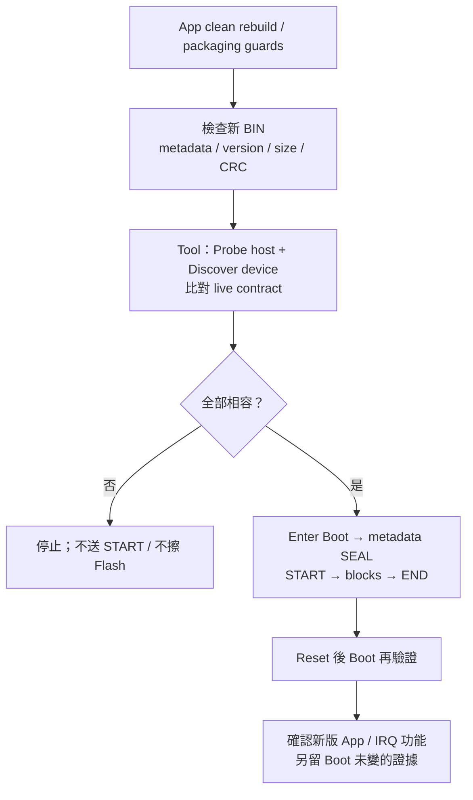

本章的 command／JSON／byte 範例以現有來源與暫存產表測試核對；不是已在板上啟用新 INTP1。
F24 device 的 CAN／RFD 實板更新與故障矩陣仍需另驗；F13 已有正常更新紀錄也不代表此新增 IRQ 已驗證。
CRC 是完整性檢查，不是簽章或防回滾；不完整更新也不等於可以 rollback 到舊 App。

### F. 常見錯誤與只換 App 的邊界

| 變更／錯誤 | 處理原則 |
| --- | --- |
| 只改 App version／build 或相容的一般 IRQ | 產表、重建與封裝 App；不因 ISR 名稱改動重燒 Boot |
| 改 MCU／App start／geometry／IRQ ABI／更新協定 | 不是上述 App-only 教學；同步 Boot、App、producer、Tool／validator 並重新驗證 |
| JSON key 寫 `0x2014`、IRQ index 或保留／奇數 vector | 應寫合法實體 byte address，本例為 `0x0A`；不能跨 MCU 照抄 |
| C 檔只複製進資料夾，沒有加入 MTPJ | generator 或 linker 應拒絕；先修正專案登錄 |
| ISR 帶 `vect=`／static／普通函式，或 symbol 拼錯 | 改成正常 global interrupt ISR，再核對 JSON 與 generated table |
| 覆蓋原有 UART／timer mappings | 先恢復仍在用的清單；新增不是替換整份 JSON |
| 手改 `.inc`、generated table、identity、BIN bytes／CRC | 回到兩份 JSON／ISR 來源修改並重建；CheckOnly 不會替你更新生成檔 |
| 拿 host 的 `prepare_f24_app_irq.ps1`／BUR1／Misc 套 device | 使用本章 F24 device 工具鏈；兩個角色不可混用 |

同一份 Boot 可搭配 App A／B 的不同 ISR 清單，前提是完整共同契約不變。
「Boot 不必因新增普通 IRQ 修改」不等於硬體初始化、stack、pending flag 或 IRQ 行為不需驗證。
<!-- DEVICE_WORKSHOP_END -->

<!-- PUBLIC_RESOURCES_BEGIN -->
<a id="downloads"></a>

## 下載與操作總覽

本頁現行CAN範例的角色為 **F24 (MCU CAN host)** 與 **F13 (MCU CAN device)**。
Host透過Host Link連接PC並橋接CAN，device是CAN另一端被更新的MCU。
後續 **F24 (MCU CAN device)** 的Boot/App是另一組專案與映像；
不可把下列F24 host韌體當成F24 device韌體。角色由專案與metadata決定，不由MCU型號推斷。
F24 host自身的App仍經Misc／UART更新；「CAN host」不表示其自身Boot改用CAN更新。

以下連結提供Tool、Host board與Device board的公開來源；不用原開發者的本機路徑。
首次安裝Boot使用燒錄器，之後更新App才使用對應的Tool流程；不可把Host與Device映像互換。

| 項目 | 下載／原始碼 | 適用方式 |
| --- | --- | --- |
| PC Tool | [Windows EXE](https://raw.githubusercontent.com/released/simple_renesas_isp_tool/main/build/FirmwareUpgradeTool.exe)／[完整原始碼](https://github.com/released/simple_renesas_isp_tool) | Windows x64；先安裝實際VCOM所需driver，再選COM並Probe Host |
| F24 (MCU CAN host) Boot | [Boot專案](https://github.com/released/simple_renesas_isp_tool/tree/main/firmware/RL78_F24_Bridge_boot)／[Boot MOT](https://raw.githubusercontent.com/released/simple_renesas_isp_tool/main/firmware/RL78_F24_Bridge_boot/DefaultBuild/RL78_F24_Bridge_boot.mot) | 首次以燒錄器安裝；Misc不更新Boot |
| F24 (MCU CAN host) App | [App專案](https://github.com/released/simple_renesas_isp_tool/tree/main/firmware/RL78_F24_Bridge_app)／[Host App BIN](https://raw.githubusercontent.com/released/simple_renesas_isp_tool/main/firmware/RL78_F24_Bridge_app/DefaultBuild/RL78_F24_Bridge_app_bridge_update.bin) | Misc／UART115200；完成後明確Run Validated Bridge App |
| F13 (MCU CAN device) Boot | [Boot專案](https://github.com/released/RL78_F13_Boot_loader_CAN)／[Boot HEX](https://raw.githubusercontent.com/released/RL78_F13_Boot_loader_CAN/main/DefaultBuild/boot0000_1FFF.hex) | 首次以燒錄器安裝matching Boot/App；不要保留不相容舊App |
| F13 (MCU CAN device) App | [App專案](https://github.com/released/RL78_F13_Boot_loader_CAN_app)／[初裝合併HEX](https://raw.githubusercontent.com/released/RL78_F13_Boot_loader_CAN_app/main/boot_app.hex)／[CAN更新BIN](https://raw.githubusercontent.com/released/RL78_F13_Boot_loader_CAN_app/main/DefaultBuild/RL78_F13_Boot_loader_CAN_app_update.bin) | 合併HEX供燒錄器初裝；CAN TAB載入_update.bin更新Device App |
| F13 (MCU CAN device) 通訊測試 | [Transfer範例](https://github.com/released/RL78_F13_CAN_Transfer) | Custom Transfer，不擦寫Flash；不是Boot/App更新映像 |

F24 firmware需下載完整Tool repository，保留firmware共用來源與scripts，不能只取Boot/App子目錄。
F13 Boot與App需以原repository名稱放在同一父目錄，App會引用相鄰Boot；Download ZIP
解壓後請移除-main尾碼。先build Boot，再build App；版本、metadata、IRQ ABI與CRC仍須相容。

### 六個操作與流程圖入口

| 想了解的動作 | 網站操作／流程圖 | Tool docs中的詳細說明 |
| --- | --- | --- |
| Tool／F24 (MCU CAN host) 流程與責任 | [Tool與bridge動作圖](https://released.github.io/slide_isp_tool_for_RL78/#tool-bridge-flow) | [多介面架構與流程](https://github.com/released/simple_renesas_isp_tool/blob/main/docs/MULTIBUS_TOOL_GUIDE_zh-TW.md) |
| F13 (MCU CAN device) Boot啟動、ENTER與逾時 | [F13 Boot→App完整條件圖](https://released.github.io/slide_isp_tool_for_RL78/#f13-boot-flow) | [Boot decision與更新流程](https://github.com/released/simple_renesas_isp_tool/blob/main/docs/F13_BOOT_UPDATE_FLOW_zh-TW.md) |
| Tool operation | [COM／Host識別與操作起點](https://released.github.io/slide_isp_tool_for_RL78/#tool-operation) | [共用畫面與操作指南](https://github.com/released/simple_renesas_isp_tool/blob/main/docs/SHARED_CONSOLE_BRIDGE_GUIDE_zh-TW.md) |
| 更新F24 (MCU CAN host) App | [Misc：Host App更新圖與RUN](https://released.github.io/slide_isp_tool_for_RL78/#host-bridge-firmware) | [F24 UART自更新協定](https://github.com/released/simple_renesas_isp_tool/blob/main/docs/BRIDGE_SELF_UPDATE_PROTOCOL.md) |
| 更新F13 (MCU CAN device) App | [CAN：驗證、Enter Boot、更新與確認](https://released.github.io/slide_isp_tool_for_RL78/#f13-device-update) | [CAN區塊更新及保護](https://github.com/released/simple_renesas_isp_tool/blob/main/docs/CAN_BLOCK_TRANSFER_V5_zh-TW.md) |
| Boot code如何移植 | [Boot/App移植與向量工程](https://released.github.io/slide_boot_loader_for_RL78/#boot-app-porting) | [完整移植指南](https://github.com/released/simple_renesas_isp_tool/blob/main/docs/RL78_BOOT_APP_PORTING_GUIDE_zh-TW.md) |

<a id="tool-bridge-flow"></a>

先用[CAN 更新逐層導讀](https://released.github.io/slide_isp_tool_for_RL78/#can-update-walkthrough)
對照 Tool 操作／BIN 驗證、F24 UART↔CAN 轉送、F13 metadata／receive／Flash 的表格與流程圖；
[MD](https://github.com/released/simple_renesas_isp_tool/blob/main/docs/CAN_UPDATE_WALKTHROUGH_zh-TW.md)／[PDF](https://github.com/released/simple_renesas_isp_tool/blob/main/docs/CAN_UPDATE_WALKTHROUGH_zh-TW.pdf)可離線閱讀。

Flash mapping、metadata全部256個byte的address／範例值、產生與解析程式，以及CAN逐byte格式，
請讀[Flash／Metadata／CAN移植對照](https://released.github.io/slide_boot_loader_for_RL78/#flash-metadata-can-reference)。

### Tool／F24 (MCU CAN host)／F13 (MCU CAN device) 動作分工

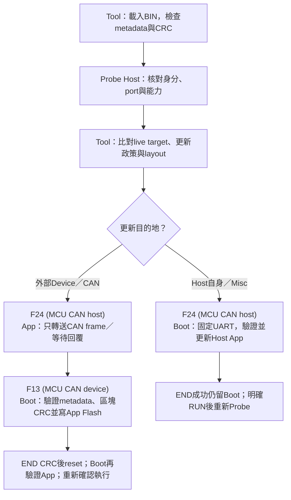

錯映像或不相容條件先封鎖，不送START／BEGIN。完整故障、斷電與高速可靠性仍須實板驗證；
CRC是完整性檢查，不是簽章。F13正常更新完成不等於已看到reset後App執行；兩者應分別留證。
<!-- PUBLIC_RESOURCES_END -->

<a id="boot-app-porting"></a>

<!-- RL78_PORTING_BEGIN -->
## 自訂 Bootloader／App：先選導入方式

要實際編輯／產生 Metadata 或新增 App IRQ，請先讀
[F13／F24 device 實作教學](https://released.github.io/slide_boot_loader_for_RL78/#device-metadata-vector-workshop)：
有修改前後範例、產生命令與驗證表。以下既有比較欄中的 F24 指 MCU CAN host；
F24 MCU CAN device 使用獨立章節的 8 KiB／App2000 工程，不套用 host 分區或產表腳本。

本節現行配套為 **F13 (MCU CAN device)** 與 **F24 (MCU CAN host)**。
F24 host的Boot/App走Misc／UART自更新，不是後續F24 (MCU CAN device) 的CAN Boot/App；
型號相同不代表板子角色、映像政策或更新協定相同。舊UART／I2C教材依各自專案判定角色。

| 需求 | 建議切入方式 | 必須保留的邊界 |
| --- | --- | --- |
| 沿用現有 Boot，只換自己的 App | 從同 MCU 的已整合 App 複製專案，再加入應用功能 | 固定 MCU、分區、IRQ ABI、startup／RAM、metadata／CRC、更新契約 |
| 自己設計更新 command／傳輸流程 | 參考向量、startup、Flash 保護與映像產生架構，另行實作更新狀態機 | 自己定義並驗證 Boot/App 共同契約，不能直接宣稱相容現有 Tool |
| 移植到另一顆 MCU／板子 | 先核對硬體手冊、device file 與該系列 Flash library，再建立 matching Boot/App | 不能直接複製 F13/F24 的 register、clock、Flash driver 或 HEX |

若只參考 firmware 架構，不必採用 Host Link、F24 bridge 或現有 CAN commands。
若仍要由 FirmwareUpgradeTool 更新，則必須保留對應 image／live descriptor／
protocol，或另行開發 PC target adapter；不能只修改 BIN 的 MCU 名稱或版本。

### 1. 選定目前的參考專案

F13與F24範例皆可由下列GitHub連結取得，不需要開發者的本機工作區。
F24 Boot／App位於同一Tool repository的firmware目錄，應下載完整repository，
不能只下載個別資料夾而省略共用driver、SC、library與scripts。

| 項目 | F13 (MCU CAN device) | F24 (MCU CAN host) |
| --- | --- | --- |
| CAN通訊測試 | [RL78_F13_CAN_Transfer](https://github.com/released/RL78_F13_CAN_Transfer)；不擦寫Flash | 搭配同一通用bridge；不是Host App更新映像 |
| Boot 專案 | [RL78_F13_Boot_loader_CAN](https://github.com/released/RL78_F13_Boot_loader_CAN) | [RL78_F24_Bridge_boot](https://github.com/released/simple_renesas_isp_tool/tree/main/firmware/RL78_F24_Bridge_boot) |
| App 專案 | [RL78_F13_Boot_loader_CAN_app](https://github.com/released/RL78_F13_Boot_loader_CAN_app) | [RL78_F24_Bridge_app](https://github.com/released/simple_renesas_isp_tool/tree/main/firmware/RL78_F24_Bridge_app) |
| MCU | R5F10BMG，128 KiB Flash | R7F124FLJ3xFB，256 KiB Flash |
| 更新契約 | image format6、CAN protocol5、IRQ ABI F1V1；需matching Boot/App | BUR1 contract3、IRQ ABI F2V1；需matching Boot/App |
| 更新入口 | CAN 500K，standard ID 0x700／0x701 | PC UART，Host Boot 固定115200；Tool 的 Misc |
| Flash library | F13 FSL | F24 RFD Type02，programming-mode 路徑在 RAM 執行 |

F13_CAN_Transfer 是通訊 benchmark，不是 Boot/App 移植模板。先使用Transfer
確認傳輸，再依需要安裝Boot/App；Transfer與Boot/App是不同的device韌體。

下載Boot與App時，必須保留以下相鄰目錄及名稱。App會引用Boot的共用board來源、
CAN設定及產表腳本；只下載App，或保留ZIP解壓後的-main尾碼，不能直接重建。

```text
examples/
  RL78_F13_CAN_Transfer/
  RL78_F13_Boot_loader_CAN/
  RL78_F13_Boot_loader_CAN_app/
```

可在同一空目錄依序執行：

```powershell
git clone https://github.com/released/RL78_F13_CAN_Transfer.git
git clone https://github.com/released/RL78_F13_Boot_loader_CAN.git
git clone https://github.com/released/RL78_F13_Boot_loader_CAN_app.git
```

若使用Download ZIP，解壓後將目錄改成上方名稱。首次先build Boot，再build App
產生matching boot_app.hex；後續更新使用App產生的_update.bin。不能把兩種檔案互換。

舊 F24_Boot_loader_UART／I2C／CRC 教材可參考原理，不可把其 callback ISR、
固定 CRC 位址或舊封裝流程混入現行固定完整 RETI 向量與 metadata 契約。
G16 新版 I2C Boot/App 尚未開發；舊範例不代表已具備相同安全條件。

### 2. 先固定記憶體與映像配置

| 區域 | F13 (MCU CAN device) 目前設定 | F24 (MCU CAN host) 目前設定 |
| --- | --- | --- |
| Boot | 0x0000..0x1FFF，8 KiB | 0x0000..0x4FFF，20 KiB |
| App 可用區 | 0x2000..0x1FFFF，120 KiB | 0x5000..0x3FBFF，235 KiB |
| App 跳轉表 | 0x2000..0x20FF | 0x5000..0x50FF |
| Metadata 整區 | 0x2100..0x21FF，256 bytes | 0x5100..0x51FF，256 bytes |
| 已定義 core | 0x2100..0x217F，128 bytes | 0x5100..0x517F，128 bytes |
| Reserved metadata | 0x2180..0x21FF，128 bytes，填0xFF | 0x5180..0x51FF，128 bytes，填0xFF |
| App code 起點 | 0x2200 | 0x5200 |
| Image CRC32 | 實際 update image 最後4 bytes，little-endian | 同左 |
| 其他保護 | Boot/FSL 至少保留512 bytes ROM 餘量；保留 debug trace RAM | 0x3FC00..0x3FFFF 最後1 KiB 不可更新 |

App 前512 bytes 不是整塊空白：前256 bytes 是64個4-byte 跳轉入口，
後256 bytes 是 metadata。一般 code 從 app start＋0x200 開始。
CRC32 涵蓋從 app start 到尾端 CRC 前的全部 bytes，包含表、metadata 與填洞0xFF。
BIN 長度由 linker map 的實際 loaded section 決定、4-byte 對齊，最小516 bytes；
不是每次固定輸出整個 App capacity，也不是把 CRC 永遠放在 Flash 最後4 bytes。

F13 layout／CAN identity 來源是 Boot 的 can_boot_config.h／user_def.h，
App 生成的 ftable.inc 與 linker／分割 HEX 設定必須一致，不應手改生成檔；版本／build 是 App 自己的欄位。
F24 分區集中在 firmware/f24_bridge_common/f24_bridge_layout.h，
App 版本／build 由該 App 自己的 app_image.json 提供。
改分區時須一起調整 linker、產表／封裝／驗證腳本及 metadata，重新安裝 matching Boot/App。
現行 generator 有固定 ABI 位址檢查，不能假設只改一個 define 就能任意搬移。

### 3. 向量：Boot 固定介面，App 自己決定 handler

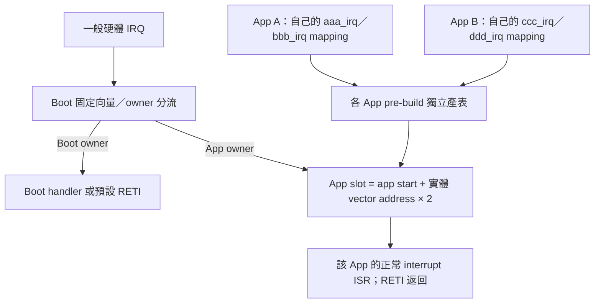

固定表有64個4-byte slot；例如 F13 vector 0x34 的 App slot 是0x2068，
F24 則是0x5068。JSON 的 key 是實體 vector 位址，不是 IRQ 序號或 slot 位址。
Boot 固定涵蓋一般位置0x04..0x7C；其中保留位置不可啟用。
合法可用 IRQ 必須依本 MCU 的 device header／硬體手冊及 generator 檢查，
不能因表內有位置就認為有對應周邊。

Reset 仍由 Boot 擁有；App table 第一個 slot 轉到 App startup，不是直接跳 main。
0x02 保留。Physical BRK 0x7E 不由此介面轉送，留給 device/debugger；
App 的 BRK 保留 slot 使用 RETB，不是一般 IRQ 的 RETI，正式 App 不應把它當通用 API。

一般 App ISR（包含 F13 INTTRJ0）採下列寫法，來源必須加入該 App 的 MTPJ：

```c
#pragma interrupt your_handler
void __near your_handler(void)
{
    /* Acknowledge the interrupt source and capture bounded state. */
}
```

- 必須 global、非 static、正常 interrupt pragma；不要帶 vect= 或另加競爭的 -VECTN。
- ISR 以 RETI 返回，不是普通 C callback；不可用一般函式呼叫 ISR。
- Boot/App 分別連結，可以使用相同 ISR 函式名；真正禁止的是重複擁有實體 vector。
- 新 IRQ 在 EI 前須完成周邊初始化、清 pending flag、優先權及 mask 設定。
- 未用 IRQ 必須遮罩；預設 RETI 不會替你清除硬體中斷原因。
- Code Generator／Smart Configurator 重產後，要重新核對 pragma、export、mapping 與 user hook。

F13 以 near CALL＋literal 與共用組語 dispatcher 節省 ROM，暫時額外使用10 bytes stack，
最終保留原硬體 frame 交由 ISR RETI。F24 使用逐向量直接分支。
這是內部實作差異，不是 App 可改回普通 RET callback 的理由。

### 4. CS+／Startup／RAM 必須一起移植

| 檢查位置 | 移植時必做事項 |
| --- | --- |
| Project device／CC-RL | 選正確 MCU、記憶體模型與 Flash library，保留原授權聲明；不抄另一系列設定 |
| Source tree | 登錄自己的 table、startup、ISR、identity、必要 board support；不是只把檔案放進資料夾 |
| Linker section start | 表、metadata、code、RAM、stack 互不重疊；核對實際 map，不只看 IDE 畫面 |
| RAM／stack 初始化 | 保留 recovery／owner／handoff no-init，檢查 .bss／.data／stack 初始化不會清掉它們 |
| Build events | 保留 pre-build 產表與 post-build 封裝／拒絕條件；生成檔不可手改 |
| Option bytes／debug | Boot/App 設定一致且符合產品需求；保留 debug monitor／trace RAM，不由 App 更新覆寫 |
| 跨目錄搬移 | 修正 source／include／library／preinclude／hook 路徑，不能只改 MTPJ 名稱 |

兩個目前範例都使用 FF700 recovery 與 FF710 owner，但 marker 值不是同一協定：
F13 的 AA=Boot、55=App；F24 Boot 初始化為00，只有 A5 才轉送 App，其餘走 Boot handler／預設。
Recovery cookie 的值與後續交接資料也不可跨系列照抄。
F13 額外使用 FF714 handoff、FF718 update-complete，在 FF710..FF71F 中保留；
須在 App startup 消耗與清除一次性標記，不能把上次 log 當成本次更新成功。
F13 normal data 從0xFE500以上開始，保留0xFE300..0xFE4FF trace RAM。
F24 明確配置4 KiB stack 並避開交接 RAM；不能任由 stack 初始化掃過 cookie／owner。

Boot 關中斷並交接，不表示 App 可以略過自己的 startup 或周邊初始化。
Clock、UART/CAN/I2C 狀態、pending flag、stack 與 RAM 都必須有明確責任。
F13 需保留 f13_board_support 與生成檔 user-area clock hook，不能在 App 停掉已有效的 inherited PLL。
其板端 X1=4 MHz、CPU32／CAN16；F24 App X1=20 MHz、PLL80／CPU40，Boot 用 HOCO40。
這些是本板設定，不是其他 RL78 的預設值。

### 5. F13 (MCU CAN device)：把應用功能加進已整合 App

保留的主要檔案／責任：

| 檔案 | 責任 |
| --- | --- |
| cstart.asm | App runtime startup 與 RAM／stack 初始化 |
| app_image.json | 此 App 的 version／build 與固定 target／role／transport 核對值 |
| ftable.inc、ftable_RL78_F13.asm | pre-build 生成常數／固定排列，產生256-byte metadata；不手改 ftable.inc |
| app_irq_handlers.json | 此 App 的實體 vector → ISR 名稱 |
| app_irq_table.inc、app_identity.h | pre-build 生成，不手改 |
| generate_update_image.ps1 | map 導出長度、metadata 檢查、CRC 與安裝／更新產物 |
| Boot 的 generate_irq_contract.ps1 | -Mode App 時只產此 App 的 ftable.inc、表與 identity；Boot 表獨立 |
| f13_board_support、App INFO／ENTER | clock／周邊交接、在線資訊及回 Boot 入口 |

1. 複製已整合 App，先不改 MCU／分區。備份原 Boot image 與已知可用 App。
2. 將自己的功能來源加入 MTPJ；保留仍需要的 timer／UART／INFO／ENTER。
3. 在自己的 app_irq_handlers.json 加入合法 IRQ；在 app_image.json 改 App version／build。
4. CS+ pre-build 保留以下命令，搬移後修正腳本路徑；post-build 保留 generate_update_image.ps1。

```powershell
powershell.exe -NoProfile -ExecutionPolicy Bypass `
  -File "..\RL78_F13_Boot_loader_CAN\generate_irq_contract.ps1" `
  -Mode App -AppProject "."
```

5. Clean rebuild 該 App；檢查 log、map、更新 BIN、CRC 與低位址排除結果。
6. 在 Tool root 執行 scripts/verify_f13_artifacts.ps1，可傳 -BootProject／-AppProject。
   產表只檢查時用 generate_irq_contract.ps1 -Mode App -AppProject 路徑 -CheckOnly。
7. 用 matching Boot 測整合啟動，再以更新 BIN 測只換 App；比較 Boot 區內容確認沒被改寫。

目前 F13 封裝與 artifact checker 仍有參考 MTPJ／map／BIN 名稱及 sibling Boot 路徑。
-AppProject 不代表已支援任意改名的一鍵工程：先保留參考檔名／目錄關係；
若要改名或搬離原樹，須一併調整 post-build 的 -MapFile／輸出命名、Boot HEX 路徑、
MTPJ 與 checker 的檔名假設，再重新驗證。這不需要為 ISR 名稱重編 Boot，
但不能跳過工程路徑整合。不是 standalone 專案只加 JSON 就能變成 boot-compatible App。

### 6. F24 (MCU CAN host)：各 App 自己產表、封裝，不動共用 Boot

1. 從 firmware/RL78_F24_Bridge_app 建立自己的專案資料夾，保留唯一 MTPJ、
   全部 App .c／.h、generated_projection、table 登錄與 BRIDGE_SPLIT_APP 定義。
2. 保留 app5000／code5200、4 KiB stack、FF700／FF710 與最後1 KiB保護。
   共用硬體／driver／SC 來源在 firmware/f24_board，不在 projection 重產 SC。
   Bridge_boot／Bridge_app 是唯一兩份產品專案，f24_board 沒有 MTPJ 或燒錄產物。
3. 自己維護 app_irq_handlers.json 與 app_image.json；保留仍在用的 UART／timer／bus mapping。
4. Pre-build 使用 scripts/prepare_f24_app_irq.ps1 -AppProject "."；
   post-build 使用 scripts/package_f24_bridge.ps1 -Kind app -AppProject "."。
   生成 bridge_vectors.asm／f24_app_identity.generated.h，不手改。
5. 在 Tool root 建置自己的 App，例如：

```powershell
.\scripts\build_f24_bridge.ps1 -Kind app -AppProject ".\ProjectA"
.\scripts\build_f24_bridge.ps1 -Kind app -AppProject ".\ProjectB"
```

上述路徑是使用者自訂位置的例子。搬移時必須先修正所有來源與 build hook 路徑。
只檢查生成檔可用 prepare_f24_app_irq.ps1 -AppProject 路徑 -CheckOnly。
App-only 建置／封裝不寫 Boot，並依該 MTPJ stem 產生各自的 BIN／flash MOT。
此 wrapper 仍是特定 F24 bridge integration，不是任意 RL78 App 的通用建置器。

只有 canonical SC 確實重產時，才對 reference projection 使用
prepare_f24_bridge_projects.ps1 -Kind app。日常 App-only 更新不要呼叫省略 Kind
的雙專案 prepare，也不要對自訂 App 直接使用 reference 重產腳本覆寫設定。
Boot 自己的硬體／layout 改變才另行 prepare／build Boot。
SC 唯一設定為 f24_board/f24_board.scfg，輸出在 f24_board/src/smc_gen。
搬移工作目錄後先 prepare -Kind app 刷新 SC 路徑，再從 App MTPJ 開啟。
prepare 讀取各自既有 MTPJ，保留專案選項／hook 與 App JSON，不再由第三個專案產生。
App main／Host Link／CAN service 在 App；共用 UART／timer 透過最小 hooks
由 Boot、App 分別實作。SC 新路徑 GUI 重產尚待操作確認。

### 7. 初次安裝、後續更新與除錯不可混用

| 用途 | F13 (MCU CAN device) | F24 (MCU CAN host) |
| --- | --- | --- |
| 初次 matching 安裝 | App 專案根目錄 boot_app.hex，包含 Boot＋封裝 App | Boot 的 .mot 加 App 的 *_flash.mot；先確認燒錄工具不會全片擦除另一區 |
| 後續只更新 App | DefaultBuild/RL78_F13_Boot_loader_CAN_app_update.bin | DefaultBuild/*_bridge_update.bin，載入 Misc |
| 不應當正式安裝檔 | App raw ABS／暫時低位址 vector；raw HEX 不能當 update BIN | App raw .mot／.abs 的低位址 placeholder，不是 *_flash.mot |

F24 也可首次只用 programmer 安裝 Boot；沒有有效 App 會留在 recovery，
再以 tool Misc／115200 安裝 matching App BIN、驗證後明確 RUN。Misc 不更新 Boot。

F13 Boot CS+ Run-to-symbol 是 _boot_main；App standalone 是 _main。
Standalone ABS 下載可能覆寫 Boot 實體向量，不算 Boot→App 整合測試。
正式 handoff 除錯需保留已燒入的 matching Boot/App，只載入 App symbols，
從 reset 經 Boot 再停在 App main；核對 CS+ download／erase 設定與 -OCDTR。
F24 同樣不可用 raw App 下載覆蓋低位 Boot vector；E2 lite halt／continue／stop 要實測。

Misc 僅更新 Host App，不更新 Boot。現行 F24 Host Boot 的更新 UART 在編譯時固定115200；
Host App 的一般 Host Link 可協商115200／460800／921600，與 Device 更新速度獨立。
高速 App 先在原速度完成 ENTER ACK，再 reset 進 Boot，PC 以115200重新核對身分。
單純切 TAB 不會立即改速；活動更新不允許切 TAB。未來 Device UART 的固定 baud
由其 Boot/App 編譯契約與 BIN policy 決定，不是上方 Host Baud，也不是 Misc 的115200。
目前 F24 I2C 只有100K，Device UART adapter 尚未啟用，不能把400K／1M／9M當成既有能力。

### 8. 若改用自己的 Boot 更新流程

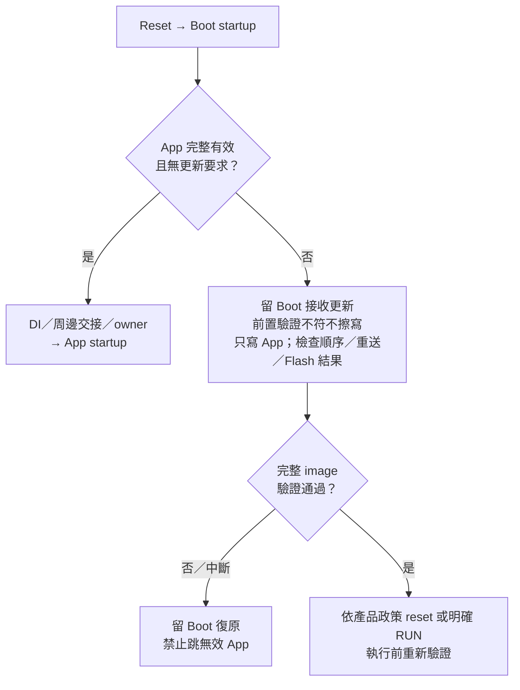

這是移植檢查骨架，不是兩個既有產品狀態機完全相同。
F13 CAN：有效 App＋ENTER 在接受 START 前可因30秒 inactivity 返回舊 App；
無效 App 從不啟用這個自動返回。START 後 timeout／ABORT／fatal write error 留 Boot；
END 成功 reset，重新驗證才啟動。完整細節以 F13 flow guide 第2.2節為準。
F24 Misc：END 成功仍留 Boot，必須明確 RUN；有效 magic 採最後提交。
兩者都不等於雙映像 rollback，不能宣稱掉電一定保留舊 App。

自己設計流程至少必須定義：更新要求／清除方式、身分與 geometry 檢查、
擦寫 allowlist、命令與 offset 邊界、duplicate／retry、斷線／timeout／cancel、
完整 image CRC 與有效性提交、上電重新驗證、周邊交接與復原入口。
F13 FSL 與 F24 RFD 不能互換；F24 programming mode 的 code／常數／IRQ
不可從 code Flash 取用，driver 與必要 hooks 須在 RAM，並配置足夠 stack。

若沿用現有 Tool：metadata 整區256、core128、reserved128FF，UPD1 的 role、
允許更新介面、IRQ ABI、最低 Boot 版本都要匹配 live Boot；CAN-only Device BIN
不能切 I2C／UART 更新，Device BIN 也不能用 Misc 更新 Host。
F13 必須 RESET metadata／64段各4 bytes／SEAL 再 START；
F24 必須四段64-byte STAGE 驗完整區再 BEGIN。傳輸 chunk 不是 metadata 區域大小。
CRC32 只有完整性，不是身分認證、簽章或防回滾；有資安需求必須另設計。
現行參考專案不使用 WDT；自己的產品若啟用 WDT，須重新設計 Flash／timeout／交接行為。

### 9. 哪些變更只更新 App？如何驗收？

| 變更 | 可否保留同一份 Boot |
| --- | --- |
| 相容 App 新增／刪除一般 IRQ、換 handler 名稱 | 可以，更新自己的 mapping、正常 ISR、初始化與封裝即可 |
| App A 換成 App B、版本或一般功能變更 | 可以，但必須保持既定 MCU／layout／RAM／startup／IRQ／image／更新契約 |
| 改 MCU、分區、owner RAM、IRQ ABI、Boot 自己的 IRQ 或更新 protocol | 不屬於 App-only；須重新評估 Boot，必要時重新安裝 matching pair |
| 只改 peripheral clock／pin 或 Flash library | 不可假設相容；核對 Boot 使用與交接責任，再決定是否需改 Boot |

每次移植至少完成以下 gates，不能只看 compile 成功：

1. 靜態：確認 MTPJ 登錄、table64 slots、branch 目的地／RETI／RETB、ROM／RAM／stack／保護區。
2. 產物：長度、完整256-byte metadata、role／transport／ABI、CRC 與安裝檔排除低位 vector。
3. App-only 隔離：保存更新前後 Boot 區／Boot 產物雜湊；App A/B 使用不同 IRQ／版本確認仍相容。
4. 實板：上電、無有效 App、正常 App、ENTER、更新、明確 RUN（若適用）、新增 IRQ 與原有 IRQ。
5. 實板故障：錯映像、重送、斷線、取消、reset／斷電、CRC 錯、Flash failure 與 recovery。
6. 除錯：保留 Boot vector 測 App main、E2 lite halt／continue／stop；獨立確認 UART／CAN/I2C 電氣與時鐘。

現有 build／map／HEX／mock／stack model 是軟體證據，不能代替以上實板驗證。
F13 Transfer benchmark 只證明當時通訊；不代表目前 Boot/App 完整更新已驗證。
本次指南僅整理工程流程，不編譯新 firmware、不開 COM、不燒錄、不發布網站。
<!-- RL78_PORTING_END -->

先讀[CAN 更新逐層導讀：Tool／F24 (MCU CAN host)／F13 (MCU CAN device)](https://released.github.io/slide_isp_tool_for_RL78/#can-update-walkthrough)，
以操作、RAM staging、CAN decode、COMMIT／END 表格與 Mermaid 圖理解整條路徑，再查以下每個 byte。

<!-- FLASH_REFERENCE_BEGIN -->
<a id="flash-metadata-can-reference"></a>

## 1. 適用角色與閱讀方式

本節對照 **F13 (MCU CAN device)** 的CAN3映像與 **F24 (MCU CAN host)** 的BUR1映像。
後續F24 (MCU CAN device) 是另一組Boot/App，不能直接使用本表F24 host的分區或BUR1更新協定。
CAN3／BUR1的metadata位置相對App相同，但前96 bytes欄位排列不同；0x60..0x7F才是共用UPD1。
這是Flash／封包與原始碼閱讀指南，不是跳過驗證或直接用CAN analyzer擦寫的操作指令。

### Flash絕對位址、BIN offset與metadata offset

```text
metadata_base = app_start + 0x100
field_flash_address = app_start + 0x100 + metadata_offset
field_bin_offset = 0x100 + metadata_offset
crc_flash_address = app_start + image_size - 4
crc_bin_offset = image_size - 4
```

例如F13的target_id在metadata offset0x0C..0x0D：Flash為0x0210C..0x0210D，
BIN為0x10C..0x10D。F24 host的app_start在metadata offset0x18..0x1B：Flash為0x05118..0x0511B。
這兩個offset不能跨CAN3／BUR1直接互換；所有多byte整數皆little-endian，低位byte在低位址。

| 區域 | F13 (MCU CAN device) | F24 (MCU CAN host) |
| --- | --- | --- |
| Code Flash | 0x00000..0x1FFFF | 0x00000..0x3FFFF |
| Boot（含低位向量／option等受保護區） | 0x00000..0x01FFF | 0x00000..0x04FFF |
| App可用範圍 | 0x02000..0x1FFFF | 0x05000..0x3FBFF |
| App固定跳轉表 | 0x02000..0x020FF | 0x05000..0x050FF |
| Metadata整區 | 0x02100..0x021FF | 0x05100..0x051FF |
| 已定義core／含UPD1 | 0x02100..0x0217F | 0x05100..0x0517F |
| Reserved，全部0xFF | 0x02180..0x021FF | 0x05180..0x051FF |
| Linked code起點 | 0x02200 | 0x05200 |
| 最後保留區 | 無另設此表所述尾端保留區；仍須保留既定debug trace RAM | 0x3FC00..0x3FFFF，不擦寫 |
| Image CRC32 | 實際BIN最後4 bytes，不是固定Flash尾端 | 同左 |

### 不同CRC不要混淆

| 名稱 | 存放／傳送位置 | 計算範圍 |
| --- | --- | --- |
| Image CRC32 | BIN最後4 bytes／LE32 | BIN[0..image_size-5]，含跳轉表、metadata、reserved及填洞FF；排除CRC自身 |
| Metadata staging CRC32 | CAN SEAL或Host BEGIN的command payload | 完整metadata 256 bytes；不是多佔用一組metadata內的CRC欄位 |
| CAN block CRC32 | BLOCK_BEGIN及BLOCK_COMMIT的Byte4..7 | 本區塊實際image bytes，最多64；不含control header或未傳送padding |
| Custom Transfer CRC8 | 固定8-byte payload的Byte7 | 該Transfer封包Byte0..6；不是CAN Upgrade的固定Byte7規則 |
| CAN控制器鏈路CRC | CAN frame硬體協定欄位 | 由CAN控制器處理，不佔本文件Byte0..7的payload |
| Host Link CRC16 | UART frame的header CRC／payload CRC | CRC16/CCITT-FALSE；header覆蓋Byte2..9，payload CRC只覆蓋UART payload，不是image CRC |
| Intel HEX／S-record checksum | HEX／MOT每筆文字record | 燒錄檔record完整性；不是App image CRC32 |

Image／metadata／block採CRC32/ISO-HDLC，reflected polynomial0xEDB88320，init及xorout0xFFFFFFFF。
CRC提供完整性，不是簽章、認證或防回滾。image_size隨linker結果改變，所以CRC實際address必須重新計算。

## 2. 每個metadata byte：address、範例值與來源

下表所有offset均相對metadata_base；address／offset以0x標示，value欄是兩位十六進位byte，bytes欄長度為十進位。
「產生端來源」對照下一節可點選的真正範例程式；欄位後[0]／[1]等表示該欄位內的byte。
CAN3來源主要是ftable.inc／ftable_RL78_F13.asm；BUR1來源是package_f24_bridge.ps1。
UPD1來源是F13組語的policy words、F24 packager及共用image_policy.h。

<!-- METADATA_BYTES_BEGIN -->
### F13 (MCU CAN device)：CAN3 欄位與產生端

| Metadata offset | bytes | 欄位 | 產生端來源符號／位置 |
| --- | --- | --- | --- |
| 0x00..0x03 | 4 | CAN3 magic | IMAGE_MANIFEST_MAGIC |
| 0x04..0x04 | 1 | image_format | IMAGE_MANIFEST_FORMAT_INFO |
| 0x05..0x05 | 1 | core_length | IMAGE_MANIFEST_FORMAT_INFO |
| 0x06..0x07 | 2 | flags | IMAGE_MANIFEST_FORMAT_INFO |
| 0x08..0x09 | 2 | protocol_id | IMAGE_MANIFEST_PROTOCOL |
| 0x0A..0x0A | 1 | protocol_version | IMAGE_MANIFEST_PROTOCOL |
| 0x0B..0x0B | 1 | checksum_type | IMAGE_MANIFEST_PROTOCOL |
| 0x0C..0x0D | 2 | target_id | IMAGE_MANIFEST_TARGET |
| 0x0E..0x0E | 1 | can_mode_mask | IMAGE_MANIFEST_TARGET |
| 0x0F..0x0F | 1 | can_id_format | IMAGE_MANIFEST_TARGET |
| 0x10..0x13 | 4 | app_version | APP_IMAGE_VERSION |
| 0x14..0x17 | 4 | app_build | APP_IMAGE_BUILD |
| 0x18..0x1B | 4 | image_size | IMAGE_SIZE_POST_BUILD / post-build |
| 0x1C..0x1F | 4 | app_start | FLASH_TABLE |
| 0x20..0x23 | 4 | app_capacity | APP_REGION_SIZE |
| 0x24..0x27 | 4 | flash_size | CODE_FLASH_SIZE |
| 0x28..0x2B | 4 | boot_size | BOOT_RESERVED_SIZE |
| 0x2C..0x2F | 4 | erase_size | FLASH_ERASE_BLOCK_SIZE |
| 0x30..0x33 | 4 | nominal_rate_mask | CAN_NOMINAL_BITRATE_MASK |
| 0x34..0x37 | 4 | data_rate_mask | CAN_DATA_BITRATE_MASK |
| 0x38..0x3B | 4 | request_id | CAN_REQUEST_ID |
| 0x3C..0x3F | 4 | response_id | CAN_RESPONSE_ID |
| 0x40..0x4F | 16 | mcu_part ASCII | MCU_PART_0..1 / zero padding |
| 0x50..0x5B | 12 | mcu_family ASCII | MCU_FAMILY_0..1 / zero padding |
| 0x5C..0x5F | 4 | minimum_size | MINIMUM_IMAGE_SIZE |
| 0x60..0x63 | 4 | UPD1 magic | UPD1 policy |
| 0x64..0x64 | 1 | policy_version | UPD1 policy |
| 0x65..0x65 | 1 | policy_size | UPD1 policy |
| 0x66..0x66 | 1 | image_role | UPD1 policy |
| 0x67..0x67 | 1 | update_transports | UPD1 policy |
| 0x68..0x6B | 4 | irq_abi | UPD1 policy |
| 0x6C..0x6F | 4 | minimum_boot | UPD1 policy |
| 0x70..0x73 | 4 | device_uart_baud | UPD1 policy |
| 0x74..0x7F | 12 | reserved_zero | UPD1 policy |
| 0x80..0xFF | 128 | reserved_FF | reserved region |

### F24 (MCU CAN host)：BUR1 欄位與產生端

| Metadata offset | bytes | 欄位 | 產生端來源符號／位置 |
| --- | --- | --- | --- |
| 0x00..0x03 | 4 | BUR1 magic | Put32 0 |
| 0x04..0x04 | 1 | contract_version | image[0x104] |
| 0x05..0x05 | 1 | core_length | image[0x105] |
| 0x06..0x06 | 1 | image_role | image[0x106] |
| 0x07..0x07 | 1 | checksum_type | image[0x107] |
| 0x08..0x09 | 2 | board_id | BOARD_ID / image[0x108] |
| 0x0A..0x0B | 2 | contract_id | image[0x10A] / zero padding |
| 0x0C..0x0F | 4 | image_size | Put32 12 / linker-derived size |
| 0x10..0x13 | 4 | app_version | app_image.json / Put32 16 |
| 0x14..0x17 | 4 | app_build | app_image.json / Put32 20 |
| 0x18..0x1B | 4 | app_start | APP_START / Put32 24 |
| 0x1C..0x1F | 4 | app_capacity | APP_LIMIT - APP_START / Put32 28 |
| 0x20..0x23 | 4 | flash_size | FLASH_SIZE / Put32 32 |
| 0x24..0x27 | 4 | boot_size | APP_START / Put32 36 |
| 0x28..0x2B | 4 | erase_size | ERASE_SIZE / Put32 40 |
| 0x2C..0x2F | 4 | minimum_size | MINIMUM_SIZE / Put32 44 |
| 0x30..0x33 | 4 | boot_uart_baud | UART_BAUD / Put32 48 |
| 0x34..0x3F | 12 | mcu_family ASCII | ASCII CopyTo image[0x134] |
| 0x40..0x4F | 16 | mcu_part ASCII | ASCII CopyTo image[0x140] |
| 0x50..0x53 | 4 | minimum_boot_copy | BOOT_VERSION / Put32 80 |
| 0x54..0x5F | 12 | reserved_zero | core initialized zero |
| 0x60..0x63 | 4 | UPD1 magic | UPD1 policy |
| 0x64..0x64 | 1 | policy_version | UPD1 policy |
| 0x65..0x65 | 1 | policy_size | UPD1 policy |
| 0x66..0x66 | 1 | image_role | UPD1 policy |
| 0x67..0x67 | 1 | update_transports | UPD1 policy |
| 0x68..0x6B | 4 | irq_abi | UPD1 policy |
| 0x6C..0x6F | 4 | minimum_boot | UPD1 policy |
| 0x70..0x73 | 4 | device_uart_baud | UPD1 policy |
| 0x74..0x7F | 12 | reserved_zero | UPD1 policy |
| 0x80..0xFF | 128 | reserved_FF | reserved region |

### 逐 byte 實體位址與範例值
方括號是欄位內byte索引；LE數值的[0]是最低有效byte。ASCII依字元順序，reserved依原始順序。
範例值取配套BIN，不是所有專案的固定值；每個metadata byte皆各列一行，包含128個reserved FF。
#### Metadata 0x00..0x1F
| offset | F13 address | value | F13欄位[byte] | F24 host address | value | F24欄位[byte] |
| --- | --- | --- | --- | --- | --- | --- |
| 0x00 | 0x02100 | 43 | CAN3 magic[0] | 0x05100 | 42 | BUR1 magic[0] |
| 0x01 | 0x02101 | 41 | CAN3 magic[1] | 0x05101 | 55 | BUR1 magic[1] |
| 0x02 | 0x02102 | 4E | CAN3 magic[2] | 0x05102 | 52 | BUR1 magic[2] |
| 0x03 | 0x02103 | 33 | CAN3 magic[3] | 0x05103 | 31 | BUR1 magic[3] |
| 0x04 | 0x02104 | 06 | image_format[0] | 0x05104 | 03 | contract_version[0] |
| 0x05 | 0x02105 | 80 | core_length[0] | 0x05105 | 80 | core_length[0] |
| 0x06 | 0x02106 | 03 | flags[0] | 0x05106 | 02 | image_role[0] |
| 0x07 | 0x02107 | 00 | flags[1] | 0x05107 | 01 | checksum_type[0] |
| 0x08 | 0x02108 | 01 | protocol_id[0] | 0x05108 | 01 | board_id[0] |
| 0x09 | 0x02109 | 00 | protocol_id[1] | 0x05109 | 01 | board_id[1] |
| 0x0A | 0x0210A | 05 | protocol_version[0] | 0x0510A | 02 | contract_id[0] |
| 0x0B | 0x0210B | 01 | checksum_type[0] | 0x0510B | 00 | contract_id[1] |
| 0x0C | 0x0210C | 3B | target_id[0] | 0x0510C | C8 | image_size[0] |
| 0x0D | 0x0210D | F1 | target_id[1] | 0x0510D | A6 | image_size[1] |
| 0x0E | 0x0210E | 01 | can_mode_mask[0] | 0x0510E | 00 | image_size[2] |
| 0x0F | 0x0210F | 00 | can_id_format[0] | 0x0510F | 00 | image_size[3] |
| 0x10 | 0x02110 | 00 | app_version[0] | 0x05110 | 00 | app_version[0] |
| 0x11 | 0x02111 | 05 | app_version[1] | 0x05111 | 05 | app_version[1] |
| 0x12 | 0x02112 | 01 | app_version[2] | 0x05112 | 01 | app_version[2] |
| 0x13 | 0x02113 | 00 | app_version[3] | 0x05113 | 00 | app_version[3] |
| 0x14 | 0x02114 | 97 | app_build[0] | 0x05114 | 97 | app_build[0] |
| 0x15 | 0x02115 | 28 | app_build[1] | 0x05115 | 28 | app_build[1] |
| 0x16 | 0x02116 | 35 | app_build[2] | 0x05116 | 35 | app_build[2] |
| 0x17 | 0x02117 | 01 | app_build[3] | 0x05117 | 01 | app_build[3] |
| 0x18 | 0x02118 | 2C | image_size[0] | 0x05118 | 00 | app_start[0] |
| 0x19 | 0x02119 | 4B | image_size[1] | 0x05119 | 50 | app_start[1] |
| 0x1A | 0x0211A | 00 | image_size[2] | 0x0511A | 00 | app_start[2] |
| 0x1B | 0x0211B | 00 | image_size[3] | 0x0511B | 00 | app_start[3] |
| 0x1C | 0x0211C | 00 | app_start[0] | 0x0511C | 00 | app_capacity[0] |
| 0x1D | 0x0211D | 20 | app_start[1] | 0x0511D | AC | app_capacity[1] |
| 0x1E | 0x0211E | 00 | app_start[2] | 0x0511E | 03 | app_capacity[2] |
| 0x1F | 0x0211F | 00 | app_start[3] | 0x0511F | 00 | app_capacity[3] |
#### Metadata 0x20..0x3F
| offset | F13 address | value | F13欄位[byte] | F24 host address | value | F24欄位[byte] |
| --- | --- | --- | --- | --- | --- | --- |
| 0x20 | 0x02120 | 00 | app_capacity[0] | 0x05120 | 00 | flash_size[0] |
| 0x21 | 0x02121 | E0 | app_capacity[1] | 0x05121 | 00 | flash_size[1] |
| 0x22 | 0x02122 | 01 | app_capacity[2] | 0x05122 | 04 | flash_size[2] |
| 0x23 | 0x02123 | 00 | app_capacity[3] | 0x05123 | 00 | flash_size[3] |
| 0x24 | 0x02124 | 00 | flash_size[0] | 0x05124 | 00 | boot_size[0] |
| 0x25 | 0x02125 | 00 | flash_size[1] | 0x05125 | 50 | boot_size[1] |
| 0x26 | 0x02126 | 02 | flash_size[2] | 0x05126 | 00 | boot_size[2] |
| 0x27 | 0x02127 | 00 | flash_size[3] | 0x05127 | 00 | boot_size[3] |
| 0x28 | 0x02128 | 00 | boot_size[0] | 0x05128 | 00 | erase_size[0] |
| 0x29 | 0x02129 | 20 | boot_size[1] | 0x05129 | 04 | erase_size[1] |
| 0x2A | 0x0212A | 00 | boot_size[2] | 0x0512A | 00 | erase_size[2] |
| 0x2B | 0x0212B | 00 | boot_size[3] | 0x0512B | 00 | erase_size[3] |
| 0x2C | 0x0212C | 00 | erase_size[0] | 0x0512C | 04 | minimum_size[0] |
| 0x2D | 0x0212D | 04 | erase_size[1] | 0x0512D | 02 | minimum_size[1] |
| 0x2E | 0x0212E | 00 | erase_size[2] | 0x0512E | 00 | minimum_size[2] |
| 0x2F | 0x0212F | 00 | erase_size[3] | 0x0512F | 00 | minimum_size[3] |
| 0x30 | 0x02130 | 04 | nominal_rate_mask[0] | 0x05130 | 00 | boot_uart_baud[0] |
| 0x31 | 0x02131 | 00 | nominal_rate_mask[1] | 0x05131 | C2 | boot_uart_baud[1] |
| 0x32 | 0x02132 | 00 | nominal_rate_mask[2] | 0x05132 | 01 | boot_uart_baud[2] |
| 0x33 | 0x02133 | 00 | nominal_rate_mask[3] | 0x05133 | 00 | boot_uart_baud[3] |
| 0x34 | 0x02134 | 00 | data_rate_mask[0] | 0x05134 | 52 | mcu_family ASCII[0] |
| 0x35 | 0x02135 | 00 | data_rate_mask[1] | 0x05135 | 4C | mcu_family ASCII[1] |
| 0x36 | 0x02136 | 00 | data_rate_mask[2] | 0x05136 | 37 | mcu_family ASCII[2] |
| 0x37 | 0x02137 | 00 | data_rate_mask[3] | 0x05137 | 38 | mcu_family ASCII[3] |
| 0x38 | 0x02138 | 00 | request_id[0] | 0x05138 | 2F | mcu_family ASCII[4] |
| 0x39 | 0x02139 | 07 | request_id[1] | 0x05139 | 46 | mcu_family ASCII[5] |
| 0x3A | 0x0213A | 00 | request_id[2] | 0x0513A | 32 | mcu_family ASCII[6] |
| 0x3B | 0x0213B | 00 | request_id[3] | 0x0513B | 34 | mcu_family ASCII[7] |
| 0x3C | 0x0213C | 01 | response_id[0] | 0x0513C | 00 | mcu_family ASCII[8] |
| 0x3D | 0x0213D | 07 | response_id[1] | 0x0513D | 00 | mcu_family ASCII[9] |
| 0x3E | 0x0213E | 00 | response_id[2] | 0x0513E | 00 | mcu_family ASCII[10] |
| 0x3F | 0x0213F | 00 | response_id[3] | 0x0513F | 00 | mcu_family ASCII[11] |
#### Metadata 0x40..0x5F
| offset | F13 address | value | F13欄位[byte] | F24 host address | value | F24欄位[byte] |
| --- | --- | --- | --- | --- | --- | --- |
| 0x40 | 0x02140 | 52 | mcu_part ASCII[0] | 0x05140 | 52 | mcu_part ASCII[0] |
| 0x41 | 0x02141 | 35 | mcu_part ASCII[1] | 0x05141 | 37 | mcu_part ASCII[1] |
| 0x42 | 0x02142 | 46 | mcu_part ASCII[2] | 0x05142 | 46 | mcu_part ASCII[2] |
| 0x43 | 0x02143 | 31 | mcu_part ASCII[3] | 0x05143 | 31 | mcu_part ASCII[3] |
| 0x44 | 0x02144 | 30 | mcu_part ASCII[4] | 0x05144 | 32 | mcu_part ASCII[4] |
| 0x45 | 0x02145 | 42 | mcu_part ASCII[5] | 0x05145 | 34 | mcu_part ASCII[5] |
| 0x46 | 0x02146 | 4D | mcu_part ASCII[6] | 0x05146 | 46 | mcu_part ASCII[6] |
| 0x47 | 0x02147 | 47 | mcu_part ASCII[7] | 0x05147 | 4C | mcu_part ASCII[7] |
| 0x48 | 0x02148 | 00 | mcu_part ASCII[8] | 0x05148 | 4A | mcu_part ASCII[8] |
| 0x49 | 0x02149 | 00 | mcu_part ASCII[9] | 0x05149 | 33 | mcu_part ASCII[9] |
| 0x4A | 0x0214A | 00 | mcu_part ASCII[10] | 0x0514A | 78 | mcu_part ASCII[10] |
| 0x4B | 0x0214B | 00 | mcu_part ASCII[11] | 0x0514B | 46 | mcu_part ASCII[11] |
| 0x4C | 0x0214C | 00 | mcu_part ASCII[12] | 0x0514C | 42 | mcu_part ASCII[12] |
| 0x4D | 0x0214D | 00 | mcu_part ASCII[13] | 0x0514D | 00 | mcu_part ASCII[13] |
| 0x4E | 0x0214E | 00 | mcu_part ASCII[14] | 0x0514E | 00 | mcu_part ASCII[14] |
| 0x4F | 0x0214F | 00 | mcu_part ASCII[15] | 0x0514F | 00 | mcu_part ASCII[15] |
| 0x50 | 0x02150 | 52 | mcu_family ASCII[0] | 0x05150 | 00 | minimum_boot_copy[0] |
| 0x51 | 0x02151 | 4C | mcu_family ASCII[1] | 0x05151 | 02 | minimum_boot_copy[1] |
| 0x52 | 0x02152 | 37 | mcu_family ASCII[2] | 0x05152 | 01 | minimum_boot_copy[2] |
| 0x53 | 0x02153 | 38 | mcu_family ASCII[3] | 0x05153 | 00 | minimum_boot_copy[3] |
| 0x54 | 0x02154 | 2F | mcu_family ASCII[4] | 0x05154 | 00 | reserved_zero[0] |
| 0x55 | 0x02155 | 46 | mcu_family ASCII[5] | 0x05155 | 00 | reserved_zero[1] |
| 0x56 | 0x02156 | 31 | mcu_family ASCII[6] | 0x05156 | 00 | reserved_zero[2] |
| 0x57 | 0x02157 | 33 | mcu_family ASCII[7] | 0x05157 | 00 | reserved_zero[3] |
| 0x58 | 0x02158 | 00 | mcu_family ASCII[8] | 0x05158 | 00 | reserved_zero[4] |
| 0x59 | 0x02159 | 00 | mcu_family ASCII[9] | 0x05159 | 00 | reserved_zero[5] |
| 0x5A | 0x0215A | 00 | mcu_family ASCII[10] | 0x0515A | 00 | reserved_zero[6] |
| 0x5B | 0x0215B | 00 | mcu_family ASCII[11] | 0x0515B | 00 | reserved_zero[7] |
| 0x5C | 0x0215C | 04 | minimum_size[0] | 0x0515C | 00 | reserved_zero[8] |
| 0x5D | 0x0215D | 02 | minimum_size[1] | 0x0515D | 00 | reserved_zero[9] |
| 0x5E | 0x0215E | 00 | minimum_size[2] | 0x0515E | 00 | reserved_zero[10] |
| 0x5F | 0x0215F | 00 | minimum_size[3] | 0x0515F | 00 | reserved_zero[11] |
#### Metadata 0x60..0x7F
| offset | F13 address | value | F13欄位[byte] | F24 host address | value | F24欄位[byte] |
| --- | --- | --- | --- | --- | --- | --- |
| 0x60 | 0x02160 | 55 | UPD1 magic[0] | 0x05160 | 55 | UPD1 magic[0] |
| 0x61 | 0x02161 | 50 | UPD1 magic[1] | 0x05161 | 50 | UPD1 magic[1] |
| 0x62 | 0x02162 | 44 | UPD1 magic[2] | 0x05162 | 44 | UPD1 magic[2] |
| 0x63 | 0x02163 | 31 | UPD1 magic[3] | 0x05163 | 31 | UPD1 magic[3] |
| 0x64 | 0x02164 | 01 | policy_version[0] | 0x05164 | 01 | policy_version[0] |
| 0x65 | 0x02165 | 20 | policy_size[0] | 0x05165 | 20 | policy_size[0] |
| 0x66 | 0x02166 | 01 | image_role[0] | 0x05166 | 02 | image_role[0] |
| 0x67 | 0x02167 | 01 | update_transports[0] | 0x05167 | 04 | update_transports[0] |
| 0x68 | 0x02168 | 46 | irq_abi[0] | 0x05168 | 46 | irq_abi[0] |
| 0x69 | 0x02169 | 31 | irq_abi[1] | 0x05169 | 32 | irq_abi[1] |
| 0x6A | 0x0216A | 56 | irq_abi[2] | 0x0516A | 56 | irq_abi[2] |
| 0x6B | 0x0216B | 31 | irq_abi[3] | 0x0516B | 31 | irq_abi[3] |
| 0x6C | 0x0216C | 00 | minimum_boot[0] | 0x0516C | 00 | minimum_boot[0] |
| 0x6D | 0x0216D | 05 | minimum_boot[1] | 0x0516D | 02 | minimum_boot[1] |
| 0x6E | 0x0216E | 01 | minimum_boot[2] | 0x0516E | 01 | minimum_boot[2] |
| 0x6F | 0x0216F | 00 | minimum_boot[3] | 0x0516F | 00 | minimum_boot[3] |
| 0x70 | 0x02170 | 00 | device_uart_baud[0] | 0x05170 | 00 | device_uart_baud[0] |
| 0x71 | 0x02171 | 00 | device_uart_baud[1] | 0x05171 | 00 | device_uart_baud[1] |
| 0x72 | 0x02172 | 00 | device_uart_baud[2] | 0x05172 | 00 | device_uart_baud[2] |
| 0x73 | 0x02173 | 00 | device_uart_baud[3] | 0x05173 | 00 | device_uart_baud[3] |
| 0x74 | 0x02174 | 00 | reserved_zero[0] | 0x05174 | 00 | reserved_zero[0] |
| 0x75 | 0x02175 | 00 | reserved_zero[1] | 0x05175 | 00 | reserved_zero[1] |
| 0x76 | 0x02176 | 00 | reserved_zero[2] | 0x05176 | 00 | reserved_zero[2] |
| 0x77 | 0x02177 | 00 | reserved_zero[3] | 0x05177 | 00 | reserved_zero[3] |
| 0x78 | 0x02178 | 00 | reserved_zero[4] | 0x05178 | 00 | reserved_zero[4] |
| 0x79 | 0x02179 | 00 | reserved_zero[5] | 0x05179 | 00 | reserved_zero[5] |
| 0x7A | 0x0217A | 00 | reserved_zero[6] | 0x0517A | 00 | reserved_zero[6] |
| 0x7B | 0x0217B | 00 | reserved_zero[7] | 0x0517B | 00 | reserved_zero[7] |
| 0x7C | 0x0217C | 00 | reserved_zero[8] | 0x0517C | 00 | reserved_zero[8] |
| 0x7D | 0x0217D | 00 | reserved_zero[9] | 0x0517D | 00 | reserved_zero[9] |
| 0x7E | 0x0217E | 00 | reserved_zero[10] | 0x0517E | 00 | reserved_zero[10] |
| 0x7F | 0x0217F | 00 | reserved_zero[11] | 0x0517F | 00 | reserved_zero[11] |
#### Metadata 0x80..0x9F
| offset | F13 address | value | F13欄位[byte] | F24 host address | value | F24欄位[byte] |
| --- | --- | --- | --- | --- | --- | --- |
| 0x80 | 0x02180 | FF | reserved_FF[0] | 0x05180 | FF | reserved_FF[0] |
| 0x81 | 0x02181 | FF | reserved_FF[1] | 0x05181 | FF | reserved_FF[1] |
| 0x82 | 0x02182 | FF | reserved_FF[2] | 0x05182 | FF | reserved_FF[2] |
| 0x83 | 0x02183 | FF | reserved_FF[3] | 0x05183 | FF | reserved_FF[3] |
| 0x84 | 0x02184 | FF | reserved_FF[4] | 0x05184 | FF | reserved_FF[4] |
| 0x85 | 0x02185 | FF | reserved_FF[5] | 0x05185 | FF | reserved_FF[5] |
| 0x86 | 0x02186 | FF | reserved_FF[6] | 0x05186 | FF | reserved_FF[6] |
| 0x87 | 0x02187 | FF | reserved_FF[7] | 0x05187 | FF | reserved_FF[7] |
| 0x88 | 0x02188 | FF | reserved_FF[8] | 0x05188 | FF | reserved_FF[8] |
| 0x89 | 0x02189 | FF | reserved_FF[9] | 0x05189 | FF | reserved_FF[9] |
| 0x8A | 0x0218A | FF | reserved_FF[10] | 0x0518A | FF | reserved_FF[10] |
| 0x8B | 0x0218B | FF | reserved_FF[11] | 0x0518B | FF | reserved_FF[11] |
| 0x8C | 0x0218C | FF | reserved_FF[12] | 0x0518C | FF | reserved_FF[12] |
| 0x8D | 0x0218D | FF | reserved_FF[13] | 0x0518D | FF | reserved_FF[13] |
| 0x8E | 0x0218E | FF | reserved_FF[14] | 0x0518E | FF | reserved_FF[14] |
| 0x8F | 0x0218F | FF | reserved_FF[15] | 0x0518F | FF | reserved_FF[15] |
| 0x90 | 0x02190 | FF | reserved_FF[16] | 0x05190 | FF | reserved_FF[16] |
| 0x91 | 0x02191 | FF | reserved_FF[17] | 0x05191 | FF | reserved_FF[17] |
| 0x92 | 0x02192 | FF | reserved_FF[18] | 0x05192 | FF | reserved_FF[18] |
| 0x93 | 0x02193 | FF | reserved_FF[19] | 0x05193 | FF | reserved_FF[19] |
| 0x94 | 0x02194 | FF | reserved_FF[20] | 0x05194 | FF | reserved_FF[20] |
| 0x95 | 0x02195 | FF | reserved_FF[21] | 0x05195 | FF | reserved_FF[21] |
| 0x96 | 0x02196 | FF | reserved_FF[22] | 0x05196 | FF | reserved_FF[22] |
| 0x97 | 0x02197 | FF | reserved_FF[23] | 0x05197 | FF | reserved_FF[23] |
| 0x98 | 0x02198 | FF | reserved_FF[24] | 0x05198 | FF | reserved_FF[24] |
| 0x99 | 0x02199 | FF | reserved_FF[25] | 0x05199 | FF | reserved_FF[25] |
| 0x9A | 0x0219A | FF | reserved_FF[26] | 0x0519A | FF | reserved_FF[26] |
| 0x9B | 0x0219B | FF | reserved_FF[27] | 0x0519B | FF | reserved_FF[27] |
| 0x9C | 0x0219C | FF | reserved_FF[28] | 0x0519C | FF | reserved_FF[28] |
| 0x9D | 0x0219D | FF | reserved_FF[29] | 0x0519D | FF | reserved_FF[29] |
| 0x9E | 0x0219E | FF | reserved_FF[30] | 0x0519E | FF | reserved_FF[30] |
| 0x9F | 0x0219F | FF | reserved_FF[31] | 0x0519F | FF | reserved_FF[31] |
#### Metadata 0xA0..0xBF
| offset | F13 address | value | F13欄位[byte] | F24 host address | value | F24欄位[byte] |
| --- | --- | --- | --- | --- | --- | --- |
| 0xA0 | 0x021A0 | FF | reserved_FF[32] | 0x051A0 | FF | reserved_FF[32] |
| 0xA1 | 0x021A1 | FF | reserved_FF[33] | 0x051A1 | FF | reserved_FF[33] |
| 0xA2 | 0x021A2 | FF | reserved_FF[34] | 0x051A2 | FF | reserved_FF[34] |
| 0xA3 | 0x021A3 | FF | reserved_FF[35] | 0x051A3 | FF | reserved_FF[35] |
| 0xA4 | 0x021A4 | FF | reserved_FF[36] | 0x051A4 | FF | reserved_FF[36] |
| 0xA5 | 0x021A5 | FF | reserved_FF[37] | 0x051A5 | FF | reserved_FF[37] |
| 0xA6 | 0x021A6 | FF | reserved_FF[38] | 0x051A6 | FF | reserved_FF[38] |
| 0xA7 | 0x021A7 | FF | reserved_FF[39] | 0x051A7 | FF | reserved_FF[39] |
| 0xA8 | 0x021A8 | FF | reserved_FF[40] | 0x051A8 | FF | reserved_FF[40] |
| 0xA9 | 0x021A9 | FF | reserved_FF[41] | 0x051A9 | FF | reserved_FF[41] |
| 0xAA | 0x021AA | FF | reserved_FF[42] | 0x051AA | FF | reserved_FF[42] |
| 0xAB | 0x021AB | FF | reserved_FF[43] | 0x051AB | FF | reserved_FF[43] |
| 0xAC | 0x021AC | FF | reserved_FF[44] | 0x051AC | FF | reserved_FF[44] |
| 0xAD | 0x021AD | FF | reserved_FF[45] | 0x051AD | FF | reserved_FF[45] |
| 0xAE | 0x021AE | FF | reserved_FF[46] | 0x051AE | FF | reserved_FF[46] |
| 0xAF | 0x021AF | FF | reserved_FF[47] | 0x051AF | FF | reserved_FF[47] |
| 0xB0 | 0x021B0 | FF | reserved_FF[48] | 0x051B0 | FF | reserved_FF[48] |
| 0xB1 | 0x021B1 | FF | reserved_FF[49] | 0x051B1 | FF | reserved_FF[49] |
| 0xB2 | 0x021B2 | FF | reserved_FF[50] | 0x051B2 | FF | reserved_FF[50] |
| 0xB3 | 0x021B3 | FF | reserved_FF[51] | 0x051B3 | FF | reserved_FF[51] |
| 0xB4 | 0x021B4 | FF | reserved_FF[52] | 0x051B4 | FF | reserved_FF[52] |
| 0xB5 | 0x021B5 | FF | reserved_FF[53] | 0x051B5 | FF | reserved_FF[53] |
| 0xB6 | 0x021B6 | FF | reserved_FF[54] | 0x051B6 | FF | reserved_FF[54] |
| 0xB7 | 0x021B7 | FF | reserved_FF[55] | 0x051B7 | FF | reserved_FF[55] |
| 0xB8 | 0x021B8 | FF | reserved_FF[56] | 0x051B8 | FF | reserved_FF[56] |
| 0xB9 | 0x021B9 | FF | reserved_FF[57] | 0x051B9 | FF | reserved_FF[57] |
| 0xBA | 0x021BA | FF | reserved_FF[58] | 0x051BA | FF | reserved_FF[58] |
| 0xBB | 0x021BB | FF | reserved_FF[59] | 0x051BB | FF | reserved_FF[59] |
| 0xBC | 0x021BC | FF | reserved_FF[60] | 0x051BC | FF | reserved_FF[60] |
| 0xBD | 0x021BD | FF | reserved_FF[61] | 0x051BD | FF | reserved_FF[61] |
| 0xBE | 0x021BE | FF | reserved_FF[62] | 0x051BE | FF | reserved_FF[62] |
| 0xBF | 0x021BF | FF | reserved_FF[63] | 0x051BF | FF | reserved_FF[63] |
#### Metadata 0xC0..0xDF
| offset | F13 address | value | F13欄位[byte] | F24 host address | value | F24欄位[byte] |
| --- | --- | --- | --- | --- | --- | --- |
| 0xC0 | 0x021C0 | FF | reserved_FF[64] | 0x051C0 | FF | reserved_FF[64] |
| 0xC1 | 0x021C1 | FF | reserved_FF[65] | 0x051C1 | FF | reserved_FF[65] |
| 0xC2 | 0x021C2 | FF | reserved_FF[66] | 0x051C2 | FF | reserved_FF[66] |
| 0xC3 | 0x021C3 | FF | reserved_FF[67] | 0x051C3 | FF | reserved_FF[67] |
| 0xC4 | 0x021C4 | FF | reserved_FF[68] | 0x051C4 | FF | reserved_FF[68] |
| 0xC5 | 0x021C5 | FF | reserved_FF[69] | 0x051C5 | FF | reserved_FF[69] |
| 0xC6 | 0x021C6 | FF | reserved_FF[70] | 0x051C6 | FF | reserved_FF[70] |
| 0xC7 | 0x021C7 | FF | reserved_FF[71] | 0x051C7 | FF | reserved_FF[71] |
| 0xC8 | 0x021C8 | FF | reserved_FF[72] | 0x051C8 | FF | reserved_FF[72] |
| 0xC9 | 0x021C9 | FF | reserved_FF[73] | 0x051C9 | FF | reserved_FF[73] |
| 0xCA | 0x021CA | FF | reserved_FF[74] | 0x051CA | FF | reserved_FF[74] |
| 0xCB | 0x021CB | FF | reserved_FF[75] | 0x051CB | FF | reserved_FF[75] |
| 0xCC | 0x021CC | FF | reserved_FF[76] | 0x051CC | FF | reserved_FF[76] |
| 0xCD | 0x021CD | FF | reserved_FF[77] | 0x051CD | FF | reserved_FF[77] |
| 0xCE | 0x021CE | FF | reserved_FF[78] | 0x051CE | FF | reserved_FF[78] |
| 0xCF | 0x021CF | FF | reserved_FF[79] | 0x051CF | FF | reserved_FF[79] |
| 0xD0 | 0x021D0 | FF | reserved_FF[80] | 0x051D0 | FF | reserved_FF[80] |
| 0xD1 | 0x021D1 | FF | reserved_FF[81] | 0x051D1 | FF | reserved_FF[81] |
| 0xD2 | 0x021D2 | FF | reserved_FF[82] | 0x051D2 | FF | reserved_FF[82] |
| 0xD3 | 0x021D3 | FF | reserved_FF[83] | 0x051D3 | FF | reserved_FF[83] |
| 0xD4 | 0x021D4 | FF | reserved_FF[84] | 0x051D4 | FF | reserved_FF[84] |
| 0xD5 | 0x021D5 | FF | reserved_FF[85] | 0x051D5 | FF | reserved_FF[85] |
| 0xD6 | 0x021D6 | FF | reserved_FF[86] | 0x051D6 | FF | reserved_FF[86] |
| 0xD7 | 0x021D7 | FF | reserved_FF[87] | 0x051D7 | FF | reserved_FF[87] |
| 0xD8 | 0x021D8 | FF | reserved_FF[88] | 0x051D8 | FF | reserved_FF[88] |
| 0xD9 | 0x021D9 | FF | reserved_FF[89] | 0x051D9 | FF | reserved_FF[89] |
| 0xDA | 0x021DA | FF | reserved_FF[90] | 0x051DA | FF | reserved_FF[90] |
| 0xDB | 0x021DB | FF | reserved_FF[91] | 0x051DB | FF | reserved_FF[91] |
| 0xDC | 0x021DC | FF | reserved_FF[92] | 0x051DC | FF | reserved_FF[92] |
| 0xDD | 0x021DD | FF | reserved_FF[93] | 0x051DD | FF | reserved_FF[93] |
| 0xDE | 0x021DE | FF | reserved_FF[94] | 0x051DE | FF | reserved_FF[94] |
| 0xDF | 0x021DF | FF | reserved_FF[95] | 0x051DF | FF | reserved_FF[95] |
#### Metadata 0xE0..0xFF
| offset | F13 address | value | F13欄位[byte] | F24 host address | value | F24欄位[byte] |
| --- | --- | --- | --- | --- | --- | --- |
| 0xE0 | 0x021E0 | FF | reserved_FF[96] | 0x051E0 | FF | reserved_FF[96] |
| 0xE1 | 0x021E1 | FF | reserved_FF[97] | 0x051E1 | FF | reserved_FF[97] |
| 0xE2 | 0x021E2 | FF | reserved_FF[98] | 0x051E2 | FF | reserved_FF[98] |
| 0xE3 | 0x021E3 | FF | reserved_FF[99] | 0x051E3 | FF | reserved_FF[99] |
| 0xE4 | 0x021E4 | FF | reserved_FF[100] | 0x051E4 | FF | reserved_FF[100] |
| 0xE5 | 0x021E5 | FF | reserved_FF[101] | 0x051E5 | FF | reserved_FF[101] |
| 0xE6 | 0x021E6 | FF | reserved_FF[102] | 0x051E6 | FF | reserved_FF[102] |
| 0xE7 | 0x021E7 | FF | reserved_FF[103] | 0x051E7 | FF | reserved_FF[103] |
| 0xE8 | 0x021E8 | FF | reserved_FF[104] | 0x051E8 | FF | reserved_FF[104] |
| 0xE9 | 0x021E9 | FF | reserved_FF[105] | 0x051E9 | FF | reserved_FF[105] |
| 0xEA | 0x021EA | FF | reserved_FF[106] | 0x051EA | FF | reserved_FF[106] |
| 0xEB | 0x021EB | FF | reserved_FF[107] | 0x051EB | FF | reserved_FF[107] |
| 0xEC | 0x021EC | FF | reserved_FF[108] | 0x051EC | FF | reserved_FF[108] |
| 0xED | 0x021ED | FF | reserved_FF[109] | 0x051ED | FF | reserved_FF[109] |
| 0xEE | 0x021EE | FF | reserved_FF[110] | 0x051EE | FF | reserved_FF[110] |
| 0xEF | 0x021EF | FF | reserved_FF[111] | 0x051EF | FF | reserved_FF[111] |
| 0xF0 | 0x021F0 | FF | reserved_FF[112] | 0x051F0 | FF | reserved_FF[112] |
| 0xF1 | 0x021F1 | FF | reserved_FF[113] | 0x051F1 | FF | reserved_FF[113] |
| 0xF2 | 0x021F2 | FF | reserved_FF[114] | 0x051F2 | FF | reserved_FF[114] |
| 0xF3 | 0x021F3 | FF | reserved_FF[115] | 0x051F3 | FF | reserved_FF[115] |
| 0xF4 | 0x021F4 | FF | reserved_FF[116] | 0x051F4 | FF | reserved_FF[116] |
| 0xF5 | 0x021F5 | FF | reserved_FF[117] | 0x051F5 | FF | reserved_FF[117] |
| 0xF6 | 0x021F6 | FF | reserved_FF[118] | 0x051F6 | FF | reserved_FF[118] |
| 0xF7 | 0x021F7 | FF | reserved_FF[119] | 0x051F7 | FF | reserved_FF[119] |
| 0xF8 | 0x021F8 | FF | reserved_FF[120] | 0x051F8 | FF | reserved_FF[120] |
| 0xF9 | 0x021F9 | FF | reserved_FF[121] | 0x051F9 | FF | reserved_FF[121] |
| 0xFA | 0x021FA | FF | reserved_FF[122] | 0x051FA | FF | reserved_FF[122] |
| 0xFB | 0x021FB | FF | reserved_FF[123] | 0x051FB | FF | reserved_FF[123] |
| 0xFC | 0x021FC | FF | reserved_FF[124] | 0x051FC | FF | reserved_FF[124] |
| 0xFD | 0x021FD | FF | reserved_FF[125] | 0x051FD | FF | reserved_FF[125] |
| 0xFE | 0x021FE | FF | reserved_FF[126] | 0x051FE | FF | reserved_FF[126] |
| 0xFF | 0x021FF | FF | reserved_FF[127] | 0x051FF | FF | reserved_FF[127] |
### 本表範例BIN與CRC位置
| 項目 | F13 (MCU CAN device) | F24 (MCU CAN host) |
| --- | --- | --- |
| image_size | 0x4B2C | 0xA6C8 |
| stored image CRC32 | 0xCA0DF55C | 0x864E811E |
| CRC32 Flash address | 0x06B28..0x06B2B | 0x0F6C4..0x0F6C7 |
| metadata staging CRC32 | 0x15CBDE8C | 0x7D759D88 |
F13 範例BIN SHA-256：`2C8C405A04A86F8C0B8E8CAC6AB834379BD43707C6600EA9F3666699ECED36B1`。
F24 host 範例BIN SHA-256：`B263AAC4300F94B5D385444FD4022D31CE3F8C2AE6E7FA5A0CC3095FEF84EC11`。
<!-- METADATA_BYTES_END -->

### 欄位的語意與修改限制

- core_length=128，不是整區256；0x80..0xFF目前必須全部FF，不能直接塞自訂欄位。
- flags=0x0003、protocol ID／version、checksum type及magic是契約，不是任意使用者標籤。
  目前flags按完整0x0003比對，不能自行把其中bit當作新的可選功能開關。
- CAN mode mask的bit0代表Classical；目前F13 id_format=0代表standard。nominal_rate_mask的bit2表示500K，mask不是十進位500000。
- target_id／board_id是邏輯識別；MCU part／family是零結尾、其餘零填補ASCII，不是Flash address。
- image_size是實際封裝BIN含最後4-byte CRC的長度；app_capacity是最大容量，不能混用。
- app_version為0x00MMmmpp，app_build為32-bit建置識別；不是字串。image_size／CRC由post-build產生，勿手填規劃容量。
- UPD1 image_role：1=DEVICE_APP、2=HOST_BRIDGE_APP；update_transports：bit0 CAN、bit1 I2C、bit2 UART。
- irq_abi是固定向量介面的識別，minimum_boot是最低相容Boot版本，不是App最低版本。
- 現行CAN／HOST的policy_version=1，device_uart_baud及reserved_zero均為0。未來DEVICE UART的policy_version=2才解讀編譯時固定baud；不是上方PC↔host的Host Baud。
- BUR1在offset0x50與0x6C重複minimum_boot，兩份必須相等；BUR1 header role與UPD1 role也須一致。

## 3. 對應的真正範例程式與修改位置

| 用途 | 原始碼／位置 | 要如何閱讀或修改 |
| --- | --- | --- |
| F13 metadata生成常數 | [ftable.inc](https://github.com/released/RL78_F13_Boot_loader_CAN_app/blob/main/ftable.inc) | 此檔現為生成檔；編輯App的app_image.json，由App-mode generator結合Boot contract產生常數；不可手改.inc |
| F13 byte排列／policy | [ftable_RL78_F13.asm](https://github.com/released/RL78_F13_Boot_loader_CAN_app/blob/main/ftable_RL78_F13.asm) | .appmeta從APP_MANIFEST_TABLE開始，.DB4依LE放4 bytes；尾128 bytes填FF |
| F13實際size／CRC封裝 | [generate_update_image.ps1](https://github.com/released/RL78_F13_Boot_loader_CAN_app/blob/main/generate_update_image.ps1) | 依map決定結尾、patch image_size、計算尾CRC；ExpectedTargetId等驗證亦須與新專案一致 |
| F13 Boot驗證契約 | [can_boot_config.h](https://github.com/released/RL78_F13_Boot_loader_CAN/blob/main/can_boot_config.h)／[can_boot_metadata.inc](https://github.com/released/RL78_F13_Boot_loader_CAN/blob/main/can_boot_metadata.inc) | g_manifest_contract／MetadataValid核對欄位；不能只改App產生端 |
| F13 CAN解碼與回覆 | [can_boot_transport.c](https://github.com/released/RL78_F13_Boot_loader_CAN/blob/main/can_boot_transport.c)／[can_boot_block.inc](https://github.com/released/RL78_F13_Boot_loader_CAN/blob/main/can_boot_block.inc) | CAN_BootReceive、CAN_BootSend、BlockBegin／Segment／Check |
| F24 host分區 | [f24_bridge_layout.h](https://github.com/released/simple_renesas_isp_tool/blob/main/firmware/f24_bridge_common/f24_bridge_layout.h) | APP_START、APP_LIMIT、FLASH_SIZE、ERASE_SIZE、UART_BAUD等；不是F24 CAN device配置 |
| F24 host App版本 | [app_image.json](https://github.com/released/simple_renesas_isp_tool/blob/main/firmware/RL78_F24_Bridge_app/app_image.json) | 每個App自己的version／build；不從其他App複製產表結果 |
| F24 host metadata封裝 | [package_f24_bridge.ps1](https://github.com/released/simple_renesas_isp_tool/blob/main/scripts/package_f24_bridge.ps1) | Put32先加BIN offset0x100；產生BUR1、size、ASCII／UPD1及尾CRC |
| BUR1共用解析／驗證 | [bridge_update_contract.c](https://github.com/released/simple_renesas_isp_tool/blob/main/firmware/common/bridge_update_contract.c) | Bu_ParseManifest／Bu_ParseMetadataRegion；Bu_Read16／Bu_Read32皆LE |
| 共用政策常數 | [image_policy.h](https://github.com/released/simple_renesas_isp_tool/blob/main/firmware/common/image_policy.h) | ROLE／CAN／I2C／UART bits、IRQ ABI、core／policy長度 |
| Tool image解析 | [firmware_update_profile.cpp](https://github.com/released/simple_renesas_isp_tool/blob/main/src/core/firmware_update_profile.cpp)／[bridge_update_profile.cpp](https://github.com/released/simple_renesas_isp_tool/blob/main/src/core/bridge_update_profile.cpp) | 檢查BIN、metadata、CRC及目的地；不是只改UI顯示字串 |
| Tool CAN frame編碼 | [f13_boot_profile.cpp](https://github.com/released/simple_renesas_isp_tool/blob/main/src/core/f13_boot_profile.cpp) | BuildStartRequest、BuildBlockRequest、Client::StageMetadata／SendBlock，與下方逐byte表核對 |

### F13組語常數與實際byte的關係

```asm
; Values from the paired F13 CAN example, not a new device configuration.
IMAGE_MANIFEST_FORMAT_INFO .EQU 0x00038006
IMAGE_MANIFEST_PROTOCOL    .EQU 0x01050001
IMAGE_MANIFEST_TARGET      .EQU 0x0001F13B
; .DB4 emits little-endian words:
; metadata 04..07 = 06 80 03 00
; metadata 08..0B = 01 00 05 01
; metadata 0C..0F = 3B F1 01 00
```

例如改target_id要核對F13 Boot的CAN_BOOT_TARGET_ID、App的IMAGE_MANIFEST_TARGET、
post-build驗證及Tool live INFO，不是只修改0x0210C。改CAN ID還須保持control／response與raw720..727不重疊。

### C90示例：讀metadata而不依賴struct padding

```c
/* The input is a RAM copy beginning at metadata offset 0x00. */
static unsigned long ReadLe32(const unsigned char *p)
{
    return (unsigned long)p[0] |
           ((unsigned long)p[1] << 8) |
           ((unsigned long)p[2] << 16) |
           ((unsigned long)p[3] << 24);
}

static unsigned long ExampleCan3AppStart(const unsigned char *metadata)
{
    return ReadLe32(metadata + 0x1C);
}

static unsigned long ExampleBur1AppStart(const unsigned char *metadata)
{
    return ReadLe32(metadata + 0x18);
}
```

此示例只示意LE與不同契約offset，不是完整驗證器。先驗magic、format、完整長度與CRC再使用欄位；
讀RL78遠端Flash須依實際編譯器的far pointer／讀取API搬到RAM，不能將上例near pointer直接指向所有Flash。
Flash erase／write必須走該MCU的FSL／RFD及保護流程，不能用普通pointer賦值取代。

## 4. CAN payload逐byte格式

Byte0..Byte7指CAN Data payload，不含ID、DLC、CAN硬體CRC／ACK。不是每個command都DLC8。
下表的「-」代表沒有傳送該byte，不是要求補00。所有offset／size／CRC數值皆LE。

### F13 CAN Upgrade：control request（ID0x700）

| Command | DLC | B0 | B1 | B2 | B3 | B4 | B5 | B6 | B7 |
| --- | --- | --- | --- | --- | --- | --- | --- | --- | --- |
| HELLO | 1 | 01 | - | - | - | - | - | - | - |
| START | 8 | 02 | protocol | target0 | target1 | size0 | size1 | size2 | size3 |
| END | 1 | 04 | - | - | - | - | - | - | - |
| ABORT | 1 | 05 | - | - | - | - | - | - | - |
| ENTER | 1 | 06 | - | - | - | - | - | - | - |
| INFO | 2 | 07 | page | - | - | - | - | - | - |
| METADATA | 8 | 08 | metaOff0 | metaOff1 | 00 | data0 | data1 | data2 | data3 |
| SEAL | 8 | 09 | 00 | 00 | 00 | metaCrc0 | metaCrc1 | metaCrc2 | metaCrc3 |
| METADATA_RESET | 1 | 0A | - | - | - | - | - | - | - |
| BLOCK_BEGIN | 8 | 0B | imageOff0 | imageOff1 | imageOff2 | blockCrc0 | blockCrc1 | blockCrc2 | blockCrc3 |
| BLOCK_COMMIT | 8 | 0C | imageOff0 | imageOff1 | imageOff2 | blockCrc0 | blockCrc1 | blockCrc2 | blockCrc3 |

protocol目前=05；target目前=0xF13B，所以START B2／B3=3B／F1。
App只處理INFO／ENTER；HELLO與更新命令供Boot使用，已在Boot時不需再送ENTER。
本表ID為目前F13範例；Tool仍須依metadata／live INFO核對。raw data base ID與block size由INFO page0x1A宣告，
不在metadata的request_id／response_id欄位內；移植時三組ID不得重疊。
size為整個BIN長度、不是capacity。metaOff相對256-byte metadata；imageOff相對整個BIN、64-byte對齊。
data0..3是本次METADATA chunk的4個原始byte；metaCrc是完整256-byte CRC，blockCrc是本區塊實際長度CRC。
BEGIN與COMMIT必須使用相同imageOff／blockCrc；BEGIN不回ACK，COMMIT驗證並寫入成功才回ACK。

### Raw image frame（ID0x720..0x727）

| Byte | 意義 |
| --- | --- |
| B0 | BIN[imageOff + segment*8 + 0] |
| B1 | BIN[imageOff + segment*8 + 1] |
| B2 | BIN[imageOff + segment*8 + 2] |
| B3 | BIN[imageOff + segment*8 + 3] |
| B4 | BIN[imageOff + segment*8 + 4] |
| B5 | BIN[imageOff + segment*8 + 5] |
| B6 | BIN[imageOff + segment*8 + 6] |
| B7 | BIN[imageOff + segment*8 + 7] |

segment=CAN_ID-0x720，範圍0..7。這8個byte全部是image，不另放command／sequence／CRC8。
最後不足8但仍4-byte對齊時DLC4，只傳B0..B3；未使用byte不寫Flash。raw frame本身不逐筆回覆。

### Response（ID0x701）

| Response | DLC | B0 | B1 | B2 | B3 | B4 | B5 | B6 | B7 |
| --- | --- | --- | --- | --- | --- | --- | --- | --- | --- |
| HELLO | 8 | 01 | status | protocol | format | target0 | target1 | capKiB0 | capKiB1 |
| INFO | 8 | 07 | status | page | state | value0 | value1 | value2 | value3 |
| ENTER | 2 | 06 | status | - | - | - | - | - | - |
| common ACK／NACK | 8 | echoedCmd | status | detail0 | detail1 | value0 | value1 | value2 | value3 |

status=00為成功，非零必須依command／狀態解讀；例如01 BAD_COMMAND、03 BAD_SEQUENCE、
05 FLASH_ERROR、06 CRC_ERROR、09 BAD_IMAGE。INFO state=1 App、2 Boot；INFO page0的value包含target／protocol／format，
其他page與定義見[CAN協定](https://github.com/released/RL78_F13_Boot_loader_CAN/blob/main/CAN_BOOT_PROTOCOL.md)。

| ACK command | detail（B2..3） | value（B4..7） |
| --- | --- | --- |
| START | 0 | App起點絕對Flash address |
| METADATA_RESET | 0 | 256 |
| METADATA | 下一個metadata offset | 256 |
| SEAL | 256 | 256 |
| BLOCK_COMMIT | (imageOff / 64)低16 bits | 下一個預期Flash絕對address |
| END | (image_size / 4)低16 bits | device計算的完整image CRC32 |
| ABORT | 當前expected image byte offset / 4低16 bits | 當前Flash address；不等於可斷線續傳承諾 |

只讀INFO範例：TX ID0x700／DLC2／`07 00`；Boot正常回ID0x701／DLC8／
`07 00 00 02 3B F1 05 06`，分別是command、OK、page0、Boot state、target LE16、protocol、format。
第一個64-byte block成功的ACK為`0C 00 00 00 40 20 00 00`，最後四byte解為下一個Flash address 0x02040。
ACK範例不是完整燒錄流程；必須先完成live比對、metadata staging／SEAL及START，不能直接拿任意raw frame寫入。

### 與Custom Transfer／Bridge Self Test的區別

| Byte | Transfer request 0x710 | Transfer response 0x711 | Self Test 0x123 |
| --- | --- | --- | --- |
| B0 | A5 magic | 5A magic | 11 |
| B1 | protocol 01 | protocol 01 | 22 |
| B2 | 非零sequence | 對應sequence | 33 |
| B3 | command | 對應command；錯誤為7F | 44 |
| B4 | argument0 | response0 | 55 |
| B5 | argument1 | response1 | 66 |
| B6 | argument2 | response2 | 77 |
| B7 | CRC8(Byte0..6) | CRC8(Byte0..6) | counter，每次Start從00遞增、FF後回00 |

Transfer固定DLC8，CRC8 polynomial07、init00、xorout00、不反射；命令參數見
[Transfer協定](https://github.com/released/simple_renesas_isp_tool/blob/main/docs/F13_TRANSFER_PROTOCOL.md)。
Self Test不是更新協定，也沒有Byte7 CRC；需CAN analyzer觀察實際bus訊號。
F24 host自身的Misc更新則是[Host Link UART／BUR1](https://github.com/released/simple_renesas_isp_tool/blob/main/docs/BRIDGE_SELF_UPDATE_PROTOCOL.md)，
不是將其UART payload硬套到上面的CAN八byte表。

## 5. 改成自己的專案：修改順序與驗證

1. 先決定角色與更新介面。F24 MCU CAN device不能直接拿F24 host的HOST_APP／BUR1／Misc當CAN更新流程。
2. 固定MCU／Flash erase-write單位、Boot／App分區、完整向量／startup／handoff RAM及IRQ ABI；
   新MCU先對齊其clock、CAN driver與FSL／RFD，不能移植另一系列register或Flash library。
3. 建立自己的producer及validator。F13參考app_image.json→生成ftable.inc＋組語＋post-build與Boot config；
   F24 host參考layout header＋app_image.json＋packager與Bu_ParseManifest。依上方欄位／原始碼表逐項修改。
4. 同一MCU／固定契約只改App功能、版本或一般ISR時，使用該App自己的JSON／mapping／版本常數及封裝流程，
   不重產共用Boot。改分區、role、更新協定、ABI或metadata格式則必須重新驗證並安裝matching Boot/App。
5. 讓linker／post-build決定image_size及CRC地址。BIN不含絕對load address；Tool必須由metadata及live INFO核對，
   不能在UI改App Start就把已link好的image搬到其他位置。
6. 保留128-byte core＋128-byte reserved FF；日後啟用reserved欄位須明確定義format／policy版本，
   同步producer、Boot、Tool與測試，不能只在App寫新值。
7. 先離線檢查所有256 metadata bytes、ASCII／LE／role／transport／geometry／IRQ ABI、BIN長度與CRC。
   再做read-only live INFO比對，之後才進入metadata staging／SEAL／START／block／END。
8. 實板須另測錯映像、重送、斷線、斷電、不完整映像不跳App、reset後版本／IRQ及Boot復原。
   文件／model測試不等於實體Flash或CAN bus驗證。

閱讀完整向量／startup工程步驟：[Boot/App移植指南](https://released.github.io/slide_boot_loader_for_RL78/#boot-app-porting)。
G16新版I2C與Device UART流程不因本文件而開放；F24 CAN device的分區／韌體需另行開發及驗證。
<!-- FLASH_REFERENCE_END -->

## 舊版 UART／I2C 教材與 CAN 操作參考

以下保留原教學與現行 CAN 操作說明。舊範例的 callback ISR／CRC／layout
不是上方新架構的移植規格；同一頁並存不代表 firmware 可以互換。

## 內容範圍

- 釐清 boot area、application area、vector table、RAM 與 data Flash 的責任邊界。
- 能建立 boot／application 兩個可獨立編譯的專案，並產生正確的映像檔。
- 能以 I2C 或 XMODEM 執行 erase、program、verify 與跳轉流程。
- 能針對更新中斷、CRC 錯誤與 application 無效設計安全復原策略。

## 更新流程總覽

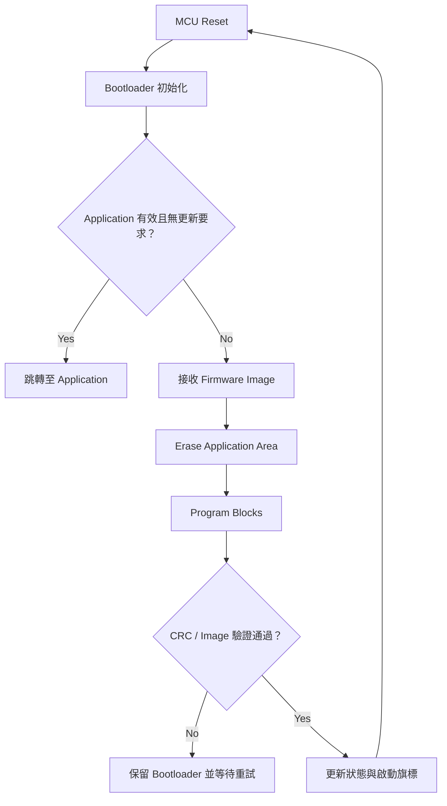

## CAN bus 更新：Tool / Host Bridge / Device

本節說明PC Tool、F24 (MCU CAN host) 與 F13 (MCU CAN device) Boot/App的責任邊界。
後續F24 (MCU CAN device) 是另一組Boot/App，不能與本頁F24 host的Bridge韌體混用。

[FirmwareUpgradeTool與MCU Bridge操作指南](../slide_isp_tool_for_RL78/)。
下方既有UART/I2C教材與CAN使用不同project/metadata，不能混用其BIN/CRC/layout。

### 外部 Device 更新與 Host 自身更新分開

FirmwareUpgradeTool以1366×768單畫面為目標，CAN／I2C共用BIN、metadata、CRC、
progress與log，主視窗不設上下捲軸；未來UART device也重用此console。
底部操作名稱／百分比維持單行，量測並預留100%寬度；
GDI字型／邊界測試已通過，真實更新畫面與桌面DPI仍待驗證。
CAN／I2C／Misc TAB只位於左側INTERFACE SETTINGS；中間SHARED IMAGE / METADATA
與右側SHARED LOG有獨立固定標題，不受TAB外框涵蓋，不另建BIN或log。
最後的Misc走PC→host UART，只更新HOST BRIDGE APP，不經CAN或I2C外部device。
Host須宣告self-update能力並提供live descriptor；BUR1 HOST APP BIN不可與F13 CAN
或舊UART／I2C教材的BIN互換。更新成功仍留boot，必須另按RUN才執行app。

F24 (MCU CAN host) bridge專案採20KiB boot／app0x5000，最後1KiB保留；首次需debugger安裝
matching boot `.mot`與app `*_flash.mot`，之後Misc載入`*_bridge_update.bin`。
分區、RAM RFD、IRQ／BRK與CRC保護已有build／mock檢查，實板擦寫／E2 lite／
掉電復原仍待驗證；不能把既有Transfer benchmark當成Boot/App更新成功。
完整操作、檔案用途及待補截圖見上方ISP操作指南。功能變更時同步MD與受影響web。

目前Host Link payload128／完整frame142，不支援舊96-host。F13 image format6與
F24 bridge contract3均固定metadata區為app offset0x100..0x1FF（256 bytes），
前128有效core、後128填0xFF；code起點維持offset0x200。首次導入時F13與F24
各自需要matching Boot/App；後續依live能力、metadata與IRQ契約判斷是否可只更新App。
Misc透過同一STAGE_METADATA command分四次64 bytes，RAM收齊／完整驗證後BEGIN才擦除；
READ_METADATA也分頁讀回，不把區域大小當成單包大小。有效core長度與區域容量分開定義。

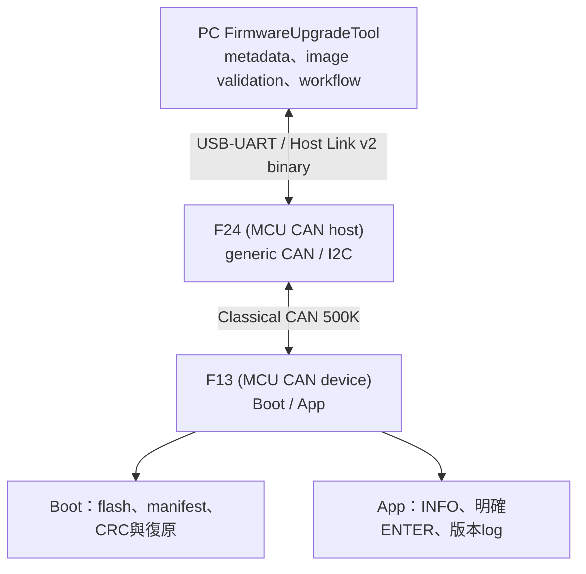

### CAN 責任與硬體基準

- Host只傳generic frame，不解讀F13 flash address，不驗app CRC。
- Device回報MCU/target、protocol、boot/app version、app start/capacity、erase unit、CAN能力。
- Tool依metadata匹配，不用MCU名稱猜layout；未來相同protocol的MCU不需新增專用layout profile。
- F24 (MCU CAN host) X1 20MHz → PLL80 → CPU/CAN40；CAN P10 TX/P11 RX/P12 STB。
- F13 (MCU CAN device) X1 4MHz → PLL/CPU32 → CAN16；不可抄F24 host clock。
- F13 EVB TJA1050T需5V；本次3.3V bus error改5V後Transfer正常。
- 各系列flash library、linker/vector、clock、pin、erase/write unit需依device設定。

| Workflow | CAN ID / DLC | 功能與證據範圍 |
|---|---|---|
| Bridge Board Self Test | STD0x123 / 8 | 每秒11 22 33 44 55 66 77 counter，啟動reset00；需active analyzer/ACK；不擦寫 |
| Custom Transfer v1 | STD0x710 / 0x711；8 | DEVICE_INFO、PING、ECHO、PATTERN、STATS；不載BIN；已有benchmark |
| CAN Upgrade v5 | control700／reply701；raw720..727；8 | INFO／ENTER／metadata／START／64-byte BLOCK／END／ABORT；v5速度與故障矩陣待板測 |

Upgrade ID來自本次metadata，不是所有MCU固定ID。
Tool baud dropdown經UART SET_CAN_CONFIG在stopped時修改bridge；target不會自動變速。

### 可變長度 app BIN 與 CRC32

120KiB只是目前128KiB F13、8KiB boot的app capacity，不是固定BIN長度。
32K/60K/80K/110K可用同一flow，仍須manifest minimum/capacity、4-byte alignment、
MCU/target/protocol、start、CAN能力与checksum符合。
若boot改16K或保留data區，boot/app metadata與linker須一致，不能只改tool。

App post-build依linker map實際loaded section end決定結尾、填manifest image-size，
末端4bytes寫CRC32（LE32）；CRC範圍不含這4bytes。不需每次新增60K/110K size define。
App Start Override Auto使用BIN metadata start；手動值須與image/device一致，不能重定位app。

### CAN 操作流程（Boot/App實板驗證待補）

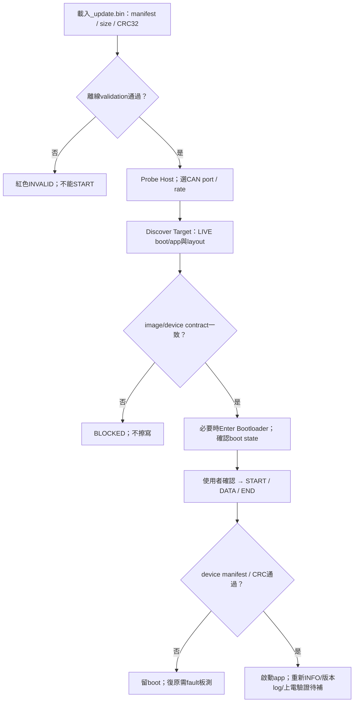

CRC32是完整性，不是簽章、認證或anti-rollback。
G16 I2C reference缺少active READ/auth/safe boot CRC/recovery，新tool保持不擦寫；
不能將下方其他UART/I2C範例當成新tool已完成其全部更新流程。

### F13 CAN device：所有 boot→app 條件、ENTER 與逾時

<!-- F13_BOOT_DECISION_BEGIN -->
本節僅適用目前 F13 (MCU CAN device) boot/app（format6／CAN protocol5），不是 F24 (MCU CAN host)
host bridge 的 Misc／RUN 規則，也不是既有 UART／I2C 教材的 boot contract。
依據 `r_main.c` 的 `application_is_valid`／`condition_check`／`boot_main`，以及
`can_boot_transport.c` 的 manifest、START、END 與 timeout 實作；是 source 核對，非新增實板驗證。

#### A. 每次 reset 的 app 有效性檢查：全部通過才可啟動

| 檢查 | 目前 F13 build 必須符合 |
| --- | --- |
| Reset entry | `0x2000` 的第一個 DWORD 不為 `0xFFFFFFFF`；只檢查非 erased，沒有完整反組譯／驗證跳轉目的地 |
| Metadata header | `0x2100` magic=`CAN3`；format6、core length128、flags=`0x0003`；protocol ID1／version5、checksum type1（CRC32）、target=`0xF13B`、Classical CAN／standard ID 格式全部匹配 |
| Metadata reserved | 整區256 bytes 中後128 bytes（`0x2180..0x21FF`）全部為 `0xFF` |
| Metadata policy | UPD1 version1／size32、DEVICE_APP、允許CAN、無未知transport bit、F1V1 IRQ ABI；minimum boot不高於目前boot；policy保留16 bytes全0 |
| Image size | manifest size 含尾端 CRC4 bytes，介於516與122880 bytes，且4-byte aligned |
| App version | 不可為 `0xFFFFFFFF`；不要求比舊版新，不是 anti-rollback |
| Flash layout | app start=`0x2000`、capacity=`0x1E000`、code Flash=`0x20000`、boot reserve=`0x2000`、erase=`0x400`、minimum=`0x204`，均等於 boot 編譯設定 |
| CAN contract | nominal mask=`0x04`（500K）、data mask=0、request ID=`0x700`、response ID=`0x701`，均等於 boot 編譯設定 |
| CRC32 | 對 `[app_start, app_start + image_size - 4)` 計算 CRC32，等於該 image 最後4 bytes 的 LE32 stored CRC |

Boot 現在也直接比對 MCU ASCII family／part，要求 build 已初始化，並檢查
UPD1更新政策、IRQ ABI與最低boot版本。PC仍須另作image/live device比對。
CRC是完整性，不是簽章或身分認證；最低boot版本不等於app防回滾。

#### B. ENTER marker 與啟動路徑

1. app 有效且沒有 ENTER marker：正常返回 startup，轉到 `0x2000` 的 app table。
2. app 收到 standard data ID=`0x700`、DLC1、data=`06` 的明確 ENTER request 時，
   先嘗試送 ACK（ID=`0x701`、DLC2、`06 00`），再將 `0xAA55AA55` 寫入
   no-init RAM `0xFF700`，最後 software reset。ACK 不是 reset 的可靠送達保證。
3. boot 看見 marker 後立即清除，表示本次先進入更新模式，不是永久鎖住 boot。
   P13.7／INTP0 不參與 boot decision，也不要求 tool 或 analyzer 必須在線才能正常開 app。
4. app 無效：禁止跳 app；CAN ready 時留 boot 等完整更新，clock／CAN 初始化失敗則
   software reset 重試，不能藉此放行無效 app。
5. app 有效但要求進 boot，而 clock／CAN 初始化失敗：目前實作會返回有效 app，
   不會永久卡 boot；CAN ready／FSL ready 不是所有正常啟動都必須通過的額外 gate。
6. 真正交接前關中斷，寫 `0xFF714` handoff signature、將 `0xFF710` ISR owner
   設為 app（`0x55`），startup 再 branch app table。這些是 boot 的輸出，不是額外外部啟動要求。

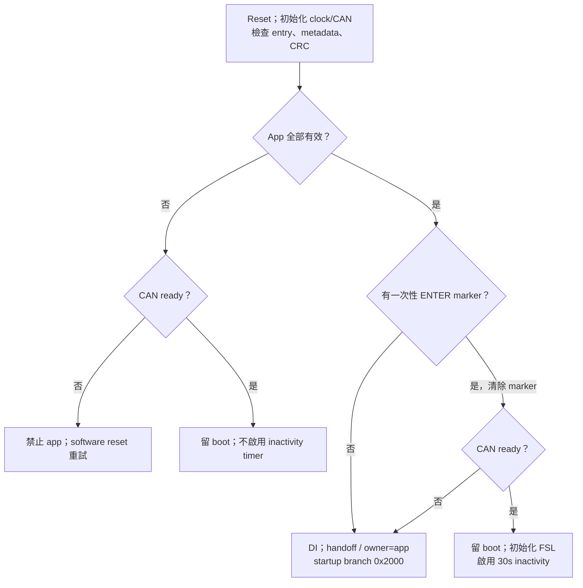

#### C. 30 秒 inactivity、START、失敗與更新成功

| 事件 | boot 的實際結果 |
| --- | --- |
| 原 app 有效、ENTER 後尚未接受 START | 連續30秒沒有符合底層接收條件的 CAN request，關閉已初始化的 FSL 後返回原 app |
| 持續 INFO／HELLO／其他符合接收條件的 frame | 都會刷新 inactivity；不是上電後固定30秒，也不是只由 DATA 刷新；未知 command／錯誤 DLC 也可能刷新 |
| 原 app 無效 | 從一開始不啟用 inactivity timer，接受 START 後也不會自動啟用；失聯仍留 boot 等重試 |
| START 被拒絕（protocol／target／size／FSL not ready） | 沒有進入 started state；不能把這個拒絕當成 app 已被擦寫；原 app 有效且 timer 啟用時仍可 inactivity 返回 |
| START 已接受後 inactivity 到期 | 若本次 timer 原本啟用，回 session-timeout error、留 boot、關閉後續自動返回；不跳可能只有部分內容的 app |
| ABORT／erase-write error／END metadata 或 CRC error | error 返回主迴圈，關閉後續自動返回，留 boot 等新 session；ABORT 即使在 START 前也走這條留 boot 路徑 |
| END 長度／state 尚不完整 | 回錯誤但保留 session；不得先宣布成功或跳 app |
| END 收齊、metadata size 等於 START size、Flash metadata 與 CRC 正確 | ACK 成功，關閉 FSL，寫 `0xFF718` update-complete marker，再 software reset；下次 reset 重新通過 A 節與 ENTER 判斷才進 app |
| 擦寫中掉電 | 下次上電重新跑 A 節；若 image 仍有效且無 ENTER 則可啟動，否則留 boot；不是保證有雙映像回復 |

底層接收條件為standard／非RTR、ID700或720..727、DLC>0；通過即刷新timer，之後才
檢查 command。計時由1ms TMRJ0 IRQ 累加，Flash 操作關 IRQ 時不是嚴格的 wall-clock
30秒。timer 已停用或未啟用時，PC 失聯不能期待 target 自動 timeout／reset；tool 的
bounded wait／ABORT 不能取代供電、Flash、IRQ 與掉電的實板驗證。

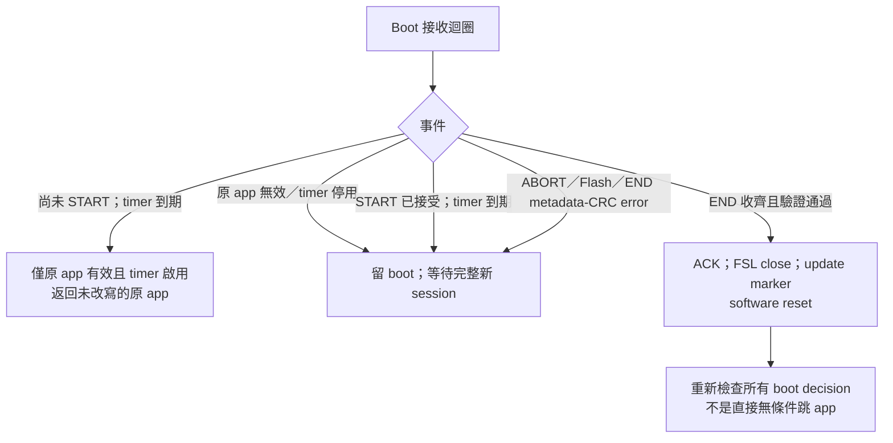
#### 固定完整 IRQ 介面：不同 app 專案沿用同一份 boot

F13 image format6／boot1.4.0 起，boot 固定擁有一般 vector 0x04..0x7C
的61個位置（包含保留位置，但 app 不可啟用保留 vector）。Reset 仍屬 boot；
0x02 保留，physical BRK 0x7E 不轉送，留給 debugger／device 設定。
App 的64個4-byte slot 固定在0x2000..0x20FF，公式是0x2000＋vector×2。

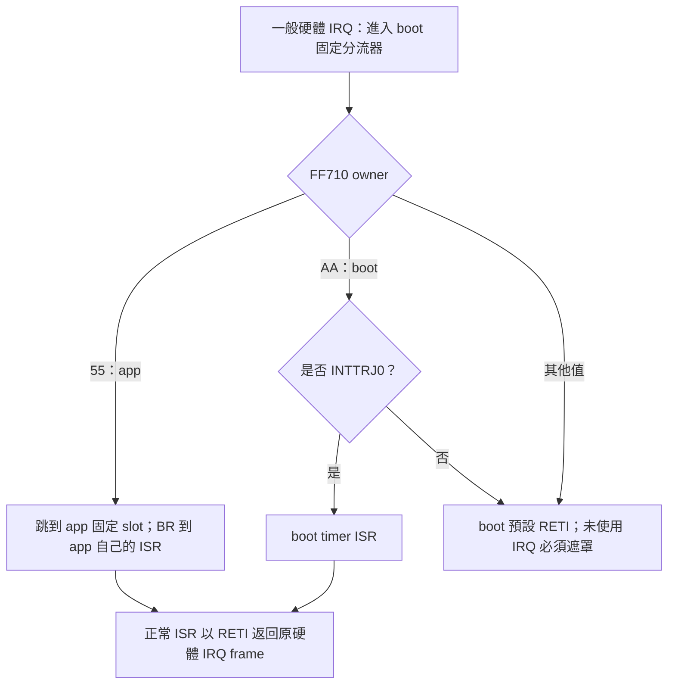

INTTRJ0 不再是普通 callback，與其他 app ISR 一樣使用無 vect 的 interrupt
pragma、以 RETI 返回。Boot 內部的 CALL／RET 僅用於壓縮組語分流，先移除
自己的暫存 call frame 再交給 ISR，並不是 C ISR 呼叫另一個 ISR。
分流暫存額外使用10 bytes stack，恢復 AX／HL／ES，原硬體 PC20／PSW frame
保持完整；未採用在分流期間重新 EI 的巢狀模式。

加入 app IRQ 只需：新增非 static ISR、在 app_irq_handlers.json 設定實體 vector
與函式名、將來源加入 app MTPJ、在 EI 前初始化／清旗標／設定優先權與解除遮罩。
App pre-build 會驗證 pragma 並產生 app_irq_table.inc；不要手改產物或 boot 向量。
未用 slot 指向 app 預設 RETI，不再是FFFFFFFF；預設返回不替你清除硬體原因，
所以不能把未處理的 IRQ 打開，否則可能反覆進中斷。

不同 app 專案可共用 boot 的前提：相同 R5F10BMG、8KiB boot／app2000、
完整跳轉表、FF700 recovery 與 FF710..FF71F no-init／stack 保留、startup 與
4MHz／PLL32／CAN16 交接、format6 的256-byte metadata／CRC32，以及
CAN protocol5／ID700與701。App 版本／build 由自己的 app_image.json 產生 ftable.inc／identity，
不綁定 boot 的編譯版本；若仍需 Tool 從 app ENTER 回 boot，該 app 必須實作
INFO／ENTER 與相同 reset request，不能只加入向量表。

**本次需先以燒錄器安裝 matching format6 boot＋app 一次。** 舊 format4 的
callback app 與新 RETI boot 不相容，即使 CRC 正確也拒絕；以後在上述契約內
換 app 專案、新增一般 IRQ 或改 app 版本，只更新 app，不需重燒 boot。
若改 MCU、分區、共用 RAM、boot 本身使用的 IRQ／更新通訊或 metadata ABI，
仍須評估並重新安裝 boot。完整向量不代表所有周邊已初始化。

F24 與 F13 現在採相同 app-facing 原則：boot 持有固定完整一般向量、依 owner
轉送 app slot、app ISR 都是 RETI。F24 用各向量直接分支；F13 為維持8KiB
boot 以共用組語分流節省 ROM，實作不同但 app 不再有 callback 特例。
目前軟體建置／HEX與stack模型檢查可執行；實板新增IRQ、E2 lite、update/reset
及斷電回復仍需驗證，不能把模型結果視為硬體通過。
<!-- F13_BOOT_DECISION_END -->

<!-- F24_APP_IRQ_BEGIN -->
### F24 (MCU CAN host)：各 app 專案獨立產表，沿用同一份 boot

本節為F24 (MCU CAN host) 的Bridge Boot/App；其自身App由Misc／UART更新。
F13 (MCU CAN device) 為CAN另一端的更新對象；後續F24 (MCU CAN device) 須使用另一組Boot/App。

Boot 固定轉送一般 IRQ 到 app start＋實體 vector×2；app 的64個4-byte slot
固定佔用 offset000h..0FFh。各專案決定 slot 要跳到哪個函式，boot 不認識
aaa_irq／ccc_irq 等 app 名稱。這項流程不改 UART boot、分區或 BUR1 contract3。

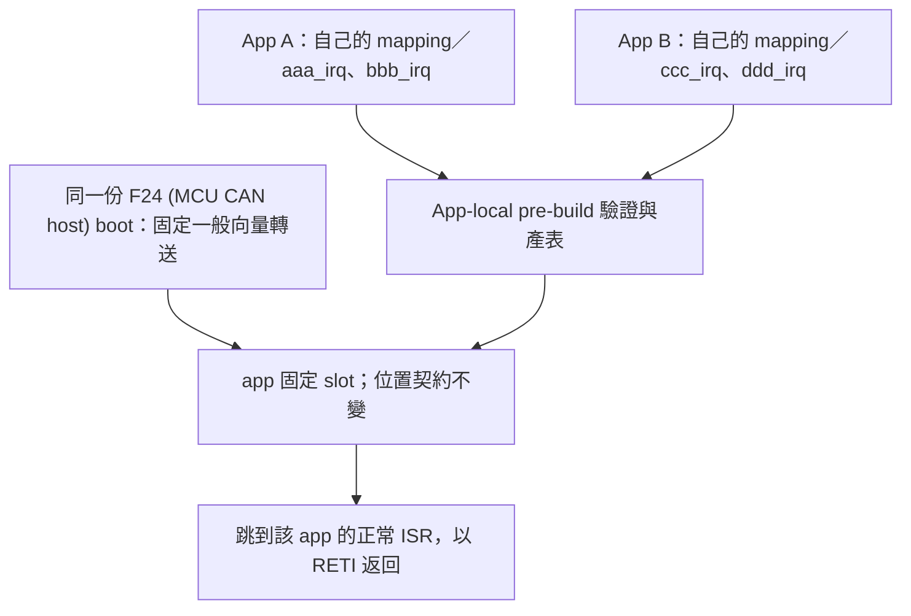

工程只保留兩個產品：Bridge_boot 是唯一 Boot；Bridge_app 是唯一正常 App。
f24_board 提供共用 board／driver／SC，不是第三份可燒錄韌體。
App 的 main、Host Link dispatch、CAN service 已回到 App 自己的目錄；
共用 UART／timer 僅依賴 f24_runtime_hooks.h，由 Boot／App 分別實作。
可攜式 I2C staging 在 common；分區／BUR1 支援在 f24_bridge_common。

SC 唯一設定為 firmware/f24_board/f24_board.scfg，輸出為同目錄 src/smc_gen。
搬移工作目錄後先執行 prepare_f24_bridge_projects.ps1 -Kind app 更新 SC 路徑，
由 App MTPJ 開啟並核對輸出位置。重產後再 prepare -Kind app、build App；
僅 Boot 自己的硬體設定改變才另行 prepare -Kind boot、build Boot。
prepare 讀取各自既有 MTPJ，保留 build options／hook 與 App JSON，不再複製第三個專案。
SC 新位置的 GUI 重產仍待操作確認；目前已驗證現有設定、來源與乾淨編譯。

每個 app 根目錄保存兩份來源：app_irq_handlers.json 對應實體 vector 與
函式名；app_image.json 保存自己的 packed version／build。產生的
bridge_vectors.asm 與 f24_app_identity.generated.h 不可手改；版本同時用於
Host Link 回報及 BIN metadata，不必修改共用 boot layout header。

```json
{"0x08":"aaa_irq","0x0A":"bbb_irq"}
```

上例只展示新增 IRQ；從 bridge 範例建立專案時，必須保留仍有使用的 UART／
timer／CAN／I2C mapping，不可用這兩筆覆蓋必要的清單。B 專案可改用其他合法
vector／函式名。來源需加入該 app MTPJ；ISR 必須 global、非 static、正常
interrupt pragma 且無 vect=，函式定義為 void handler(void)，以 RETI 返回。
未用的 IRQ 必須停用或遮罩，預設 RETI 不會替你清除周邊原因。

整合順序：

1. 以已整合的 F24 split app 為範本，建立自己的 app 專案；每個資料夾一份
   MTPJ。保留 R7F124FLJ3xFB、BRIDGE_SPLIT_APP、startup／4KiB stack／
   FF700與FF710保留、app5000／code5200／末1KiB保護等契約。不是任意
   standalone 專案加入 JSON 就能完成整合。
2. 複製專案時一併保留自己的全部 App .c／.h、generated_projection、兩份 JSON
   及 bridge_vectors.asm 的專案登錄。若移到不同目錄，先在 CS+ 修正相對
   source／include／library／preinclude 路徑；不要重新產生或覆寫共用 boot。
3. CS+ pre-build 呼叫 prepare_f24_app_irq.ps1 -AppProject "."；post-build
   呼叫 package_f24_bridge.ps1 -Kind app -AppProject "."。腳本路徑指向
   tool 的 scripts，跨目錄專案請使用正確完整路徑；不要呼叫雙專案 prepare。
4. 登錄各 app 自己的 ISR、修改 mapping／app_image.json 後，只執行：

```powershell
.\scripts\build_f24_bridge.ps1 -Kind app -AppProject ".\ProjectA"
.\scripts\build_f24_bridge.ps1 -Kind app -AppProject ".\ProjectB"
```

也可從 CS+ clean rebuild，hook 會自動執行。只驗證產物是否最新使用
prepare_f24_app_irq.ps1 -AppProject 專案路徑 -CheckOnly，不會寫檔。
產表不讀其他 app 的 IRQ 清單；build 的 -AppProject 與 -Prepare 不可併用，
避免誤重建參考專案。App-only 操作不產生／編譯／寫入 boot。

封裝依各 MTPJ 檔名找 DefaultBuild 下的 map／MOT，輸出各自的
專案名_bridge_update.bin／專案名_flash.mot。除原本分區、stack、flash/RAM、
metadata／CRC 檢查，還逐 slot 比對實際 branch 與 mapping，核對 ISR 的
真實 RETI／保留 BRK slot 的 RETB。Physical BRK 仍不轉送。Build 失敗時
舊 BIN 可能仍保留，不得把前次產物當成這次成功輸出。

本輪 A／B 實際 CC-RL 編譯與封裝、不同 mapping／版本、輸入拒絕及 boot
向量／MTPJ／MOT 雜湊隔離測試通過；測試沒有啟用新 IRQ，也沒有燒錄 MCU。
先安裝policy contract3 matching boot/app；之後相容的app-only IRQ改動不需重燒boot。
CAN區塊更新需要bridge宣告泛用CAN burst22／bit12，以live能力判斷，不以版號猜測。
已有相容Boot時，可用Misc115200更新App。實板只換 app、新舊 IRQ／UART ENTER、reset／斷電
與 E2 lite 仍待驗證。
F13 保留既有 app-local mapping 流程；未新增 F13 I2C boot。

若舊F24 App重新連線時INFO成功、接著0x57回BAD_COMMAND，可能是外層分派
漏了READ_METADATA。應安裝包含完整metadata讀回支援的App，不可略過驗證。復原方式：

1. 關閉COM，按住實體SW1（P32，LOW），同時重置／重新上電，讓既有Boot留在recovery。
2. 開啟Tool，Host Baud115200，Open + Probe Host；確認live顯示BOOT。
3. Misc重新Load Update Image，選交付套件中與此Boot相容的_bridge_update.bin，確認metadata及CRC。
4. Update HOST APP成功後另按Run Validated Bridge App；再重新Probe並關閉／重開Tool確認實際App身分。

若Boot、分區與IRQ契約仍相容，不必重燒Boot。步驟為source／mock驗證，實板復測待補。
<!-- F24_APP_IRQ_END -->

## 既有 UART / I2C 內容索引

* Introduce boot code and app code modification for RL78 
  * In this section , use RL78 F24 as example  
  <br/>


* reference document 
  * How to set up boot code and app project
  [How to Divide Boot and Flash Areas](https://www.renesas.com/en/document/man/rl78-family-c-compiler-package-cc-rl-how-divide-boot-and-flash-areas?srsltid=AfmBOoopybLnK6nMIfwPclpX1SYJL0OfZ1ZD5o9odBLUk4F70ckFtVWd)
  document no. : R20UT3475EJ0300
  <br/>

  <a id="target_MCU_flash_type"></a>
  * How to know the MCU need use which flash library type (code flash)
  [RL78 FAMILY FLASH MEMORY REPROGRAMMING SOFTWARE INTRODUCTION](https://www.renesas.com/en/document/oth/rl78-family-flash-memory-reprogramming-software-introduction?r=488891)

    * RL78 F23/F24 : Renesas Flash Driver RL78 Type 02 (document no. : R20UT5009EJ0110)
    [Renesas Flash Driver RL78 Type 02](https://www.renesas.com/en/document/mat/renesas-flash-driver-rl78-type-02-users-manual-rl78f23-and-rl78f24)
    * RL78 G22/G23/G24 : Renesas Flash Driver RL78 Type 01
    * RL78 G15/G16 : Renesas Flash Sample Program Type 01
    * RL78 x1x : Flash Self Programming Library Type01
  <br/>

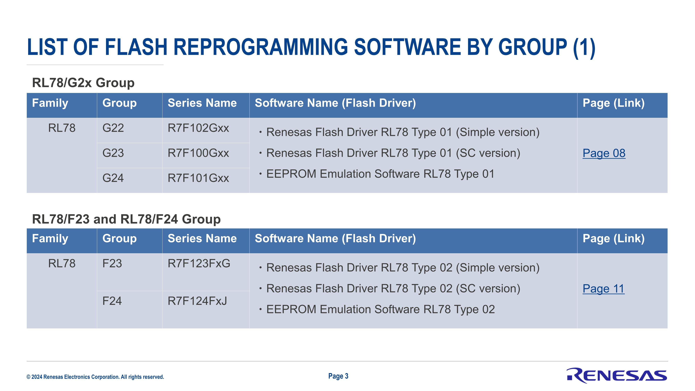
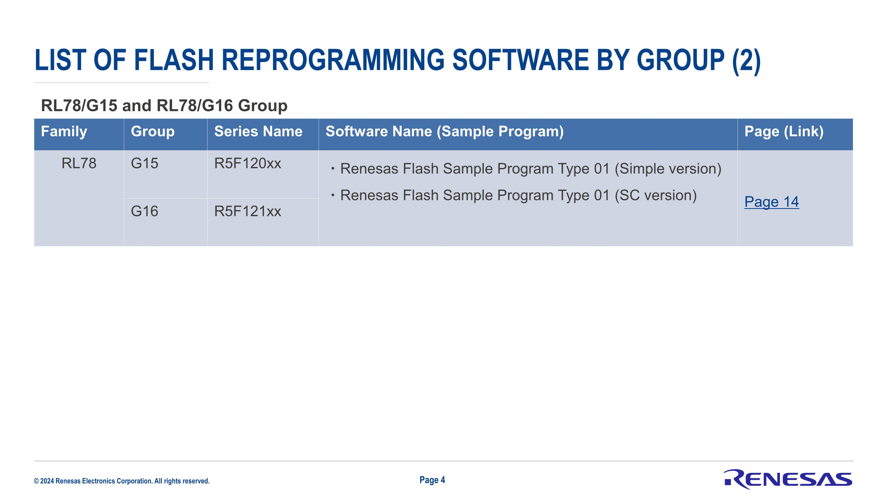
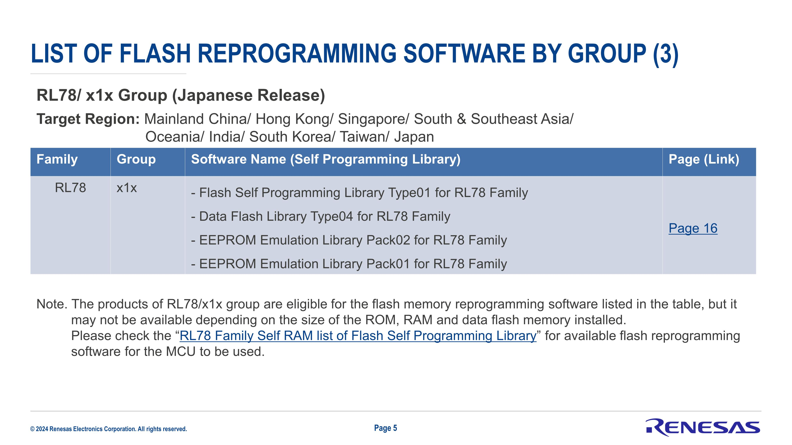
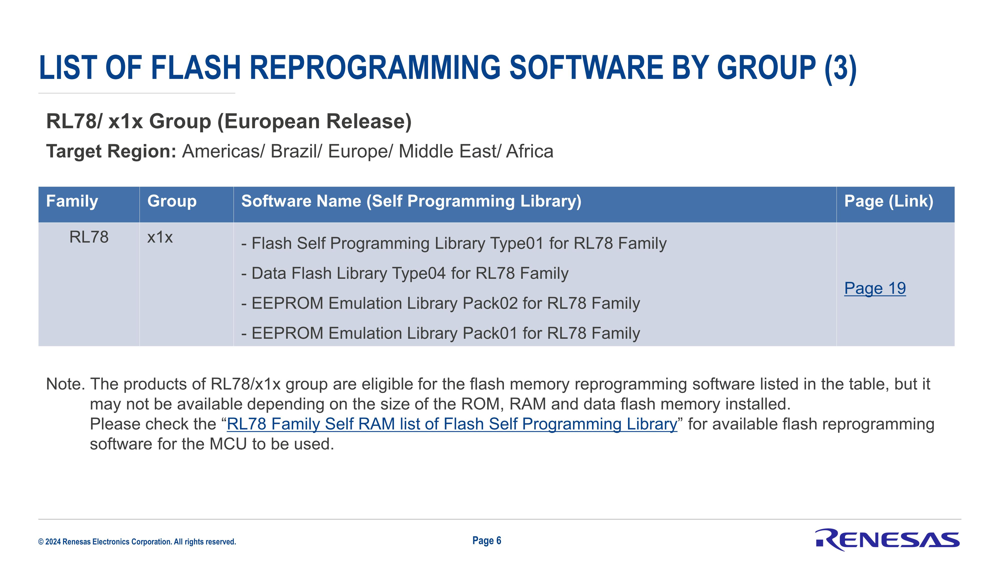
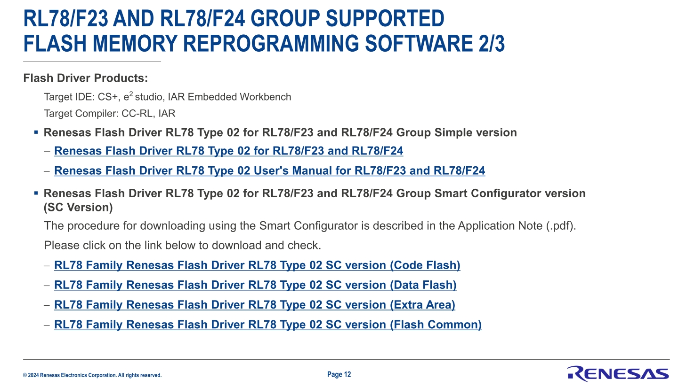

__code base : polling__
* reference code base : boot code (RL78 F24)
[RL78_F24_Boot_loader_UART](https://github.com/released/RL78_F24_Boot_loader_UART)
[RL78_F24_Boot_loader_UART_e2](https://github.com/released/RL78_F24_Boot_loader_UART_e2)
<br/>

* reference code base : app code (RL78 F24)
[RL78_F24_Boot_loader_app](https://github.com/released/RL78_F24_Boot_loader_app)
[RL78_F24_Boot_loader_app_e2](https://github.com/released/RL78_F24_Boot_loader_app_e2)
<br/>

  * interface : xmodem by UART (polling)
  * interface : IICA0 (polling)
  * LDROM address : 0x0000 , size : 20K
  * APROM address : 0x5000 , size : 236K (CRC addr:3FFFC)
  * check define as below 

```c
#define ENABLE_UART_BL                                  (1)
#define ENALBE_IICA0_BL                                 (0)
```

__code base : interrupt__
* reference code base : boot code (RL78 F24)
[RL78_F24_Boot_loader_UART_CRC](https://github.com/released/RL78_F24_Boot_loader_UART_CRC)
<br/>

* reference code base : app code (RL78 F24)
[RL78_F24_Boot_loader_app_CRC](https://github.com/released/RL78_F24_Boot_loader_app_CRC)
<br/>

  * interface : xmodem by UART (polling) + TIMER interrupt
  * interface : IICA0 (interrupt) + TIMER interrupt
  * LDROM address : 0x0000 , size : 20K
  * APROM address : 0x5000 , size : 235K (CRC addr:3FBFC)
  * check define as below 

```c
#define ENABLE_UART_PRINTF                      (1)
#define ENABLE_UART_BL                          (1)

#define ENALBE_TIMER_TAU0_1_IRQ                 (1)

#define ENALBE_IICA0_BL                         (0)
#if ENALBE_IICA0_BL
#define ENALBE_IICA0_BL_USE_IRQ                 (1)
#endif
```


__code base : interrupt with hardware CRC__
* reference code base : boot code (RL78 F24)
[RL78_F24_Boot_loader_UART_HW_CRC](https://github.com/released/RL78_F24_Boot_loader_UART_HW_CRC)
<br/>

* reference code base : app code (RL78 F24)
[RL78_F24_Boot_loader_app_HW_CRC](https://github.com/released/RL78_F24_Boot_loader_app_HW_CRC)
<br/>

  * interface : xmodem by UART (polling) + TIMER interrupt
  * interface : IICA0 (interrupt) + TIMER interrupt
  * LDROM address : 0x0000 , size : 20K (0x5000)
  * APROM address : 0x5000 , size : 235K (CRC addr:3FBFB)

refer to document :
[RL78 Family RL78 Hardware CRC Functions (R01AN3530EU0110)](https://www.renesas.com/en/document/apn/rl78-family-rl78-hardware-crc-functions?queryID=f29102cd30aa1ffab265983af4afc4fe)

download sample code :
[RL78 Family RL78 Hardware CRC Functions (R01AN3530EU0110)](https://www.renesas.com/en/document/scd/rl78-family-rl78-hardware-crc-functions?queryID=f29102cd30aa1ffab265983af4afc4fe)

<span style="color:#FF0000">
<b><u>Key point</b></u><br><br>
</span> 

* project setting for boot code and app code 
* target MCU platform flash library usage and setting
* target interface initial and receive data 


---

# Flash architecture

MCU flash will split to Boot area (boot code) and Flash area (app code)

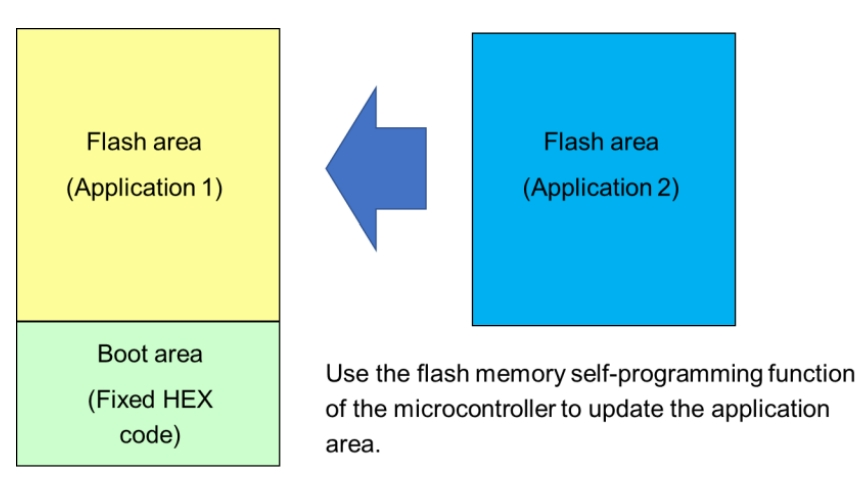


<u>How to Divide Boot and Flash Areas</u>

---

# Scenario : Boot area (boot code)

* use UART0 : P15/TX , P16/RX , to check terminal log meesgae
* __condition_check__ : 
  * detect ==flag== store in ram specific area (ex : 0xFF700) , to determine if re-boot from Flash area (app code) 
  * if no app code in app section

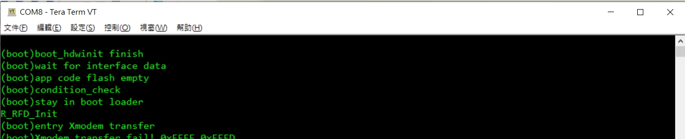

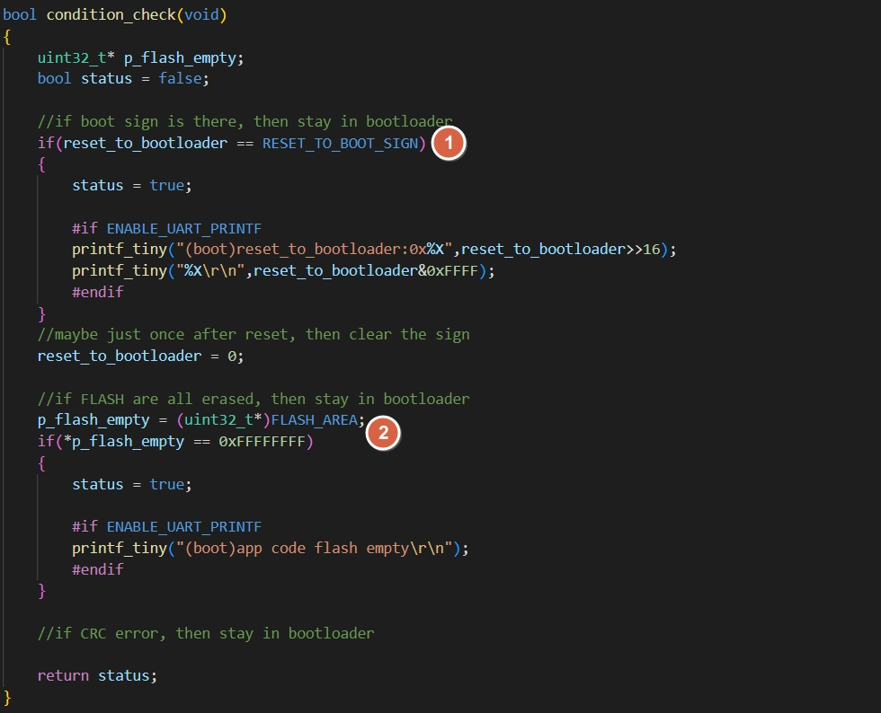


  * base on the ==flag== or ==BUTTON presssed (active LOW)== , to determine 
    * need to stay in boot code , to receive data flow from interface (ex : I2C , UART , ...) 
    * ready to jump into Flash area (app code)


* __verify_application_chksum__ : 
  * compare CRC checksum when power on 
  * at Flash area (app code) last 4 bytes , will store ==CRC data==
  * calculate the Flash area (app code) CRC byte (==caculate_crc32_checksum==) and compare to the CRC data store in last 4 bytes of Flash area (app code)
  * if comapare error , stay in Boot area (boot code) 

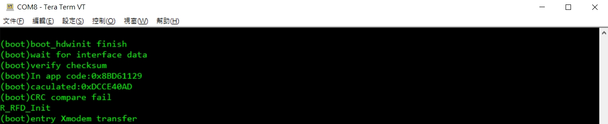

* any other custom user defined condition

* __programming Flash area (app code) flow__
  * refer the code flash sample function : Sample_CodeFlashControl and modify as : 
    * ==Sample_CodeFlashControl_Erase==
    * ==Sample_CodeFlashControl_SingleWrite==
    * __KEY POINT : SAMPLE_START_SECTION_SMP_CF__
  * after Flash area (app code) update finish , 
    * UART (xmodem , UART1 : P74/TX , P75/RX) : reboot MCU 
    * I2C (IICA0 , P62/SCL , P63/SDA): reboot MCU

xmodem
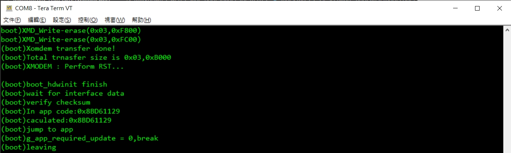

I2C
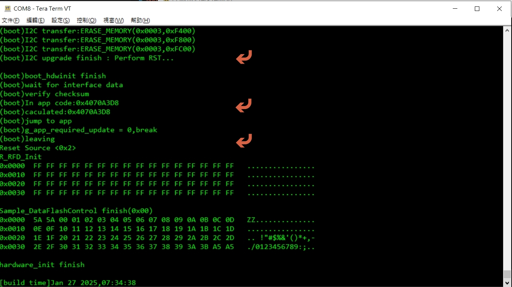

  * if CRC compare OK and no detect update inquiry , jump to Flash area (app code)

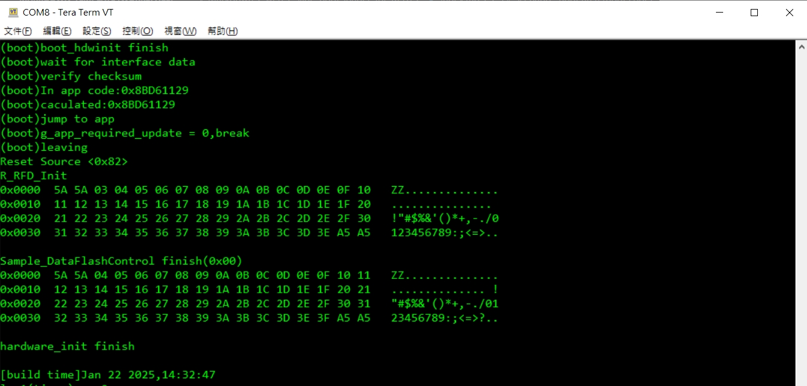

* at project:RL78_F24_Boot_loader_UART_CRC , add timer to control reset flow
  * when entry boot code in upgrade process , count down to 30 sec and execute reboot MCU if no receive data from interface (XMODEM , IICA0)

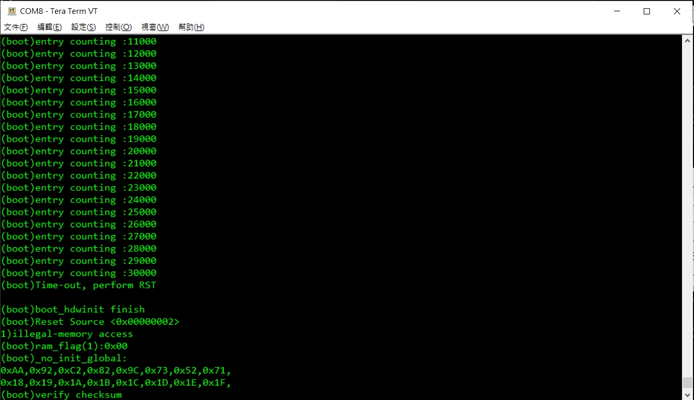

---

<a id="ram_flag"></a>

# Scenario : Flash area (app code)

* set ==ram flag== store in ram specific area (ex : 0xFF700) 
  * change flag data and execute reset , when
    * receive interface boot command (ex : I2C , UART , ...) 

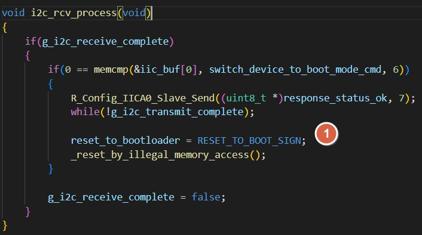
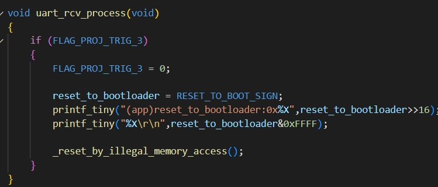

  * any other custom user defined condition (ex : ADC , GPIO etc)
  * use terminal (UART0 : P15/TX , P16/RX) , by press ==digit 3== ,to set ram flag and reset

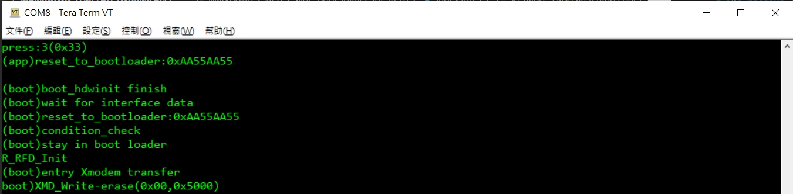

* by press ==digit 1== to write data flash 
* by press ==digit 2== to read data flash

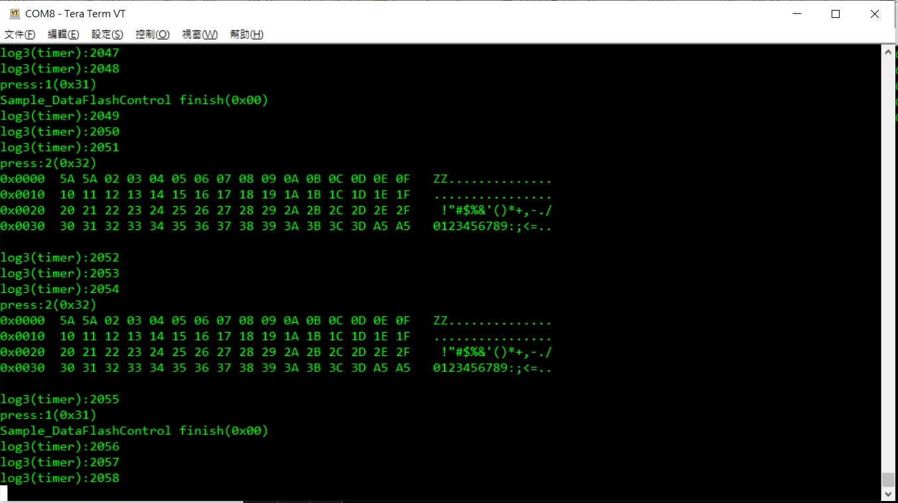

* at Flash area (app code) last 4 bytes , will add ==CRC data== after ==project compile finish==

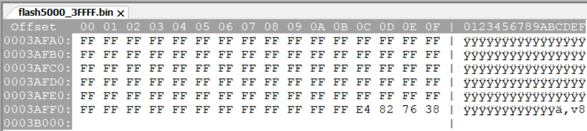

---

# Project : boot code/app code modifictaion - ftable.inc

<a id="FALSH_TABLE"></a>
<a id="ftable_inc"></a>
* ==create and register== below file in __Boot area (boot code)__ and __Flash area (app code)__ project

* ftable.inc 

```c
FLASH_TABLE       .EQU  0x5000 
INTERRUPT_OFFSET  .EQU  0x100 
```
<br/>

<a id="map_const"></a>
* the vaule will be ==boot code size (app code start address)==
* Due to mirror memory limitations, constant data cannot exist before mirror address - 0xF0000 (ex : 0xF5000 - 0xF0000 = 0x5000)
* below is each RL78 platform minimum boot code code size definition , FLASH_TABLE ==MUST set bigger or equal to== definition

| RL78 | const size |
|:--:|:--:|
| F24  | 0x5000 |
| F23  | 0x3000 |
| F13  | 0x2000 | 
| G15  | 0x800 |
| G16  | 0x800 |

* below is default project map file after compile

**RL78 F24**
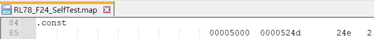
**RL78 F23**
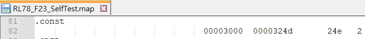
**RL78 F13**
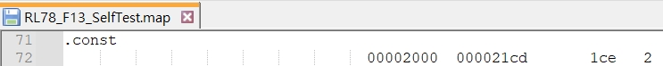
**RL78 G15**
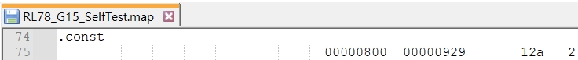
**RL78 G16**
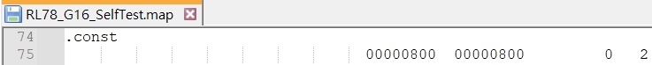

<u>How to Divide Boot and Flash Areas</u>

---

# Project : boot code modifictaion - cstart.asm

refer to How to Divide Boot and Flash Areas :
__3.1.1  Modifying the startup routine (cstart.asm)__

* use smart config generate code
* ==copy== cstart.asm to boot code project root folder
* ==register== to Boot area (boot code) project , then start to ==modify==

(1) 
include [ftable.inc](#ftable_inc)

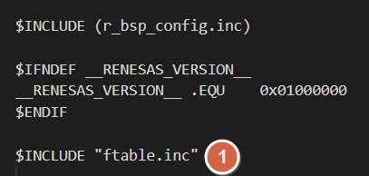

(2)
comment out conditional check

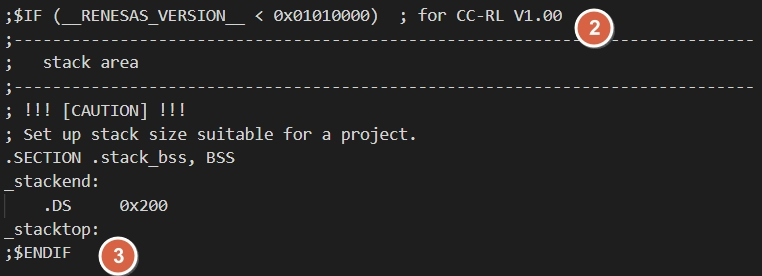

(3)
modify the section name

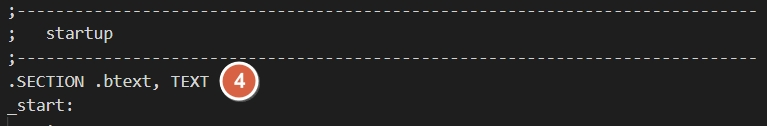

(4)
comment out conditional check and assembly instructions

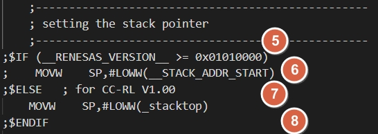

(5)
modify main function name (__boot_main__) <a id="boot_main"></a>
add branch instructions : [FALSH_TABLE](#FALSH_TABLE)

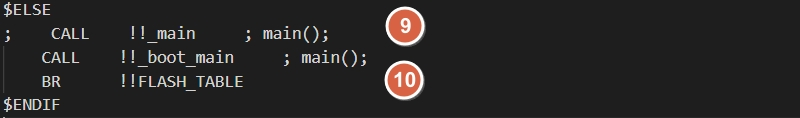

(6)
comment out .const section

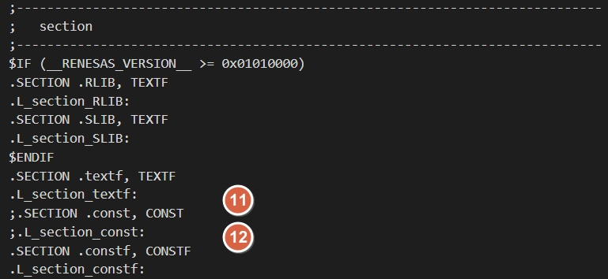

(7)
modify bsp_init_system function name

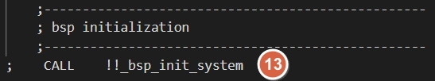

(8)
modify hardware init function name (__boot_hdwinit__) <a id="boot_hdwinit"></a>

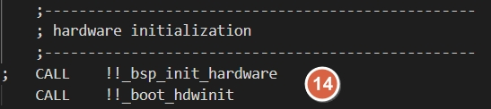

(9)
increase bss size to 0x500

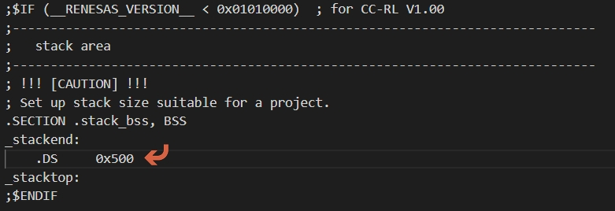
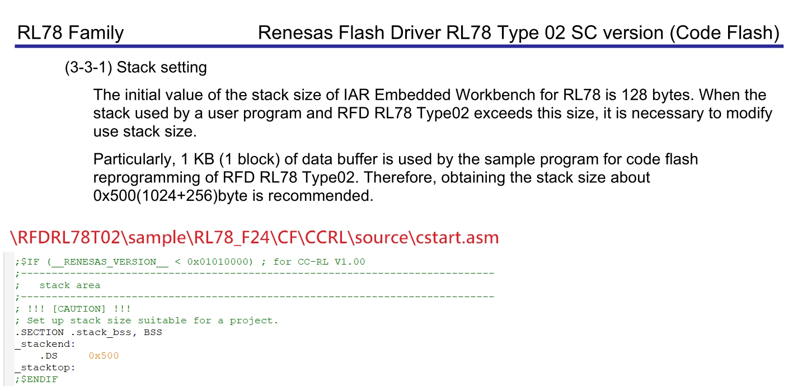

(10)
add ram flag section

```c
  .SECTION .boot_info, BSS
  .L_section_boot_info:
```

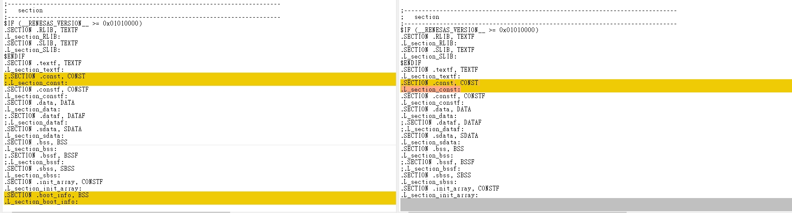

(11)
add ==code flash library section==

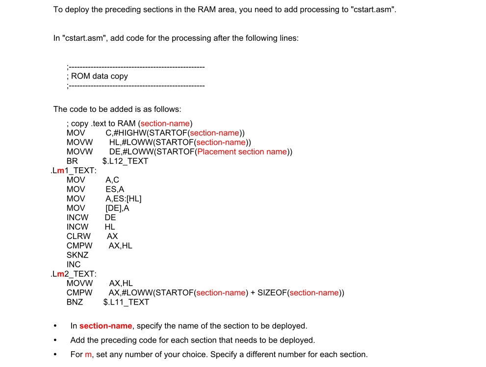

```c
  .SECTION RFD_DATA_nR, DATA
  .SECTION RFD_CMN_fR, TEXTF
  .SECTION RFD_CF_fR, TEXTF
  .SECTION SMP_CMN_fR, TEXTF
  .SECTION SMP_CF_fR, TEXTF
```

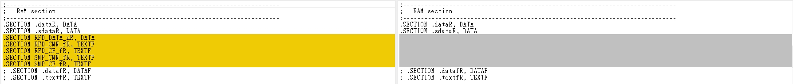

```c

	; copy RFD external variables having initial value (near)
	MOV	ES,#HIGHW(STARTOF(RFD_DATA_n))
	MOVW	BC,#LOWW(SIZEOF(RFD_DATA_n))
	BR	$.L2_RFD_DATA
.L1_RFD_DATA:
	DECW	BC
	MOV	A,ES:LOWW(STARTOF(RFD_DATA_n))[BC]
	MOV	LOWW(STARTOF(RFD_DATA_nR))[BC],A
.L2_RFD_DATA:
	CLRW	AX
	CMPW	AX,BC
	BNZ	$.L1_RFD_DATA


	; copy code to RAM (RFD_CMN)
	MOV	C,#HIGHW(STARTOF(RFD_CMN_f))
	MOVW	HL,#LOWW(STARTOF(RFD_CMN_f))
	MOVW	DE,#LOWW(STARTOF(RFD_CMN_fR))
	BR	$.L12_TEXT
.L11_TEXT:
	MOV	A,C
	MOV	ES,A
	MOV	A,ES:[HL]
	MOV	[DE],A
	INCW	DE
	INCW	HL
	CLRW	AX
	CMPW	AX,HL
	SKNZ
	INC	C
.L12_TEXT:
	MOVW	AX,HL
	CMPW	AX,#LOWW(STARTOF(RFD_CMN_f) + SIZEOF(RFD_CMN_f))
	BNZ	$.L11_TEXT

	; copy code to RAM (RFD_CF)
	MOV	C,#HIGHW(STARTOF(RFD_CF_f))
	MOVW	HL,#LOWW(STARTOF(RFD_CF_f))
	MOVW	DE,#LOWW(STARTOF(RFD_CF_fR))
	BR	$.L22_TEXT
.L21_TEXT:
	MOV	A,C
	MOV	ES,A
	MOV	A,ES:[HL]
	MOV	[DE],A
	INCW	DE
	INCW	HL
	CLRW	AX
	CMPW	AX,HL
	SKNZ
	INC	C
.L22_TEXT:
	MOVW	AX,HL
	CMPW	AX,#LOWW(STARTOF(RFD_CF_f) + SIZEOF(RFD_CF_f))
	BNZ	$.L21_TEXT

	; copy code to RAM (SMP_CMN)
	MOV	C,#HIGHW(STARTOF(SMP_CMN_f))
	MOVW	HL,#LOWW(STARTOF(SMP_CMN_f))
	MOVW	DE,#LOWW(STARTOF(SMP_CMN_fR))
	BR	$.L32_TEXT
.L31_TEXT:
	MOV	A,C
	MOV	ES,A
	MOV	A,ES:[HL]
	MOV	[DE],A
	INCW	DE
	INCW	HL
	CLRW	AX
	CMPW	AX,HL
	SKNZ
	INC	C
.L32_TEXT:
	MOVW	AX,HL
	CMPW	AX,#LOWW(STARTOF(SMP_CMN_f) + SIZEOF(SMP_CMN_f))
	BNZ	$.L31_TEXT

	; copy code to RAM (SMP_CF)
	MOV	C,#HIGHW(STARTOF(SMP_CF_f))
	MOVW	HL,#LOWW(STARTOF(SMP_CF_f))
	MOVW	DE,#LOWW(STARTOF(SMP_CF_fR))
	BR	$.L42_TEXT
.L41_TEXT:
	MOV	A,C
	MOV	ES,A
	MOV	A,ES:[HL]
	MOV	[DE],A
	INCW	DE
	INCW	HL
	CLRW	AX
	CMPW	AX,HL
	SKNZ
	INC	C
.L42_TEXT:
	MOVW	AX,HL
	CMPW	AX,#LOWW(STARTOF(SMP_CF_f) + SIZEOF(SMP_CF_f))
	BNZ	$.L41_TEXT
```

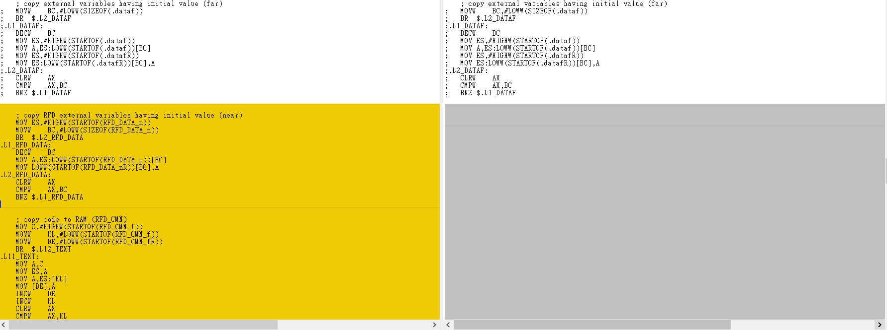


---

boot code : Compare below file to see the difference
after modification : 
RL78_F24_Boot_loader_UART\cstart.asm
https://github.com/released/RL78_F24_Boot_loader_UART/blob/main/cstart.asm

code flash : 
RL78_F24_Boot_loader_UART\RFDRL78T02\sample\RL78_F24\CF\CCRL\source\cstart.asm

smart configurator original file : 
RL78_F24_Boot_loader_UART\src\smc_gen\r_bsp\mcu\all\cstart.asm


<u>How to Divide Boot and Flash Areas</u>

---

# Project : boot code modifictaion - stkinit.asm

refer to How to Divide Boot and Flash Areas :
__3.1.2  Modifying hdwinit.asm and stkinit.asm__

* use smart config generate code 
* ==copy== stkinit.asm to boot code project root folder
* ==register== to Boot area (boot code) project , then start to ==modify==

- modify the section name


<u>How to Divide Boot and Flash Areas</u>

---

# Project : boot code modifictaion - project tree

* after modification , ==Boot area (boot code) project== will increse 3 files as below 


* make sure manual register ==cstart.asm , stkinit.asm== if file ==missing== after ==generate code==


<u>How to Divide Boot and Flash Areas</u>

---

# Project : boot code modifictaion - add CODE FLASH library

* base on [RL78 MCU](#target_MCU_flash_type)  , register correspond ==CODE FLASH library== into Boot area (boot code) project and exclude uncessary file (data flash , extra area)


---

* refer to RL78_F24_Boot_loader_UART\RFDRL78T02\sample\common\source\codeflash\sample_control_code_flash.c
* __KEY POINT : SAMPLE_START_SECTION_SMP_CF__

* __Sample_CodeFlashControl_Erase__

```c
R_RFD_FAR_FUNC e_sample_ret_t Sample_CodeFlashControl_Erase(uint32_t i_u32_start_addr)
{
    /* Local variable definition */
    e_rfd_ret_t    l_e_rfd_ret_status;
    e_sample_ret_t l_e_sam_ret_status;
    e_sample_ret_t l_e_sam_ret_value;
    bool           l_e_sam_error_flag;
    // uint16_t       l_u16_count;
    uint16_t       l_u16_block_number;
    // uint32_t       l_u32_check_write_data_addr;
    
    /* Set local variables */
    l_e_sam_ret_value           = SAMPLE_ENUM_RET_STS_OK;
    l_e_sam_error_flag          = false;
    
    /* This expression (actual block number) never exceeds the range of casting uint16_t */
    l_u16_block_number          = (uint16_t)(i_u32_start_addr >> SAMPLE_VALUE_U08_SHIFT_ADDR_TO_BLOCK_CF);
    // l_u32_check_write_data_addr = i_u32_start_addr;
    
    /******************************************************************************************************************
     * Set the code flash programming mode
     *****************************************************************************************************************/
    l_e_rfd_ret_status = R_RFD_SetFlashMemoryMode(R_RFD_ENUM_FLASH_MODE_CODE_PROGRAMMING);
    
    if (R_RFD_ENUM_RET_STS_OK != l_e_rfd_ret_status)
    {
        l_e_sam_error_flag = true;
        l_e_sam_ret_value  = SAMPLE_ENUM_RET_ERR_MODE_MISMATCHED;
    }
    else
    {
        /* No operation */
    }
    
    /******************************************************************************************************************
     * BLANKCHECK -> ERASE
     *****************************************************************************************************************/
    if (false == l_e_sam_error_flag)
    {
        /* BLANKCHECK (1 block) */
        R_RFD_BlankCheckCodeFlashReq(l_u16_block_number);
        l_e_sam_ret_status = Sample_CheckCFDFSeqEnd();
        
        if (SAMPLE_ENUM_RET_ERR_ACT_BLANKCHECK == l_e_sam_ret_status)
        {
            /* ERASE (1 block) */
            R_RFD_EraseCodeFlashReq(l_u16_block_number);
            l_e_sam_ret_status = Sample_CheckCFDFSeqEnd();
            
            if (SAMPLE_ENUM_RET_STS_OK != l_e_sam_ret_status)
            {
                l_e_sam_error_flag = true;
                l_e_sam_ret_value  = SAMPLE_ENUM_RET_ERR_CMD_ERASE;
            }
            else
            {
                /* No operation */
            }
        }
        else if (SAMPLE_ENUM_RET_STS_OK != l_e_sam_ret_status)
        {
            l_e_sam_error_flag = true;
            l_e_sam_ret_value  = SAMPLE_ENUM_RET_ERR_CMD_BLANKCHECK;
        }
        else
        {
            /* No operation */
        }
    }
    else /* true == l_e_sam_error_flag */
    {
        /* No operation */
    }
        
    /******************************************************************************************************************
     * Set non-programmable mode
     *****************************************************************************************************************/
    l_e_rfd_ret_status = R_RFD_SetFlashMemoryMode(R_RFD_ENUM_FLASH_MODE_CODE_TO_NONPROGRAMMABLE);
    
    if (R_RFD_ENUM_RET_STS_OK != l_e_rfd_ret_status)
    {
        l_e_sam_error_flag = true;
        l_e_sam_ret_value  = SAMPLE_ENUM_RET_ERR_MODE_MISMATCHED;
    }
    else
    {
        /* No operation */
    }
        
    return (l_e_sam_ret_value);
}
```

* __Sample_CodeFlashControl_SingleWrite__

```c
R_RFD_FAR_FUNC e_sample_ret_t Sample_CodeFlashControl_SingleWrite(uint32_t i_u32_start_addr,
                                                      uint8_t __near * inp_u08_write_data)
{
    /* Local variable definition */
    e_rfd_ret_t    l_e_rfd_ret_status;
    e_sample_ret_t l_e_sam_ret_status;
    e_sample_ret_t l_e_sam_ret_value;
    bool           l_e_sam_error_flag;
    uint16_t       l_u16_count = 0;
    // uint16_t       l_u16_block_number;
    // uint32_t       l_u32_check_write_data_addr;
    
    /* Set local variables */
    l_e_sam_ret_value           = SAMPLE_ENUM_RET_STS_OK;
    l_e_sam_error_flag          = false;
    
    /* This expression (actual block number) never exceeds the range of casting uint16_t */
    // l_u16_block_number          = (uint16_t)(i_u32_start_addr >> SAMPLE_VALUE_U08_SHIFT_ADDR_TO_BLOCK_CF);
    // l_u32_check_write_data_addr = i_u32_start_addr;
    
    /******************************************************************************************************************
     * Set the code flash programming mode
     *****************************************************************************************************************/
    l_e_rfd_ret_status = R_RFD_SetFlashMemoryMode(R_RFD_ENUM_FLASH_MODE_CODE_PROGRAMMING);
    
    if (R_RFD_ENUM_RET_STS_OK != l_e_rfd_ret_status)
    {
        l_e_sam_error_flag = true;
        l_e_sam_ret_value  = SAMPLE_ENUM_RET_ERR_MODE_MISMATCHED;
    }
    else
    {
        /* No operation */
    }
   
    /******************************************************************************************************************
     * WRITE
     *****************************************************************************************************************/
    if (false == l_e_sam_error_flag)
    {
        // for (l_u16_count = 0u; l_u16_count < i_u16_write_data_length; l_u16_count += 4u)
        {
            // R_RFD_WriteCodeFlashReq(i_u32_start_addr + l_u16_count, &inp_u08_write_data[l_u16_count]);
            R_RFD_WriteCodeFlashReq(i_u32_start_addr , &inp_u08_write_data[l_u16_count]);
            l_e_sam_ret_status = Sample_CheckCFDFSeqEnd();
            
            if (SAMPLE_ENUM_RET_STS_OK != l_e_sam_ret_status)
            {
                l_e_sam_error_flag = true;
                l_e_sam_ret_value  = SAMPLE_ENUM_RET_ERR_CMD_WRITE;
                // break;
            }
            else
            {
                /* No operation */
            }
        }
    }
    else /* true == l_e_sam_error_flag */
    {
        /* No operation */
    }
        
    /******************************************************************************************************************
     * Set non-programmable mode
     *****************************************************************************************************************/
    l_e_rfd_ret_status = R_RFD_SetFlashMemoryMode(R_RFD_ENUM_FLASH_MODE_CODE_TO_NONPROGRAMMABLE);
    
    if (R_RFD_ENUM_RET_STS_OK != l_e_rfd_ret_status)
    {
        l_e_sam_error_flag = true;
        l_e_sam_ret_value  = SAMPLE_ENUM_RET_ERR_MODE_MISMATCHED;
    }
    else
    {
        /* No operation */
    }
    
    return (l_e_sam_ret_value);
}


```

<u>Renesas Flash Driver RL78 Type 02 User’s  Manual</u>

---

# Project : boot code modifictaion - add CRC compare (1)

* register CRC compare into Boot area (boot code) project 
* purpose: 
  * condition check (check and compare app code CRC , prevent jump into corrupted app code)


---

# Project : boot code modifictaion - add CRC compare (2)

<br/>
<span style="color:#FF0000">
CRC in app code last 4 bytes will be added after compile at <b><u>app code project</u></b> by use SRecord tool<br/><br/>
</span>


---

# Project : boot code modifictaion - use smart config tool to generate driver

* use smart config to generate target interface drvier , to use in boot code project
  * make sure manual register ==cstart.asm , stkinit.asm== if file ==missing== after ==generate code==


* move those driver function into boot_main.c (to reduce boot code size and prevent duplicate function call in app code)
* exclude the driver code (c code , asm code)


---

* smart configurator system setting as below


---

# Project : boot code modifictaion - boot_main.c

* for boot_hdwinit() , will be initialized by [cstart.asm](#boot_hdwinit)
  * ==copy== below function from driver and ==rename== with prefix: ==boot_== in boot_main.c for boot_hdwinit
    * bsp_init_system() 
      * copy mcu_clock_setup()
    * R_Config_PORT_Create
    * if use UART for debug or download
      * R_SAU0_Create()
      * R_Config_UART0_Start()
      * R_SAU1_Create()
      * R_Config_UART1_Start()
    * R_Config_IICA0_Create()
    * R_Config_TAU0_0_Start , for delay function (1ms)
* for boot_main() , will start with condition check and judge if need to start programming

---

# Project : boot code modifictaion - I2C command flow

* No READ operation
* No Authentication operation


---

# Project : boot code modifictaion - I2C command flow (check_generic_boot_standard_interface)

(0) send initial byte (master)


(1) boot mode check command byte (master)


(1-1) check read status (master)


(2) device inquiry command packet (master)


(2-1) report status about device inquiry command packet (slave)


---

# Project : boot code modifictaion - I2C command flow (read_device_signature)

(3) obtain target device signature (master)


(3-1) report status about obtain target device signature (slave)


---

# Project : boot code modifictaion - I2C command flow (read_area_information)

(4) obtain target device signature  (master)


(4-1) report status about obtain target device signature  (slave)


---

# Project : boot code modifictaion - I2C command flow (start_device_image_transfer)

(5) erase user code flash area (master)


(5-1) report status about erase user code flash area (slave)


(6) initiate write user code flash area (master)


(6-1) report status about initiate write user code flash area (master)


---

# Project : boot code modifictaion - I2C command flow terminal operation (master & slave)

(1) log message at master : set target image 


(2) log message at master : check slave status


(3) log message at master : program binary to slave code flash


(4) log message at slave : erase (RL78 F24)


(5) log message at slave : programming finish (RL78 F24)


(6) code flow at slave : WriteCodeFlash (RL78 F24)


erase per page (1K bytes) , program per 4 bytes


---

# Project : boot code modifictaion - xmodem update flow

below is at xmodem update when g_app_required_update == 1


when trig update flow , will wait for xmodem from PC host


use teraterm , to send file under xmodem


when under transmit binary file


trasmit time , update RL78 F24 app code : 236K
* with boot code enable log message (xmodem.c , check debug3) , spent 41 sec

* without boot code enable log message (xmodem.c , check debug3) , spent 40 sec


when update app code finish


---

# Project : boot code property modifictaion - E2 lite setting


<u>CC-RL Compiler User's Manual</u>
<u>CS+ User’s Manual: CC-RL Build Tool Operation</u>


---

# Project : boot code property modifictaion - CC-RL Build Tool setting

**Common Options**

refer to How to Divide Boot and Flash Areas :
__3.2.5  Specifying hex file output only to the boot area address range__


* __[Frequently Used Options (for Hex Output)] > [Division output file]__
  * base on MCU (ex : RL78F24) , to set boot code ==start address and end address== as file name
* file size will be different if use other platform (ex : RL78 F13 , RL78 G16 , etc)
  * [map const define ?](#map_const)

```c
%BuildModeName%\boot0000_4FFF.hex=0000-4FFF
```

| RL78 | const size |
|:--:|:--:|
| F24  | 0x5000 |
| F23  | 0x3000 |
| F13  | 0x2000 | 
| G15  | 0x800 |
| G16  | 0x800 |

---


<a id="fsy_file"></a>
* __[Other] > [Commands executed after build processing]__
  * add : copy_fsy.bat
  * copy ==boot code project fsy== file to app code project root folder

```c
copy /y/v .\DefaultBuild\RL78_F24_Boot_loader_UART.fsy ..\RL78_F24_Boot_loader_app\
```


<u>How to Divide Boot and Flash Areas</u>
<u>CC-RL Compiler User's Manual</u>
<u>CS+ User’s Manual: CC-RL Build Tool Operation</u>

---

# Project : boot code property modifictaion - CC-RL Build Tool setting

**Compile Options**


<u>How to Divide Boot and Flash Areas</u>
<u>CC-RL Compiler User's Manual</u>
<u>CS+ User’s Manual: CC-RL Build Tool Operation</u>

---

# Project : boot code property modifictaion - CC-RL Build Tool setting

**Link Options**


* __[Device] > [Option byte values for OCD]__
  * set to ```A5```
  * default will be 0xFF

<br>

<br>

* __==important notice==__
  * [RL78/F24 Locked](https://en.na4.teamsupport.com/knowledgeBase/21225578)


* __[Output Code] > [Execute start address]__
  * will be called by cstart.asm
<br>

---
<a id="vect_address"></a>
* __[Output Code] > [Address setting for specified area for vector table]__
  * use vect_address.xlsx under boot code project , to copy shift address


  * entry editor and paste the shift address
  

  * the final result : 

<br>


---


* __[List] > [Ooutput link map file]__
  * select -SHow=ALL , will display the compile result (function , address) in map file for debug
  * map file under /DefaultBuild
  

* refer to document : 
  * How to Divide Boot and Flash Areas (R20UT3475EJ0300) 
    * __3.2.2  Specifying the section allocation__
  * Renesas Flash Driver RL78 Type 02 User’s  Manual (R20UT5009EJ0110) 
    * __6.1.3.3  Section Item Settings__
<br>

---


* __[Section] > [Section start address]__

  * set __Layout sections automatically__ to ==NO== 
  * entry editor and modify as below ( for code flash library ) 
  * flash area
  ```
  RFD_DATA_n 
  RFD_CMN_f 
  RFD_CF_f 
  SMP_CMN_f 
  SMP_CF_f 

  ```

  * ram area
  ```
  RFD_DATA_nR 
  RFD_CMN_fR 
  RFD_CF_fR
  SMP_CMN_fR 
  SMP_CF_fR  

  ```

  
<br>

* __[Section] > [Section that outputs external symbols to the file]__
  * entry editor and modify as below : 

  ```
  .constf
  .text
  .textf
  .bss
  .sbss
  .data
  .sdata
  .RLIB
  .SLIB  
  ```


<br>

* reserve SRAM flag 0xFF700 area [(ram flag)](#ram_flag) , to prevent initial when power on

* __[Section] > [ROM to RAM mapped section]__
  * entry editor and modify as below :

  ```
  .data=.dataR
  .sdata=.sdataR
  RFD_DATA_n=RFD_DATA_nR 
  RFD_CMN_f=RFD_CMN_fR 
  RFD_CF_f=RFD_CF_fR 
  SMP_CMN_f=SMP_CMN_fR 
  SMP_CF_f=SMP_CF_fR

  ``` 


  * set __Layout sections automatically__ to ==YES== 
  * the final result : 


<br>

---

* how do we know section address meaning


  * ==flash assignment after debug area==
    * 0x000F0 (RL78 F24 , F23)

---


  * ==ram assignment==
    * 0xF9F00 (RL78 F24)
    * 0xFCF00 (RL78 F23)


---


  * ==short direction address (.saddr) assignment==
    * 0xFFE20 (RL78 F24 , F23)


---

* in case of need to modify from RL78 F24 to RL78 F23 (code flash , data flash , extra area)
  * code flash
  
  * data flash
  
  * extra area
  
  * RAM
  
<br>

---


* __[Others] > [Display total size sections]__
  * select -Total_size , will display the section size in output window
  * display build code size in Output window


<u>How to Divide Boot and Flash Areas</u>
<u>CC-RL Compiler User's Manual</u>
<u>CS+ User’s Manual: CC-RL Build Tool Operation</u>
<u>Renesas Flash Driver RL78 Type 02 User’s  Manual</u>

---

# Project : boot code property modifictaion - CC-RL Build Tool setting

**Hex Output Options**

refer to How to Divide Boot and Flash Areas :
__3.2.5  Specifying hex file output only to the boot area address range__


* __[Output File] > [Division output file]__  
  * base on MCU (ex : RL78F24) , to set boot code ==start address and end address== as file name
* file size will be different if use other platform (ex : RL78 F13 , RL78 G16 , etc)
  * [map const define ?](#map_const)

```c
%BuildModeName%\boot0000_4FFF.hex=0000-4FFF
```

| RL78 | const size |
|:--:|:--:|
| F24  | 0x5000 |
| F23  | 0x3000 |
| F13  | 0x2000 | 
| G15  | 0x800 |
| G16  | 0x800 |

<br>

---


* __[Hex Format]__  
  * follow the setting of the picture 


<u>How to Divide Boot and Flash Areas</u>
<u>CC-RL Compiler User's Manual</u>
<u>CS+ User’s Manual: CC-RL Build Tool Operation</u>
<u>Renesas Flash Driver RL78 Type 02 User’s  Manual</u>

---

# Reference - RL78/F23, F24 User’s Manual: Hardware - Input Source List


---
<a id="vector_table"></a>
# Project : RL78/F23, F24 User’s Manual: Hardware - Vector Table


---

# Project : boot code/app code modifictaion - ftable.inc

<a id="FALSH_TABLE"></a>
<a id="ftable_inc"></a>
* ==create and register== below file in __Boot area (boot code)__ and __Flash area (app code)__ project

* ftable.inc 

```c
FLASH_TABLE       .EQU  0x5000 
INTERRUPT_OFFSET  .EQU  0x100 
```
<br/>

<a id="map_const"></a>
* the vaule will be ==boot code size (app code start address)==
* Due to mirror memory limitations, constant data cannot exist before mirror address - 0xF0000 (ex : 0xF5000 - 0xF0000 = 0x5000)
* below is each RL78 platform minimum boot code code size definition , FLASH_TABLE ==MUST set bigger or equal to== definition

| RL78 | const size |
|:--:|:--:|
| F24  | 0x5000 |
| F23  | 0x3000 |
| F13  | 0x2000 | 
| G15  | 0x800 |
| G16  | 0x800 |

* below is default project map file after compile

**RL78 F24**

**RL78 F23**

**RL78 F13**

**RL78 G15**

**RL78 G16**


<u>How to Divide Boot and Flash Areas</u>

---


# Project : app code modifictaion - cstart.asm

refer to How to Divide Boot and Flash Areas :
__4.1.1  Modifying the startup routine (cstart.asm)__

* use smart config generate code
* ==copy== cstart.asm to app code project root folder
* ==register== to Flash area (app code) project , then start to ==modify==

(1)
comment out conditional check


(2)
add ram flag section

```c
  .SECTION .boot_info, BSS
  .L_section_boot_info:
```


(3)
add ==data flash library section==

```c
  .SECTION RFD_DATA_nR, DATA
```


```c
	; copy RFD external variables having initial value (near)
	MOV	ES,#HIGHW(STARTOF(RFD_DATA_n))
	MOVW	BC,#LOWW(SIZEOF(RFD_DATA_n))
	BR	$.L2_RFD_DATA
.L1_RFD_DATA:
	DECW	BC
	MOV	A,ES:LOWW(STARTOF(RFD_DATA_n))[BC]
	MOV	LOWW(STARTOF(RFD_DATA_nR))[BC],A
.L2_RFD_DATA:
	CLRW	AX
	CMPW	AX,BC
	BNZ	$.L1_RFD_DATA

```


---

app code : Compare below file to see the difference
after modification : 
RL78_F24_Boot_loader_app\cstart.asm
https://github.com/released/RL78_F24_Boot_loader_app/blob/main/cstart.asm

data flash : 
RL78_F24_Boot_loader_app\RFDRL78T02\sample\RL78_F24\DF\CCRL\source\cstart.asm

smart configurator original file : 
RL78_F24_Boot_loader_app\src\smc_gen\r_bsp\mcu\all\cstart.asm


<u>How to Divide Boot and Flash Areas</u>

---

# Project : app code modifictaion - ftable.asm

refer to How to Divide Boot and Flash Areas :
__4.1.2  Creating a branch table program (ftable.asm)__

* create ftable and register interrupt (used in app code) in proper sequence
  * [vector table ?](#vector_table)


* ==register== ftable to Flash area (app code) project


* example 
  * in app code , use UART0 TX/RX , UART1 TX/RX , TAU0_1 , IICA0 interrupt
  * register these interrupt name with prefix !!_ 

```c
		.DB4    0xffffffff                      ; INTP13/INTCL	             	;0x0014
		 BR     !!_r_Config_UART0_interrupt_send	; INTST0/INTCSI00/INTIIC00  ;0x0016
		 BR     !!_r_Config_UART0_interrupt_receive	; INTSR0/INTCSI01/INTIIC01 	;0x0018
		.DB4    0xffffffff						; INTTRD0                       ;0x001A
    ...
		.DB4    0xffffffff					    ; INTLIN0STA/INTLIN0	        ;0x0026
		 BR     !!_r_Config_IICA0_interrupt	    ; INTIICA0 		                ;0x0028
		.DB4    0xffffffff                      ; INTP8/INTRTC                  ;0x002A
		.DB4    0xffffffff      				; INTTM00                     	;0x002C
		 BR     !!_r_Config_TAU0_1_interrupt    ; INTTM01                       ;0x002E
		.DB4    0xffffffff                	    ; INTTM02                       ;0x0030
    ...
		.DB4    0xffffffff                      ; INTP10/INTTM03H               ;0x003C
		 BR     !!_r_Config_UART1_interrupt_send	; INTST1/INTCSI10/INTIIC10      ;0x003E
		 BR     !!_r_Config_UART1_interrupt_receive	; INTSR1/INTCSI11/INTIIC11      ;0x0040
		.DB4    0xffffffff					    ; INTTM04                       ;0x0042

```

<u>How to Divide Boot and Flash Areas</u>

---

# Project : app code modifictaion - fsy file

refer to How to Divide Boot and Flash Areas :
__4.2.1  Registering the externally defined symbol file with the project__

* when boot code build finish , will copy fsy file into app code project 
  * [fsy file ?](#fsy_file)
* ==register== fsy file to Flash area (app code) project


<u>How to Divide Boot and Flash Areas</u>

---

# Project : app code modifictaion - project tree

* after modification , ==Flash area (app code) project== will increse 4 files as below 


---

# Project : app code modifictaion - add DATA FLASH library

* base on [RL78 MCU](#target_MCU_flash_type)  , register correspond ==DATA FLASH library== into Flash area (app code) project and exclude uncessary file (code flash , extra area)


---

# Project : app code modifictaion - use smart config tool to generate driver

* exclude the driver code (c code , asm code)


---

* smart configurator system setting as below


---


# Project : app code modifictaion -  remove static and vect define

refer to How to Divide Boot and Flash Areas :
__Do not specify the vector address (vect) with the #pragma interrupt directive in the flash area.__

* ==EVERY TIME== when use smart config tool to ==re-generate driver==
* need to ==remove static declaration== and ==comment on vect definition== in earch drvier ==Config_xxx_user.c==


<u>How to Divide Boot and Flash Areas</u>

---

# Project : app code modifictaion - main.c

* add [ram flag](#ram_flag) declaration

```c
#define RESET_TO_BOOT_SIGN 0xAA55AA55

#pragma address (reset_to_bootloader = 0x000FF700)
volatile uint32_t reset_to_bootloader;
#pragma address (_no_init_global = 0x000FF710)
unsigned char _no_init_global[RAM_FLAG_MAX];

```
below is map file result 


* add change flag data ==condition check== and execute reset

  * example : when receive change to boot mode command , modify the flag and reset MCU

```c
    if(g_i2c_receive_complete)
    {
        if(0 == memcmp(&iic_buf[0], switch_device_to_boot_mode_cmd, 6))
        {
            R_Config_IICA0_Slave_Send((uint8_t *)response_status_ok, 7);
            while(!g_i2c_transmit_complete);

            reset_to_bootloader = RESET_TO_BOOT_SIGN;
            _reset_by_illegal_memory_access();
        }

        g_i2c_receive_complete = false;
    }

```

```c
void uart_rcv_process(void)
{
    if (FLAG_PROJ_TRIG_3)
    {
        FLAG_PROJ_TRIG_3 = 0;

        reset_to_bootloader = RESET_TO_BOOT_SIGN;
        printf_tiny("(app)reset_to_bootloader:0x%X",reset_to_bootloader>>16);
        printf_tiny("%X\r\n",reset_to_bootloader&0xFFFF);

        _reset_by_illegal_memory_access();        
    }
}
```

---
# Project : app code property modifictaion - E2 lite setting


<u>CC-RL Compiler User's Manual</u>
<u>CS+ User’s Manual: CC-RL Build Tool Operation</u>

---

# Project : app code property modifictaion - CC-RL Build Tool setting

**Common Options**

refer to How to Divide Boot and Flash Areas :
__4.2.3  Specifying hex file output only to the flash area address range__


* __[Frequently Used Options (for Hex Output)] > [Division output file]__
  * base on MCU (ex : RL78F24 , 256K flash) , to ==app code start address and end address== as file name
* file size will be different if use other platform (ex : RL78 F13 , RL78 G16 , etc)
  * [map const define ?](#map_const)

```c
%BuildModeName%\flash5000_3FFFF.hex=5000-3FFFF
```


---


* __[Other] > [Commands executed after build processing]__
  * add : boot_flash.bat , for RL78 F24 (256K)
  * use srecord tool , do action as below
    * save app code hex to back hex file
      * 1backupHex.cmd
    * base on app code hex , generate CRC
      * 2generateChecksum.cmd
    * base on app code hex (w/ CRC) , generate CRC into hex
      * 3generateCRCHex.cmd
    * covert app code hex (w/ CRC) to app code bin
      * 4generateCRCBin.cmd
    * base on app code hex (w/ CRC) , to over lap original hex
      * 5generateCRCHexOverlap.cmd
    * combine boot code and app code
      * 6generateBootAppHex.cmd
    * covert boot/app code hex (w/ CRC) to boot/app code bin
      * 7generateBootAppBin.cmd

<br>

__1backupHex.cmd__
```c
# input file
.\DefaultBuild\flash5000_3FFFF.hex -Intel

-crop 0x005000 0x40000

# produce the output file
-Output
.\DefaultBuild\flash5000_3FFFF_backup.hex -Intel

```

<br>

__2generateChecksum.cmd__
```c
# input file
.\DefaultBuild\flash5000_3FFFF.hex -Intel

-crop 0x5000 0x3FFFC

-crc32-l-e 0x3FFFC		

-crop 0x3FFFC 0x40000
											
-Output 
- 
-HEX_Dump

```

<br>

__3generateCRCHex.cmd__
```c

# input file
.\DefaultBuild\flash5000_3FFFF.hex -Intel

-crop 0x5000 0x3FFFC

-crc32-l-e 0x3FFFC

-Output
.\DefaultBuild\flash5000_3FFFF_CRC.hex -Intel

```

<br>

__4generateCRCBin.cmd__
```c

# input file
.\DefaultBuild\flash5000_3FFFF_CRC.hex -Intel

-crop 0x005000 0x40000 -offset -0x005000

# produce the output file
-Output
.\DefaultBuild\flash5000_3FFFF.bin -binary

```

<br>

__5generateCRCHexOverlap.cmd__
```c

# input file
.\DefaultBuild\flash5000_3FFFF_CRC.hex -Intel

-crop 0x005000 0x40000

# produce the output file
-Output
.\DefaultBuild\flash5000_3FFFF.hex -intel

```

<br>

__6generateBootAppHex.cmd__
```c
..\RL78_F24_Boot_loader_UART\DefaultBuild\boot0000_4FFF.hex -Intel .\DefaultBuild\flash5000_3FFFF.hex -Intel -o .\boot_app.hex -Intel -Output_Block_Size=16

```

<br>

__7generateBootAppBin.cmd__
```c

# input file
.\boot_app.hex -Intel

-crop 0x00000 0x40000

# produce the output file
-Output
.\boot_app.bin -binary

```

---

use RFP to download whole program : boot_app.bin(boot code + app code)


__boot+app binary folder__ : 
RL78_F24_Boot_loader_app\boot_app.bin

__boot code binary folder__ : 
RL78_F24_Boot_loader_UART\DefaultBuild\boot0000_4FFF.hex

__app code binary folder__ : 
RL78_F24_Boot_loader_app\DefaultBuild\flash5000_3FFFF.bin
RL78_F24_Boot_loader_app\DefaultBuild\flash5000_3FFFF.hex

---

# Project : app code property modifictaion - CC-RL Build Tool setting

**Compile Options**


<u>How to Divide Boot and Flash Areas</u>
<u>CC-RL Compiler User's Manual</u>
<u>CS+ User’s Manual: CC-RL Build Tool Operation</u>


---

# Project : app code property modifictaion - CC-RL Build Tool setting

**Link Options**


* __[Device] > [Option byte values for OCD]__
  * set to ```A5```
  * default will be 0xFF

<br>


* __[Output Code] > [Execute start address]__
  * will be called by cstart.asm
<br>


---


* __[List] > [Ooutput link map file]__
  * select -SHow=ALL , will display the compile result (function , address) in map file for debug
  * map file under /DefaultBuild

* refer to document : 
  * How to Divide Boot and Flash Areas (R20UT3475EJ0300) 
    * __3.2.2  Specifying the section allocation__
  * Renesas Flash Driver RL78 Type 02 User’s  Manual (R20UT5009EJ0110) 
    * __6.1.3.3  Section Item Settings__
<br>

---


* __[Section] > [Section start address]__

refer to How to Divide Boot and Flash Areas :
__4.2.2  Specifying the section allocation__

  * set __Layout sections automatically__ to ==NO== 
  * app code will start from 0x5000 (RL78 F24) , and reserved branch table area (0x5200)
  * entry editor and modify as below ( for data flash library )
  * flash area
  ```
  RFD_DATA_n 
  RFD_CMN_f 
  RFD_DF_f 
  SMP_CMN_f 
  SMP_DF_f 

  ```

  * ram area
  ```
  RFD_DATA_nR 

  ```

  * reserve SRAM flag 0xFF700 area [(ram flag)](#ram_flag) , to prevent initial when power on

  * __[Section] > [ROM to RAM mapped section]__
    * entry editor and modify as below :

  ```
  .data=.dataR
  .sdata=.sdataR
  RFD_DATA_n=RFD_DATA_nR
  ``` 


  * set __Layout sections automatically__ to ==YES==
  * the final result : 


<br>

---


* __[Others] > [Display total size sections]__
  * select -Total_size , will display the section size in output window
  * display build code size in Output window


<u>How to Divide Boot and Flash Areas</u>
<u>CC-RL Compiler User's Manual</u>
<u>CS+ User’s Manual: CC-RL Build Tool Operation</u>
<u>Renesas Flash Driver RL78 Type 02 User’s  Manual</u>


---

# Project : app code property modifictaion - CC-RL Build Tool setting

**Hex Output Options**

refer to How to Divide Boot and Flash Areas :
__4.2.3  Specifying hex file output only to the flash area address range__


* __[Output File] > [Division output file]__  
  * base on MCU (ex : RL78F24) , to set ==app code start address and end address== as file name
* file size will be different if use other platform (ex : RL78 F13 , RL78 G16 , etc)
  * [map const define ?](#map_const)

```c
%BuildModeName%\flash5000_3FFFF.hex=5000-3FFFF
```

---


* __[Hex Format]__  
  * follow the setting of the picture 


<u>How to Divide Boot and Flash Areas</u>
<u>CC-RL Compiler User's Manual</u>
<u>CS+ User’s Manual: CC-RL Build Tool Operation</u>
<u>Renesas Flash Driver RL78 Type 02 User’s  Manual</u>


---

# How to add interrupt at boot code 

> 舊版 UART／I2C 範例維護說明：下列程式不是現行固定完整 RETI 向量架構。
> 新專案／一般 App 新增 IRQ 請依 [Boot/App 移植指南](#boot-app-porting)，
> 不要把下方普通函式 callback 呼叫方式套到現行 F13／F24 App ISR。

__I2C example__
refer to define : ENALBE_IICA0_BL_USE_IRQ in project:RL78_F24_Boot_loader_UART_CRC

add interrupt vect declare in boot code 
  * use smart config generate driver code and move to boot_main.c
  * use [#pragma interrupt] to declare custom interrupt 
  * vect refer to [vector table ](#vector_table)
  * use ram flag (ex:_no_init_global[RAM_FLAG_INDICATE_BOOT_APP]) to define excute which irq when in boot code / app code
    * declare ram_flag = 0xAA when in boot code
    * declare ram_flag = 0x55 when in app code
  * add boot code interrupt process (ex:I2C_Downloader_routine_IRQ)
  * interrupt process in app code wll be defined as [vector number](#vect_address)


```C
#pragma interrupt boot_r_Config_IICA0_interrupt(vect=INTIICA0)
void __near boot_r_Config_IICA0_interrupt(void)
{
	if(_no_init_global[RAM_FLAG_INDICATE_BOOT_APP] == 0xAA)   // execute boot code ISR
	{
        if (0U == (IICS0 & _80_IICA_STATUS_MASTER))
        {            
            I2C_Downloader_routine_IRQ();   // r_Config_IICA0_slave_handler();
        }
	}
	if(_no_init_global[RAM_FLAG_INDICATE_BOOT_APP] == 0x55)   //user app ISR address
	{	    	
        if (0U == (IICS0 & _80_IICA_STATUS_MASTER))
        {
            ((void(*)(void))0x5050)();	
        }
	}
}
```


__TIMER example__
refer to define : ENALBE_TIMER_TAU0_1_IRQ in project:RL78_F24_Boot_loader_UART_CRC

add interrupt vect declare in boot code 
  * use smart config generate driver code and move to boot_main.c
  * use [#pragma interrupt] to declare custom interrupt 
  * vect refer to [vector table ](#vector_table)
  * use ram flag (ex:_no_init_global[RAM_FLAG_INDICATE_BOOT_APP]) to define excute which irq when in boot code / app code
    * declare ram_flag = 0xAA when in boot code
    * declare ram_flag = 0x55 when in app code
  * add boot code interrupt process (ex:boot_Timer_1ms_IRQ)
  * interrupt process in app code wll be defined as [vector number](#vect_address)


```C
#pragma interrupt boot_r_Config_TAU0_1_interrupt(vect=INTTM01)
void __near boot_r_Config_TAU0_1_interrupt(void)
{
	if(_no_init_global[RAM_FLAG_INDICATE_BOOT_APP] == 0xAA)   // execute boot code ISR
	{
        boot_Timer_1ms_IRQ();
	}
	if(_no_init_global[RAM_FLAG_INDICATE_BOOT_APP] == 0x55)   //user app ISR address
	{	    	
        ((void(*)(void))0x505C)();
	}
}
```


---

# How to use hardware CRC at boot code and app code project

__setting in CS+ (boot code)__

```c
Target Range : 0000-4FFB
type of CRC : CRC-CCITT (LSB) type (General-purpose CRC)
Initial value : 0000
Output size : 2
CRC store address : 0x4FFE

```


__setting in CS+ (app code)__


```c
Target Range : 5000-3FBFB
type of CRC : CRC-CCITT (LSB) type (General-purpose CRC)
Initial value : 0000
Output size : 2
CRC store address : 0x3FBFE

```


for CRC compare , refer to function : ==verify_application_chksum==
and ==verify_bootcode_chksum==

below is boot code , verify result 


below is boot code , log message 


__Need to modify driver , due to far pointers 16bit addressing issue__

[issue](https://community.renesas.com/mcu/rl78/f/rl78-forum/1850/read-program-flash)

```c
void r_crc_general_hardware (uint32_t start_address, uint32_t end_address, uint16_t initial_value, uint16_t *crc)
{
    uint32_t word_counter;
    uint8_t __far *p_address = (uint8_t __far *) start_address;

    CRCD = initial_value;

    if ((end_address >= 0x10000) && (start_address <= 0xFFFF))
    {
        for (word_counter = start_address; word_counter < 0x10000 ; word_counter++)
        {
            CRCIN = *p_address++;
            __nop();
        }  

        p_address = (uint8_t __far *)0x10000;
        for (word_counter = 0x10000; word_counter < (end_address + 1); word_counter++)
        {
            CRCIN = *p_address++;
            __nop();
        }  
    }
    else
    {
        /* Read 4 bytes of data each loop until range complete */
        for (word_counter = start_address; word_counter < (end_address + 1); word_counter++)
        {
            CRCIN = *p_address++;
            __nop();
        }    
    }
    __nop();
    
    /* Return value */
    *crc = CRCD;

    return;
} /* End of function r_crc_general_hardware() */

```

__Reson why can not use High speed CRC__

  * if target size not 16K/32K/48K/64K/... , unable to use HIGH SPEED CRC
  * if address NOT START FROM 0x00 , check reg : CRC0CTL


---

<!-- COMMON_IMAGE_POLICY_BEGIN -->
## 共用 Metadata 與跨介面防呆

Metadata固定256 bytes：前128 bytes為已定義內容（含32-byte UPD1政策），
後128 bytes必須為0xFF；app code仍從offset0x200開始。舊core96格式不相容。

| UI資訊 | 意義 |
| --- | --- |
| Update Policy | DEVICE APP或HOST APP，以及允許CAN／I2C／UART更新的清單 |
| Boot / IRQ ABI | 映像要求的最低boot版本，以及固定向量介面識別 |
| MCU、版本、分區、CRC | 仍來自載入BIN；不以目前TAB或在線device補造 |

允許更新介面不是app執行時使用的周邊。CAN-only BIN切到I2C仍顯示原本
MCU／版本／CRC32與政策，卡片及政策欄變紅並封鎖更新；不改解讀為G16 raw BIN。
Misc的目的地是HOST BRIDGE APP，不能拿DEVICE APP更新host。
PC到bridge的Host Link UART不算device更新介面；未實作UART device adapter。

上方Baud只管PC到bridge：上電115200，驗證APP支援後可協商460800／921600。
CAN／I2C／未來第二組UART不跟著換速。UART device映像的UPD1 policy version2
在metadata112..115宣告編譯時固定的device_uart_baud，Tool顯示UART @固定值，
不能由Host Link選單覆寫。boot/app須共用target編譯設定；version1 CAN／HOST
BIN保持原值與相容性。BUR1的uart_baud另指bridge自身BOOT固定更新速度。
目前僅準備UART policy解析、build helper與防呆；未提供UART device燒錄流程。

正常Close會盡力回115200；異常斷線後只對選定COM有限探測三組速度。
Misc ENTER改以BOOT描述器的固定baud重連，現行115200，不沿用APP高速。
F24分頻計算值115200→114942、460800→454545、921600→909090；Tool log
會列名義／計算值。高速度的FTDI、時鐘誤差及負載可靠性仍待實板驗證。

更新路徑必須同時受BIN政策、live boot能力、bridge選定port支援；並通過
MCU／target／分區／protocol／IRQ ABI／最低boot版本／CRC檢查。
UI與worker皆檢查，device boot在首次擦寫前再驗證完整metadata，不能只靠按鈕。
切換介面不能沿用另一介面的探索結果；port／address／rate改動後必須重新確認。

F13 (MCU CAN device) 使用CAN protocol5、image format6，DEVICE_APP／CAN／F1V1。
F24 (MCU CAN host) 使用BUR1 contract3，HOST_APP／UART／F2V1。
後續F24 (MCU CAN device) 是不同專案，不能因型號相同就套用HOST_APP／BUR1。
平台首次安裝須有matching Boot/App；不同更新協定或IRQ契約不能任意混用。
已有matching Boot時，可用Misc更新相容的Host App；Misc不更新boot本身。
精確配套版本與映像雜湊以交付說明、live INFO及BIN metadata為準。
已固定的完整一般向量轉送架構不變，未來相容app新增中斷仍只更新app。

G16新版I2C boot/app依使用者要求延後開發；舊範例保留參考及read-only探索，
不提供erase／write／app jump，也不因tool新增metadata就視為可安全更新。

正常更新／END CRC成功，不代表reset後App已執行，也不代表完整故障驗收。
自動測試包含錯映像、介面／目的地不符、
metadata重送／缺段／CRC錯、重設與768個模擬中斷寫入點。這不是實板斷電驗證；
實體CAN／FSL故障、UART斷線、
最大映像CRC耗時、debug／IRQ、斷電復原及1366×768／DPI視覺驗證仍需板測／目視。
CRC提供完整性，不是簽章、身分認證或防降版。


<!-- COMMON_IMAGE_POLICY_END -->
