[回到知識庫總索引](https://released.github.io/)

<a id="article_top"></a>

# RL78 Bootloader 實作指南

> 以 RL78/F24 為主要範例，說明 boot code 與 application code 的 Flash 配置、啟動流程、通訊更新、CRC 驗證與專案設定。實作前請先熟悉 RL78 專案建立、linker section 與 Flash library。

只想把 Boot/App 架構移植到自己的專案？先讀下方
[自訂 Bootloader／App 移植指南](#boot-app-porting)，不必先學 PC Tool。
本機新增內容依現行 F13 format6／F24 contract3 整理，尚未發布。

2026-10-15使用者0079 log164225與UART截圖已證明一次F13 CAN500K／Host115200
更新、END CRC1DE10DCD與reset後V2 App啟動。19224bytes／4806筆4-byte DATA
耗時約142秒。0080僅修PC串口短回覆讀取延遲，無資料等待每次最多50ms，
有資料即返回；該0080修正不改韌體。使用者0080 log171150同BIN的DATA約77秒、
整體79秒；trace有缺行，不能當完整packet紀錄。
0082改CAN Upgrade v5：64-byte區塊、8-byte raw frame、一次ACK；19224B由4806
次改301次交易。使用者182253 log已實測19244B／301區塊／10963ms／1755B/s，
END CRC CA0DF55C相符且無重試／CAN錯誤；較舊約79秒快約7.2倍，但BIN略有不同、
僅單次v5結果。工程第一版固定Tool0082；新版reset後App仍需UART／INFO證據。
F24 App升1.5.0（Boot1.2.0不變），
F13重燒Boot/App1.5.0；保留8KiB／App2000／完整向量ABI，Boot剩餘530B。
缺段／CRC先拒寫，最後已提交區塊重送不重寫，END仍全映像CRC後reset再驗證。
實體高速及斷電故障矩陣仍待驗證；比較方法見[ISP Tool 操作指南](../slide_isp_tool_for_RL78/#can-upgrade-performance)。

<a id="boot-app-porting"></a>

<!-- RL78_PORTING_BEGIN -->
## 自訂 Bootloader／App：先選導入方式

| 需求 | 建議切入方式 | 必須保留的邊界 |
| --- | --- | --- |
| 沿用現有 Boot，只換自己的 App | 從同 MCU 的已整合 App 複製專案，再加入應用功能 | 固定 MCU、分區、IRQ ABI、startup／RAM、metadata／CRC、更新契約 |
| 自己設計更新 command／傳輸流程 | 參考向量、startup、Flash 保護與映像產生架構，另行實作更新狀態機 | 自己定義並驗證 Boot/App 共同契約，不能直接宣稱相容現有 Tool |
| 移植到另一顆 MCU／板子 | 先核對硬體手冊、device file 與該系列 Flash library，再建立 matching Boot/App | 不能直接複製 F13/F24 的 register、clock、Flash driver 或 HEX |

若只參考 firmware 架構，不必採用 Host Link、F24 bridge 或現有 CAN commands。
若仍要由 FirmwareUpgradeTool 更新，則必須保留對應 image／live descriptor／
protocol，或另行開發 PC target adapter；不能只修改 BIN 的 MCU 名稱或版本。

### 1. 選定目前的參考專案

下列路徑以工作區的 SourceCode 與 simple_renesas_isp_tool 為基準，非固定安裝路徑。

| 項目 | F13 Device | F24 Host Bridge |
| --- | --- | --- |
| Boot 專案 | `_Avery_Renesas/CS+/RL78_F13_Boot_loader_CAN` | `firmware/RL78_F24_Bridge_boot` |
| App 專案 | `_Avery_Renesas/CS+/RL78_F13_Boot_loader_CAN_app` | `firmware/RL78_F24_Bridge_app` |
| MCU | R5F10BMG，128 KiB Flash | R7F124FLJ3xFB，256 KiB Flash |
| 現行契約 | Boot/App 1.5.0；image format6、CAN protocol5、IRQ ABI F1V1 | Boot 1.2.0／App 1.5.0；BUR1 contract3、IRQ ABI F2V1 |
| 更新入口 | CAN 500K，standard ID 0x700／0x701 | PC UART，Host Boot 固定115200；Tool 的 Misc |
| Flash library | F13 FSL | F24 RFD Type02，programming-mode 路徑在 RAM 執行 |

F13_CAN_Transfer 是通訊 benchmark，不是 Boot/App 移植模板。
舊 F24_Boot_loader_UART／I2C／CRC 教材可參考原理，不可把其 callback ISR、
固定 CRC 位址或舊封裝流程混入現行固定完整 RETI 向量與 metadata 契約。
G16 新版 I2C Boot/App 尚未開發；舊範例不代表已具備相同安全條件。

### 2. 先固定記憶體與映像配置

| 區域 | F13 目前設定 | F24 目前設定 |
| --- | --- | --- |
| Boot | 0x0000..0x1FFF，8 KiB | 0x0000..0x4FFF，20 KiB |
| App 可用區 | 0x2000..0x1FFFF，120 KiB | 0x5000..0x3FBFF，235 KiB |
| App 跳轉表 | 0x2000..0x20FF | 0x5000..0x50FF |
| Metadata 整區 | 0x2100..0x21FF，256 bytes | 0x5100..0x51FF，256 bytes |
| 已定義 core | 0x2100..0x217F，128 bytes | 0x5100..0x517F，128 bytes |
| Reserved metadata | 0x2180..0x21FF，128 bytes，填0xFF | 0x5180..0x51FF，128 bytes，填0xFF |
| App code 起點 | 0x2200 | 0x5200 |
| Image CRC32 | 實際 update image 最後4 bytes，little-endian | 同左 |
| 其他保護 | Boot/FSL 至少保留512 bytes ROM 餘量；保留 debug trace RAM | 0x3FC00..0x3FFFF 最後1 KiB 不可更新 |

App 前512 bytes 不是整塊空白：前256 bytes 是64個4-byte 跳轉入口，
後256 bytes 是 metadata。一般 code 從 app start＋0x200 開始。
CRC32 涵蓋從 app start 到尾端 CRC 前的全部 bytes，包含表、metadata 與填洞0xFF。
BIN 長度由 linker map 的實際 loaded section 決定、4-byte 對齊，最小516 bytes；
不是每次固定輸出整個 App capacity，也不是把 CRC 永遠放在 Flash 最後4 bytes。

F13 layout／CAN identity 來源是 Boot 的 can_boot_config.h／user_def.h，
App ftable.inc 與 linker／分割 HEX 設定必須一致；版本／build 是 App 自己的欄位。
F24 分區集中在 firmware/f24_bridge_common/f24_bridge_layout.h，
App 版本／build 由該 App 自己的 app_image.json 提供。
改分區時須一起調整 linker、產表／封裝／驗證腳本及 metadata，重新安裝 matching Boot/App。
現行 generator 有固定 ABI 位址檢查，不能假設只改一個 define 就能任意搬移。

### 3. 向量：Boot 固定介面，App 自己決定 handler

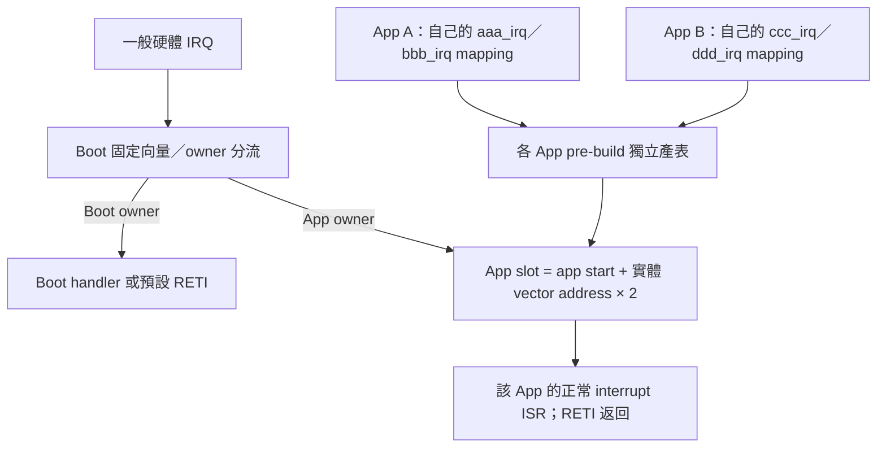

固定表有64個4-byte slot；例如 F13 vector 0x34 的 App slot 是0x2068，
F24 則是0x5068。JSON 的 key 是實體 vector 位址，不是 IRQ 序號或 slot 位址。
Boot 固定涵蓋一般位置0x04..0x7C；其中保留位置不可啟用。
合法可用 IRQ 必須依本 MCU 的 device header／硬體手冊及 generator 檢查，
不能因表內有位置就認為有對應周邊。

Reset 仍由 Boot 擁有；App table 第一個 slot 轉到 App startup，不是直接跳 main。
0x02 保留。Physical BRK 0x7E 不由此介面轉送，留給 device/debugger；
App 的 BRK 保留 slot 使用 RETB，不是一般 IRQ 的 RETI，正式 App 不應把它當通用 API。

一般 App ISR（包含 F13 INTTRJ0）採下列寫法，來源必須加入該 App 的 MTPJ：

```c
#pragma interrupt your_handler
void __near your_handler(void)
{
    /* Acknowledge the interrupt source and capture bounded state. */
}
```

- 必須 global、非 static、正常 interrupt pragma；不要帶 vect= 或另加競爭的 -VECTN。
- ISR 以 RETI 返回，不是普通 C callback；不可用一般函式呼叫 ISR。
- Boot/App 分別連結，可以使用相同 ISR 函式名；真正禁止的是重複擁有實體 vector。
- 新 IRQ 在 EI 前須完成周邊初始化、清 pending flag、優先權及 mask 設定。
- 未用 IRQ 必須遮罩；預設 RETI 不會替你清除硬體中斷原因。
- Code Generator／Smart Configurator 重產後，要重新核對 pragma、export、mapping 與 user hook。

F13 以 near CALL＋literal 與共用組語 dispatcher 節省 ROM，暫時額外使用10 bytes stack，
最終保留原硬體 frame 交由 ISR RETI。F24 使用逐向量直接分支。
這是內部實作差異，不是 App 可改回普通 RET callback 的理由。

### 4. CS+／Startup／RAM 必須一起移植

| 檢查位置 | 移植時必做事項 |
| --- | --- |
| Project device／CC-RL | 選正確 MCU、記憶體模型與 Flash library，保留原授權聲明；不抄另一系列設定 |
| Source tree | 登錄自己的 table、startup、ISR、identity、必要 board support；不是只把檔案放進資料夾 |
| Linker section start | 表、metadata、code、RAM、stack 互不重疊；核對實際 map，不只看 IDE 畫面 |
| RAM／stack 初始化 | 保留 recovery／owner／handoff no-init，檢查 .bss／.data／stack 初始化不會清掉它們 |
| Build events | 保留 pre-build 產表與 post-build 封裝／拒絕條件；生成檔不可手改 |
| Option bytes／debug | Boot/App 設定一致且符合產品需求；保留 debug monitor／trace RAM，不由 App 更新覆寫 |
| 跨目錄搬移 | 修正 source／include／library／preinclude／hook 路徑，不能只改 MTPJ 名稱 |

兩個目前範例都使用 FF700 recovery 與 FF710 owner，但 marker 值不是同一協定：
F13 的 AA=Boot、55=App；F24 Boot 初始化為00，只有 A5 才轉送 App，其餘走 Boot handler／預設。
Recovery cookie 的值與後續交接資料也不可跨系列照抄。
F13 額外使用 FF714 handoff、FF718 update-complete，在 FF710..FF71F 中保留；
須在 App startup 消耗與清除一次性標記，不能把上次 log 當成本次更新成功。
F13 normal data 從0xFE500以上開始，保留0xFE300..0xFE4FF trace RAM。
F24 明確配置4 KiB stack 並避開交接 RAM；不能任由 stack 初始化掃過 cookie／owner。

Boot 關中斷並交接，不表示 App 可以略過自己的 startup 或周邊初始化。
Clock、UART/CAN/I2C 狀態、pending flag、stack 與 RAM 都必須有明確責任。
F13 需保留 f13_board_support 與生成檔 user-area clock hook，不能在 App 停掉已有效的 inherited PLL。
其板端 X1=4 MHz、CPU32／CAN16；F24 App X1=20 MHz、PLL80／CPU40，Boot 用 HOCO40。
這些是本板設定，不是其他 RL78 的預設值。

### 5. F13：把應用功能加進已整合 App

保留的主要檔案／責任：

| 檔案 | 責任 |
| --- | --- |
| cstart.asm | App runtime startup 與 RAM／stack 初始化 |
| ftable.inc、ftable_RL78_F13.asm | layout／App identity 與256-byte metadata |
| app_irq_handlers.json | 此 App 的實體 vector → ISR 名稱 |
| app_irq_table.inc、app_identity.h | pre-build 生成，不手改 |
| generate_update_image.ps1 | map 導出長度、metadata 檢查、CRC 與安裝／更新產物 |
| Boot 的 generate_irq_contract.ps1 | -Mode App 時只產此 App 表與 identity；Boot 表獨立 |
| f13_board_support、App INFO／ENTER | clock／周邊交接、在線資訊及回 Boot 入口 |

1. 複製已整合 App，先不改 MCU／分區。備份原 Boot image 與已知可用 App。
2. 將自己的功能來源加入 MTPJ；保留仍需要的 timer／UART／INFO／ENTER。
3. 在自己的 app_irq_handlers.json 加入合法 IRQ；在 ftable.inc 改 App version／build。
4. CS+ pre-build 保留以下命令，搬移後修正腳本路徑；post-build 保留 generate_update_image.ps1。

```powershell
powershell.exe -NoProfile -ExecutionPolicy Bypass `
  -File "..\RL78_F13_Boot_loader_CAN\generate_irq_contract.ps1" `
  -Mode App -AppProject "."
```

5. Clean rebuild 該 App；檢查 log、map、更新 BIN、CRC 與低位址排除結果。
6. 在 Tool root 執行 scripts/verify_f13_artifacts.ps1，可傳 -BootProject／-AppProject。
   產表只檢查時用 generate_irq_contract.ps1 -Mode App -AppProject 路徑 -CheckOnly。
7. 用 matching Boot 測整合啟動，再以更新 BIN 測只換 App；比較 Boot 區內容確認沒被改寫。

目前 F13 封裝與 artifact checker 仍有參考 MTPJ／map／BIN 名稱及 sibling Boot 路徑。
-AppProject 不代表已支援任意改名的一鍵工程：先保留參考檔名／目錄關係；
若要改名或搬離原樹，須一併調整 post-build 的 -MapFile／輸出命名、Boot HEX 路徑、
MTPJ 與 checker 的檔名假設，再重新驗證。這不需要為 ISR 名稱重編 Boot，
但不能跳過工程路徑整合。不是 standalone 專案只加 JSON 就能變成 boot-compatible App。

### 6. F24：各 App 自己產表、封裝，不動共用 Boot

1. 從 firmware/RL78_F24_Bridge_app 建立自己的專案資料夾，保留唯一 MTPJ、
   全部 App .c／.h、generated_projection、table 登錄與 BRIDGE_SPLIT_APP 定義。
2. 保留 app5000／code5200、4 KiB stack、FF700／FF710 與最後1 KiB保護。
   共用硬體／driver／SC 來源在 firmware/f24_board，不在 projection 重產 SC。
   Bridge_boot／Bridge_app 是唯一兩份產品專案，f24_board 沒有 MTPJ 或燒錄產物。
3. 自己維護 app_irq_handlers.json 與 app_image.json；保留仍在用的 UART／timer／bus mapping。
4. Pre-build 使用 scripts/prepare_f24_app_irq.ps1 -AppProject "."；
   post-build 使用 scripts/package_f24_bridge.ps1 -Kind app -AppProject "."。
   生成 bridge_vectors.asm／f24_app_identity.generated.h，不手改。
5. 在 Tool root 建置自己的 App，例如：

```powershell
.\scripts\build_f24_bridge.ps1 -Kind app -AppProject "D:\MyApps\ProjectA"
.\scripts\build_f24_bridge.ps1 -Kind app -AppProject "D:\MyApps\ProjectB"
```

上述路徑是使用者自訂位置的例子。搬移時必須先修正所有來源與 build hook 路徑。
只檢查生成檔可用 prepare_f24_app_irq.ps1 -AppProject 路徑 -CheckOnly。
App-only 建置／封裝不寫 Boot，並依該 MTPJ stem 產生各自的 BIN／flash MOT。
此 wrapper 仍是特定 F24 bridge integration，不是任意 RL78 App 的通用建置器。

只有 canonical SC 確實重產時，才對 reference projection 使用
prepare_f24_bridge_projects.ps1 -Kind app。日常 App-only 更新不要呼叫省略 Kind
的雙專案 prepare，也不要對自訂 App 直接使用 reference 重產腳本覆寫設定。
Boot 自己的硬體／layout 改變才另行 prepare／build Boot。
SC 唯一設定為 f24_board/f24_board.scfg，輸出在 f24_board/src/smc_gen。
搬移工作目錄後先 prepare -Kind app 刷新 SC 路徑，再從 App MTPJ 開啟。
prepare 讀取各自既有 MTPJ，保留專案選項／hook 與 App JSON，不再由第三個專案產生。
App main／Host Link／CAN service 在 App；共用 UART／timer 透過最小 hooks
由 Boot、App 分別實作。SC 新路徑 GUI 重產尚待操作確認。

### 7. 初次安裝、後續更新與除錯不可混用

| 用途 | F13 | F24 |
| --- | --- | --- |
| 初次 matching 安裝 | App 專案根目錄 boot_app.hex，包含 Boot＋封裝 App | Boot 的 .mot 加 App 的 *_flash.mot；先確認燒錄工具不會全片擦除另一區 |
| 後續只更新 App | DefaultBuild/RL78_F13_Boot_loader_CAN_app_update.bin | DefaultBuild/*_bridge_update.bin，載入 Misc |
| 不應當正式安裝檔 | App raw ABS／暫時低位址 vector；raw HEX 不能當 update BIN | App raw .mot／.abs 的低位址 placeholder，不是 *_flash.mot |

F24 也可首次只用 programmer 安裝 Boot；沒有有效 App 會留在 recovery，
再以 tool Misc／115200 安裝 matching App BIN、驗證後明確 RUN。Misc 不更新 Boot。

F13 Boot CS+ Run-to-symbol 是 _boot_main；App standalone 是 _main。
Standalone ABS 下載可能覆寫 Boot 實體向量，不算 Boot→App 整合測試。
正式 handoff 除錯需保留已燒入的 matching Boot/App，只載入 App symbols，
從 reset 經 Boot 再停在 App main；核對 CS+ download／erase 設定與 -OCDTR。
F24 同樣不可用 raw App 下載覆蓋低位 Boot vector；E2 lite halt／continue／stop 要實測。

Misc 僅更新 Host App，不更新 Boot。現行 F24 Host Boot 的更新 UART 在編譯時固定115200；
Host App 的一般 Host Link 可協商115200／460800／921600，與 Device 更新速度獨立。
高速 App 先在原速度完成 ENTER ACK，再 reset 進 Boot，PC 以115200重新核對身分。
單純切 TAB 不會立即改速；活動更新不允許切 TAB。未來 Device UART 的固定 baud
由其 Boot/App 編譯契約與 BIN policy 決定，不是上方 Host Baud，也不是 Misc 的115200。
目前 F24 I2C 只有100K，Device UART adapter 尚未啟用，不能把400K／1M／9M當成既有能力。

### 8. 若改用自己的 Boot 更新流程

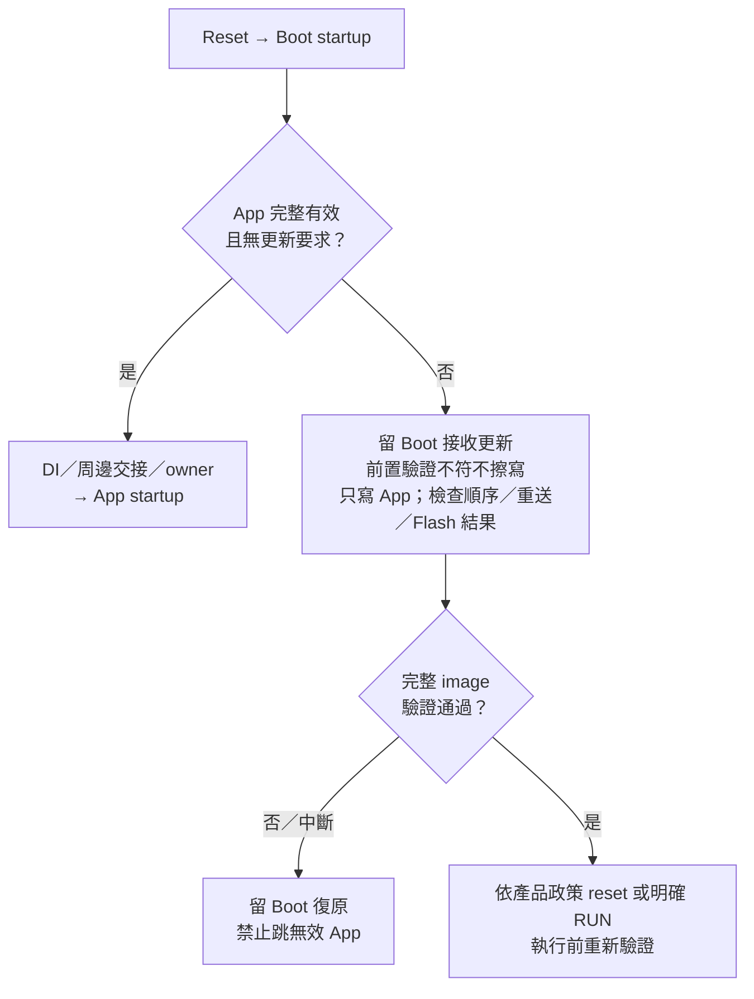

這是移植檢查骨架，不是兩個既有產品狀態機完全相同。
F13 CAN：有效 App＋ENTER 在接受 START 前可因30秒 inactivity 返回舊 App；
無效 App 從不啟用這個自動返回。START 後 timeout／ABORT／fatal write error 留 Boot；
END 成功 reset，重新驗證才啟動。完整細節以 F13 flow guide 第2.2節為準。
F24 Misc：END 成功仍留 Boot，必須明確 RUN；有效 magic 採最後提交。
兩者都不等於雙映像 rollback，不能宣稱掉電一定保留舊 App。

自己設計流程至少必須定義：更新要求／清除方式、身分與 geometry 檢查、
擦寫 allowlist、命令與 offset 邊界、duplicate／retry、斷線／timeout／cancel、
完整 image CRC 與有效性提交、上電重新驗證、周邊交接與復原入口。
F13 FSL 與 F24 RFD 不能互換；F24 programming mode 的 code／常數／IRQ
不可從 code Flash 取用，driver 與必要 hooks 須在 RAM，並配置足夠 stack。

若沿用現有 Tool：metadata 整區256、core128、reserved128FF，UPD1 的 role、
允許更新介面、IRQ ABI、最低 Boot 版本都要匹配 live Boot；CAN-only Device BIN
不能切 I2C／UART 更新，Device BIN 也不能用 Misc 更新 Host。
F13 必須 RESET metadata／64段各4 bytes／SEAL 再 START；
F24 必須四段64-byte STAGE 驗完整區再 BEGIN。傳輸 chunk 不是 metadata 區域大小。
CRC32 只有完整性，不是身分認證、簽章或防回滾；有資安需求必須另設計。
現行參考專案不使用 WDT；自己的產品若啟用 WDT，須重新設計 Flash／timeout／交接行為。

### 9. 哪些變更只更新 App？如何驗收？

| 變更 | 可否保留同一份 Boot |
| --- | --- |
| 相容 App 新增／刪除一般 IRQ、換 handler 名稱 | 可以，更新自己的 mapping、正常 ISR、初始化與封裝即可 |
| App A 換成 App B、版本或一般功能變更 | 可以，但必須保持既定 MCU／layout／RAM／startup／IRQ／image／更新契約 |
| 改 MCU、分區、owner RAM、IRQ ABI、Boot 自己的 IRQ 或更新 protocol | 不屬於 App-only；須重新評估 Boot，必要時重新安裝 matching pair |
| 只改 peripheral clock／pin 或 Flash library | 不可假設相容；核對 Boot 使用與交接責任，再決定是否需改 Boot |

每次移植至少完成以下 gates，不能只看 compile 成功：

1. 靜態：確認 MTPJ 登錄、table64 slots、branch 目的地／RETI／RETB、ROM／RAM／stack／保護區。
2. 產物：長度、完整256-byte metadata、role／transport／ABI、CRC 與安裝檔排除低位 vector。
3. App-only 隔離：保存更新前後 Boot 區／Boot 產物雜湊；App A/B 使用不同 IRQ／版本確認仍相容。
4. 實板：上電、無有效 App、正常 App、ENTER、更新、明確 RUN（若適用）、新增 IRQ 與原有 IRQ。
5. 實板故障：錯映像、重送、斷線、取消、reset／斷電、CRC 錯、Flash failure 與 recovery。
6. 除錯：保留 Boot vector 測 App main、E2 lite halt／continue／stop；獨立確認 UART／CAN/I2C 電氣與時鐘。

現有 build／map／HEX／mock／stack model 是軟體證據，不能代替以上實板驗證。
F13 Transfer benchmark 只證明當時通訊；不代表目前 Boot/App 完整更新已驗證。
本次指南僅整理工程流程，不編譯新 firmware、不開 COM、不燒錄、不發布網站。
<!-- RL78_PORTING_END -->

## 舊版 UART／I2C 教材與 CAN 操作參考

以下保留原教學與現行 CAN 操作說明。舊範例的 callback ISR／CRC／layout
不是上方新架構的移植規格；同一頁並存不代表 firmware 可以互換。

## 內容範圍

- 釐清 boot area、application area、vector table、RAM 與 data Flash 的責任邊界。
- 能建立 boot／application 兩個可獨立編譯的專案，並產生正確的映像檔。
- 能以 I2C 或 XMODEM 執行 erase、program、verify 與跳轉流程。
- 能針對更新中斷、CRC 錯誤與 application 無效設計安全復原策略。

## 更新流程總覽

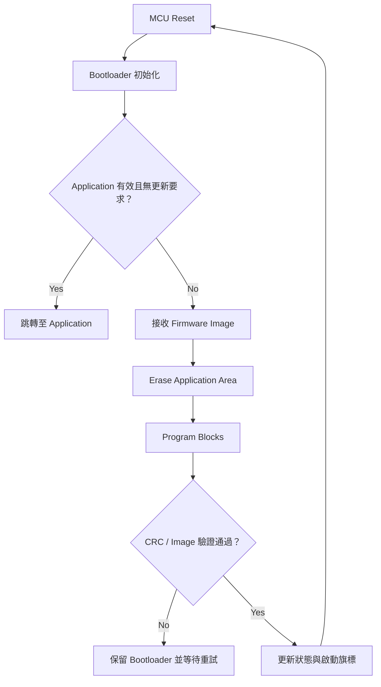

## CAN bus 更新：Tool / Host Bridge / Device

2026-10-15新增｜Custom Transfer已有使用者benchmark；Boot/App擦寫板測待補。

[FirmwareUpgradeTool與MCU Bridge操作稿](../slide_isp_tool_for_RL78/)（本機準備，尚未發布）。
下方既有UART/I2C教材與CAN使用不同project/metadata，不能混用其BIN/CRC/layout。

### 0074：外部 Device 更新與 Host 自身更新分開

FirmwareUpgradeTool以1366×768單畫面為目標，CAN／I2C共用BIN、metadata、CRC、
progress與log，主視窗不設上下捲軸；未來UART device也重用此console。
0078修正底部長操作名稱／百分比的換行裁切，量測並預留100%寬度；
GDI字型／邊界測試已通過，真實更新畫面與桌面DPI仍待驗證。
CAN／I2C／Misc TAB只位於左側INTERFACE SETTINGS；中間SHARED IMAGE / METADATA
與右側SHARED LOG有獨立固定標題，不受TAB外框涵蓋，不另建BIN或log。
最後的Misc走PC→host UART，只更新HOST BRIDGE APP，不經CAN或I2C外部device。
Host須宣告self-update能力並提供live descriptor；BUR1 HOST APP BIN不可與F13 CAN
或舊UART／I2C教材的BIN互換。更新成功仍留boot，必須另按RUN才執行app。

新F24 bridge專案採20KiB boot／app0x5000，最後1KiB保留；首次需debugger安裝
matching boot `.mot`與app `*_flash.mot`，之後Misc載入`*_bridge_update.bin`。
分區、RAM RFD、IRQ／BRK與CRC保護已有build／mock檢查，實板擦寫／E2 lite／
掉電復原仍待驗證；不能把既有Transfer benchmark當成Boot/App更新成功。
完整操作、檔案用途及待補截圖見上方ISP操作稿。每次功能變更同步MD與受影響web，
本機編輯不代表已公開發布。

目前Host Link payload128／完整frame142，不支援舊96-host。F13 image format6與
F24 bridge contract3均固定metadata區為app offset0x100..0x1FF（256 bytes），
前128有效core、後128填0xFF；code起點維持offset0x200。F13 paired boot/app為1.5.0，
須重新安裝；F24同樣須安裝matching新boot/app。Flash分區沒有因本次metadata改動而搬移。
Misc透過同一STAGE_METADATA command分四次64 bytes，RAM收齊／完整驗證後BEGIN才擦除；
READ_METADATA也分頁讀回，不把區域大小當成單包大小。有效core長度與區域容量分開定義。

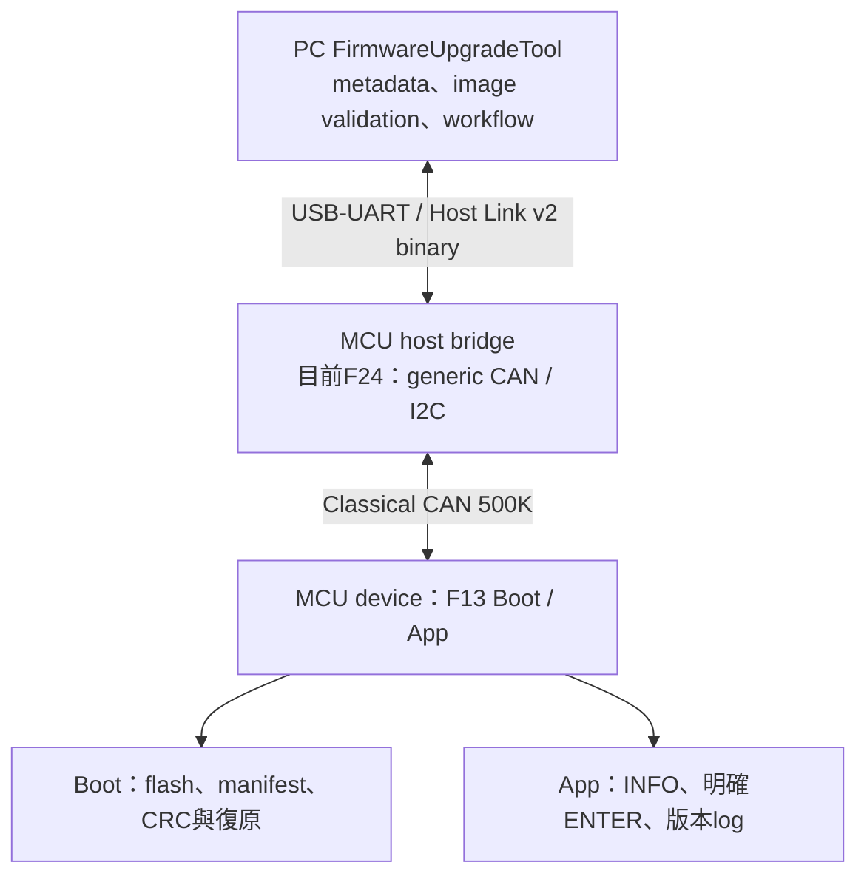

### CAN 責任與硬體基準

- Host只傳generic frame，不解讀F13 flash address，不驗app CRC。
- Device回報MCU/target、protocol、boot/app version、app start/capacity、erase unit、CAN能力。
- Tool依metadata匹配，不用MCU名稱猜layout；未來相同protocol的MCU不需新增專用layout profile。
- F24 X1 20MHz → PLL80 → CPU/CAN40；CAN P10 TX/P11 RX/P12 STB。
- F13 X1 4MHz → PLL/CPU32 → CAN16；不可抄F24 clock。
- F13 EVB TJA1050T需5V；本次3.3V bus error改5V後Transfer正常。
- 各系列flash library、linker/vector、clock、pin、erase/write unit需依device設定。

| Workflow | CAN ID / DLC | 功能與證據範圍 |
|---|---|---|
| Bridge Board Self Test | STD0x123 / 8 | 每秒11 22 33 44 55 66 77 counter，啟動reset00；需active analyzer/ACK；不擦寫 |
| Custom Transfer v1 | STD0x710 / 0x711；8 | DEVICE_INFO、PING、ECHO、PATTERN、STATS；不載BIN；已有benchmark |
| CAN Upgrade v5 | control700／reply701；raw720..727；8 | INFO／ENTER／metadata／START／64-byte BLOCK／END／ABORT；v5速度與故障矩陣待板測 |

Upgrade ID來自本次metadata，不是所有MCU固定ID。
Tool baud dropdown經UART SET_CAN_CONFIG在stopped時修改bridge；target不會自動變速。

### 可變長度 app BIN 與 CRC32

120KiB只是目前128KiB F13、8KiB boot的app capacity，不是固定BIN長度。
32K/60K/80K/110K可用同一flow，仍須manifest minimum/capacity、4-byte alignment、
MCU/target/protocol、start、CAN能力与checksum符合。
若boot改16K或保留data區，boot/app metadata與linker須一致，不能只改tool。

App post-build依linker map實際loaded section end決定結尾、填manifest image-size，
末端4bytes寫CRC32（LE32）；CRC範圍不含這4bytes。不需每次新增60K/110K size define。
App Start Override Auto使用BIN metadata start；手動值須與image/device一致，不能重定位app。

### CAN 操作流程（Boot/App實板驗證待補）

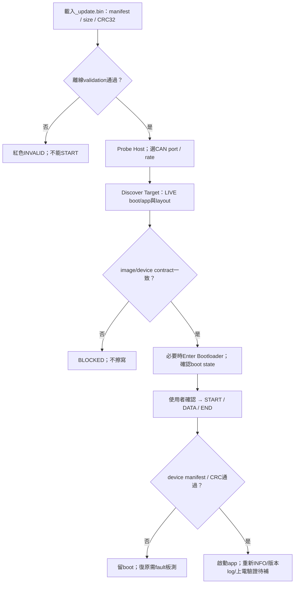

CRC32是完整性，不是簽章、認證或anti-rollback。
G16 I2C reference缺少active READ/auth/safe boot CRC/recovery，新tool保持不擦寫；
不能將下方其他UART/I2C範例當成新tool已完成其全部更新流程。

### F13 CAN device：所有 boot→app 條件、ENTER 與逾時

<!-- F13_BOOT_DECISION_BEGIN -->
本節僅適用目前 F13 CAN device boot/app（format6／CAN protocol5），不是 F24
host bridge 的 Misc／RUN 規則，也不是既有 UART／I2C 教材的 boot contract。
依據 `r_main.c` 的 `application_is_valid`／`condition_check`／`boot_main`，以及
`can_boot_transport.c` 的 manifest、START、END 與 timeout 實作；是 source 核對，非新增實板驗證。

#### A. 每次 reset 的 app 有效性檢查：全部通過才可啟動

| 檢查 | 目前 F13 build 必須符合 |
| --- | --- |
| Reset entry | `0x2000` 的第一個 DWORD 不為 `0xFFFFFFFF`；只檢查非 erased，沒有完整反組譯／驗證跳轉目的地 |
| Metadata header | `0x2100` magic=`CAN3`；format6、core length128、flags=`0x0003`；protocol ID1／version5、checksum type1（CRC32）、target=`0xF13B`、Classical CAN／standard ID 格式全部匹配 |
| Metadata reserved | 整區256 bytes 中後128 bytes（`0x2180..0x21FF`）全部為 `0xFF` |
| Metadata policy | UPD1 version1／size32、DEVICE_APP、允許CAN、無未知transport bit、F1V1 IRQ ABI；minimum boot不高於目前boot；policy保留16 bytes全0 |
| Image size | manifest size 含尾端 CRC4 bytes，介於516與122880 bytes，且4-byte aligned |
| App version | 不可為 `0xFFFFFFFF`；不要求比舊版新，不是 anti-rollback |
| Flash layout | app start=`0x2000`、capacity=`0x1E000`、code Flash=`0x20000`、boot reserve=`0x2000`、erase=`0x400`、minimum=`0x204`，均等於 boot 編譯設定 |
| CAN contract | nominal mask=`0x04`（500K）、data mask=0、request ID=`0x700`、response ID=`0x701`，均等於 boot 編譯設定 |
| CRC32 | 對 `[app_start, app_start + image_size - 4)` 計算 CRC32，等於該 image 最後4 bytes 的 LE32 stored CRC |

Boot 現在也直接比對 MCU ASCII family／part，要求 build 已初始化，並檢查
UPD1更新政策、IRQ ABI與最低boot版本。PC仍須另作image/live device比對。
CRC是完整性，不是簽章或身分認證；最低boot版本不等於app防回滾。

#### B. ENTER marker 與啟動路徑

1. app 有效且沒有 ENTER marker：正常返回 startup，轉到 `0x2000` 的 app table。
2. app 收到 standard data ID=`0x700`、DLC1、data=`06` 的明確 ENTER request 時，
   先嘗試送 ACK（ID=`0x701`、DLC2、`06 00`），再將 `0xAA55AA55` 寫入
   no-init RAM `0xFF700`，最後 software reset。ACK 不是 reset 的可靠送達保證。
3. boot 看見 marker 後立即清除，表示本次先進入更新模式，不是永久鎖住 boot。
   P13.7／INTP0 不參與 boot decision，也不要求 tool 或 analyzer 必須在線才能正常開 app。
4. app 無效：禁止跳 app；CAN ready 時留 boot 等完整更新，clock／CAN 初始化失敗則
   software reset 重試，不能藉此放行無效 app。
5. app 有效但要求進 boot，而 clock／CAN 初始化失敗：目前實作會返回有效 app，
   不會永久卡 boot；CAN ready／FSL ready 不是所有正常啟動都必須通過的額外 gate。
6. 真正交接前關中斷，寫 `0xFF714` handoff signature、將 `0xFF710` ISR owner
   設為 app（`0x55`），startup 再 branch app table。這些是 boot 的輸出，不是額外外部啟動要求。

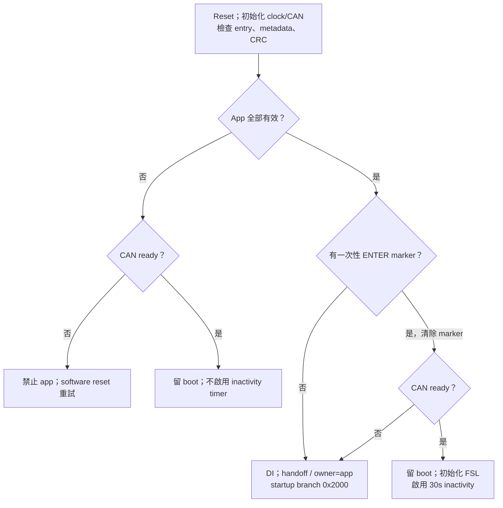

#### C. 30 秒 inactivity、START、失敗與更新成功

| 事件 | boot 的實際結果 |
| --- | --- |
| 原 app 有效、ENTER 後尚未接受 START | 連續30秒沒有符合底層接收條件的 CAN request，關閉已初始化的 FSL 後返回原 app |
| 持續 INFO／HELLO／其他符合接收條件的 frame | 都會刷新 inactivity；不是上電後固定30秒，也不是只由 DATA 刷新；未知 command／錯誤 DLC 也可能刷新 |
| 原 app 無效 | 從一開始不啟用 inactivity timer，接受 START 後也不會自動啟用；失聯仍留 boot 等重試 |
| START 被拒絕（protocol／target／size／FSL not ready） | 沒有進入 started state；不能把這個拒絕當成 app 已被擦寫；原 app 有效且 timer 啟用時仍可 inactivity 返回 |
| START 已接受後 inactivity 到期 | 若本次 timer 原本啟用，回 session-timeout error、留 boot、關閉後續自動返回；不跳可能只有部分內容的 app |
| ABORT／erase-write error／END metadata 或 CRC error | error 返回主迴圈，關閉後續自動返回，留 boot 等新 session；ABORT 即使在 START 前也走這條留 boot 路徑 |
| END 長度／state 尚不完整 | 回錯誤但保留 session；不得先宣布成功或跳 app |
| END 收齊、metadata size 等於 START size、Flash metadata 與 CRC 正確 | ACK 成功，關閉 FSL，寫 `0xFF718` update-complete marker，再 software reset；下次 reset 重新通過 A 節與 ENTER 判斷才進 app |
| 擦寫中掉電 | 下次上電重新跑 A 節；若 image 仍有效且無 ENTER 則可啟動，否則留 boot；不是保證有雙映像回復 |

底層接收條件為standard／非RTR、ID700或720..727、DLC>0；通過即刷新timer，之後才
檢查 command。計時由1ms TMRJ0 IRQ 累加，Flash 操作關 IRQ 時不是嚴格的 wall-clock
30秒。timer 已停用或未啟用時，PC 失聯不能期待 target 自動 timeout／reset；tool 的
bounded wait／ABORT 不能取代供電、Flash、IRQ 與掉電的實板驗證。

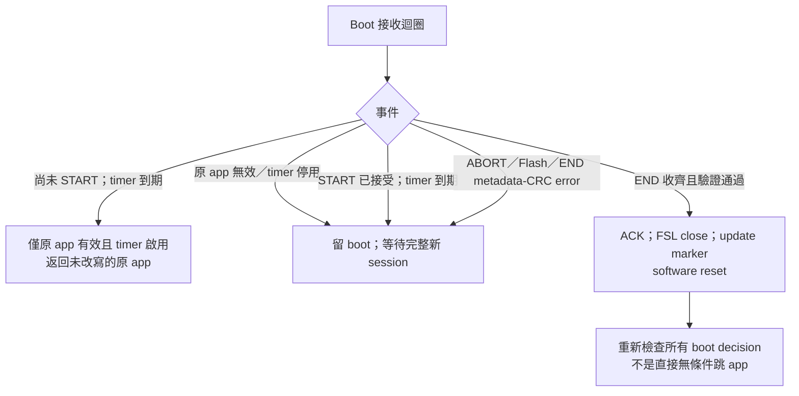
#### 固定完整 IRQ 介面：不同 app 專案沿用同一份 boot

F13 image format6／boot1.4.0 起，boot 固定擁有一般 vector 0x04..0x7C
的61個位置（包含保留位置，但 app 不可啟用保留 vector）。Reset 仍屬 boot；
0x02 保留，physical BRK 0x7E 不轉送，留給 debugger／device 設定。
App 的64個4-byte slot 固定在0x2000..0x20FF，公式是0x2000＋vector×2。

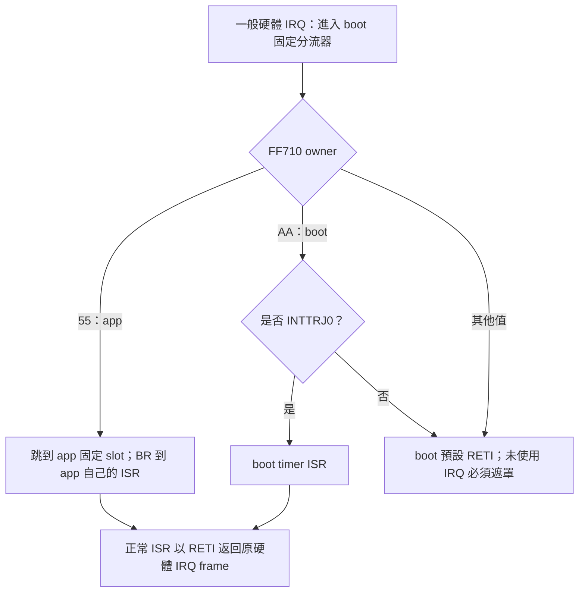

INTTRJ0 不再是普通 callback，與其他 app ISR 一樣使用無 vect 的 interrupt
pragma、以 RETI 返回。Boot 內部的 CALL／RET 僅用於壓縮組語分流，先移除
自己的暫存 call frame 再交給 ISR，並不是 C ISR 呼叫另一個 ISR。
分流暫存額外使用10 bytes stack，恢復 AX／HL／ES，原硬體 PC20／PSW frame
保持完整；未採用在分流期間重新 EI 的巢狀模式。

加入 app IRQ 只需：新增非 static ISR、在 app_irq_handlers.json 設定實體 vector
與函式名、將來源加入 app MTPJ、在 EI 前初始化／清旗標／設定優先權與解除遮罩。
App pre-build 會驗證 pragma 並產生 app_irq_table.inc；不要手改產物或 boot 向量。
未用 slot 指向 app 預設 RETI，不再是FFFFFFFF；預設返回不替你清除硬體原因，
所以不能把未處理的 IRQ 打開，否則可能反覆進中斷。

不同 app 專案可共用 boot 的前提：相同 R5F10BMG、8KiB boot／app2000、
完整跳轉表、FF700 recovery 與 FF710..FF71F no-init／stack 保留、startup 與
4MHz／PLL32／CAN16 交接、format6 的256-byte metadata／CRC32，以及
CAN protocol5／ID700與701。App 版本／build 由自己的 ftable.inc 產生，
不綁定 boot 的編譯版本；若仍需 Tool 從 app ENTER 回 boot，該 app 必須實作
INFO／ENTER 與相同 reset request，不能只加入向量表。

**本次需先以燒錄器安裝 matching format6 boot＋app 一次。** 舊 format4 的
callback app 與新 RETI boot 不相容，即使 CRC 正確也拒絕；以後在上述契約內
換 app 專案、新增一般 IRQ 或改 app 版本，只更新 app，不需重燒 boot。
若改 MCU、分區、共用 RAM、boot 本身使用的 IRQ／更新通訊或 metadata ABI，
仍須評估並重新安裝 boot。完整向量不代表所有周邊已初始化。

F24 與 F13 現在採相同 app-facing 原則：boot 持有固定完整一般向量、依 owner
轉送 app slot、app ISR 都是 RETI。F24 用各向量直接分支；F13 為維持8KiB
boot 以共用組語分流節省 ROM，實作不同但 app 不再有 callback 特例。
目前軟體建置／HEX與stack模型檢查可執行；實板新增IRQ、E2 lite、update/reset
及斷電回復仍需驗證，不能把模型結果視為硬體通過。
<!-- F13_BOOT_DECISION_END -->

<!-- F24_APP_IRQ_BEGIN -->
### F24：各 app 專案獨立產表，沿用同一份 boot

Boot 固定轉送一般 IRQ 到 app start＋實體 vector×2；app 的64個4-byte slot
固定佔用 offset000h..0FFh。各專案決定 slot 要跳到哪個函式，boot 不認識
aaa_irq／ccc_irq 等 app 名稱。這項流程不改 UART boot、分區或 BUR1 contract3。

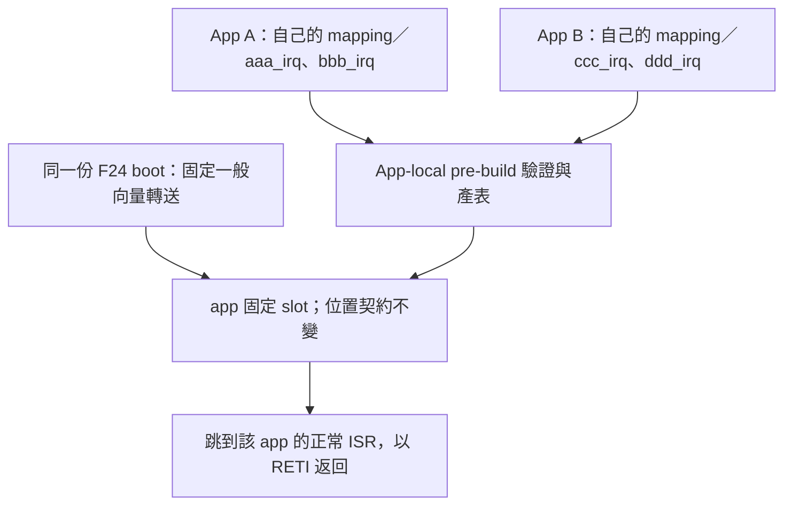

工程只保留兩個產品：Bridge_boot 是唯一 Boot；Bridge_app 是唯一正常 App。
f24_board 提供共用 board／driver／SC，不是第三份可燒錄韌體。
App 的 main、Host Link dispatch、CAN service 已回到 App 自己的目錄；
共用 UART／timer 僅依賴 f24_runtime_hooks.h，由 Boot／App 分別實作。
可攜式 I2C staging 在 common；分區／BUR1 支援在 f24_bridge_common。

SC 唯一設定為 firmware/f24_board/f24_board.scfg，輸出為同目錄 src/smc_gen。
搬移工作目錄後先執行 prepare_f24_bridge_projects.ps1 -Kind app 更新 SC 路徑，
由 App MTPJ 開啟並核對輸出位置。重產後再 prepare -Kind app、build App；
僅 Boot 自己的硬體設定改變才另行 prepare -Kind boot、build Boot。
prepare 讀取各自既有 MTPJ，保留 build options／hook 與 App JSON，不再複製第三個專案。
SC 新位置的 GUI 重產仍待操作確認；目前已驗證現有設定、來源與乾淨編譯。

每個 app 根目錄保存兩份來源：app_irq_handlers.json 對應實體 vector 與
函式名；app_image.json 保存自己的 packed version／build。產生的
bridge_vectors.asm 與 f24_app_identity.generated.h 不可手改；版本同時用於
Host Link 回報及 BIN metadata，不必修改共用 boot layout header。

```json
{"0x08":"aaa_irq","0x0A":"bbb_irq"}
```

上例只展示新增 IRQ；從 bridge 範例建立專案時，必須保留仍有使用的 UART／
timer／CAN／I2C mapping，不可用這兩筆覆蓋必要的清單。B 專案可改用其他合法
vector／函式名。來源需加入該 app MTPJ；ISR 必須 global、非 static、正常
interrupt pragma 且無 vect=，函式定義為 void handler(void)，以 RETI 返回。
未用的 IRQ 必須停用或遮罩，預設 RETI 不會替你清除周邊原因。

整合順序：

1. 以已整合的 F24 split app 為範本，建立自己的 app 專案；每個資料夾一份
   MTPJ。保留 R7F124FLJ3xFB、BRIDGE_SPLIT_APP、startup／4KiB stack／
   FF700與FF710保留、app5000／code5200／末1KiB保護等契約。不是任意
   standalone 專案加入 JSON 就能完成整合。
2. 複製專案時一併保留自己的全部 App .c／.h、generated_projection、兩份 JSON
   及 bridge_vectors.asm 的專案登錄。若移到不同目錄，先在 CS+ 修正相對
   source／include／library／preinclude 路徑；不要重新產生或覆寫共用 boot。
3. CS+ pre-build 呼叫 prepare_f24_app_irq.ps1 -AppProject "."；post-build
   呼叫 package_f24_bridge.ps1 -Kind app -AppProject "."。腳本路徑指向
   tool 的 scripts，跨目錄專案請使用正確完整路徑；不要呼叫雙專案 prepare。
4. 登錄各 app 自己的 ISR、修改 mapping／app_image.json 後，只執行：

```powershell
.\scripts\build_f24_bridge.ps1 -Kind app -AppProject "D:\MyApps\ProjectA"
.\scripts\build_f24_bridge.ps1 -Kind app -AppProject "D:\MyApps\ProjectB"
```

也可從 CS+ clean rebuild，hook 會自動執行。只驗證產物是否最新使用
prepare_f24_app_irq.ps1 -AppProject 專案路徑 -CheckOnly，不會寫檔。
產表不讀其他 app 的 IRQ 清單；build 的 -AppProject 與 -Prepare 不可併用，
避免誤重建參考專案。App-only 操作不產生／編譯／寫入 boot。

封裝依各 MTPJ 檔名找 DefaultBuild 下的 map／MOT，輸出各自的
專案名_bridge_update.bin／專案名_flash.mot。除原本分區、stack、flash/RAM、
metadata／CRC 檢查，還逐 slot 比對實際 branch 與 mapping，核對 ISR 的
真實 RETI／保留 BRK slot 的 RETB。Physical BRK 仍不轉送。Build 失敗時
舊 BIN 可能仍保留，不得把前次產物當成這次成功輸出。

本輪 A／B 實際 CC-RL 編譯與封裝、不同 mapping／版本、輸入拒絕及 boot
向量／MTPJ／MOT 雜湊隔離測試通過；測試沒有啟用新 IRQ，也沒有燒錄 MCU。
先安裝本輪policy contract3 matching boot/app；之後相容的app-only IRQ改動不需重燒boot。
本輪參考app1.5.0為42696 bytes／CRC864E811E，新增泛用CAN burst22／bit12。
F24 Boot1.2.0不變，可用Misc115200更新此App。實板只換 app、新舊 IRQ／UART ENTER、reset／斷電
與 E2 lite 仍待驗證。
F13 保留既有 app-local mapping 流程；未新增 F13 I2C boot。

F24 App1.4.0 重新連線時可能 INFO成功、接著0x57回BAD_COMMAND：外層分派
漏了READ_METADATA，1.4.1已補上。不可略過metadata驗證。復原方式：

1. 關閉COM，按住實體SW1（P32，LOW），同時重置／重新上電，讓既有Boot留在recovery。
2. 開啟Tool0082，Host Baud115200，Open + Probe Host；確認live顯示BOOT。
3. Misc重新Load Update Image，選App1.5.0的_bridge_update.bin（42696B／CRC864E811E，包含1.4.1的修正）。
4. Update HOST APP成功後另按Run Validated Bridge App；再重新Probe並關閉／重開Tool確認App1.5.0。

Boot1.2.0、分區與IRQ契約不變，不必重燒Boot。步驟為source／mock驗證，實板復測待補。
<!-- F24_APP_IRQ_END -->

## 既有 UART / I2C 內容索引

* Introduce boot code and app code modification for RL78 
  * In this section , use RL78 F24 as example  
  <br/>


* reference document 
  * How to set up boot code and app project
  [How to Divide Boot and Flash Areas](https://www.renesas.com/en/document/man/rl78-family-c-compiler-package-cc-rl-how-divide-boot-and-flash-areas?srsltid=AfmBOoopybLnK6nMIfwPclpX1SYJL0OfZ1ZD5o9odBLUk4F70ckFtVWd)
  document no. : R20UT3475EJ0300
  <br/>

  <a id="target_MCU_flash_type"></a>
  * How to know the MCU need use which flash library type (code flash)
  [RL78 FAMILY FLASH MEMORY REPROGRAMMING SOFTWARE INTRODUCTION](https://www.renesas.com/en/document/oth/rl78-family-flash-memory-reprogramming-software-introduction?r=488891)

    * RL78 F23/F24 : Renesas Flash Driver RL78 Type 02 (document no. : R20UT5009EJ0110)
    [Renesas Flash Driver RL78 Type 02](https://www.renesas.com/en/document/mat/renesas-flash-driver-rl78-type-02-users-manual-rl78f23-and-rl78f24)
    * RL78 G22/G23/G24 : Renesas Flash Driver RL78 Type 01
    * RL78 G15/G16 : Renesas Flash Sample Program Type 01
    * RL78 x1x : Flash Self Programming Library Type01
  <br/>


__code base : polling__
* reference code base : boot code (RL78 F24)
[RL78_F24_Boot_loader_UART](https://github.com/released/RL78_F24_Boot_loader_UART)
[RL78_F24_Boot_loader_UART_e2](https://github.com/released/RL78_F24_Boot_loader_UART_e2)
<br/>

* reference code base : app code (RL78 F24)
[RL78_F24_Boot_loader_app](https://github.com/released/RL78_F24_Boot_loader_app)
[RL78_F24_Boot_loader_app_e2](https://github.com/released/RL78_F24_Boot_loader_app_e2)
<br/>

  * interface : xmodem by UART (polling)
  * interface : IICA0 (polling)
  * LDROM address : 0x0000 , size : 20K
  * APROM address : 0x5000 , size : 236K (CRC addr:3FFFC)
  * check define as below 

```c
#define ENABLE_UART_BL                                  (1)
#define ENALBE_IICA0_BL                                 (0)
```

__code base : interrupt__
* reference code base : boot code (RL78 F24)
[RL78_F24_Boot_loader_UART_CRC](https://github.com/released/RL78_F24_Boot_loader_UART_CRC)
<br/>

* reference code base : app code (RL78 F24)
[RL78_F24_Boot_loader_app_CRC](https://github.com/released/RL78_F24_Boot_loader_app_CRC)
<br/>

  * interface : xmodem by UART (polling) + TIMER interrupt
  * interface : IICA0 (interrupt) + TIMER interrupt
  * LDROM address : 0x0000 , size : 20K
  * APROM address : 0x5000 , size : 235K (CRC addr:3FBFC)
  * check define as below 

```c
#define ENABLE_UART_PRINTF                      (1)
#define ENABLE_UART_BL                          (1)

#define ENALBE_TIMER_TAU0_1_IRQ                 (1)

#define ENALBE_IICA0_BL                         (0)
#if ENALBE_IICA0_BL
#define ENALBE_IICA0_BL_USE_IRQ                 (1)
#endif
```


__code base : interrupt with hardware CRC__
* reference code base : boot code (RL78 F24)
[RL78_F24_Boot_loader_UART_HW_CRC](https://github.com/released/RL78_F24_Boot_loader_UART_HW_CRC)
<br/>

* reference code base : app code (RL78 F24)
[RL78_F24_Boot_loader_app_HW_CRC](https://github.com/released/RL78_F24_Boot_loader_app_HW_CRC)
<br/>

  * interface : xmodem by UART (polling) + TIMER interrupt
  * interface : IICA0 (interrupt) + TIMER interrupt
  * LDROM address : 0x0000 , size : 20K (0x5000)
  * APROM address : 0x5000 , size : 235K (CRC addr:3FBFB)

refer to document :
[RL78 Family RL78 Hardware CRC Functions (R01AN3530EU0110)](https://www.renesas.com/en/document/apn/rl78-family-rl78-hardware-crc-functions?queryID=f29102cd30aa1ffab265983af4afc4fe)

download sample code :
[RL78 Family RL78 Hardware CRC Functions (R01AN3530EU0110)](https://www.renesas.com/en/document/scd/rl78-family-rl78-hardware-crc-functions?queryID=f29102cd30aa1ffab265983af4afc4fe)

<span style="color:#FF0000">
<b><u>Key point</b></u><br><br>
</span> 

* project setting for boot code and app code 
* target MCU platform flash library usage and setting
* target interface initial and receive data 


---

# Flash architecture

MCU flash will split to Boot area (boot code) and Flash area (app code)


<u>How to Divide Boot and Flash Areas</u>

---

# Scenario : Boot area (boot code)

* use UART0 : P15/TX , P16/RX , to check terminal log meesgae
* __condition_check__ : 
  * detect ==flag== store in ram specific area (ex : 0xFF700) , to determine if re-boot from Flash area (app code) 
  * if no app code in app section


  * base on the ==flag== or ==BUTTON presssed (active LOW)== , to determine 
    * need to stay in boot code , to receive data flow from interface (ex : I2C , UART , ...) 
    * ready to jump into Flash area (app code)


* __verify_application_chksum__ : 
  * compare CRC checksum when power on 
  * at Flash area (app code) last 4 bytes , will store ==CRC data==
  * calculate the Flash area (app code) CRC byte (==caculate_crc32_checksum==) and compare to the CRC data store in last 4 bytes of Flash area (app code)
  * if comapare error , stay in Boot area (boot code) 


* any other custom user defined condition

* __programming Flash area (app code) flow__
  * refer the code flash sample function : Sample_CodeFlashControl and modify as : 
    * ==Sample_CodeFlashControl_Erase==
    * ==Sample_CodeFlashControl_SingleWrite==
    * __KEY POINT : SAMPLE_START_SECTION_SMP_CF__
  * after Flash area (app code) update finish , 
    * UART (xmodem , UART1 : P74/TX , P75/RX) : reboot MCU 
    * I2C (IICA0 , P62/SCL , P63/SDA): reboot MCU

xmodem


I2C


  * if CRC compare OK and no detect update inquiry , jump to Flash area (app code)


* at project:RL78_F24_Boot_loader_UART_CRC , add timer to control reset flow
  * when entry boot code in upgrade process , count down to 30 sec and execute reboot MCU if no receive data from interface (XMODEM , IICA0)


---

<a id="ram_flag"></a>

# Scenario : Flash area (app code)

* set ==ram flag== store in ram specific area (ex : 0xFF700) 
  * change flag data and execute reset , when
    * receive interface boot command (ex : I2C , UART , ...) 


  * any other custom user defined condition (ex : ADC , GPIO etc)
  * use terminal (UART0 : P15/TX , P16/RX) , by press ==digit 3== ,to set ram flag and reset


* by press ==digit 1== to write data flash 
* by press ==digit 2== to read data flash


* at Flash area (app code) last 4 bytes , will add ==CRC data== after ==project compile finish==


---

# Project : boot code/app code modifictaion - ftable.inc

<a id="FALSH_TABLE"></a>
<a id="ftable_inc"></a>
* ==create and register== below file in __Boot area (boot code)__ and __Flash area (app code)__ project

* ftable.inc 

```c
FLASH_TABLE       .EQU  0x5000 
INTERRUPT_OFFSET  .EQU  0x100 
```
<br/>

<a id="map_const"></a>
* the vaule will be ==boot code size (app code start address)==
* Due to mirror memory limitations, constant data cannot exist before mirror address - 0xF0000 (ex : 0xF5000 - 0xF0000 = 0x5000)
* below is each RL78 platform minimum boot code code size definition , FLASH_TABLE ==MUST set bigger or equal to== definition

| RL78 | const size |
|:--:|:--:|
| F24  | 0x5000 |
| F23  | 0x3000 |
| F13  | 0x2000 | 
| G15  | 0x800 |
| G16  | 0x800 |

* below is default project map file after compile

**RL78 F24**

**RL78 F23**

**RL78 F13**

**RL78 G15**

**RL78 G16**


<u>How to Divide Boot and Flash Areas</u>

---

# Project : boot code modifictaion - cstart.asm

refer to How to Divide Boot and Flash Areas :
__3.1.1  Modifying the startup routine (cstart.asm)__

* use smart config generate code
* ==copy== cstart.asm to boot code project root folder
* ==register== to Boot area (boot code) project , then start to ==modify==

(1) 
include [ftable.inc](#ftable_inc)


(2)
comment out conditional check


(3)
modify the section name


(4)
comment out conditional check and assembly instructions


(5)
modify main function name (__boot_main__) <a id="boot_main"></a>
add branch instructions : [FALSH_TABLE](#FALSH_TABLE)


(6)
comment out .const section


(7)
modify bsp_init_system function name


(8)
modify hardware init function name (__boot_hdwinit__) <a id="boot_hdwinit"></a>


(9)
increase bss size to 0x500


(10)
add ram flag section

```c
  .SECTION .boot_info, BSS
  .L_section_boot_info:
```


(11)
add ==code flash library section==


```c
  .SECTION RFD_DATA_nR, DATA
  .SECTION RFD_CMN_fR, TEXTF
  .SECTION RFD_CF_fR, TEXTF
  .SECTION SMP_CMN_fR, TEXTF
  .SECTION SMP_CF_fR, TEXTF
```


```c

	; copy RFD external variables having initial value (near)
	MOV	ES,#HIGHW(STARTOF(RFD_DATA_n))
	MOVW	BC,#LOWW(SIZEOF(RFD_DATA_n))
	BR	$.L2_RFD_DATA
.L1_RFD_DATA:
	DECW	BC
	MOV	A,ES:LOWW(STARTOF(RFD_DATA_n))[BC]
	MOV	LOWW(STARTOF(RFD_DATA_nR))[BC],A
.L2_RFD_DATA:
	CLRW	AX
	CMPW	AX,BC
	BNZ	$.L1_RFD_DATA


	; copy code to RAM (RFD_CMN)
	MOV	C,#HIGHW(STARTOF(RFD_CMN_f))
	MOVW	HL,#LOWW(STARTOF(RFD_CMN_f))
	MOVW	DE,#LOWW(STARTOF(RFD_CMN_fR))
	BR	$.L12_TEXT
.L11_TEXT:
	MOV	A,C
	MOV	ES,A
	MOV	A,ES:[HL]
	MOV	[DE],A
	INCW	DE
	INCW	HL
	CLRW	AX
	CMPW	AX,HL
	SKNZ
	INC	C
.L12_TEXT:
	MOVW	AX,HL
	CMPW	AX,#LOWW(STARTOF(RFD_CMN_f) + SIZEOF(RFD_CMN_f))
	BNZ	$.L11_TEXT

	; copy code to RAM (RFD_CF)
	MOV	C,#HIGHW(STARTOF(RFD_CF_f))
	MOVW	HL,#LOWW(STARTOF(RFD_CF_f))
	MOVW	DE,#LOWW(STARTOF(RFD_CF_fR))
	BR	$.L22_TEXT
.L21_TEXT:
	MOV	A,C
	MOV	ES,A
	MOV	A,ES:[HL]
	MOV	[DE],A
	INCW	DE
	INCW	HL
	CLRW	AX
	CMPW	AX,HL
	SKNZ
	INC	C
.L22_TEXT:
	MOVW	AX,HL
	CMPW	AX,#LOWW(STARTOF(RFD_CF_f) + SIZEOF(RFD_CF_f))
	BNZ	$.L21_TEXT

	; copy code to RAM (SMP_CMN)
	MOV	C,#HIGHW(STARTOF(SMP_CMN_f))
	MOVW	HL,#LOWW(STARTOF(SMP_CMN_f))
	MOVW	DE,#LOWW(STARTOF(SMP_CMN_fR))
	BR	$.L32_TEXT
.L31_TEXT:
	MOV	A,C
	MOV	ES,A
	MOV	A,ES:[HL]
	MOV	[DE],A
	INCW	DE
	INCW	HL
	CLRW	AX
	CMPW	AX,HL
	SKNZ
	INC	C
.L32_TEXT:
	MOVW	AX,HL
	CMPW	AX,#LOWW(STARTOF(SMP_CMN_f) + SIZEOF(SMP_CMN_f))
	BNZ	$.L31_TEXT

	; copy code to RAM (SMP_CF)
	MOV	C,#HIGHW(STARTOF(SMP_CF_f))
	MOVW	HL,#LOWW(STARTOF(SMP_CF_f))
	MOVW	DE,#LOWW(STARTOF(SMP_CF_fR))
	BR	$.L42_TEXT
.L41_TEXT:
	MOV	A,C
	MOV	ES,A
	MOV	A,ES:[HL]
	MOV	[DE],A
	INCW	DE
	INCW	HL
	CLRW	AX
	CMPW	AX,HL
	SKNZ
	INC	C
.L42_TEXT:
	MOVW	AX,HL
	CMPW	AX,#LOWW(STARTOF(SMP_CF_f) + SIZEOF(SMP_CF_f))
	BNZ	$.L41_TEXT
```


---

boot code : Compare below file to see the difference
after modification : 
RL78_F24_Boot_loader_UART\cstart.asm
https://github.com/released/RL78_F24_Boot_loader_UART/blob/main/cstart.asm

code flash : 
RL78_F24_Boot_loader_UART\RFDRL78T02\sample\RL78_F24\CF\CCRL\source\cstart.asm

smart configurator original file : 
RL78_F24_Boot_loader_UART\src\smc_gen\r_bsp\mcu\all\cstart.asm


<u>How to Divide Boot and Flash Areas</u>

---

# Project : boot code modifictaion - stkinit.asm

refer to How to Divide Boot and Flash Areas :
__3.1.2  Modifying hdwinit.asm and stkinit.asm__

* use smart config generate code 
* ==copy== stkinit.asm to boot code project root folder
* ==register== to Boot area (boot code) project , then start to ==modify==

- modify the section name


<u>How to Divide Boot and Flash Areas</u>

---

# Project : boot code modifictaion - project tree

* after modification , ==Boot area (boot code) project== will increse 3 files as below 


* make sure manual register ==cstart.asm , stkinit.asm== if file ==missing== after ==generate code==


<u>How to Divide Boot and Flash Areas</u>

---

# Project : boot code modifictaion - add CODE FLASH library

* base on [RL78 MCU](#target_MCU_flash_type)  , register correspond ==CODE FLASH library== into Boot area (boot code) project and exclude uncessary file (data flash , extra area)


---

* refer to RL78_F24_Boot_loader_UART\RFDRL78T02\sample\common\source\codeflash\sample_control_code_flash.c
* __KEY POINT : SAMPLE_START_SECTION_SMP_CF__

* __Sample_CodeFlashControl_Erase__

```c
R_RFD_FAR_FUNC e_sample_ret_t Sample_CodeFlashControl_Erase(uint32_t i_u32_start_addr)
{
    /* Local variable definition */
    e_rfd_ret_t    l_e_rfd_ret_status;
    e_sample_ret_t l_e_sam_ret_status;
    e_sample_ret_t l_e_sam_ret_value;
    bool           l_e_sam_error_flag;
    // uint16_t       l_u16_count;
    uint16_t       l_u16_block_number;
    // uint32_t       l_u32_check_write_data_addr;
    
    /* Set local variables */
    l_e_sam_ret_value           = SAMPLE_ENUM_RET_STS_OK;
    l_e_sam_error_flag          = false;
    
    /* This expression (actual block number) never exceeds the range of casting uint16_t */
    l_u16_block_number          = (uint16_t)(i_u32_start_addr >> SAMPLE_VALUE_U08_SHIFT_ADDR_TO_BLOCK_CF);
    // l_u32_check_write_data_addr = i_u32_start_addr;
    
    /******************************************************************************************************************
     * Set the code flash programming mode
     *****************************************************************************************************************/
    l_e_rfd_ret_status = R_RFD_SetFlashMemoryMode(R_RFD_ENUM_FLASH_MODE_CODE_PROGRAMMING);
    
    if (R_RFD_ENUM_RET_STS_OK != l_e_rfd_ret_status)
    {
        l_e_sam_error_flag = true;
        l_e_sam_ret_value  = SAMPLE_ENUM_RET_ERR_MODE_MISMATCHED;
    }
    else
    {
        /* No operation */
    }
    
    /******************************************************************************************************************
     * BLANKCHECK -> ERASE
     *****************************************************************************************************************/
    if (false == l_e_sam_error_flag)
    {
        /* BLANKCHECK (1 block) */
        R_RFD_BlankCheckCodeFlashReq(l_u16_block_number);
        l_e_sam_ret_status = Sample_CheckCFDFSeqEnd();
        
        if (SAMPLE_ENUM_RET_ERR_ACT_BLANKCHECK == l_e_sam_ret_status)
        {
            /* ERASE (1 block) */
            R_RFD_EraseCodeFlashReq(l_u16_block_number);
            l_e_sam_ret_status = Sample_CheckCFDFSeqEnd();
            
            if (SAMPLE_ENUM_RET_STS_OK != l_e_sam_ret_status)
            {
                l_e_sam_error_flag = true;
                l_e_sam_ret_value  = SAMPLE_ENUM_RET_ERR_CMD_ERASE;
            }
            else
            {
                /* No operation */
            }
        }
        else if (SAMPLE_ENUM_RET_STS_OK != l_e_sam_ret_status)
        {
            l_e_sam_error_flag = true;
            l_e_sam_ret_value  = SAMPLE_ENUM_RET_ERR_CMD_BLANKCHECK;
        }
        else
        {
            /* No operation */
        }
    }
    else /* true == l_e_sam_error_flag */
    {
        /* No operation */
    }
        
    /******************************************************************************************************************
     * Set non-programmable mode
     *****************************************************************************************************************/
    l_e_rfd_ret_status = R_RFD_SetFlashMemoryMode(R_RFD_ENUM_FLASH_MODE_CODE_TO_NONPROGRAMMABLE);
    
    if (R_RFD_ENUM_RET_STS_OK != l_e_rfd_ret_status)
    {
        l_e_sam_error_flag = true;
        l_e_sam_ret_value  = SAMPLE_ENUM_RET_ERR_MODE_MISMATCHED;
    }
    else
    {
        /* No operation */
    }
        
    return (l_e_sam_ret_value);
}
```

* __Sample_CodeFlashControl_SingleWrite__

```c
R_RFD_FAR_FUNC e_sample_ret_t Sample_CodeFlashControl_SingleWrite(uint32_t i_u32_start_addr,
                                                      uint8_t __near * inp_u08_write_data)
{
    /* Local variable definition */
    e_rfd_ret_t    l_e_rfd_ret_status;
    e_sample_ret_t l_e_sam_ret_status;
    e_sample_ret_t l_e_sam_ret_value;
    bool           l_e_sam_error_flag;
    uint16_t       l_u16_count = 0;
    // uint16_t       l_u16_block_number;
    // uint32_t       l_u32_check_write_data_addr;
    
    /* Set local variables */
    l_e_sam_ret_value           = SAMPLE_ENUM_RET_STS_OK;
    l_e_sam_error_flag          = false;
    
    /* This expression (actual block number) never exceeds the range of casting uint16_t */
    // l_u16_block_number          = (uint16_t)(i_u32_start_addr >> SAMPLE_VALUE_U08_SHIFT_ADDR_TO_BLOCK_CF);
    // l_u32_check_write_data_addr = i_u32_start_addr;
    
    /******************************************************************************************************************
     * Set the code flash programming mode
     *****************************************************************************************************************/
    l_e_rfd_ret_status = R_RFD_SetFlashMemoryMode(R_RFD_ENUM_FLASH_MODE_CODE_PROGRAMMING);
    
    if (R_RFD_ENUM_RET_STS_OK != l_e_rfd_ret_status)
    {
        l_e_sam_error_flag = true;
        l_e_sam_ret_value  = SAMPLE_ENUM_RET_ERR_MODE_MISMATCHED;
    }
    else
    {
        /* No operation */
    }
   
    /******************************************************************************************************************
     * WRITE
     *****************************************************************************************************************/
    if (false == l_e_sam_error_flag)
    {
        // for (l_u16_count = 0u; l_u16_count < i_u16_write_data_length; l_u16_count += 4u)
        {
            // R_RFD_WriteCodeFlashReq(i_u32_start_addr + l_u16_count, &inp_u08_write_data[l_u16_count]);
            R_RFD_WriteCodeFlashReq(i_u32_start_addr , &inp_u08_write_data[l_u16_count]);
            l_e_sam_ret_status = Sample_CheckCFDFSeqEnd();
            
            if (SAMPLE_ENUM_RET_STS_OK != l_e_sam_ret_status)
            {
                l_e_sam_error_flag = true;
                l_e_sam_ret_value  = SAMPLE_ENUM_RET_ERR_CMD_WRITE;
                // break;
            }
            else
            {
                /* No operation */
            }
        }
    }
    else /* true == l_e_sam_error_flag */
    {
        /* No operation */
    }
        
    /******************************************************************************************************************
     * Set non-programmable mode
     *****************************************************************************************************************/
    l_e_rfd_ret_status = R_RFD_SetFlashMemoryMode(R_RFD_ENUM_FLASH_MODE_CODE_TO_NONPROGRAMMABLE);
    
    if (R_RFD_ENUM_RET_STS_OK != l_e_rfd_ret_status)
    {
        l_e_sam_error_flag = true;
        l_e_sam_ret_value  = SAMPLE_ENUM_RET_ERR_MODE_MISMATCHED;
    }
    else
    {
        /* No operation */
    }
    
    return (l_e_sam_ret_value);
}


```

<u>Renesas Flash Driver RL78 Type 02 User’s  Manual</u>

---

# Project : boot code modifictaion - add CRC compare (1)

* register CRC compare into Boot area (boot code) project 
* purpose: 
  * condition check (check and compare app code CRC , prevent jump into corrupted app code)


---

# Project : boot code modifictaion - add CRC compare (2)

<br/>
<span style="color:#FF0000">
CRC in app code last 4 bytes will be added after compile at <b><u>app code project</u></b> by use SRecord tool<br/><br/>
</span>


---

# Project : boot code modifictaion - use smart config tool to generate driver

* use smart config to generate target interface drvier , to use in boot code project
  * make sure manual register ==cstart.asm , stkinit.asm== if file ==missing== after ==generate code==


* move those driver function into boot_main.c (to reduce boot code size and prevent duplicate function call in app code)
* exclude the driver code (c code , asm code)


---

* smart configurator system setting as below


---

# Project : boot code modifictaion - boot_main.c

* for boot_hdwinit() , will be initialized by [cstart.asm](#boot_hdwinit)
  * ==copy== below function from driver and ==rename== with prefix: ==boot_== in boot_main.c for boot_hdwinit
    * bsp_init_system() 
      * copy mcu_clock_setup()
    * R_Config_PORT_Create
    * if use UART for debug or download
      * R_SAU0_Create()
      * R_Config_UART0_Start()
      * R_SAU1_Create()
      * R_Config_UART1_Start()
    * R_Config_IICA0_Create()
    * R_Config_TAU0_0_Start , for delay function (1ms)
* for boot_main() , will start with condition check and judge if need to start programming

---

# Project : boot code modifictaion - I2C command flow

* No READ operation
* No Authentication operation


---

# Project : boot code modifictaion - I2C command flow (check_generic_boot_standard_interface)

(0) send initial byte (master)


(1) boot mode check command byte (master)


(1-1) check read status (master)


(2) device inquiry command packet (master)


(2-1) report status about device inquiry command packet (slave)


---

# Project : boot code modifictaion - I2C command flow (read_device_signature)

(3) obtain target device signature (master)


(3-1) report status about obtain target device signature (slave)


---

# Project : boot code modifictaion - I2C command flow (read_area_information)

(4) obtain target device signature  (master)


(4-1) report status about obtain target device signature  (slave)


---

# Project : boot code modifictaion - I2C command flow (start_device_image_transfer)

(5) erase user code flash area (master)


(5-1) report status about erase user code flash area (slave)


(6) initiate write user code flash area (master)


(6-1) report status about initiate write user code flash area (master)


---

# Project : boot code modifictaion - I2C command flow terminal operation (master & slave)

(1) log message at master : set target image 


(2) log message at master : check slave status


(3) log message at master : program binary to slave code flash


(4) log message at slave : erase (RL78 F24)


(5) log message at slave : programming finish (RL78 F24)


(6) code flow at slave : WriteCodeFlash (RL78 F24)


erase per page (1K bytes) , program per 4 bytes


---

# Project : boot code modifictaion - xmodem update flow

below is at xmodem update when g_app_required_update == 1


when trig update flow , will wait for xmodem from PC host


use teraterm , to send file under xmodem


when under transmit binary file


trasmit time , update RL78 F24 app code : 236K
* with boot code enable log message (xmodem.c , check debug3) , spent 41 sec

* without boot code enable log message (xmodem.c , check debug3) , spent 40 sec


when update app code finish


---

# Project : boot code property modifictaion - E2 lite setting


<u>CC-RL Compiler User's Manual</u>
<u>CS+ User’s Manual: CC-RL Build Tool Operation</u>


---

# Project : boot code property modifictaion - CC-RL Build Tool setting

**Common Options**

refer to How to Divide Boot and Flash Areas :
__3.2.5  Specifying hex file output only to the boot area address range__


* __[Frequently Used Options (for Hex Output)] > [Division output file]__
  * base on MCU (ex : RL78F24) , to set boot code ==start address and end address== as file name
* file size will be different if use other platform (ex : RL78 F13 , RL78 G16 , etc)
  * [map const define ?](#map_const)

```c
%BuildModeName%\boot0000_4FFF.hex=0000-4FFF
```

| RL78 | const size |
|:--:|:--:|
| F24  | 0x5000 |
| F23  | 0x3000 |
| F13  | 0x2000 | 
| G15  | 0x800 |
| G16  | 0x800 |

---


<a id="fsy_file"></a>
* __[Other] > [Commands executed after build processing]__
  * add : copy_fsy.bat
  * copy ==boot code project fsy== file to app code project root folder

```c
copy /y/v .\DefaultBuild\RL78_F24_Boot_loader_UART.fsy ..\RL78_F24_Boot_loader_app\
```


<u>How to Divide Boot and Flash Areas</u>
<u>CC-RL Compiler User's Manual</u>
<u>CS+ User’s Manual: CC-RL Build Tool Operation</u>

---

# Project : boot code property modifictaion - CC-RL Build Tool setting

**Compile Options**


<u>How to Divide Boot and Flash Areas</u>
<u>CC-RL Compiler User's Manual</u>
<u>CS+ User’s Manual: CC-RL Build Tool Operation</u>

---

# Project : boot code property modifictaion - CC-RL Build Tool setting

**Link Options**


* __[Device] > [Option byte values for OCD]__
  * set to ```A5```
  * default will be 0xFF

<br>

<br>

* __==important notice==__
  * [RL78/F24 Locked](https://en.na4.teamsupport.com/knowledgeBase/21225578)


* __[Output Code] > [Execute start address]__
  * will be called by cstart.asm
<br>

---
<a id="vect_address"></a>
* __[Output Code] > [Address setting for specified area for vector table]__
  * use vect_address.xlsx under boot code project , to copy shift address


  * entry editor and paste the shift address
  

  * the final result : 

<br>


---


* __[List] > [Ooutput link map file]__
  * select -SHow=ALL , will display the compile result (function , address) in map file for debug
  * map file under /DefaultBuild
  

* refer to document : 
  * How to Divide Boot and Flash Areas (R20UT3475EJ0300) 
    * __3.2.2  Specifying the section allocation__
  * Renesas Flash Driver RL78 Type 02 User’s  Manual (R20UT5009EJ0110) 
    * __6.1.3.3  Section Item Settings__
<br>

---


* __[Section] > [Section start address]__

  * set __Layout sections automatically__ to ==NO== 
  * entry editor and modify as below ( for code flash library ) 
  * flash area
  ```
  RFD_DATA_n 
  RFD_CMN_f 
  RFD_CF_f 
  SMP_CMN_f 
  SMP_CF_f 

  ```

  * ram area
  ```
  RFD_DATA_nR 
  RFD_CMN_fR 
  RFD_CF_fR
  SMP_CMN_fR 
  SMP_CF_fR  

  ```

  
<br>

* __[Section] > [Section that outputs external symbols to the file]__
  * entry editor and modify as below : 

  ```
  .constf
  .text
  .textf
  .bss
  .sbss
  .data
  .sdata
  .RLIB
  .SLIB  
  ```


<br>

* reserve SRAM flag 0xFF700 area [(ram flag)](#ram_flag) , to prevent initial when power on

* __[Section] > [ROM to RAM mapped section]__
  * entry editor and modify as below :

  ```
  .data=.dataR
  .sdata=.sdataR
  RFD_DATA_n=RFD_DATA_nR 
  RFD_CMN_f=RFD_CMN_fR 
  RFD_CF_f=RFD_CF_fR 
  SMP_CMN_f=SMP_CMN_fR 
  SMP_CF_f=SMP_CF_fR

  ``` 


  * set __Layout sections automatically__ to ==YES== 
  * the final result : 


<br>

---

* how do we know section address meaning


  * ==flash assignment after debug area==
    * 0x000F0 (RL78 F24 , F23)

---


  * ==ram assignment==
    * 0xF9F00 (RL78 F24)
    * 0xFCF00 (RL78 F23)


---


  * ==short direction address (.saddr) assignment==
    * 0xFFE20 (RL78 F24 , F23)


---

* in case of need to modify from RL78 F24 to RL78 F23 (code flash , data flash , extra area)
  * code flash
  
  * data flash
  
  * extra area
  
  * RAM
  
<br>

---


* __[Others] > [Display total size sections]__
  * select -Total_size , will display the section size in output window
  * display build code size in Output window


<u>How to Divide Boot and Flash Areas</u>
<u>CC-RL Compiler User's Manual</u>
<u>CS+ User’s Manual: CC-RL Build Tool Operation</u>
<u>Renesas Flash Driver RL78 Type 02 User’s  Manual</u>

---

# Project : boot code property modifictaion - CC-RL Build Tool setting

**Hex Output Options**

refer to How to Divide Boot and Flash Areas :
__3.2.5  Specifying hex file output only to the boot area address range__


* __[Output File] > [Division output file]__  
  * base on MCU (ex : RL78F24) , to set boot code ==start address and end address== as file name
* file size will be different if use other platform (ex : RL78 F13 , RL78 G16 , etc)
  * [map const define ?](#map_const)

```c
%BuildModeName%\boot0000_4FFF.hex=0000-4FFF
```

| RL78 | const size |
|:--:|:--:|
| F24  | 0x5000 |
| F23  | 0x3000 |
| F13  | 0x2000 | 
| G15  | 0x800 |
| G16  | 0x800 |

<br>

---


* __[Hex Format]__  
  * follow the setting of the picture 


<u>How to Divide Boot and Flash Areas</u>
<u>CC-RL Compiler User's Manual</u>
<u>CS+ User’s Manual: CC-RL Build Tool Operation</u>
<u>Renesas Flash Driver RL78 Type 02 User’s  Manual</u>

---

# Reference - RL78/F23, F24 User’s Manual: Hardware - Input Source List


---
<a id="vector_table"></a>
# Project : RL78/F23, F24 User’s Manual: Hardware - Vector Table


---

# Project : boot code/app code modifictaion - ftable.inc

<a id="FALSH_TABLE"></a>
<a id="ftable_inc"></a>
* ==create and register== below file in __Boot area (boot code)__ and __Flash area (app code)__ project

* ftable.inc 

```c
FLASH_TABLE       .EQU  0x5000 
INTERRUPT_OFFSET  .EQU  0x100 
```
<br/>

<a id="map_const"></a>
* the vaule will be ==boot code size (app code start address)==
* Due to mirror memory limitations, constant data cannot exist before mirror address - 0xF0000 (ex : 0xF5000 - 0xF0000 = 0x5000)
* below is each RL78 platform minimum boot code code size definition , FLASH_TABLE ==MUST set bigger or equal to== definition

| RL78 | const size |
|:--:|:--:|
| F24  | 0x5000 |
| F23  | 0x3000 |
| F13  | 0x2000 | 
| G15  | 0x800 |
| G16  | 0x800 |

* below is default project map file after compile

**RL78 F24**

**RL78 F23**

**RL78 F13**

**RL78 G15**

**RL78 G16**


<u>How to Divide Boot and Flash Areas</u>

---


# Project : app code modifictaion - cstart.asm

refer to How to Divide Boot and Flash Areas :
__4.1.1  Modifying the startup routine (cstart.asm)__

* use smart config generate code
* ==copy== cstart.asm to app code project root folder
* ==register== to Flash area (app code) project , then start to ==modify==

(1)
comment out conditional check


(2)
add ram flag section

```c
  .SECTION .boot_info, BSS
  .L_section_boot_info:
```


(3)
add ==data flash library section==

```c
  .SECTION RFD_DATA_nR, DATA
```


```c
	; copy RFD external variables having initial value (near)
	MOV	ES,#HIGHW(STARTOF(RFD_DATA_n))
	MOVW	BC,#LOWW(SIZEOF(RFD_DATA_n))
	BR	$.L2_RFD_DATA
.L1_RFD_DATA:
	DECW	BC
	MOV	A,ES:LOWW(STARTOF(RFD_DATA_n))[BC]
	MOV	LOWW(STARTOF(RFD_DATA_nR))[BC],A
.L2_RFD_DATA:
	CLRW	AX
	CMPW	AX,BC
	BNZ	$.L1_RFD_DATA

```


---

app code : Compare below file to see the difference
after modification : 
RL78_F24_Boot_loader_app\cstart.asm
https://github.com/released/RL78_F24_Boot_loader_app/blob/main/cstart.asm

data flash : 
RL78_F24_Boot_loader_app\RFDRL78T02\sample\RL78_F24\DF\CCRL\source\cstart.asm

smart configurator original file : 
RL78_F24_Boot_loader_app\src\smc_gen\r_bsp\mcu\all\cstart.asm


<u>How to Divide Boot and Flash Areas</u>

---

# Project : app code modifictaion - ftable.asm

refer to How to Divide Boot and Flash Areas :
__4.1.2  Creating a branch table program (ftable.asm)__

* create ftable and register interrupt (used in app code) in proper sequence
  * [vector table ?](#vector_table)


* ==register== ftable to Flash area (app code) project


* example 
  * in app code , use UART0 TX/RX , UART1 TX/RX , TAU0_1 , IICA0 interrupt
  * register these interrupt name with prefix !!_ 

```c
		.DB4    0xffffffff                      ; INTP13/INTCL	             	;0x0014
		 BR     !!_r_Config_UART0_interrupt_send	; INTST0/INTCSI00/INTIIC00  ;0x0016
		 BR     !!_r_Config_UART0_interrupt_receive	; INTSR0/INTCSI01/INTIIC01 	;0x0018
		.DB4    0xffffffff						; INTTRD0                       ;0x001A
    ...
		.DB4    0xffffffff					    ; INTLIN0STA/INTLIN0	        ;0x0026
		 BR     !!_r_Config_IICA0_interrupt	    ; INTIICA0 		                ;0x0028
		.DB4    0xffffffff                      ; INTP8/INTRTC                  ;0x002A
		.DB4    0xffffffff      				; INTTM00                     	;0x002C
		 BR     !!_r_Config_TAU0_1_interrupt    ; INTTM01                       ;0x002E
		.DB4    0xffffffff                	    ; INTTM02                       ;0x0030
    ...
		.DB4    0xffffffff                      ; INTP10/INTTM03H               ;0x003C
		 BR     !!_r_Config_UART1_interrupt_send	; INTST1/INTCSI10/INTIIC10      ;0x003E
		 BR     !!_r_Config_UART1_interrupt_receive	; INTSR1/INTCSI11/INTIIC11      ;0x0040
		.DB4    0xffffffff					    ; INTTM04                       ;0x0042

```

<u>How to Divide Boot and Flash Areas</u>

---

# Project : app code modifictaion - fsy file

refer to How to Divide Boot and Flash Areas :
__4.2.1  Registering the externally defined symbol file with the project__

* when boot code build finish , will copy fsy file into app code project 
  * [fsy file ?](#fsy_file)
* ==register== fsy file to Flash area (app code) project


<u>How to Divide Boot and Flash Areas</u>

---

# Project : app code modifictaion - project tree

* after modification , ==Flash area (app code) project== will increse 4 files as below 


---

# Project : app code modifictaion - add DATA FLASH library

* base on [RL78 MCU](#target_MCU_flash_type)  , register correspond ==DATA FLASH library== into Flash area (app code) project and exclude uncessary file (code flash , extra area)


---

# Project : app code modifictaion - use smart config tool to generate driver

* exclude the driver code (c code , asm code)


---

* smart configurator system setting as below


---


# Project : app code modifictaion -  remove static and vect define

refer to How to Divide Boot and Flash Areas :
__Do not specify the vector address (vect) with the #pragma interrupt directive in the flash area.__

* ==EVERY TIME== when use smart config tool to ==re-generate driver==
* need to ==remove static declaration== and ==comment on vect definition== in earch drvier ==Config_xxx_user.c==


<u>How to Divide Boot and Flash Areas</u>

---

# Project : app code modifictaion - main.c

* add [ram flag](#ram_flag) declaration

```c
#define RESET_TO_BOOT_SIGN 0xAA55AA55

#pragma address (reset_to_bootloader = 0x000FF700)
volatile uint32_t reset_to_bootloader;
#pragma address (_no_init_global = 0x000FF710)
unsigned char _no_init_global[RAM_FLAG_MAX];

```
below is map file result 


* add change flag data ==condition check== and execute reset

  * example : when receive change to boot mode command , modify the flag and reset MCU

```c
    if(g_i2c_receive_complete)
    {
        if(0 == memcmp(&iic_buf[0], switch_device_to_boot_mode_cmd, 6))
        {
            R_Config_IICA0_Slave_Send((uint8_t *)response_status_ok, 7);
            while(!g_i2c_transmit_complete);

            reset_to_bootloader = RESET_TO_BOOT_SIGN;
            _reset_by_illegal_memory_access();
        }

        g_i2c_receive_complete = false;
    }

```

```c
void uart_rcv_process(void)
{
    if (FLAG_PROJ_TRIG_3)
    {
        FLAG_PROJ_TRIG_3 = 0;

        reset_to_bootloader = RESET_TO_BOOT_SIGN;
        printf_tiny("(app)reset_to_bootloader:0x%X",reset_to_bootloader>>16);
        printf_tiny("%X\r\n",reset_to_bootloader&0xFFFF);

        _reset_by_illegal_memory_access();        
    }
}
```

---
# Project : app code property modifictaion - E2 lite setting


<u>CC-RL Compiler User's Manual</u>
<u>CS+ User’s Manual: CC-RL Build Tool Operation</u>

---

# Project : app code property modifictaion - CC-RL Build Tool setting

**Common Options**

refer to How to Divide Boot and Flash Areas :
__4.2.3  Specifying hex file output only to the flash area address range__


* __[Frequently Used Options (for Hex Output)] > [Division output file]__
  * base on MCU (ex : RL78F24 , 256K flash) , to ==app code start address and end address== as file name
* file size will be different if use other platform (ex : RL78 F13 , RL78 G16 , etc)
  * [map const define ?](#map_const)

```c
%BuildModeName%\flash5000_3FFFF.hex=5000-3FFFF
```


---


* __[Other] > [Commands executed after build processing]__
  * add : boot_flash.bat , for RL78 F24 (256K)
  * use srecord tool , do action as below
    * save app code hex to back hex file
      * 1backupHex.cmd
    * base on app code hex , generate CRC
      * 2generateChecksum.cmd
    * base on app code hex (w/ CRC) , generate CRC into hex
      * 3generateCRCHex.cmd
    * covert app code hex (w/ CRC) to app code bin
      * 4generateCRCBin.cmd
    * base on app code hex (w/ CRC) , to over lap original hex
      * 5generateCRCHexOverlap.cmd
    * combine boot code and app code
      * 6generateBootAppHex.cmd
    * covert boot/app code hex (w/ CRC) to boot/app code bin
      * 7generateBootAppBin.cmd

<br>

__1backupHex.cmd__
```c
# input file
.\DefaultBuild\flash5000_3FFFF.hex -Intel

-crop 0x005000 0x40000

# produce the output file
-Output
.\DefaultBuild\flash5000_3FFFF_backup.hex -Intel

```

<br>

__2generateChecksum.cmd__
```c
# input file
.\DefaultBuild\flash5000_3FFFF.hex -Intel

-crop 0x5000 0x3FFFC

-crc32-l-e 0x3FFFC		

-crop 0x3FFFC 0x40000
											
-Output 
- 
-HEX_Dump

```

<br>

__3generateCRCHex.cmd__
```c

# input file
.\DefaultBuild\flash5000_3FFFF.hex -Intel

-crop 0x5000 0x3FFFC

-crc32-l-e 0x3FFFC

-Output
.\DefaultBuild\flash5000_3FFFF_CRC.hex -Intel

```

<br>

__4generateCRCBin.cmd__
```c

# input file
.\DefaultBuild\flash5000_3FFFF_CRC.hex -Intel

-crop 0x005000 0x40000 -offset -0x005000

# produce the output file
-Output
.\DefaultBuild\flash5000_3FFFF.bin -binary

```

<br>

__5generateCRCHexOverlap.cmd__
```c

# input file
.\DefaultBuild\flash5000_3FFFF_CRC.hex -Intel

-crop 0x005000 0x40000

# produce the output file
-Output
.\DefaultBuild\flash5000_3FFFF.hex -intel

```

<br>

__6generateBootAppHex.cmd__
```c
..\RL78_F24_Boot_loader_UART\DefaultBuild\boot0000_4FFF.hex -Intel .\DefaultBuild\flash5000_3FFFF.hex -Intel -o .\boot_app.hex -Intel -Output_Block_Size=16

```

<br>

__7generateBootAppBin.cmd__
```c

# input file
.\boot_app.hex -Intel

-crop 0x00000 0x40000

# produce the output file
-Output
.\boot_app.bin -binary

```

---

use RFP to download whole program : boot_app.bin(boot code + app code)


__boot+app binary folder__ : 
RL78_F24_Boot_loader_app\boot_app.bin

__boot code binary folder__ : 
RL78_F24_Boot_loader_UART\DefaultBuild\boot0000_4FFF.hex

__app code binary folder__ : 
RL78_F24_Boot_loader_app\DefaultBuild\flash5000_3FFFF.bin
RL78_F24_Boot_loader_app\DefaultBuild\flash5000_3FFFF.hex

---

# Project : app code property modifictaion - CC-RL Build Tool setting

**Compile Options**


<u>How to Divide Boot and Flash Areas</u>
<u>CC-RL Compiler User's Manual</u>
<u>CS+ User’s Manual: CC-RL Build Tool Operation</u>


---

# Project : app code property modifictaion - CC-RL Build Tool setting

**Link Options**


* __[Device] > [Option byte values for OCD]__
  * set to ```A5```
  * default will be 0xFF

<br>


* __[Output Code] > [Execute start address]__
  * will be called by cstart.asm
<br>


---


* __[List] > [Ooutput link map file]__
  * select -SHow=ALL , will display the compile result (function , address) in map file for debug
  * map file under /DefaultBuild

* refer to document : 
  * How to Divide Boot and Flash Areas (R20UT3475EJ0300) 
    * __3.2.2  Specifying the section allocation__
  * Renesas Flash Driver RL78 Type 02 User’s  Manual (R20UT5009EJ0110) 
    * __6.1.3.3  Section Item Settings__
<br>

---


* __[Section] > [Section start address]__

refer to How to Divide Boot and Flash Areas :
__4.2.2  Specifying the section allocation__

  * set __Layout sections automatically__ to ==NO== 
  * app code will start from 0x5000 (RL78 F24) , and reserved branch table area (0x5200)
  * entry editor and modify as below ( for data flash library )
  * flash area
  ```
  RFD_DATA_n 
  RFD_CMN_f 
  RFD_DF_f 
  SMP_CMN_f 
  SMP_DF_f 

  ```

  * ram area
  ```
  RFD_DATA_nR 

  ```

  * reserve SRAM flag 0xFF700 area [(ram flag)](#ram_flag) , to prevent initial when power on

  * __[Section] > [ROM to RAM mapped section]__
    * entry editor and modify as below :

  ```
  .data=.dataR
  .sdata=.sdataR
  RFD_DATA_n=RFD_DATA_nR
  ``` 


  * set __Layout sections automatically__ to ==YES==
  * the final result : 


<br>

---


* __[Others] > [Display total size sections]__
  * select -Total_size , will display the section size in output window
  * display build code size in Output window


<u>How to Divide Boot and Flash Areas</u>
<u>CC-RL Compiler User's Manual</u>
<u>CS+ User’s Manual: CC-RL Build Tool Operation</u>
<u>Renesas Flash Driver RL78 Type 02 User’s  Manual</u>


---

# Project : app code property modifictaion - CC-RL Build Tool setting

**Hex Output Options**

refer to How to Divide Boot and Flash Areas :
__4.2.3  Specifying hex file output only to the flash area address range__


* __[Output File] > [Division output file]__  
  * base on MCU (ex : RL78F24) , to set ==app code start address and end address== as file name
* file size will be different if use other platform (ex : RL78 F13 , RL78 G16 , etc)
  * [map const define ?](#map_const)

```c
%BuildModeName%\flash5000_3FFFF.hex=5000-3FFFF
```

---


* __[Hex Format]__  
  * follow the setting of the picture 


<u>How to Divide Boot and Flash Areas</u>
<u>CC-RL Compiler User's Manual</u>
<u>CS+ User’s Manual: CC-RL Build Tool Operation</u>
<u>Renesas Flash Driver RL78 Type 02 User’s  Manual</u>


---

# How to add interrupt at boot code 

> 舊版 UART／I2C 範例維護說明：下列程式不是現行固定完整 RETI 向量架構。
> 新專案／一般 App 新增 IRQ 請依 [Boot/App 移植指南](#boot-app-porting)，
> 不要把下方普通函式 callback 呼叫方式套到現行 F13／F24 App ISR。

__I2C example__
refer to define : ENALBE_IICA0_BL_USE_IRQ in project:RL78_F24_Boot_loader_UART_CRC

add interrupt vect declare in boot code 
  * use smart config generate driver code and move to boot_main.c
  * use [#pragma interrupt] to declare custom interrupt 
  * vect refer to [vector table ](#vector_table)
  * use ram flag (ex:_no_init_global[RAM_FLAG_INDICATE_BOOT_APP]) to define excute which irq when in boot code / app code
    * declare ram_flag = 0xAA when in boot code
    * declare ram_flag = 0x55 when in app code
  * add boot code interrupt process (ex:I2C_Downloader_routine_IRQ)
  * interrupt process in app code wll be defined as [vector number](#vect_address)


```C
#pragma interrupt boot_r_Config_IICA0_interrupt(vect=INTIICA0)
void __near boot_r_Config_IICA0_interrupt(void)
{
	if(_no_init_global[RAM_FLAG_INDICATE_BOOT_APP] == 0xAA)   // execute boot code ISR
	{
        if (0U == (IICS0 & _80_IICA_STATUS_MASTER))
        {            
            I2C_Downloader_routine_IRQ();   // r_Config_IICA0_slave_handler();
        }
	}
	if(_no_init_global[RAM_FLAG_INDICATE_BOOT_APP] == 0x55)   //user app ISR address
	{	    	
        if (0U == (IICS0 & _80_IICA_STATUS_MASTER))
        {
            ((void(*)(void))0x5050)();	
        }
	}
}
```


__TIMER example__
refer to define : ENALBE_TIMER_TAU0_1_IRQ in project:RL78_F24_Boot_loader_UART_CRC

add interrupt vect declare in boot code 
  * use smart config generate driver code and move to boot_main.c
  * use [#pragma interrupt] to declare custom interrupt 
  * vect refer to [vector table ](#vector_table)
  * use ram flag (ex:_no_init_global[RAM_FLAG_INDICATE_BOOT_APP]) to define excute which irq when in boot code / app code
    * declare ram_flag = 0xAA when in boot code
    * declare ram_flag = 0x55 when in app code
  * add boot code interrupt process (ex:boot_Timer_1ms_IRQ)
  * interrupt process in app code wll be defined as [vector number](#vect_address)


```C
#pragma interrupt boot_r_Config_TAU0_1_interrupt(vect=INTTM01)
void __near boot_r_Config_TAU0_1_interrupt(void)
{
	if(_no_init_global[RAM_FLAG_INDICATE_BOOT_APP] == 0xAA)   // execute boot code ISR
	{
        boot_Timer_1ms_IRQ();
	}
	if(_no_init_global[RAM_FLAG_INDICATE_BOOT_APP] == 0x55)   //user app ISR address
	{	    	
        ((void(*)(void))0x505C)();
	}
}
```


---

# How to use hardware CRC at boot code and app code project

__setting in CS+ (boot code)__

```c
Target Range : 0000-4FFB
type of CRC : CRC-CCITT (LSB) type (General-purpose CRC)
Initial value : 0000
Output size : 2
CRC store address : 0x4FFE

```


__setting in CS+ (app code)__


```c
Target Range : 5000-3FBFB
type of CRC : CRC-CCITT (LSB) type (General-purpose CRC)
Initial value : 0000
Output size : 2
CRC store address : 0x3FBFE

```


for CRC compare , refer to function : ==verify_application_chksum==
and ==verify_bootcode_chksum==

below is boot code , verify result 


below is boot code , log message 


__Need to modify driver , due to far pointers 16bit addressing issue__

[issue](https://community.renesas.com/mcu/rl78/f/rl78-forum/1850/read-program-flash)

```c
void r_crc_general_hardware (uint32_t start_address, uint32_t end_address, uint16_t initial_value, uint16_t *crc)
{
    uint32_t word_counter;
    uint8_t __far *p_address = (uint8_t __far *) start_address;

    CRCD = initial_value;

    if ((end_address >= 0x10000) && (start_address <= 0xFFFF))
    {
        for (word_counter = start_address; word_counter < 0x10000 ; word_counter++)
        {
            CRCIN = *p_address++;
            __nop();
        }  

        p_address = (uint8_t __far *)0x10000;
        for (word_counter = 0x10000; word_counter < (end_address + 1); word_counter++)
        {
            CRCIN = *p_address++;
            __nop();
        }  
    }
    else
    {
        /* Read 4 bytes of data each loop until range complete */
        for (word_counter = start_address; word_counter < (end_address + 1); word_counter++)
        {
            CRCIN = *p_address++;
            __nop();
        }    
    }
    __nop();
    
    /* Return value */
    *crc = CRCD;

    return;
} /* End of function r_crc_general_hardware() */

```

__Reson why can not use High speed CRC__

  * if target size not 16K/32K/48K/64K/... , unable to use HIGH SPEED CRC
  * if address NOT START FROM 0x00 , check reg : CRC0CTL


---

<!-- COMMON_IMAGE_POLICY_BEGIN -->
## 共用 Metadata 與跨介面防呆（0077）

Metadata固定256 bytes：前128 bytes為已定義內容（含32-byte UPD1政策），
後128 bytes必須為0xFF；app code仍從offset0x200開始。舊core96格式不相容。

| UI資訊 | 意義 |
| --- | --- |
| Update Policy | DEVICE APP或HOST APP，以及允許CAN／I2C／UART更新的清單 |
| Boot / IRQ ABI | 映像要求的最低boot版本，以及固定向量介面識別 |
| MCU、版本、分區、CRC | 仍來自載入BIN；不以目前TAB或在線device補造 |

允許更新介面不是app執行時使用的周邊。CAN-only BIN切到I2C仍顯示原本
MCU／版本／CRC32與政策，卡片及政策欄變紅並封鎖更新；不改解讀為G16 raw BIN。
Misc的目的地是HOST BRIDGE APP，不能拿DEVICE APP更新host。
PC到bridge的Host Link UART不算device更新介面；未實作UART device adapter。

上方Baud只管PC到bridge：上電115200，驗證APP支援後可協商460800／921600。
CAN／I2C／未來第二組UART不跟著換速。UART device映像的UPD1 policy version2
在metadata112..115宣告編譯時固定的device_uart_baud，Tool顯示UART @固定值，
不能由Host Link選單覆寫。boot/app須共用target編譯設定；version1 CAN／HOST
BIN保持原值與相容性。BUR1的uart_baud另指bridge自身BOOT固定更新速度。
目前僅準備UART policy解析、build helper與防呆；未提供UART device燒錄流程。

正常Close會盡力回115200；異常斷線後只對選定COM有限探測三組速度。
Misc ENTER改以BOOT描述器的固定baud重連，現行115200，不沿用APP高速。
F24分頻計算值115200→114942、460800→454545、921600→909090；Tool log
會列名義／計算值。高速度的FTDI、時鐘誤差及負載可靠性仍待實板驗證。

更新路徑必須同時受BIN政策、live boot能力、bridge選定port支援；並通過
MCU／target／分區／protocol／IRQ ABI／最低boot版本／CRC檢查。
UI與worker皆檢查，device boot在首次擦寫前再驗證完整metadata，不能只靠按鈕。
切換介面不能沿用另一介面的探索結果；port／address／rate改動後必須重新確認。

F13目前為boot/app1.5.0、CAN protocol5、image format6，DEVICE_APP／CAN／F1V1。
F24 split boot1.2.0、app1.5.0、BUR1 contract3，HOST_APP／UART／F2V1。
平台首次安裝須有matching Boot/App；本次v5需重燒F13配對，F24 Boot1.2.0不變，
已有matching Boot可直接用Misc更新App1.5.0；Misc不更新boot本身。
已固定的完整一般向量轉送架構不變，未來相容app新增中斷仍只更新app。

G16新版I2C boot/app依使用者要求延後開發；舊範例保留參考及read-only探索，
不提供erase／write／app jump，也不因tool新增metadata就視為可安全更新。

使用者182253 log已證明單次F13 CAN v5正常更新／END CRC，19244B／301區塊／10963ms；
不代表reset後新版App或完整故障驗收。自動測試包含錯映像、介面／目的地不符、
metadata重送／缺段／CRC錯、重設與768個模擬中斷寫入點。這不是實板斷電驗證；
實體CAN／FSL故障、UART斷線、
最大映像CRC耗時、debug／IRQ、斷電復原及1366×768／DPI視覺驗證仍需板測／目視。
CRC提供完整性，不是簽章、身分認證或防降版。

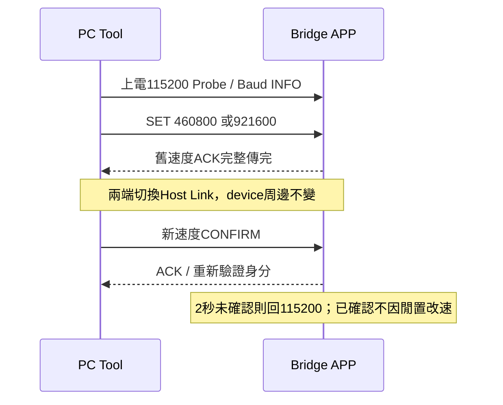

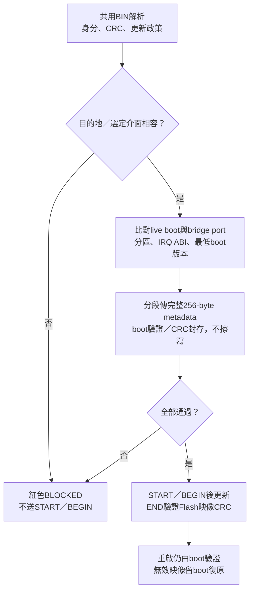
<!-- COMMON_IMAGE_POLICY_END -->
