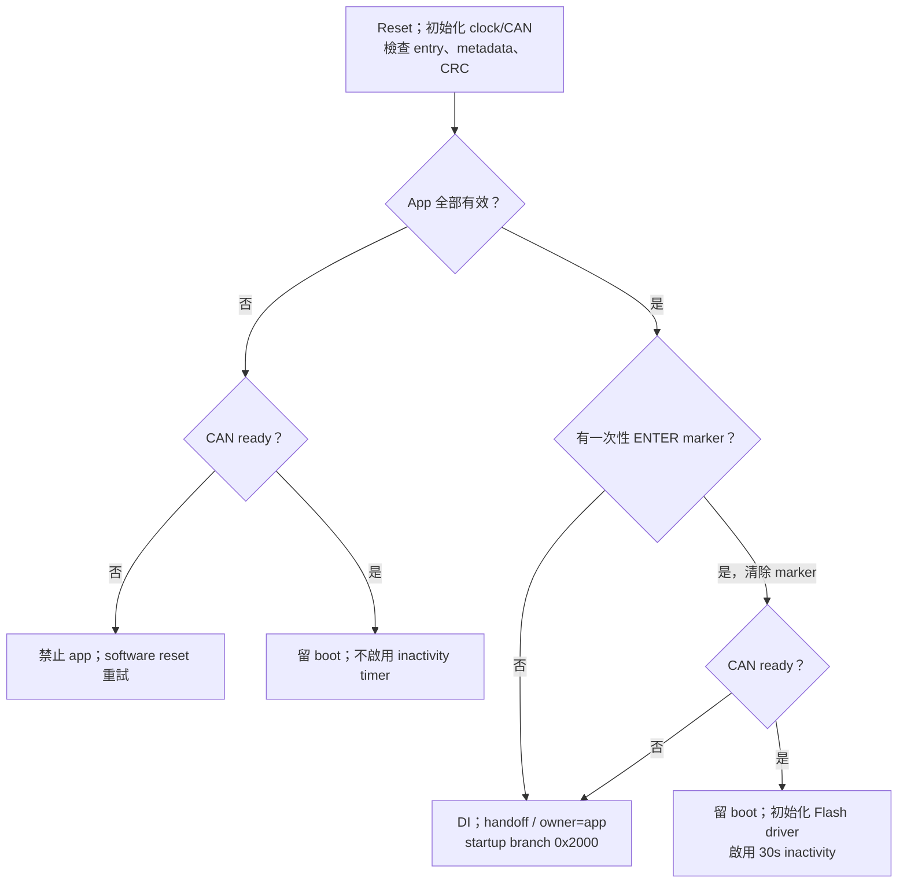
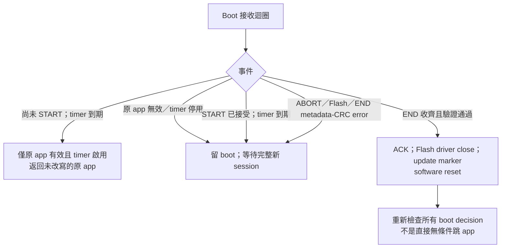
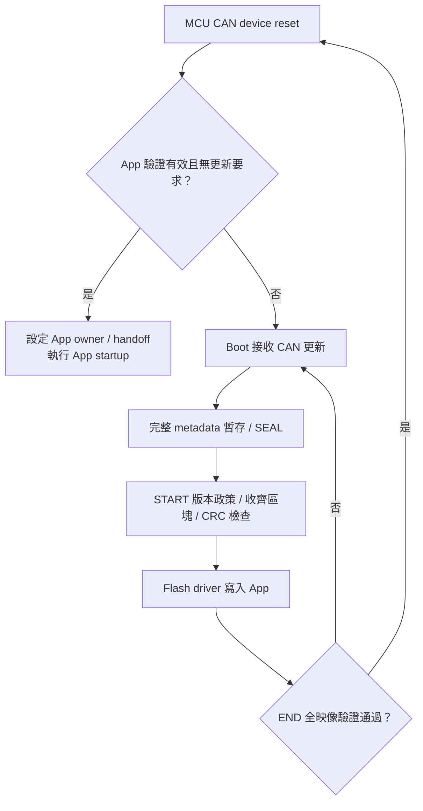
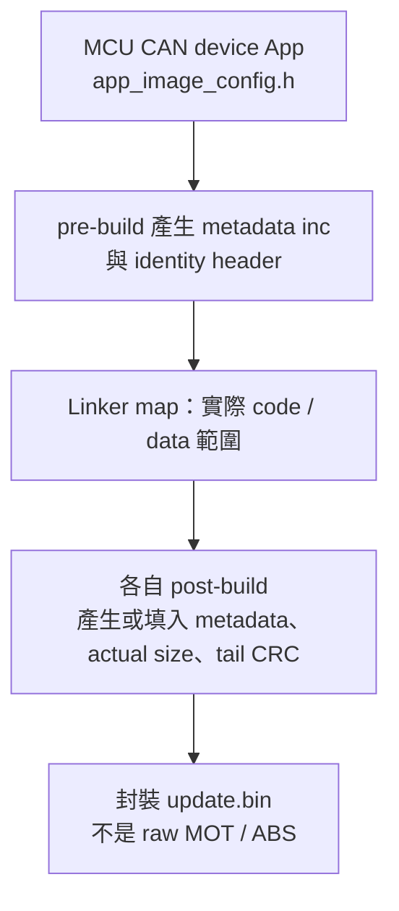
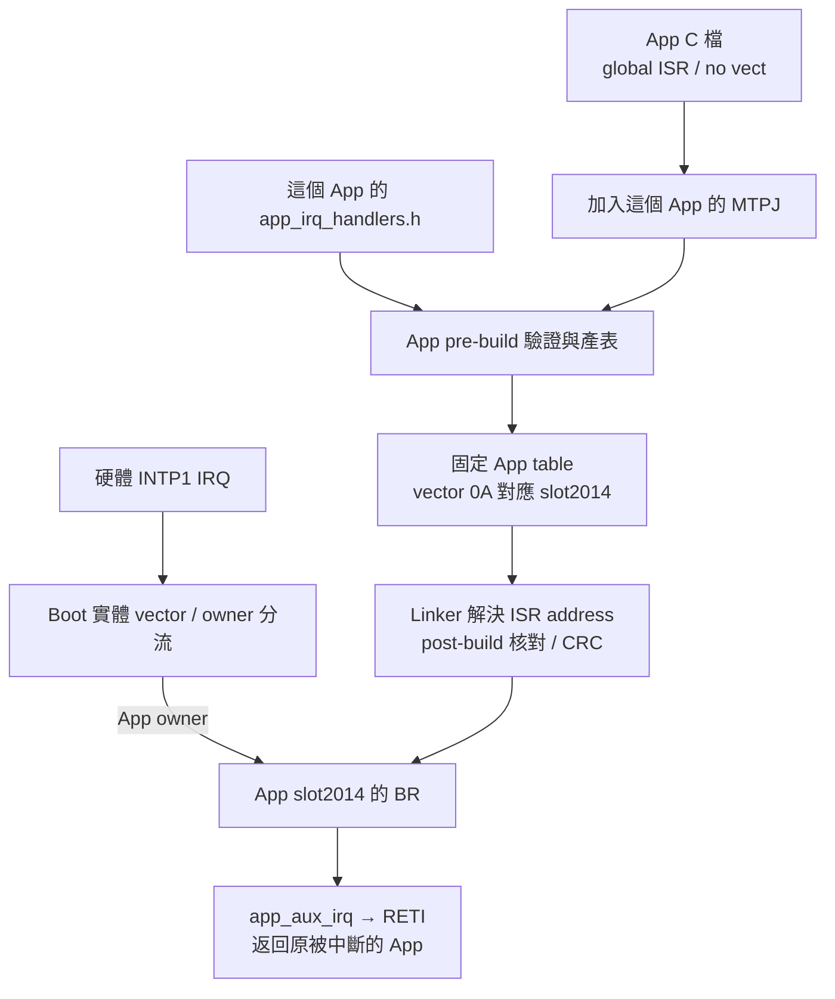
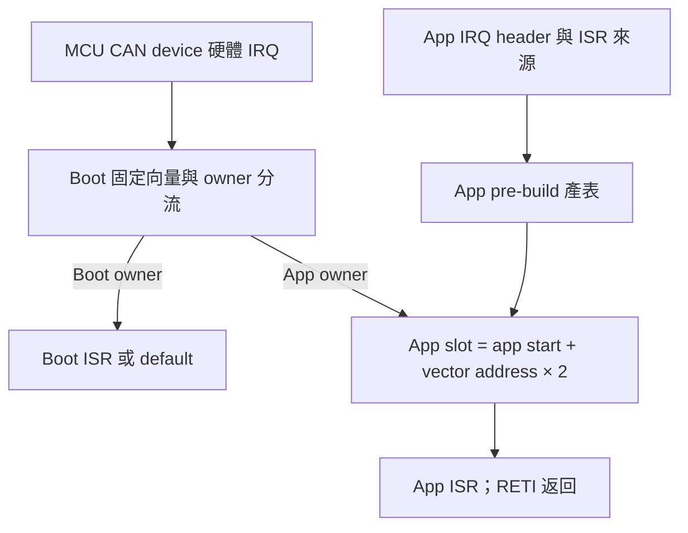
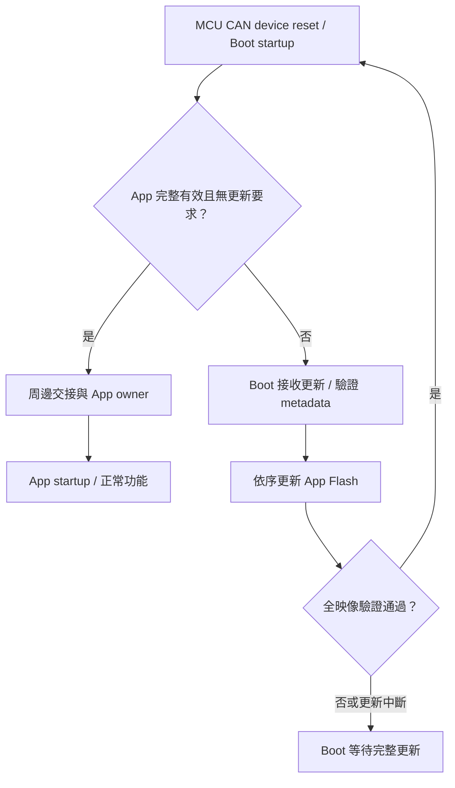

[知識庫首頁](https://released.github.io/) · [ISP Tool 操作](../slide_isp_tool_for_RL78/)

<a id="article_top"></a>

# RL78 Bootloader 實作指南

本頁整理 MCU CAN device 的 Boot／App 工程、metadata、向量與啟動流程。
F13、F24 各自使用獨立工程，後續 MCU 可依相同流程加入。

## MCU CAN device

| Device | 工程與說明 |
| --- | --- |
| F13 (MCU CAN device) | [Boot 啟動與更新狀態](#f13-boot-decision) |
| F24 (MCU CAN device) | [Boot／App 工程配置](#f24-can-device) |

- [Metadata 與 IRQ 設定](#device-metadata-vector-workshop)
- [Boot／App 移植](#boot-app-porting)
- [Flash／metadata 每 byte 與 CAN 格式](#flash-metadata-can-reference)
- [Custom Transfer 通訊驗證](https://released.github.io/slide_isp_tool_for_RL78/#custom-transfer)

## F13 (MCU CAN device)：Boot 啟動與更新

<!-- F13_BOOT_DECISION_BEGIN -->
<a id="f13-boot-decision"></a>

本節整理 F13 (MCU CAN device) 的 Boot 啟動與更新狀態。
對應來源為 `r_main.c` 與 `can_boot_transport.c`。

#### A. 每次 reset 的 app 有效性檢查：全部通過才可啟動

| 檢查 | 目前 F13 build 必須符合 |
| --- | --- |
| Reset entry | `0x2000` 的第一個 DWORD 不為 `0xFFFFFFFF`；只檢查非 erased，沒有完整反組譯／驗證跳轉目的地 |
| Metadata header | `0x2100` magic=`0x004E4143`；format6、core length128、flags=`0x0003`；protocol ID1／version5、checksum type1（CRC32）、target=`0xF13B`、Classical CAN／standard ID 格式全部匹配 |
| Metadata reserved | 整區256 bytes 中後128 bytes（`0x2180..0x21FF`）全部為 `0xFF` |
| Metadata policy | UPD1 version3／size32、DEVICE_APP／CAN、F1V1 IRQ ABI；minimum Boot 不高於目前 Boot；`0x74..0x77` version control 為0或1，UART baud 與其餘保留欄位為0 |
| Image size | manifest size 含尾端 CRC4 bytes，介於516與122880 bytes，且4-byte aligned |
| App version | `0x00MMmmpp`；啟動時驗證欄位有效。更新版本比較在 START 執行，依目前有效 App 的 version control 判斷；build 不參與比較 |
| Flash layout | app start=`0x2000`、capacity=`0x1E000`、code Flash=`0x20000`、boot reserve=`0x2000`、erase=`0x400`、minimum=`0x204`，均等於 boot 編譯設定 |
| CAN contract | nominal mask=`0x04`（500K）、data mask=0、request ID=`0x700`、response ID=`0x701`，均等於 boot 編譯設定 |
| CRC32 | 對 `[app_start, app_start + image_size - 4)` 計算 CRC32，等於該 image 最後4 bytes 的 LE32 stored CRC |

Boot 直接比對 MCU ASCII family／part，要求 build 已初始化，並檢查
UPD1更新政策、IRQ ABI與最低boot版本。PC仍須另作image/live device比對。
CRC是完整性，不是簽章或身分認證；最低boot版本不等於app防回滾。

#### B. ENTER marker 與啟動路徑

1. app 有效且沒有 ENTER marker：正常返回 startup，轉到 `0x2000` 的 app table。
2. app 收到 standard data ID=`0x700`、DLC1、data=`06` 的明確 ENTER request 時，
   先嘗試送 ACK（ID=`0x701`、DLC2、`06 00`），再將 `0xAA55AA55` 寫入
   no-init RAM `0xFF700`，最後 software reset。ACK 不是 reset 的可靠送達保證。
3. boot 看見 marker 後立即清除，表示本次先進入更新模式，不是永久鎖住 boot。
   P13.7／INTP0 不參與 boot decision，也不要求 tool 或 analyzer 必須在線才能正常開 app。
4. app 無效：禁止跳 app；CAN ready 時留 boot 等完整更新，clock／CAN 初始化失敗則
   software reset 重試，不能藉此放行無效 app。
5. app 有效但要求進 boot，而 clock／CAN 初始化失敗：目前實作會返回有效 app，
   不會永久卡 boot；CAN ready／FSL ready 不是所有正常啟動都必須通過的額外 gate。
6. 真正交接前關中斷，寫 `0xFF714` handoff signature、將 `0xFF710` ISR owner
   設為 app（`0x55`），startup 再 branch app table。這些是 boot 的輸出，不是額外外部啟動要求。



#### C. 30 秒 inactivity、START、失敗與更新成功

| 事件 | boot 的實際結果 |
| --- | --- |
| 原 app 有效、ENTER 後尚未接受 START | 連續30秒沒有符合底層接收條件的 CAN request，關閉已初始化的 FSL 後返回原 app |
| 持續 INFO／HELLO／其他符合接收條件的 frame | 都會刷新 inactivity；不是上電後固定30秒，也不是只由 DATA 刷新；未知 command／錯誤 DLC 也可能刷新 |
| 原 app 無效 | 從一開始不啟用 inactivity timer，接受 START 後也不會自動啟用；失聯仍留 boot 等重試 |
| START 被拒絕（protocol／target／size／FSL not ready） | 沒有進入 started state；不能把這個拒絕當成 app 已被擦寫；原 app 有效且 timer 啟用時仍可 inactivity 返回 |
| START 已接受後 inactivity 到期 | 若本次 timer 原本啟用，回 session-timeout error、留 boot、關閉後續自動返回；不跳可能只有部分內容的 app |
| ABORT／erase-write error／END metadata 或 CRC error | error 返回主迴圈，關閉後續自動返回，留 boot 等新 session；ABORT 即使在 START 前也走這條留 boot 路徑 |
| END 長度／state 尚不完整 | 回錯誤但保留 session；不得先宣布成功或跳 app |
| END 收齊、metadata size 等於 START size、Flash metadata 與 CRC 正確 | ACK 成功，關閉 FSL，寫 `0xFF718` update-complete marker，再 software reset；下次 reset 重新通過 A 節與 ENTER 判斷才進 app |
| 擦寫中掉電 | 下次上電重新跑 A 節；若 image 仍有效且無 ENTER 則可啟動，否則留 boot；不是保證有雙映像回復 |

底層接收條件為standard／非RTR、ID700或720..727、DLC>0；通過即刷新timer，之後才
檢查 command。計時由1ms TMRJ0 IRQ 累加，Flash 操作關 IRQ 時不是嚴格的 wall-clock
30秒。timer 已停用或未啟用時，PC 失聯不能期待 target 自動 timeout／reset；tool 的
bounded wait／ABORT 不能取代供電、Flash、IRQ 與掉電的實板驗證。


#### App 工程設定

固定向量介面與 ISR 登錄方式見 [Device IRQ 設定](https://released.github.io/slide_boot_loader_for_RL78/#device-app-irq)。
Metadata 與 App-only 建置命令見 [Device App 建置](https://released.github.io/slide_boot_loader_for_RL78/#device-app-build)。

<!-- F13_BOOT_DECISION_END -->

<!-- F24_DEVICE_BEGIN -->
<a id="f24-can-device"></a>

## F24 (MCU CAN device)：Boot／App 工程配置

F24 CAN device 使用獨立的 Transfer、Boot 與 App 工程。
板端為 RL78/F24 Target Board R7F124FPJ5xFB。

### 板端與更新設定

| 項目 | 設定 |
| --- | --- |
| X1／CPU／CAN clock | 4 MHz／40 MHz／40 MHz，PLL80 |
| CAN backend | RS-CANFD，Classical CAN 500K |
| CAN pins | P10 TX、P11 RX、P12 STB LOW |
| 診斷 UART | P15 TX、P16 RX、115200 |
| Flash driver | RFD Type02，programming-mode 路徑在 RAM 執行 |
| Target／IRQ ABI | `0xF24B`／F2V1 |
| IRQ owner | `0xAA`：Boot；`0x55`：App |
| CAN IDs | Control `0x700`、response `0x701`、raw `0x720..0x727` |
| 更新格式 | App image format6、CAN protocol5、64-byte blocks |

### Flash 配置

| 絕對 address | 用途 |
| --- | --- |
| `0x00000..0x01FFF` | 8 KiB Boot，含實體 vector／option |
| `0x02000..0x020FF` | App 64 組4-byte跳轉表 |
| `0x02100..0x0217F` | 128-byte metadata core |
| `0x02180..0x021FF` | 128-byte metadata reserved FF |
| `0x02200..` | App startup／code／far constants |
| `app_start + image_size - 4` | App CRC32 尾碼 |
| `0x3FC00..0x3FFFF` | 最後1 KiB保留，含 debug monitor |

最大 App 容量為 `0x3DC00`（247 KiB），擦除單位1 KiB，寫入單位4 bytes。
建置檢查保留至少512 bytes Boot ROM 餘裕，預設關閉 Boot UART log。
完整欄位說明見 [Device metadata 位址表](https://released.github.io/slide_boot_loader_for_RL78/#flash-metadata-can-reference)。

### Boot 啟動與更新

Boot 檢查 metadata、跳轉表與全映像 CRC。
SW1（P137 LOW）或 ENTER marker 進入更新模式；有效 App 的 ENTER session 使用30秒 inactivity。
Flash 操作透過 RAM 中的 RFD 執行路徑更新 App 範圍。



### 工程與建置

三個工程放在同一父目錄。
Boot 的 `common` 提供 board／clock／CAN backend，Boot 內含 RFD 來源。
App 與 Transfer 各自保存 SC 與 MTPJ。

在 Boot 目錄使用 PowerShell：

```powershell
# Clean rebuild Transfer, Boot and App.
powershell.exe -NoProfile -ExecutionPolicy Bypass -File .\build.ps1 -Kind all

# App-only clean rebuild.
powershell.exe -NoProfile -ExecutionPolicy Bypass -File .\build.ps1 -Kind app

# Safe artifact and contract checks.
powershell.exe -NoProfile -ExecutionPolicy Bypass -File .\test.ps1
```

日常建置使用 Windows PowerShell、CS+／CC-RL。
CS+ hooks 依序執行產表與封裝；map、ROM／RAM、向量、metadata 與 CRC 由腳本核對。

C header 編輯、ISR 與 App-only 命令集中於 [Device App 設定與建置](https://released.github.io/slide_boot_loader_for_RL78/#device-app-build)。
初裝檔為 Boot `boot0000_1FFF.hex`＋App `flash_app_variable_CRC.hex`，或 App 根目錄 `boot_app.hex`。
CAN 更新使用 App `*_update.bin`。App 產表為 `ftable.inc`、`app_identity.h`、`app_irq_table.inc`，
由 `ftable_RL78_F24.asm` 組譯；兩份 C header 仍是編輯入口。

### 驗證項目

軟體檢查涵蓋編譯、向量／RETI、IRQ stack、RFD RAM 路徑及 metadata／區塊處理。
實板驗證涵蓋 CAN 波形／ACK、Flash 擦寫、reset 後 App、IRQ、斷線及斷電復原。
<!-- F24_DEVICE_END -->

<!-- DEVICE_WORKSHOP_BEGIN -->
<a id="device-metadata-vector-workshop"></a>

## Device 開發實作：編輯 Metadata、增加 IRQ、產生並驗證 App

本章整理 **F13 (MCU CAN device)** 與 **F24 (MCU CAN device)** 的 App 設定與建置流程。
兩者皆透過 CAN 更新 App，由 pre-build／post-build 將專案設定轉成映像。
兩份工程共同作為後續 MCU 的 [golden sample](https://github.com/released/simple_renesas_isp_tool/blob/main/docs/DEVICE_GOLDEN_SAMPLE_zh-TW.md)。
編輯與建置使用 C header、Windows PowerShell／.NET 與 CS+；不需要 Python。

### A. 專案配置與共用介面

| 項目 | F13 (MCU CAN device) | F24 (MCU CAN device) |
| --- | --- | --- |
| Boot／App | `RL78_F13_Boot_loader_CAN`／`RL78_F13_Boot_loader_CAN_app` | `RL78_F24_Boot_loader_CAN`／`RL78_F24_Boot_loader_CAN_app` |
| MCU／Flash driver | R5F10BMG／FSL | R7F124FPJ5xFB／RFD，忙碌期間必要程式在 RAM |
| Target／IRQ ABI | `0xF13B`／F1V1 | `0xF24B`／F2V1 |
| Boot／App 起點 | 8 KiB／`0x2000` | 8 KiB／`0x2000` |
| App capacity | `0x1E000`，120 KiB | `0x3DC00`，247 KiB；最後 1 KiB 保護 |
| 更新契約 | App image format 6、CAN protocol 5、Classical 500K | 同樣格式／協定，但身分與 geometry 不同 |
| 版本／build 編輯來源 | App `app_image_config.h` | App `app_image_config.h` |
| IRQ 編輯來源 | 各 App 的 `app_irq_handlers.h`＋已註冊 ISR C 檔 | 同左 |

App 與 matching Boot 以原名稱放在同一父目錄；保留相鄰 Boot 提供的腳本／共用來源。
F13 可由 [Boot](https://github.com/released/RL78_F13_Boot_loader_CAN)／[App](https://github.com/released/RL78_F13_Boot_loader_CAN_app) 取得。
F24 device 的板端設定與建置方式見 [F24 CAN device 工程配置](https://released.github.io/slide_boot_loader_for_RL78/#f24-can-device)。
獨立 Transfer 專案是通訊測試整機映像，不是可載入的 App 更新 BIN。

#### A1. 設定檔與產物分工

| 檔案 | 內容 | 編輯方式 |
| --- | --- | --- |
| `app_image_config.h` | App 版本、build 與映像身分核對值 | 使用者設定 |
| `app_irq_handlers.h` | 實體 vector → ISR 函式名稱 | 使用者設定，搭配 App 的 ISR C 檔 |
| `.inc`、identity header、向量表 | 編譯與封裝所需資料 | 產生器輸出；檔名見 [建置產物](#device-app-build) |
| `DefaultBuild/app_build_report.html` | 實際 BIN 的 metadata、位址、CRC、向量表 | post-build 輸出；以瀏覽器開啟，見 [編譯摘要](#device-app-build-report) |

兩個 device 使用相同的 C header 欄位，產生器依各自的 Boot 契約輸出對應檔案。

<a id="device-app-json"></a>
<a id="device-app-config"></a>

### B. Metadata 設定與產生來源

| 分類／欄位 | 編輯或產生位置 | 只更新 App？ |
| --- | --- | --- |
| App version／build | 兩者都編輯 `app_image_config.h` 的 `APP_IMAGE_VERSION`／`APP_IMAGE_BUILD` | 是，仍須符合既有契約 |
| 版本管制 | `APP_IMAGE_VERSION_CONTROL`；`0U` 預設允許任意版本，`1U` 僅允許同版／新版 | 是；成功更新後採用映像設定 |
| image_size／CRC 地址／CRC32 | 由 linker map 與 post-build 封裝決定 | 自動產生，不填預估大小、不用 hex editor 改 |
| Target、MCU part／family、Flash geometry、CAN IDs／rate | Boot 契約、App producer、linker／backend、封裝與 live INFO 必須一致 | Boot／App 共同契約 |
| Role／transport／IRQ ABI／minimum Boot | matching Boot config／producer 產生；Boot／Tool 均驗證 | 由 Boot／Tool 核對 |
| Metadata reserved `0x80..0xFF` | Producer 固定填 `FF` | 新增欄位時同步 producer 與 validator |
| `APP_IMAGE_TARGET_ID`／`APP_IMAGE_ROLE`／`APP_IMAGE_UPDATE_TRANSPORTS` | App 與 Boot 的契約核對值 | Target：F13 `0xF13B`、F24 `0xF24B`；role `1U`＝DEVICE_APP、transport `0x01U`＝CAN |

Packed version 採 `(major << 16) | (minor << 8) | patch`；每部分一個 byte。
以下版本／日期用於展示設定差異。
build 使用十進位整數。
App 版本、Boot 版本與 minimum Boot 為不同欄位。

| Define | 功能與用途 | 範例／其他值的處理 |
| --- | --- | --- |
| `APP_IMAGE_VERSION` | App 自己的 major／minor／patch；作版本比較 | `0x00020103UL`＝2.1.3；不要求等於 Boot 版本 |
| `APP_IMAGE_BUILD` | App 建置識別；不參與版本排序 | `20261018UL`；與 Boot build 不必一致；相同版本換 build 仍視為同版 |
| `APP_IMAGE_TARGET_ID` | 與 paired Boot 核對映像身分，不是 MCU 選擇器 | F13 `0xF13BU`／F24 `0xF24BU`；只改成 `0xF33BU` 會在 pre-build 被拒絕 |
| `APP_IMAGE_ROLE` | 更新目的地角色 | 協定 `1U`＝DEVICE_APP、`2U`＝HOST_BRIDGE_APP；本工程要求 `1U`，改 `2U` 或未定義的 `5U` 都拒絕產生 |
| `APP_IMAGE_UPDATE_TRANSPORTS` | 允許的更新介面 bitmask，不是 App 執行時使用的周邊 | 協定 `0x01U`＝CAN、`0x02U`＝I2C、`0x04U`＝UART，`0x03U`＝CAN＋I2C；本 CAN 工程僅接受 `0x01U`，其他值不會啟用另一種更新流程 |
| `APP_IMAGE_VERSION_CONTROL` | 已安裝有效 App 的版本政策 | `0U`＝任意版本、`1U`＝同版／新版；其他值拒絕產生；維護操作見 [force 降版](https://released.github.io/slide_isp_tool_for_RL78/#force-old-version) |

Boot 自身的版本／build 位於 `can_boot_config.h` 的 `CAN_BOOT_FIRMWARE_VERSION`／`CAN_BOOT_FIRMWARE_BUILD`。
App producer 將該 Boot 版本寫成 metadata 的 minimum Boot；板上 Boot 版本須不低於此值。
例如 Boot 1.7.0 與 App 2.1.3 可以搭配；App 版本與 Boot 版本不做相等比較。
只更新相容的 App 時，保留 Boot 設定即可。

#### B1. F13：編輯 app_image_config.h

修改前：

```c
#ifndef APP_IMAGE_CONFIG_H
#define APP_IMAGE_CONFIG_H

#define APP_IMAGE_VERSION           (0x00010500UL)
#define APP_IMAGE_BUILD             (20261015UL)
#define APP_IMAGE_TARGET_ID         (0xF13BU)
#define APP_IMAGE_ROLE              (1U)    /* DEVICE_APP */
#define APP_IMAGE_UPDATE_TRANSPORTS (0x01U) /* CAN */
#define APP_IMAGE_VERSION_CONTROL   (0U)    /* 0=any; 1=same/newer */

#endif
```

修改後（僅示範 App 資訊變更）：

```c
#ifndef APP_IMAGE_CONFIG_H
#define APP_IMAGE_CONFIG_H

#define APP_IMAGE_VERSION           (0x00010501UL)
#define APP_IMAGE_BUILD             (20261016UL)
#define APP_IMAGE_TARGET_ID         (0xF13BU)
#define APP_IMAGE_ROLE              (1U)    /* DEVICE_APP */
#define APP_IMAGE_UPDATE_TRANSPORTS (0x01U) /* CAN */
#define APP_IMAGE_VERSION_CONTROL   (0U)    /* 0=any; 1=same/newer */

#endif
```

App pre-build 讀 C header 與 matching Boot 的 `can_boot_config.h`，產生 `ftable.inc`／`app_identity.h`；
`ftable_RL78_F13.asm` 依生成常數排列 App metadata，讓 App INFO 與 BIN 使用同一版本／build。
`IMAGE_SIZE_POST_BUILD = 0xFFFFFFFF` 是封裝前的長度預留值，post-build 會填入實際大小。

#### B2. F24 device：編輯 app_image_config.h

修改前：

```c
#ifndef APP_IMAGE_CONFIG_H
#define APP_IMAGE_CONFIG_H

#define APP_IMAGE_VERSION           (0x00010000UL)
#define APP_IMAGE_BUILD             (20261015UL)
#define APP_IMAGE_TARGET_ID         (0xF24BU)
#define APP_IMAGE_ROLE              (1U)    /* DEVICE_APP */
#define APP_IMAGE_UPDATE_TRANSPORTS (0x01U) /* CAN */
#define APP_IMAGE_VERSION_CONTROL   (0U)    /* 0=any; 1=same/newer */

#endif
```

修改後（保留契約欄位）：

```c
#ifndef APP_IMAGE_CONFIG_H
#define APP_IMAGE_CONFIG_H

#define APP_IMAGE_VERSION           (0x00010001UL)
#define APP_IMAGE_BUILD             (20261016UL)
#define APP_IMAGE_TARGET_ID         (0xF24BU)
#define APP_IMAGE_ROLE              (1U)    /* DEVICE_APP */
#define APP_IMAGE_UPDATE_TRANSPORTS (0x01U) /* CAN */
#define APP_IMAGE_VERSION_CONTROL   (0U)    /* 0=any; 1=same/newer */

#endif
```

`prepare_projects.ps1` 核對 C header，產生 `app_identity.h`、`ftable.inc`
與其組語 wrapper；linker 將該 256-byte metadata 放到 `0x2100`。
`package_images.ps1` 比對已編譯 metadata 與同一 C header／Boot contract，再填實際長度與尾端 CRC。
geometry、IRQ ABI、CAN routing 等欄位由 Boot 契約提供。
更新目的地與介面的核對規則見 [更新政策](https://released.github.io/slide_isp_tool_for_RL78/#image-update-policy)。

`app_image_config.h` 使用上述六個 `APP_IMAGE_*` define 與固定 include guard。
數值採 C 的十六進位或十進位整數，可加 `U`／`UL` 及一層括號；version 為 `0x00000000..0x00FFFFFF`，build 為 `0..4294967294`。
設定以 literal 表示，不使用條件編譯、其他 include 或運算式；C90 `/* ... */` 註解可保留。
產生器會拒絕缺少／重複／未知 define、契約不符或非整數設定。

工程內的 header 在每個欄位旁標示用途、編碼與修改條件。
version／build 是 App 身分設定；target／role／transport 是與 Boot 核對的契約值。
完整 Flash／CAN／IRQ ABI 資料由 Boot 契約產生，不需要在 App header 重複填寫。

#### B3. 用 address 與 byte 核對結果

兩個 device 的 App 起點相同，以下 address 相同；**欄位值與 image capacity 仍不同**。
完整欄位見 [Flash／Metadata byte 對照](https://released.github.io/slide_boot_loader_for_RL78/#flash-metadata-can-reference)；
兩個工程的欄位值由各自的 App 設定及 Boot 契約產生。

| 欄位 | Metadata offset | BIN offset | 絕對 Flash address | 本例預期 |
| --- | --- | --- | --- | --- |
| App version | `0x10..0x13` | `0x110..0x113` | `0x2110..0x2113` | F13：`01 05 01 00`；F24：`01 00 01 00` |
| App build | `0x14..0x17` | `0x114..0x117` | `0x2114..0x2117` | 20261016，LE32 |
| Actual image size | `0x18..0x1B` | `0x118..0x11B` | `0x2118..0x211B` | 必須等於 BIN 檔案長度，不是 capacity |
| Policy／IRQ ABI | `0x60..0x6F` | `0x160..0x16F` | `0x2160..0x216F` | DEVICE_APP、允許 CAN、各自 ABI 與 minimum Boot |
| Version control | `0x74..0x77` | `0x174..0x177` | `0x2174..0x2177` | `0U`／`1U`，LE32；Boot 在一般 START 比較已安裝版本 |
| Reserved FF | `0x80..0xFF` | `0x180..0x1FF` | `0x2180..0x21FF` | 128 bytes 全 `FF` |
| Tail CRC32 | 不在 metadata 裡 | `actual size - 4` | `0x2000 + actual size - 4` | 前面全部 BIN bytes 的 CRC32，LE32 |

#### B4. Metadata 產生路徑



<a id="device-app-irq"></a>

### C. App Vector Table：新增 IRQ 範例

本例使用兩個 device header 都定義的 `INTP1 = 0x0A`。
其他 IRQ 的 vector 位址依各 MCU 的 device header 決定。
vector ? 是 **實體 vector byte address**，不是 IRQ 序號、App slot 或周邊 pin。
兩者的 App slot 計算為 `0x2000 + 0x0A × 2 = 0x2014`，即 BIN offset `0x14`。

#### C1. 加入一般 ISR，並在 App MTPJ 註冊來源

在自己的 App 新增 `app_extra_irq.c`，透過 CS+ 將它加入該 App 的編譯來源。
以下函式只清旗標並記錄事件；**不會初始化或啟用 INTP1**。

```c
#include "r_cg_macrodriver.h"

volatile unsigned char g_app_aux_irq_count;

#pragma interrupt app_aux_irq
void __near app_aux_irq(void)
{
    /* Clear the source flag and capture bounded state only. */
    PIF1 = 0U;
    g_app_aux_irq_count++;
}
```

ISR 使用 global、非 static、無 `vect=` 的 interrupt 函式，由編譯器產生 RETI。
實體 `.VECTOR` 與 `-VECTN` 由 Boot 管理，App 使用固定轉送表連到 ISR。
啟用中斷之前，另依實際板子完成 pin／edge／priority／pending flag／mask 初始化；
範例未提供可直接接線使用的 INTP1 pin 設定。未用 IRQ 應保持 mask。
SC／Code Generator 重產後，核對 ISR pragma 並移除 App 的 `vect=`，保留 Boot 的實體向量所有權。

#### C2. F13 mapping：保留原有項目，新增 0x0A

vector ? 的來源是此 App 的 [iodefine.h](https://github.com/released/RL78_F13_Boot_loader_CAN_app/blob/main/iodefine.h) 中的中斷定義。
硬體規格可對照 RL78/F13 硬體手冊「Interrupt functions」章節的中斷來源／向量表。

| vector ? | header 定義 | ISR 名稱 | 函式來源 |
| --- | --- | --- | --- |
| `0x08` | `INTP0 = 0x0008` | `r_intc0_interrupt` | [r_cg_intc_user.c](https://github.com/released/RL78_F13_Boot_loader_CAN_app/blob/main/src/code_gen/r_cg_intc_user.c) |
| `0x0A` | `INTP1 = 0x000A` | `app_aux_irq` | 本章 C1 的 `app_extra_irq.c` |
| `0x16` | `INTST0 = 0x0016` | `r_uart0_interrupt_send` | [r_cg_serial_user.c](https://github.com/released/RL78_F13_Boot_loader_CAN_app/blob/main/src/code_gen/r_cg_serial_user.c) |
| `0x18` | `INTSR0 = 0x0018` | `r_uart0_interrupt_receive` | 同一份 `r_cg_serial_user.c` |
| `0x1E` | `INTTRJ0 = 0x001E` | `r_tmr_rj0_interrupt` | [r_cg_timer_user.c](https://github.com/released/RL78_F13_Boot_loader_CAN_app/blob/main/src/code_gen/r_cg_timer_user.c) |

查找時可先在 header 搜尋周邊中斷名稱，再於 ISR C 檔確認 `#pragma interrupt` 與函式定義。
同一向量可能列有 CSI／IIC／UART 別名，實際來源由本專案啟用的周邊模式決定。
`APP_IRQ_HANDLERS(X)` 的每一筆採 `X(vector, handler)`：第一個參數為實體向量位址，第二個為 App 的 C ISR 名稱。
清單使用 C 巨集續行，除最後一筆外，每行尾端保留 `\`；無使用項目時可保留空的巨集定義。

修改前：

```c
#ifndef APP_IRQ_HANDLERS_H
#define APP_IRQ_HANDLERS_H

#define APP_IRQ_HANDLERS(X) \
    X(0x08, r_intc0_interrupt) \
    X(0x16, r_uart0_interrupt_send) \
    X(0x18, r_uart0_interrupt_receive) \
    X(0x1E, r_tmr_rj0_interrupt)

#endif
```

修改後：

```c
#ifndef APP_IRQ_HANDLERS_H
#define APP_IRQ_HANDLERS_H

#define APP_IRQ_HANDLERS(X) \
    X(0x08, r_intc0_interrupt) \
    X(0x0A, app_aux_irq) \
    X(0x16, r_uart0_interrupt_send) \
    X(0x18, r_uart0_interrupt_receive) \
    X(0x1E, r_tmr_rj0_interrupt)

#endif
```

#### C3. F24 device mapping：保留自己的 timer

F24 App 的 `iodefine.h` 定義 `INTTM01 = 0x002E`。
本工程的 timer ISR 為 `common/device_board.c` 中的 `Device_TimerIsr`，因此使用 `X(0x2E, Device_TimerIsr)`。
`0x0A` 對應此 App header 中的 `INTP1 = 0x000A`，搭配 C1 的 `app_aux_irq` 範例。

修改前：

```c
#ifndef APP_IRQ_HANDLERS_H
#define APP_IRQ_HANDLERS_H

#define APP_IRQ_HANDLERS(X) \
    X(0x2E, Device_TimerIsr)

#endif
```

修改後：

```c
#ifndef APP_IRQ_HANDLERS_H
#define APP_IRQ_HANDLERS_H

#define APP_IRQ_HANDLERS(X) \
    X(0x0A, app_aux_irq) \
    X(0x2E, Device_TimerIsr)

#endif
```

各 App 的 C header 保存該專案使用的 IRQ 清單，新增項目時保留既有 mapping。
函式改名會同步反映於 C pragma、函式定義與 C header。
移除 mapping 時，對應周邊的 IRQ 也一併停用。

#### C4. 產生結果與核對欄位

| 檢查位置 | 修改前 | 修改後 |
| --- | --- | --- |
| F13 `app_irq_table.inc` 的 vector `0x0A` | `BR !!f13_app_default_isr` | `BR !!_app_aux_irq`，slot `0x2014` |
| F24 device `app_irq_table.inc` 的 vector `0x0A` | `BR !!device_default_isr` | `BR !!_app_aux_irq`；table start `0x2000` |
| App map | 沒有新 ISR symbol | `_app_aux_irq` 有有效 code address；應為 interrupt ISR |
| 最終 BIN 的 offset `0x14..0x17` | 指向原 default ISR | `EC`＋新 ISR 的 3-byte little-endian 絕對 address |
| Boot 的實體 vector／來源 | 固定轉送介面 | 不因 App 函式名或使用清單改變 |

Assembler symbol 前綴 `_` 由 generator 加入，C header 使用 C 函式原名 `app_aux_irq`。
表有固定 64 個 4-byte slot，不是每增加一個 IRQ 就把後面的 entry 往後推。
App reset slot 進 `_start`，不是直接進 `main`；`0x02` 仍是保留位置，不能加入 C header。
F13 此 slot 填 `FF`，F24 device 產生 default branch；兩者都不代表可啟用 reserved IRQ。
physical BRK `0x7E` 不由 Boot 轉送；App 的保留 BRK slot 使用 RETB，不是一般 IRQ 的 RETI。

#### C5. IRQ 的產生與執行路徑



<a id="device-app-build"></a>

### D. 產生與建置

下列是相鄰工程的相對路徑；在自己的 App 根目錄執行。先備份／記錄 matching Boot image 雜湊。
範例只變動 App 資訊及一般 IRQ，**不應呼叫 Boot 產表或 Boot rebuild**。
兩個 device 都使用 Windows PowerShell 與工程對應的 CS+／CC-RL。
CS+ 開啟自己的 App `.mtpj`，建置組態為 `DefaultBuild`。
下方 PowerShell 腳本以單次 `-ExecutionPolicy Bypass` 執行，不需永久更改系統執行原則。

#### D0. 第一次操作：逐步完成一次 App 變更

1. 選定 F13 或 F24 **device** 的 matching Boot/App，按原名稱放在同一父目錄；確認工程可建置。
2. 保存 Boot HEX、App 更新 BIN 與兩份 C header，記錄 Boot image 雜湊。
3. 開啟 App 的 `app_image_config.h`，修改 `APP_IMAGE_VERSION`／`APP_IMAGE_BUILD`；對照 B1 或 B2，保留 target／role／transport。使用 UTF-8，程式註解採英文 C90 寫法。
4. 若只升版本，跳到第6步。若新增 IRQ，依 C1 新增正常 ISR C 檔，並在 CS+ **此 App** 的 MTPJ 加入來源；還不要啟用硬體 IRQ。
5. 編輯這個 App 的 `app_irq_handlers.h`，保留既有清單，再加入 `0x0A` 範例或已核對的合法 vector／handler。
6. 從 App 根目錄執行 D1 或 D2 的產生命令，再執行 CheckOnly。錯誤先修正 C header／MTPJ／ISR，不手改 `.inc`、identity 或 table。
7. Clean Rebuild **App**，確認 pre-build 與 post-build 都成功。對照下方產物表，確認新 table、version／build、實際 BIN 長度與 CRC；使用此次成功建置的產物。
8. 在 Tool CAN TAB 載入該 App 的 `*_update.bin`，依 E 節核對映像版本、Metadata VALID 與 CRC MATCH；這一步不寫 MCU。
9. Open + Probe host、Discover **device**，核對 live target／layout／CAN／IRQ ABI／minimum Boot；相容才 Enter Boot 並開始更新，不以離線 BIN 取代 live 身分。
10. END／reset 後另外確認 App 版本 INFO／UART、既有 IRQ 與新 IRQ；最後比較 Boot 區／映像未變。硬體 IRQ 啟用前的初始化與故障測試仍需另作。

只升 App 版本時不必新增 ISR；只新增 IRQ 時也不必更改 target 或 Boot 版本。

#### D1. F13 device

```powershell
# Generate this App's metadata INC, IRQ table and identity; never Boot.
powershell.exe -NoProfile -ExecutionPolicy Bypass `
  -File "..\RL78_F13_Boot_loader_CAN\generate_irq_contract.ps1" `
  -Mode App -AppProject "."

# Read-only freshness check; run after generating, not instead of generating.
powershell.exe -NoProfile -ExecutionPolicy Bypass `
  -File "..\RL78_F13_Boot_loader_CAN\generate_irq_contract.ps1" `
  -Mode App -AppProject "." -CheckOnly
```

然後在 CS+ **Clean Rebuild 此 App**。原有 pre-build 保留上述 App-mode 命令，
post-build 保留 `generate_update_image.ps1`；該腳本依 map／App HEX 封裝，並非只產表就有新 BIN。
Tool 的 `scripts/verify_f13_artifacts.ps1` 可作後續檢查，需指定正確 Boot／App project。
F13 目前仍保留參考 MTPJ／map／輸出檔名與 sibling Boot 假設；若改專案名／搬目錄，
必須另外對齊 source／include／hook、`-MapFile`、輸出命名、checker 及 Boot HEX 來源。

#### D2. F24 device

```powershell
# Update this App's projections / registered project settings, never Boot.
powershell.exe -NoProfile -ExecutionPolicy Bypass `
  -File "..\RL78_F24_Boot_loader_CAN\tools\prepare_projects.ps1" `
  -Kind app -Project "."

# Read-only freshness / registration check.
powershell.exe -NoProfile -ExecutionPolicy Bypass `
  -File "..\RL78_F24_Boot_loader_CAN\tools\prepare_projects.ps1" `
  -Kind app -Project "." -CheckOnly

# Clean rebuild and mandatory map / image packaging checks.
powershell.exe -NoProfile -ExecutionPolicy Bypass `
  -File "..\RL78_F24_Boot_loader_CAN\build.ps1" `
  -Kind app -AppProject "."
```

CS+ pre-build 使用 `prepare_projects.ps1 -Kind app -Project . -ArtifactsOnly`；
post-build 使用 `package_images.ps1 -Kind app -Project .`。`-ArtifactsOnly` 僅產生編譯所需檔案。
只改一般 App 功能，不用省略 kind 的 all-mode prepare／build；SC 重產後先重新 prepare **app**。
若改名或搬移，仍須修正相對 source／include／hook 路徑；不是任意 standalone App 加 C header 即可。
F24 device prepare 使用同一磁碟內的相對路徑。

| 產物 | F13 device | F24 device |
| --- | --- | --- |
| Metadata `.inc`（不可手改） | `ftable.inc` | `ftable.inc` |
| App pre-build identity | `app_identity.h` | `app_identity.h` |
| App vector table | `app_irq_table.inc` | `app_irq_table.inc` |
| 瀏覽器編譯摘要 | `DefaultBuild/app_build_report.html` | `DefaultBuild/app_build_report.html` |
| 後續 CAN 更新 | `DefaultBuild/RL78_F13_Boot_loader_CAN_app_update.bin` | `DefaultBuild/<MTPJ stem>_update.bin` |
| 燒錄器初裝 App | `DefaultBuild/flash_app_variable_CRC.hex` | `DefaultBuild/flash_app_variable_CRC.hex` |
| matching Boot 初裝 | 先核對 `boot_app.hex` 的來源／產生時間；或 matching Boot＋App HEX | matching `boot0000_1FFF.hex`＋封裝 App HEX，依燒錄器設定核對擦除範圍 |

F13 若找不到 sibling Boot HEX，post-build 不會產生新的合併檔；先前的 `boot_app.hex` 可能仍留著。
任何 build／guard 失敗，先前 BIN 仍可能保留，使用前核對此次建置結果。
raw App MOT／ABS 可能包含低位實體記錄，不應代替已封裝的 App HEX 或 update BIN。
post-build 會拒絕 C header 與已編譯 metadata／IRQ 表不同的編譯輸出；C header 修改後進行 clean rebuild。
F13 也直接比對 App map、實際 BR 目的地與 mapped ISR 的 RETI，不依賴 Boot map 才能執行這項 App 檢查。
CheckOnly 發現手改／過期生成檔時只報錯、不修復；先重產，再 clean rebuild。

<a id="device-app-build-report"></a>

#### D3. 以瀏覽器核對編譯摘要

App post-build 通過 C header、已編譯 metadata、linker map 與 BR／ISR 檢查，完成 BIN 封裝後，
會在相同的 `DefaultBuild` 目錄產生 `app_build_report.html`。
兩個 device 使用相同的 PowerShell／.NET 報告程式，不需安裝額外軟體；HTML 可離線開啟。

| 區塊 | 可以對照的內容 |
| --- | --- |
| Packaged image | MCU part、App version／build、BIN 檔名與實際長度 |
| CRC32／SHA-256 | 重新計算的 CRC32 與尾端儲存值、整份 BIN 的 SHA-256 |
| Flash 配置 | Boot、App 向量表、metadata、code 起點、實際尾端 CRC 位址 |
| Metadata field summary | 欄位 offset、解碼值與 C header／Boot contract／post-build 來源 |
| App vector table | 全部 64 個 slot、`iodefine.h` 中斷名稱、App slot 位址、實際 BR bytes／目的地、設定 handler |
| Metadata byte addresses | 展開後列出全部 256 bytes 的 metadata offset、BIN offset、Flash address、值與欄位索引 |

在 App 根目錄可執行：

```powershell
Start-Process '.\DefaultBuild\app_build_report.html'
Get-FileHash '.\DefaultBuild\RL78_F13_Boot_loader_CAN_app_update.bin' -Algorithm SHA256
```

F24 device 的 hash 命令使用 `RL78_F24_Boot_loader_CAN_app_update.bin`。
以此次 CS+ 建置成功結果為前提，再比對報告日期與 BIN SHA-256。
建置失敗時，先前的報告與 BIN 可能仍在目錄內；報告只描述其對應產物，不表示目前原始碼已成功建置。

| 報告種類 | 產生時機與用途 |
| --- | --- |
| `app_build_report.html` | MCU App 編譯／封裝完成；核對映像、metadata、vector 與程式設定 |
| Tool `reports/update_*.json` | 一次實際更新操作結束；記錄結果、分階段耗時、重試、counter 差值與錯誤，見 [更新報告](https://released.github.io/slide_isp_tool_for_RL78/#update-confirmation) |

編譯摘要不連接 MCU，不代表 Flash 已寫入或 App 已啟動。
Tool 的更新報告也不取代編譯產物檢查；板上啟動與 IRQ 行為另外依 [驗證步驟](#device-app-validation) 核對。

<a id="device-app-validation"></a>

### E. BIN 與向量驗證

| 步驟 | 要檢查的結果 | 未通過時 |
| --- | --- | --- |
| 產表 | 新 C header entry 對應到正確 slot；source 有且僅有對應的正常 ISR | 不手改生成檔，修 source／MTPJ／C header |
| map／向量 bytes | table 在 `0x2000`，metadata 不佔 code；BR 指向 App code，ISR 應有 RETI | 不更新 MCU；先查 linker／pragma／註冊 |
| BIN offline | size 等於檔長、metadata reserved FF、CRC match、role／CAN／ABI 正確 | 不用修改 Tool 欄位繞過 |
| Tool Load Update Image | Metadata VALID、CRC MATCH、新 version／build；這仍只是 offline 資訊 | 重查 producer／封裝及實際載入檔案 |
| Discover live device | MCU／target／geometry／CAN／IRQ ABI／minimum Boot 相容 | 不送 START；不能把載入 BIN 身分當 live 身分 |
| 更新與 reset | END 成功後，確認 App INFO／UART 與載入映像一致、正常與新增 IRQ，Boot 區未變 | 保留 log／trace，分別記錄 END ACK 與 App 執行證據 |

#### E1. Tool 驗證與更新後 App 證據


INTP1 範例涵蓋來源登錄與產表；實際 IRQ 功能仍需搭配板端初始化與量測。
F13 與 F24 device 的驗證狀態分別記錄於各工程；F24 device 的 CAN／RFD 尚未完成實板驗證。
CRC 用於完整性檢查。
更新中斷後，Boot 於下次啟動重新驗證現有映像，驗證有效才進入 App。

### F. 常見錯誤與只換 App 的邊界

| 變更／錯誤 | 處理原則 |
| --- | --- |
| 只改 App version／build 或相容的一般 IRQ | 產表、重建與封裝 App；不因 ISR 名稱改動重燒 Boot |
| 改 MCU／App start／geometry／IRQ ABI／更新協定 | 屬於共同契約變更；同步 Boot、App、producer、Tool／validator 並重新驗證 |
| vector ? 寫 `0x2014`、IRQ index 或保留／奇數 vector | 應寫合法實體 byte address，本例為 `0x0A`；以本工程 header 核對 |
| C 檔只複製進資料夾，沒有加入 MTPJ | generator 或 linker 應拒絕；先修正專案登錄 |
| ISR 帶 `vect=`／static／普通函式，或 symbol 拼錯 | 改成正常 global interrupt ISR，再核對 C header 與 generated table |
| 覆蓋原有 UART／timer mappings | 先恢復仍在用的清單；新增不是替換整份 C header |
| 手改 `.inc`、generated table、identity、BIN bytes／CRC | 由兩份 C header／ISR 來源修改並重建；CheckOnly 僅檢查，不更新產生檔 |

同一份 Boot 可搭配 App A／B 的不同 ISR 清單，前提是完整共同契約不變。
新增 IRQ 後，仍核對硬體初始化、stack、pending flag 與實際 IRQ 行為。
<!-- DEVICE_WORKSHOP_END -->

<!-- RL78_PORTING_BEGIN -->
<a id="boot-app-porting"></a>

## MCU CAN device：Boot 與 App 工程

本節整理 MCU CAN device 的分區、startup、RAM、向量與映像產生方式。
F13、F24 各自維護獨立的 Boot／App 工程，使用相同的流程概念與 C header 設定方式。
兩份工程共同作為後續 MCU 的 [工程基準](https://github.com/released/simple_renesas_isp_tool/blob/main/docs/DEVICE_GOLDEN_SAMPLE_zh-TW.md)。

Metadata 編輯與新增 IRQ 的逐步操作集中於 [Device App 設定](https://released.github.io/slide_boot_loader_for_RL78/#device-metadata-vector-workshop)。
本節著重移植時各項工程設定的關係。

### 1. 工程來源

| 工程 | F13 (MCU CAN device) | F24 (MCU CAN device) |
| --- | --- | --- |
| Boot | [RL78_F13_Boot_loader_CAN](https://github.com/released/RL78_F13_Boot_loader_CAN) | `RL78_F24_Boot_loader_CAN` |
| App | [RL78_F13_Boot_loader_CAN_app](https://github.com/released/RL78_F13_Boot_loader_CAN_app) | `RL78_F24_Boot_loader_CAN_app` |
| MCU | R5F10BMG | R7F124FPJ5xFB |
| Flash driver | FSL | RFD Type02 |
| Target／IRQ ABI | `0xF13B`／F1V1 | `0xF24B`／F2V1 |
| 板端時鐘 | X1 4MHz、CPU32／CAN16 | X1 4MHz、PLL80、CPU／CAN40 |
| 工程配置 | [F13 啟動與更新](https://released.github.io/slide_boot_loader_for_RL78/#f13-boot-decision) | [F24 工程配置](https://released.github.io/slide_boot_loader_for_RL78/#f24-can-device) |

各 App 引用相鄰 Boot 工程提供的共用來源與建置腳本。
工程放置方式如下，F13 與 F24 可依需要分別使用：

```text
examples/
  RL78_F13_Boot_loader_CAN/
  RL78_F13_Boot_loader_CAN_app/
  RL78_F24_Boot_loader_CAN/
  RL78_F24_Boot_loader_CAN_app/
```

ZIP 解壓後的目錄名稱與 MTPJ 引用路徑保持一致。
F13 原始碼可在同一目錄取得：

```powershell
git clone https://github.com/released/RL78_F13_Boot_loader_CAN.git
git clone https://github.com/released/RL78_F13_Boot_loader_CAN_app.git
```

### 2. Flash 與映像配置

| 區域 | F13 device | F24 device |
| --- | --- | --- |
| Boot | 0x0000..0x1FFF，8 KiB | 0x0000..0x1FFF，8 KiB |
| App 可用區 | 0x2000..0x1FFFF | 0x2000..0x3FBFF |
| App 跳轉表 | 0x2000..0x20FF | 0x2000..0x20FF |
| Metadata core | 0x2100..0x217F | 0x2100..0x217F |
| Metadata reserved FF | 0x2180..0x21FF | 0x2180..0x21FF |
| App code 起點 | 0x2200 | 0x2200 |
| 其他保留區 | debug trace RAM | Flash最後1 KiB |
| Image CRC32 | 實際 BIN 最後4 bytes、LE32 | 實際 BIN 最後4 bytes、LE32 |

App 前512 bytes 由256-byte向量表與256-byte metadata 組成。
BIN 的實際長度由 linker map 決定，尾端四位元組對齊並加上 CRC32。

分區來源為各 Boot 的 `can_boot_config.h`，linker、產生器與封裝使用同一契約。
位址與每個 byte 的欄位對照集中於 [Flash／metadata 參考](https://released.github.io/slide_boot_loader_for_RL78/#flash-metadata-can-reference)。

### 3. Startup、RAM 與中斷交接

| 項目 | 工程設定與檢查位置 |
| --- | --- |
| Project device／CC-RL | MCU、記憶體模型、Flash driver |
| Startup | stack、data／bss 初始化、App 起點 |
| No-init RAM | `0xFF710..0xFF71F` owner／handoff／update marker；startup 與 linker 保留此區 |
| ENTER marker | F13：`0xFF700`，見 r_main.c；F24：`0xFF71C`，見 boot_main.c |
| IRQ owner | `0xAA`：Boot；`0x55`：App |
| RAM／stack | linker map 確認與 no-init 區間分離 |
| Flash 執行路徑 | F24 RFD programming-mode 路徑及必要資料位於 RAM |
| Build events | App pre-build 產表；post-build 驗證及封裝 |

Boot 交接前關閉中斷、整理周邊狀態並寫入 App owner。
App 經自己的 startup 初始化後，再啟用所需周邊與 IRQ。

F13 的 `f13_board_support` 與 startup user-area clock hook 負責時鐘交接。
F24 的 `common` 與 startup projection 負責板端初始化及 RFD RAM 配置。
這些來源分別保留在各自工程中。

### 4. 固定向量介面



App table 具有64個4-byte slot。
例如 vector `0x0A` 的 slot 是 `0x2000 + 0x0A × 2 = 0x2014`。

一般 ISR 使用無 `vect=` 的 interrupt pragma，Boot 擁有實體向量。
Reset entry 經 App startup；Physical BRK 的保留 slot 使用 RETB。

vector ? 的查找來源、C 函式寫法與生成表的檢查，集中於 [IRQ 設定與來源對照](https://released.github.io/slide_boot_loader_for_RL78/#device-app-irq)。

### 5. 設定檔與建置

| 內容 | F13 device | F24 device |
| --- | --- | --- |
| App 資訊 | `app_image_config.h` | `app_image_config.h` |
| IRQ mapping | `app_irq_handlers.h` | `app_irq_handlers.h` |
| pre-build | `generate_irq_contract.ps1 -Mode App` | `prepare_projects.ps1 -Kind app` |
| post-build | `generate_update_image.ps1` | `package_images.ps1 -Kind app` |
| App-only 更新 | App update BIN | App update BIN |

兩個工程的日常產表與封裝均使用 Windows PowerShell、CS+／CC-RL。
來源搬移或改名時，source／include／hook、map 與輸出檔名一併調整。
完整命令集中於 [產生與建置](https://released.github.io/slide_boot_loader_for_RL78/#device-app-build)。

### 6. 初次安裝與後續更新

| 用途 | F13 device | F24 device |
| --- | --- | --- |
| 燒錄器初裝 | App 根目錄 `boot_app.hex` | App 根目錄 `boot_app.hex`，或 Boot `boot0000_1FFF.hex`＋App `flash_app_variable_CRC.hex` |
| CAN 更新 App | `DefaultBuild/*_update.bin` | `DefaultBuild/*_update.bin` |
| 除錯檢查 | 保留 Boot 實體向量，載入 App symbols | 保留 Boot 實體向量，載入 App symbols |

Tool 操作見 [CAN device 更新](https://released.github.io/slide_isp_tool_for_RL78/#mcu-can-device)。
以燒錄器安裝時，核對每個檔案的範圍與 erase 設定。
App raw ABS／MOT 與封裝後的安裝映像分別使用於編譯除錯及正式初裝。

### 7. 啟動與更新流程



各工程的 marker、逾時與 Flash 操作由各自 Boot 處理。
F13 的狀態條件見 [F13 Boot 啟動與更新](https://released.github.io/slide_boot_loader_for_RL78/#f13-boot-decision)。
F24 的狀態路徑見 [F24 device 工程配置](https://released.github.io/slide_boot_loader_for_RL78/#f24-can-device)。

### 8. App 變更與驗證

| 變更 | 檢查範圍 |
| --- | --- |
| App 功能、版本、一般 IRQ | App 來源、C header、初始化、生成表與更新 BIN |
| MCU、Flash 分區、RAM、IRQ ABI | Boot／App 共同契約、linker 與封裝 |
| 更新介面、CAN IDs／speed | Boot／App 通訊、metadata 與 Tool target adapter |

App 更新時可保存 Boot 映像雜湊，確認 App-only 作業的範圍。
靜態檢查包含 BR entry、RETI／RETB、metadata、CRC、ROM／RAM／stack。
實板驗證包含上電、ENTER、更新後 App、各 IRQ、重送、斷線與斷電復原。
<!-- RL78_PORTING_END -->

<!-- FLASH_REFERENCE_BEGIN -->
<a id="flash-metadata-can-reference"></a>

## 1. 適用角色與閱讀方式

本節對照 **F13 (MCU CAN device)** 與 **F24 (MCU CAN device)** 的 App metadata、Flash 位址與 CAN 封包。
兩者各自有獨立的 Boot／App 工程，共用欄位格式與更新流程概念。

映像識別碼為 ASCII `CAN\0`（數值 `0x004E4143`，bytes `43 41 4E 00`）。
這是檔案格式的 magic，與 CAN0／CAN1 等通道編號無關。
CAN channel 與 pin 由各 MCU 工程設定，bridge port 由 Tool 選擇。

### Flash絕對位址、BIN offset與metadata offset

```text
metadata_base = app_start + 0x100
field_flash_address = app_start + 0x100 + metadata_offset
field_bin_offset = 0x100 + metadata_offset
crc_flash_address = app_start + image_size - 4
crc_bin_offset = image_size - 4
```

例如兩個 device 的 target_id 都位於 metadata offset `0x0C..0x0D`，Flash 位址為 `0x0210C..0x0210D`，BIN offset 為 `0x10C..0x10D`。
多 byte 整數採 little-endian，低位 byte 放在低位址。

| 區域 | F13 (MCU CAN device) | F24 (MCU CAN device) |
| --- | --- | --- |
| Code Flash | 0x00000..0x1FFFF | 0x00000..0x3FFFF |
| Boot | 0x00000..0x01FFF | 0x00000..0x01FFF |
| App 可用範圍 | 0x02000..0x1FFFF | 0x02000..0x3FBFF |
| App 固定跳轉表 | 0x02000..0x020FF | 0x02000..0x020FF |
| Metadata 整區 | 0x02100..0x021FF | 0x02100..0x021FF |
| 已定義 core／含 UPD1 | 0x02100..0x0217F | 0x02100..0x0217F |
| Reserved FF | 0x02180..0x021FF | 0x02180..0x021FF |
| Linked code 起點 | 0x02200 | 0x02200 |
| 額外保留 | debug trace RAM | Flash 0x3FC00..0x3FFFF |
| Image CRC32 | 實際 BIN 最後4 bytes | 實際 BIN 最後4 bytes |

### CRC 類型、計算範圍與用途

| 名稱 | 存放／傳送位置 | 計算範圍 |
| --- | --- | --- |
| Image CRC32 | BIN最後4 bytes／LE32 | BIN[0..image_size-5]，含跳轉表、metadata、reserved及填洞FF；排除CRC自身 |
| Metadata staging CRC32 | CAN SEAL或Host BEGIN的command payload | 完整metadata 256 bytes；不是多佔用一組metadata內的CRC欄位 |
| CAN block CRC32 | BLOCK_BEGIN及BLOCK_COMMIT的Byte4..7 | 本區塊實際image bytes，最多64；不含control header或未傳送padding |
| Custom Transfer CRC8 | 固定8-byte payload的Byte7 | 該Transfer封包Byte0..6；不是CAN Upgrade的固定Byte7規則 |
| CAN控制器鏈路CRC | CAN frame硬體協定欄位 | 由CAN控制器處理，不佔本文件Byte0..7的payload |
| Host Link CRC16 | UART frame的header CRC／payload CRC | CRC16/CCITT-FALSE；header覆蓋Byte2..9，payload CRC只覆蓋UART payload，不是image CRC |
| Intel HEX／S-record checksum | HEX／MOT每筆文字record | 燒錄檔record完整性；不是App image CRC32 |

Image／metadata／block採CRC32/ISO-HDLC，reflected polynomial0xEDB88320，init及xorout0xFFFFFFFF。
CRC提供完整性，不是簽章、認證或防回滾。image_size隨linker結果改變，所以CRC實際address必須重新計算。

## 2. 每個metadata byte：address、範例值與來源

下表所有offset均相對metadata_base；address／offset以0x標示，value欄是兩位十六進位byte，bytes欄長度為十進位。
「產生端來源」對照下一節的範例程式連結；欄位後[0]／[1]等表示該欄位內的byte。
產生來源為各 App 的 `ftable.inc`；F13 由 `ftable_RL78_F13.asm` 組譯，F24 由 `ftable_RL78_F24.asm` 組譯。
兩者的 App 身分由各自的 C header 提供，固定欄位來自各自 Boot 契約。

<!-- METADATA_BYTES_BEGIN -->
### MCU CAN device：Metadata 欄位與產生端

| Metadata offset | bytes | 欄位 | 產生端來源符號／位置 |
| --- | --- | --- | --- |
| 0x00..0x03 | 4 | image_magic (ASCII CAN\0) | IMAGE_MANIFEST_MAGIC |
| 0x04..0x04 | 1 | image_format | IMAGE_MANIFEST_FORMAT_INFO |
| 0x05..0x05 | 1 | core_length | IMAGE_MANIFEST_FORMAT_INFO |
| 0x06..0x07 | 2 | flags | IMAGE_MANIFEST_FORMAT_INFO |
| 0x08..0x09 | 2 | protocol_id | IMAGE_MANIFEST_PROTOCOL |
| 0x0A..0x0A | 1 | protocol_version | IMAGE_MANIFEST_PROTOCOL |
| 0x0B..0x0B | 1 | checksum_type | IMAGE_MANIFEST_PROTOCOL |
| 0x0C..0x0D | 2 | target_id | IMAGE_MANIFEST_TARGET |
| 0x0E..0x0E | 1 | can_mode_mask | IMAGE_MANIFEST_TARGET |
| 0x0F..0x0F | 1 | can_id_format | IMAGE_MANIFEST_TARGET |
| 0x10..0x13 | 4 | app_version | APP_IMAGE_VERSION |
| 0x14..0x17 | 4 | app_build | APP_IMAGE_BUILD |
| 0x18..0x1B | 4 | image_size | IMAGE_SIZE_POST_BUILD / post-build |
| 0x1C..0x1F | 4 | app_start | FLASH_TABLE |
| 0x20..0x23 | 4 | app_capacity | APP_REGION_SIZE |
| 0x24..0x27 | 4 | flash_size | CODE_FLASH_SIZE |
| 0x28..0x2B | 4 | boot_size | BOOT_RESERVED_SIZE |
| 0x2C..0x2F | 4 | erase_size | FLASH_ERASE_BLOCK_SIZE |
| 0x30..0x33 | 4 | nominal_rate_mask | CAN_NOMINAL_BITRATE_MASK |
| 0x34..0x37 | 4 | data_rate_mask | CAN_DATA_BITRATE_MASK |
| 0x38..0x3B | 4 | request_id | CAN_REQUEST_ID |
| 0x3C..0x3F | 4 | response_id | CAN_RESPONSE_ID |
| 0x40..0x4F | 16 | mcu_part ASCII | MCU_PART_0..1 / zero padding |
| 0x50..0x5B | 12 | mcu_family ASCII | MCU_FAMILY_0..1 / zero padding |
| 0x5C..0x5F | 4 | minimum_size | MINIMUM_IMAGE_SIZE |
| 0x60..0x63 | 4 | UPD1 magic | UPD1 policy |
| 0x64..0x64 | 1 | policy_version | UPD1 policy |
| 0x65..0x65 | 1 | policy_size | UPD1 policy |
| 0x66..0x66 | 1 | image_role | UPD1 policy |
| 0x67..0x67 | 1 | update_transports | UPD1 policy |
| 0x68..0x6B | 4 | irq_abi | UPD1 policy |
| 0x6C..0x6F | 4 | minimum_boot | UPD1 policy |
| 0x70..0x73 | 4 | device_uart_baud | UPD1 policy |
| 0x74..0x77 | 4 | version_control | APP_IMAGE_VERSION_CONTROL |
| 0x78..0x7F | 8 | reserved_zero | UPD1 policy |
| 0x80..0xFF | 128 | reserved_FF | reserved region |

F13 的來源符號由 ftable.inc 產生；F24 的相同欄位由 device_common.ps1 的 Get-DeviceMetadata 依 App C header／Boot config 產生。

### 逐 byte 實體位址與範例值

方括號是欄位內byte索引；LE數值的[0]是最低有效byte。ASCII依字元順序，reserved依原始順序。
範例值取配套BIN，不是所有專案的固定值；每個metadata byte皆各列一行，包含128個reserved FF。
#### Metadata 0x00..0x1F
| offset | F13 device address | value | F13欄位[byte] | F24 device address | value | F24欄位[byte] |
| --- | --- | --- | --- | --- | --- | --- |
| 0x00 | 0x02100 | 43 | image_magic (ASCII CAN\0)[0] | 0x02100 | 43 | image_magic (ASCII CAN\0)[0] |
| 0x01 | 0x02101 | 41 | image_magic (ASCII CAN\0)[1] | 0x02101 | 41 | image_magic (ASCII CAN\0)[1] |
| 0x02 | 0x02102 | 4E | image_magic (ASCII CAN\0)[2] | 0x02102 | 4E | image_magic (ASCII CAN\0)[2] |
| 0x03 | 0x02103 | 00 | image_magic (ASCII CAN\0)[3] | 0x02103 | 00 | image_magic (ASCII CAN\0)[3] |
| 0x04 | 0x02104 | 06 | image_format[0] | 0x02104 | 06 | image_format[0] |
| 0x05 | 0x02105 | 80 | core_length[0] | 0x02105 | 80 | core_length[0] |
| 0x06 | 0x02106 | 03 | flags[0] | 0x02106 | 03 | flags[0] |
| 0x07 | 0x02107 | 00 | flags[1] | 0x02107 | 00 | flags[1] |
| 0x08 | 0x02108 | 01 | protocol_id[0] | 0x02108 | 01 | protocol_id[0] |
| 0x09 | 0x02109 | 00 | protocol_id[1] | 0x02109 | 00 | protocol_id[1] |
| 0x0A | 0x0210A | 05 | protocol_version[0] | 0x0210A | 05 | protocol_version[0] |
| 0x0B | 0x0210B | 01 | checksum_type[0] | 0x0210B | 01 | checksum_type[0] |
| 0x0C | 0x0210C | 3B | target_id[0] | 0x0210C | 4B | target_id[0] |
| 0x0D | 0x0210D | F1 | target_id[1] | 0x0210D | F2 | target_id[1] |
| 0x0E | 0x0210E | 01 | can_mode_mask[0] | 0x0210E | 01 | can_mode_mask[0] |
| 0x0F | 0x0210F | 00 | can_id_format[0] | 0x0210F | 00 | can_id_format[0] |
| 0x10 | 0x02110 | 01 | app_version[0] | 0x02110 | 02 | app_version[0] |
| 0x11 | 0x02111 | 06 | app_version[1] | 0x02111 | 00 | app_version[1] |
| 0x12 | 0x02112 | 01 | app_version[2] | 0x02112 | 01 | app_version[2] |
| 0x13 | 0x02113 | 00 | app_version[3] | 0x02113 | 00 | app_version[3] |
| 0x14 | 0x02114 | 99 | app_build[0] | 0x02114 | 99 | app_build[0] |
| 0x15 | 0x02115 | 28 | app_build[1] | 0x02115 | 28 | app_build[1] |
| 0x16 | 0x02116 | 35 | app_build[2] | 0x02116 | 35 | app_build[2] |
| 0x17 | 0x02117 | 01 | app_build[3] | 0x02117 | 01 | app_build[3] |
| 0x18 | 0x02118 | 30 | image_size[0] | 0x02118 | 94 | image_size[0] |
| 0x19 | 0x02119 | 4C | image_size[1] | 0x02119 | 0F | image_size[1] |
| 0x1A | 0x0211A | 00 | image_size[2] | 0x0211A | 00 | image_size[2] |
| 0x1B | 0x0211B | 00 | image_size[3] | 0x0211B | 00 | image_size[3] |
| 0x1C | 0x0211C | 00 | app_start[0] | 0x0211C | 00 | app_start[0] |
| 0x1D | 0x0211D | 20 | app_start[1] | 0x0211D | 20 | app_start[1] |
| 0x1E | 0x0211E | 00 | app_start[2] | 0x0211E | 00 | app_start[2] |
| 0x1F | 0x0211F | 00 | app_start[3] | 0x0211F | 00 | app_start[3] |
#### Metadata 0x20..0x3F
| offset | F13 device address | value | F13欄位[byte] | F24 device address | value | F24欄位[byte] |
| --- | --- | --- | --- | --- | --- | --- |
| 0x20 | 0x02120 | 00 | app_capacity[0] | 0x02120 | 00 | app_capacity[0] |
| 0x21 | 0x02121 | E0 | app_capacity[1] | 0x02121 | DC | app_capacity[1] |
| 0x22 | 0x02122 | 01 | app_capacity[2] | 0x02122 | 03 | app_capacity[2] |
| 0x23 | 0x02123 | 00 | app_capacity[3] | 0x02123 | 00 | app_capacity[3] |
| 0x24 | 0x02124 | 00 | flash_size[0] | 0x02124 | 00 | flash_size[0] |
| 0x25 | 0x02125 | 00 | flash_size[1] | 0x02125 | 00 | flash_size[1] |
| 0x26 | 0x02126 | 02 | flash_size[2] | 0x02126 | 04 | flash_size[2] |
| 0x27 | 0x02127 | 00 | flash_size[3] | 0x02127 | 00 | flash_size[3] |
| 0x28 | 0x02128 | 00 | boot_size[0] | 0x02128 | 00 | boot_size[0] |
| 0x29 | 0x02129 | 20 | boot_size[1] | 0x02129 | 20 | boot_size[1] |
| 0x2A | 0x0212A | 00 | boot_size[2] | 0x0212A | 00 | boot_size[2] |
| 0x2B | 0x0212B | 00 | boot_size[3] | 0x0212B | 00 | boot_size[3] |
| 0x2C | 0x0212C | 00 | erase_size[0] | 0x0212C | 00 | erase_size[0] |
| 0x2D | 0x0212D | 04 | erase_size[1] | 0x0212D | 04 | erase_size[1] |
| 0x2E | 0x0212E | 00 | erase_size[2] | 0x0212E | 00 | erase_size[2] |
| 0x2F | 0x0212F | 00 | erase_size[3] | 0x0212F | 00 | erase_size[3] |
| 0x30 | 0x02130 | 04 | nominal_rate_mask[0] | 0x02130 | 04 | nominal_rate_mask[0] |
| 0x31 | 0x02131 | 00 | nominal_rate_mask[1] | 0x02131 | 00 | nominal_rate_mask[1] |
| 0x32 | 0x02132 | 00 | nominal_rate_mask[2] | 0x02132 | 00 | nominal_rate_mask[2] |
| 0x33 | 0x02133 | 00 | nominal_rate_mask[3] | 0x02133 | 00 | nominal_rate_mask[3] |
| 0x34 | 0x02134 | 00 | data_rate_mask[0] | 0x02134 | 00 | data_rate_mask[0] |
| 0x35 | 0x02135 | 00 | data_rate_mask[1] | 0x02135 | 00 | data_rate_mask[1] |
| 0x36 | 0x02136 | 00 | data_rate_mask[2] | 0x02136 | 00 | data_rate_mask[2] |
| 0x37 | 0x02137 | 00 | data_rate_mask[3] | 0x02137 | 00 | data_rate_mask[3] |
| 0x38 | 0x02138 | 00 | request_id[0] | 0x02138 | 00 | request_id[0] |
| 0x39 | 0x02139 | 07 | request_id[1] | 0x02139 | 07 | request_id[1] |
| 0x3A | 0x0213A | 00 | request_id[2] | 0x0213A | 00 | request_id[2] |
| 0x3B | 0x0213B | 00 | request_id[3] | 0x0213B | 00 | request_id[3] |
| 0x3C | 0x0213C | 01 | response_id[0] | 0x0213C | 01 | response_id[0] |
| 0x3D | 0x0213D | 07 | response_id[1] | 0x0213D | 07 | response_id[1] |
| 0x3E | 0x0213E | 00 | response_id[2] | 0x0213E | 00 | response_id[2] |
| 0x3F | 0x0213F | 00 | response_id[3] | 0x0213F | 00 | response_id[3] |
#### Metadata 0x40..0x5F
| offset | F13 device address | value | F13欄位[byte] | F24 device address | value | F24欄位[byte] |
| --- | --- | --- | --- | --- | --- | --- |
| 0x40 | 0x02140 | 52 | mcu_part ASCII[0] | 0x02140 | 52 | mcu_part ASCII[0] |
| 0x41 | 0x02141 | 35 | mcu_part ASCII[1] | 0x02141 | 37 | mcu_part ASCII[1] |
| 0x42 | 0x02142 | 46 | mcu_part ASCII[2] | 0x02142 | 46 | mcu_part ASCII[2] |
| 0x43 | 0x02143 | 31 | mcu_part ASCII[3] | 0x02143 | 31 | mcu_part ASCII[3] |
| 0x44 | 0x02144 | 30 | mcu_part ASCII[4] | 0x02144 | 32 | mcu_part ASCII[4] |
| 0x45 | 0x02145 | 42 | mcu_part ASCII[5] | 0x02145 | 34 | mcu_part ASCII[5] |
| 0x46 | 0x02146 | 4D | mcu_part ASCII[6] | 0x02146 | 46 | mcu_part ASCII[6] |
| 0x47 | 0x02147 | 47 | mcu_part ASCII[7] | 0x02147 | 50 | mcu_part ASCII[7] |
| 0x48 | 0x02148 | 00 | mcu_part ASCII[8] | 0x02148 | 4A | mcu_part ASCII[8] |
| 0x49 | 0x02149 | 00 | mcu_part ASCII[9] | 0x02149 | 35 | mcu_part ASCII[9] |
| 0x4A | 0x0214A | 00 | mcu_part ASCII[10] | 0x0214A | 78 | mcu_part ASCII[10] |
| 0x4B | 0x0214B | 00 | mcu_part ASCII[11] | 0x0214B | 46 | mcu_part ASCII[11] |
| 0x4C | 0x0214C | 00 | mcu_part ASCII[12] | 0x0214C | 42 | mcu_part ASCII[12] |
| 0x4D | 0x0214D | 00 | mcu_part ASCII[13] | 0x0214D | 00 | mcu_part ASCII[13] |
| 0x4E | 0x0214E | 00 | mcu_part ASCII[14] | 0x0214E | 00 | mcu_part ASCII[14] |
| 0x4F | 0x0214F | 00 | mcu_part ASCII[15] | 0x0214F | 00 | mcu_part ASCII[15] |
| 0x50 | 0x02150 | 52 | mcu_family ASCII[0] | 0x02150 | 52 | mcu_family ASCII[0] |
| 0x51 | 0x02151 | 4C | mcu_family ASCII[1] | 0x02151 | 4C | mcu_family ASCII[1] |
| 0x52 | 0x02152 | 37 | mcu_family ASCII[2] | 0x02152 | 37 | mcu_family ASCII[2] |
| 0x53 | 0x02153 | 38 | mcu_family ASCII[3] | 0x02153 | 38 | mcu_family ASCII[3] |
| 0x54 | 0x02154 | 2F | mcu_family ASCII[4] | 0x02154 | 2F | mcu_family ASCII[4] |
| 0x55 | 0x02155 | 46 | mcu_family ASCII[5] | 0x02155 | 46 | mcu_family ASCII[5] |
| 0x56 | 0x02156 | 31 | mcu_family ASCII[6] | 0x02156 | 32 | mcu_family ASCII[6] |
| 0x57 | 0x02157 | 33 | mcu_family ASCII[7] | 0x02157 | 34 | mcu_family ASCII[7] |
| 0x58 | 0x02158 | 00 | mcu_family ASCII[8] | 0x02158 | 00 | mcu_family ASCII[8] |
| 0x59 | 0x02159 | 00 | mcu_family ASCII[9] | 0x02159 | 00 | mcu_family ASCII[9] |
| 0x5A | 0x0215A | 00 | mcu_family ASCII[10] | 0x0215A | 00 | mcu_family ASCII[10] |
| 0x5B | 0x0215B | 00 | mcu_family ASCII[11] | 0x0215B | 00 | mcu_family ASCII[11] |
| 0x5C | 0x0215C | 04 | minimum_size[0] | 0x0215C | 04 | minimum_size[0] |
| 0x5D | 0x0215D | 02 | minimum_size[1] | 0x0215D | 02 | minimum_size[1] |
| 0x5E | 0x0215E | 00 | minimum_size[2] | 0x0215E | 00 | minimum_size[2] |
| 0x5F | 0x0215F | 00 | minimum_size[3] | 0x0215F | 00 | minimum_size[3] |
#### Metadata 0x60..0x7F
| offset | F13 device address | value | F13欄位[byte] | F24 device address | value | F24欄位[byte] |
| --- | --- | --- | --- | --- | --- | --- |
| 0x60 | 0x02160 | 55 | UPD1 magic[0] | 0x02160 | 55 | UPD1 magic[0] |
| 0x61 | 0x02161 | 50 | UPD1 magic[1] | 0x02161 | 50 | UPD1 magic[1] |
| 0x62 | 0x02162 | 44 | UPD1 magic[2] | 0x02162 | 44 | UPD1 magic[2] |
| 0x63 | 0x02163 | 31 | UPD1 magic[3] | 0x02163 | 31 | UPD1 magic[3] |
| 0x64 | 0x02164 | 03 | policy_version[0] | 0x02164 | 03 | policy_version[0] |
| 0x65 | 0x02165 | 20 | policy_size[0] | 0x02165 | 20 | policy_size[0] |
| 0x66 | 0x02166 | 01 | image_role[0] | 0x02166 | 01 | image_role[0] |
| 0x67 | 0x02167 | 01 | update_transports[0] | 0x02167 | 01 | update_transports[0] |
| 0x68 | 0x02168 | 46 | irq_abi[0] | 0x02168 | 46 | irq_abi[0] |
| 0x69 | 0x02169 | 31 | irq_abi[1] | 0x02169 | 32 | irq_abi[1] |
| 0x6A | 0x0216A | 56 | irq_abi[2] | 0x0216A | 56 | irq_abi[2] |
| 0x6B | 0x0216B | 31 | irq_abi[3] | 0x0216B | 31 | irq_abi[3] |
| 0x6C | 0x0216C | 00 | minimum_boot[0] | 0x0216C | 00 | minimum_boot[0] |
| 0x6D | 0x0216D | 07 | minimum_boot[1] | 0x0216D | 01 | minimum_boot[1] |
| 0x6E | 0x0216E | 01 | minimum_boot[2] | 0x0216E | 01 | minimum_boot[2] |
| 0x6F | 0x0216F | 00 | minimum_boot[3] | 0x0216F | 00 | minimum_boot[3] |
| 0x70 | 0x02170 | 00 | device_uart_baud[0] | 0x02170 | 00 | device_uart_baud[0] |
| 0x71 | 0x02171 | 00 | device_uart_baud[1] | 0x02171 | 00 | device_uart_baud[1] |
| 0x72 | 0x02172 | 00 | device_uart_baud[2] | 0x02172 | 00 | device_uart_baud[2] |
| 0x73 | 0x02173 | 00 | device_uart_baud[3] | 0x02173 | 00 | device_uart_baud[3] |
| 0x74 | 0x02174 | 00 | version_control[0] | 0x02174 | 00 | version_control[0] |
| 0x75 | 0x02175 | 00 | version_control[1] | 0x02175 | 00 | version_control[1] |
| 0x76 | 0x02176 | 00 | version_control[2] | 0x02176 | 00 | version_control[2] |
| 0x77 | 0x02177 | 00 | version_control[3] | 0x02177 | 00 | version_control[3] |
| 0x78 | 0x02178 | 00 | reserved_zero[0] | 0x02178 | 00 | reserved_zero[0] |
| 0x79 | 0x02179 | 00 | reserved_zero[1] | 0x02179 | 00 | reserved_zero[1] |
| 0x7A | 0x0217A | 00 | reserved_zero[2] | 0x0217A | 00 | reserved_zero[2] |
| 0x7B | 0x0217B | 00 | reserved_zero[3] | 0x0217B | 00 | reserved_zero[3] |
| 0x7C | 0x0217C | 00 | reserved_zero[4] | 0x0217C | 00 | reserved_zero[4] |
| 0x7D | 0x0217D | 00 | reserved_zero[5] | 0x0217D | 00 | reserved_zero[5] |
| 0x7E | 0x0217E | 00 | reserved_zero[6] | 0x0217E | 00 | reserved_zero[6] |
| 0x7F | 0x0217F | 00 | reserved_zero[7] | 0x0217F | 00 | reserved_zero[7] |
#### Metadata 0x80..0x9F
| offset | F13 device address | value | F13欄位[byte] | F24 device address | value | F24欄位[byte] |
| --- | --- | --- | --- | --- | --- | --- |
| 0x80 | 0x02180 | FF | reserved_FF[0] | 0x02180 | FF | reserved_FF[0] |
| 0x81 | 0x02181 | FF | reserved_FF[1] | 0x02181 | FF | reserved_FF[1] |
| 0x82 | 0x02182 | FF | reserved_FF[2] | 0x02182 | FF | reserved_FF[2] |
| 0x83 | 0x02183 | FF | reserved_FF[3] | 0x02183 | FF | reserved_FF[3] |
| 0x84 | 0x02184 | FF | reserved_FF[4] | 0x02184 | FF | reserved_FF[4] |
| 0x85 | 0x02185 | FF | reserved_FF[5] | 0x02185 | FF | reserved_FF[5] |
| 0x86 | 0x02186 | FF | reserved_FF[6] | 0x02186 | FF | reserved_FF[6] |
| 0x87 | 0x02187 | FF | reserved_FF[7] | 0x02187 | FF | reserved_FF[7] |
| 0x88 | 0x02188 | FF | reserved_FF[8] | 0x02188 | FF | reserved_FF[8] |
| 0x89 | 0x02189 | FF | reserved_FF[9] | 0x02189 | FF | reserved_FF[9] |
| 0x8A | 0x0218A | FF | reserved_FF[10] | 0x0218A | FF | reserved_FF[10] |
| 0x8B | 0x0218B | FF | reserved_FF[11] | 0x0218B | FF | reserved_FF[11] |
| 0x8C | 0x0218C | FF | reserved_FF[12] | 0x0218C | FF | reserved_FF[12] |
| 0x8D | 0x0218D | FF | reserved_FF[13] | 0x0218D | FF | reserved_FF[13] |
| 0x8E | 0x0218E | FF | reserved_FF[14] | 0x0218E | FF | reserved_FF[14] |
| 0x8F | 0x0218F | FF | reserved_FF[15] | 0x0218F | FF | reserved_FF[15] |
| 0x90 | 0x02190 | FF | reserved_FF[16] | 0x02190 | FF | reserved_FF[16] |
| 0x91 | 0x02191 | FF | reserved_FF[17] | 0x02191 | FF | reserved_FF[17] |
| 0x92 | 0x02192 | FF | reserved_FF[18] | 0x02192 | FF | reserved_FF[18] |
| 0x93 | 0x02193 | FF | reserved_FF[19] | 0x02193 | FF | reserved_FF[19] |
| 0x94 | 0x02194 | FF | reserved_FF[20] | 0x02194 | FF | reserved_FF[20] |
| 0x95 | 0x02195 | FF | reserved_FF[21] | 0x02195 | FF | reserved_FF[21] |
| 0x96 | 0x02196 | FF | reserved_FF[22] | 0x02196 | FF | reserved_FF[22] |
| 0x97 | 0x02197 | FF | reserved_FF[23] | 0x02197 | FF | reserved_FF[23] |
| 0x98 | 0x02198 | FF | reserved_FF[24] | 0x02198 | FF | reserved_FF[24] |
| 0x99 | 0x02199 | FF | reserved_FF[25] | 0x02199 | FF | reserved_FF[25] |
| 0x9A | 0x0219A | FF | reserved_FF[26] | 0x0219A | FF | reserved_FF[26] |
| 0x9B | 0x0219B | FF | reserved_FF[27] | 0x0219B | FF | reserved_FF[27] |
| 0x9C | 0x0219C | FF | reserved_FF[28] | 0x0219C | FF | reserved_FF[28] |
| 0x9D | 0x0219D | FF | reserved_FF[29] | 0x0219D | FF | reserved_FF[29] |
| 0x9E | 0x0219E | FF | reserved_FF[30] | 0x0219E | FF | reserved_FF[30] |
| 0x9F | 0x0219F | FF | reserved_FF[31] | 0x0219F | FF | reserved_FF[31] |
#### Metadata 0xA0..0xBF
| offset | F13 device address | value | F13欄位[byte] | F24 device address | value | F24欄位[byte] |
| --- | --- | --- | --- | --- | --- | --- |
| 0xA0 | 0x021A0 | FF | reserved_FF[32] | 0x021A0 | FF | reserved_FF[32] |
| 0xA1 | 0x021A1 | FF | reserved_FF[33] | 0x021A1 | FF | reserved_FF[33] |
| 0xA2 | 0x021A2 | FF | reserved_FF[34] | 0x021A2 | FF | reserved_FF[34] |
| 0xA3 | 0x021A3 | FF | reserved_FF[35] | 0x021A3 | FF | reserved_FF[35] |
| 0xA4 | 0x021A4 | FF | reserved_FF[36] | 0x021A4 | FF | reserved_FF[36] |
| 0xA5 | 0x021A5 | FF | reserved_FF[37] | 0x021A5 | FF | reserved_FF[37] |
| 0xA6 | 0x021A6 | FF | reserved_FF[38] | 0x021A6 | FF | reserved_FF[38] |
| 0xA7 | 0x021A7 | FF | reserved_FF[39] | 0x021A7 | FF | reserved_FF[39] |
| 0xA8 | 0x021A8 | FF | reserved_FF[40] | 0x021A8 | FF | reserved_FF[40] |
| 0xA9 | 0x021A9 | FF | reserved_FF[41] | 0x021A9 | FF | reserved_FF[41] |
| 0xAA | 0x021AA | FF | reserved_FF[42] | 0x021AA | FF | reserved_FF[42] |
| 0xAB | 0x021AB | FF | reserved_FF[43] | 0x021AB | FF | reserved_FF[43] |
| 0xAC | 0x021AC | FF | reserved_FF[44] | 0x021AC | FF | reserved_FF[44] |
| 0xAD | 0x021AD | FF | reserved_FF[45] | 0x021AD | FF | reserved_FF[45] |
| 0xAE | 0x021AE | FF | reserved_FF[46] | 0x021AE | FF | reserved_FF[46] |
| 0xAF | 0x021AF | FF | reserved_FF[47] | 0x021AF | FF | reserved_FF[47] |
| 0xB0 | 0x021B0 | FF | reserved_FF[48] | 0x021B0 | FF | reserved_FF[48] |
| 0xB1 | 0x021B1 | FF | reserved_FF[49] | 0x021B1 | FF | reserved_FF[49] |
| 0xB2 | 0x021B2 | FF | reserved_FF[50] | 0x021B2 | FF | reserved_FF[50] |
| 0xB3 | 0x021B3 | FF | reserved_FF[51] | 0x021B3 | FF | reserved_FF[51] |
| 0xB4 | 0x021B4 | FF | reserved_FF[52] | 0x021B4 | FF | reserved_FF[52] |
| 0xB5 | 0x021B5 | FF | reserved_FF[53] | 0x021B5 | FF | reserved_FF[53] |
| 0xB6 | 0x021B6 | FF | reserved_FF[54] | 0x021B6 | FF | reserved_FF[54] |
| 0xB7 | 0x021B7 | FF | reserved_FF[55] | 0x021B7 | FF | reserved_FF[55] |
| 0xB8 | 0x021B8 | FF | reserved_FF[56] | 0x021B8 | FF | reserved_FF[56] |
| 0xB9 | 0x021B9 | FF | reserved_FF[57] | 0x021B9 | FF | reserved_FF[57] |
| 0xBA | 0x021BA | FF | reserved_FF[58] | 0x021BA | FF | reserved_FF[58] |
| 0xBB | 0x021BB | FF | reserved_FF[59] | 0x021BB | FF | reserved_FF[59] |
| 0xBC | 0x021BC | FF | reserved_FF[60] | 0x021BC | FF | reserved_FF[60] |
| 0xBD | 0x021BD | FF | reserved_FF[61] | 0x021BD | FF | reserved_FF[61] |
| 0xBE | 0x021BE | FF | reserved_FF[62] | 0x021BE | FF | reserved_FF[62] |
| 0xBF | 0x021BF | FF | reserved_FF[63] | 0x021BF | FF | reserved_FF[63] |
#### Metadata 0xC0..0xDF
| offset | F13 device address | value | F13欄位[byte] | F24 device address | value | F24欄位[byte] |
| --- | --- | --- | --- | --- | --- | --- |
| 0xC0 | 0x021C0 | FF | reserved_FF[64] | 0x021C0 | FF | reserved_FF[64] |
| 0xC1 | 0x021C1 | FF | reserved_FF[65] | 0x021C1 | FF | reserved_FF[65] |
| 0xC2 | 0x021C2 | FF | reserved_FF[66] | 0x021C2 | FF | reserved_FF[66] |
| 0xC3 | 0x021C3 | FF | reserved_FF[67] | 0x021C3 | FF | reserved_FF[67] |
| 0xC4 | 0x021C4 | FF | reserved_FF[68] | 0x021C4 | FF | reserved_FF[68] |
| 0xC5 | 0x021C5 | FF | reserved_FF[69] | 0x021C5 | FF | reserved_FF[69] |
| 0xC6 | 0x021C6 | FF | reserved_FF[70] | 0x021C6 | FF | reserved_FF[70] |
| 0xC7 | 0x021C7 | FF | reserved_FF[71] | 0x021C7 | FF | reserved_FF[71] |
| 0xC8 | 0x021C8 | FF | reserved_FF[72] | 0x021C8 | FF | reserved_FF[72] |
| 0xC9 | 0x021C9 | FF | reserved_FF[73] | 0x021C9 | FF | reserved_FF[73] |
| 0xCA | 0x021CA | FF | reserved_FF[74] | 0x021CA | FF | reserved_FF[74] |
| 0xCB | 0x021CB | FF | reserved_FF[75] | 0x021CB | FF | reserved_FF[75] |
| 0xCC | 0x021CC | FF | reserved_FF[76] | 0x021CC | FF | reserved_FF[76] |
| 0xCD | 0x021CD | FF | reserved_FF[77] | 0x021CD | FF | reserved_FF[77] |
| 0xCE | 0x021CE | FF | reserved_FF[78] | 0x021CE | FF | reserved_FF[78] |
| 0xCF | 0x021CF | FF | reserved_FF[79] | 0x021CF | FF | reserved_FF[79] |
| 0xD0 | 0x021D0 | FF | reserved_FF[80] | 0x021D0 | FF | reserved_FF[80] |
| 0xD1 | 0x021D1 | FF | reserved_FF[81] | 0x021D1 | FF | reserved_FF[81] |
| 0xD2 | 0x021D2 | FF | reserved_FF[82] | 0x021D2 | FF | reserved_FF[82] |
| 0xD3 | 0x021D3 | FF | reserved_FF[83] | 0x021D3 | FF | reserved_FF[83] |
| 0xD4 | 0x021D4 | FF | reserved_FF[84] | 0x021D4 | FF | reserved_FF[84] |
| 0xD5 | 0x021D5 | FF | reserved_FF[85] | 0x021D5 | FF | reserved_FF[85] |
| 0xD6 | 0x021D6 | FF | reserved_FF[86] | 0x021D6 | FF | reserved_FF[86] |
| 0xD7 | 0x021D7 | FF | reserved_FF[87] | 0x021D7 | FF | reserved_FF[87] |
| 0xD8 | 0x021D8 | FF | reserved_FF[88] | 0x021D8 | FF | reserved_FF[88] |
| 0xD9 | 0x021D9 | FF | reserved_FF[89] | 0x021D9 | FF | reserved_FF[89] |
| 0xDA | 0x021DA | FF | reserved_FF[90] | 0x021DA | FF | reserved_FF[90] |
| 0xDB | 0x021DB | FF | reserved_FF[91] | 0x021DB | FF | reserved_FF[91] |
| 0xDC | 0x021DC | FF | reserved_FF[92] | 0x021DC | FF | reserved_FF[92] |
| 0xDD | 0x021DD | FF | reserved_FF[93] | 0x021DD | FF | reserved_FF[93] |
| 0xDE | 0x021DE | FF | reserved_FF[94] | 0x021DE | FF | reserved_FF[94] |
| 0xDF | 0x021DF | FF | reserved_FF[95] | 0x021DF | FF | reserved_FF[95] |
#### Metadata 0xE0..0xFF
| offset | F13 device address | value | F13欄位[byte] | F24 device address | value | F24欄位[byte] |
| --- | --- | --- | --- | --- | --- | --- |
| 0xE0 | 0x021E0 | FF | reserved_FF[96] | 0x021E0 | FF | reserved_FF[96] |
| 0xE1 | 0x021E1 | FF | reserved_FF[97] | 0x021E1 | FF | reserved_FF[97] |
| 0xE2 | 0x021E2 | FF | reserved_FF[98] | 0x021E2 | FF | reserved_FF[98] |
| 0xE3 | 0x021E3 | FF | reserved_FF[99] | 0x021E3 | FF | reserved_FF[99] |
| 0xE4 | 0x021E4 | FF | reserved_FF[100] | 0x021E4 | FF | reserved_FF[100] |
| 0xE5 | 0x021E5 | FF | reserved_FF[101] | 0x021E5 | FF | reserved_FF[101] |
| 0xE6 | 0x021E6 | FF | reserved_FF[102] | 0x021E6 | FF | reserved_FF[102] |
| 0xE7 | 0x021E7 | FF | reserved_FF[103] | 0x021E7 | FF | reserved_FF[103] |
| 0xE8 | 0x021E8 | FF | reserved_FF[104] | 0x021E8 | FF | reserved_FF[104] |
| 0xE9 | 0x021E9 | FF | reserved_FF[105] | 0x021E9 | FF | reserved_FF[105] |
| 0xEA | 0x021EA | FF | reserved_FF[106] | 0x021EA | FF | reserved_FF[106] |
| 0xEB | 0x021EB | FF | reserved_FF[107] | 0x021EB | FF | reserved_FF[107] |
| 0xEC | 0x021EC | FF | reserved_FF[108] | 0x021EC | FF | reserved_FF[108] |
| 0xED | 0x021ED | FF | reserved_FF[109] | 0x021ED | FF | reserved_FF[109] |
| 0xEE | 0x021EE | FF | reserved_FF[110] | 0x021EE | FF | reserved_FF[110] |
| 0xEF | 0x021EF | FF | reserved_FF[111] | 0x021EF | FF | reserved_FF[111] |
| 0xF0 | 0x021F0 | FF | reserved_FF[112] | 0x021F0 | FF | reserved_FF[112] |
| 0xF1 | 0x021F1 | FF | reserved_FF[113] | 0x021F1 | FF | reserved_FF[113] |
| 0xF2 | 0x021F2 | FF | reserved_FF[114] | 0x021F2 | FF | reserved_FF[114] |
| 0xF3 | 0x021F3 | FF | reserved_FF[115] | 0x021F3 | FF | reserved_FF[115] |
| 0xF4 | 0x021F4 | FF | reserved_FF[116] | 0x021F4 | FF | reserved_FF[116] |
| 0xF5 | 0x021F5 | FF | reserved_FF[117] | 0x021F5 | FF | reserved_FF[117] |
| 0xF6 | 0x021F6 | FF | reserved_FF[118] | 0x021F6 | FF | reserved_FF[118] |
| 0xF7 | 0x021F7 | FF | reserved_FF[119] | 0x021F7 | FF | reserved_FF[119] |
| 0xF8 | 0x021F8 | FF | reserved_FF[120] | 0x021F8 | FF | reserved_FF[120] |
| 0xF9 | 0x021F9 | FF | reserved_FF[121] | 0x021F9 | FF | reserved_FF[121] |
| 0xFA | 0x021FA | FF | reserved_FF[122] | 0x021FA | FF | reserved_FF[122] |
| 0xFB | 0x021FB | FF | reserved_FF[123] | 0x021FB | FF | reserved_FF[123] |
| 0xFC | 0x021FC | FF | reserved_FF[124] | 0x021FC | FF | reserved_FF[124] |
| 0xFD | 0x021FD | FF | reserved_FF[125] | 0x021FD | FF | reserved_FF[125] |
| 0xFE | 0x021FE | FF | reserved_FF[126] | 0x021FE | FF | reserved_FF[126] |
| 0xFF | 0x021FF | FF | reserved_FF[127] | 0x021FF | FF | reserved_FF[127] |
### 本表範例BIN與CRC位置
| 項目 | F13 (MCU CAN device) | F24 (MCU CAN device) |
| --- | --- | --- |
| image_size | 0x4C30 | 0xF94 |
| stored image CRC32 | 0xC5CCBE1F | 0x00110089 |
| CRC32 Flash address | 0x06C2C..0x06C2F | 0x02F90..0x02F93 |
| metadata staging CRC32 | 0x8FB583FA | 0x21812950 |
F13 device 範例BIN SHA-256：`3884DF62AED505B4D39F2FD145EEDEEFC45D3B141E15BC8C08217A15D43BA7E3`。
F24 device 範例BIN SHA-256：`9B1D668EEB60E4D4101B6FD8743BF4646077FC6908991B4923FDDC7AC49093A2`。
<!-- METADATA_BYTES_END -->

### 欄位的語意與修改限制

- core_length=128，metadata 整區為256 bytes；0x80..0xFF 為保留區，依契約全部填FF。
- flags=0x0003、protocol ID／version、checksum type及magic屬於固定契約。
  flags 以完整0x0003比對；調整位元定義時同步產生端與驗證端。
- CAN mode mask的bit0代表Classical；目前F13 id_format=0代表standard。nominal_rate_mask的bit2表示500K，mask不是十進位500000。
- target_id／board_id是邏輯識別；MCU part／family是零結尾、其餘零填補ASCII，不是Flash address。
- image_size是實際封裝BIN含最後4-byte CRC的長度；app_capacity是分區允許的最大容量。
- app_version為0x00MMmmpp，app_build為32-bit建置識別。
  image_size／CRC由post-build依實際建置結果產生。
- UPD1 image_role：1=DEVICE_APP、2=HOST_BRIDGE_APP；update_transports：bit0 CAN、bit1 I2C、bit2 UART。
- irq_abi是固定向量介面的識別，minimum_boot是最低相容Boot版本，不是App最低版本。
- CAN device 的 policy_version=3，device_uart_baud 為0；`version_control` 位於 `0x74..0x77`，其後 `0x78..0x7F` 為0。
  `version_control` 由 App header 產生；`0` 允許任意版本，`1` 由 Boot 在一般 START 限制為同版／新版。
  操作與維護確認見 [Tool 版本政策](https://released.github.io/slide_isp_tool_for_RL78/#force-old-version)。

## 3. 範例程式、產生端與修改位置

| 用途 | 原始碼／位置 | 要如何閱讀或修改 |
| --- | --- | --- |
| F13 metadata生成常數 | [ftable.inc](https://github.com/released/RL78_F13_Boot_loader_CAN_app/blob/main/ftable.inc) | 此檔現為生成檔；編輯App的app_image_config.h，由App-mode generator結合Boot contract產生常數；不可手改.inc |
| F13 byte排列／policy | [ftable_RL78_F13.asm](https://github.com/released/RL78_F13_Boot_loader_CAN_app/blob/main/ftable_RL78_F13.asm) | .appmeta從APP_MANIFEST_TABLE開始，.DB4依LE放4 bytes；尾128 bytes填FF |
| F13實際size／CRC封裝 | [generate_update_image.ps1](https://github.com/released/RL78_F13_Boot_loader_CAN_app/blob/main/generate_update_image.ps1) | 依map決定結尾、patch image_size、計算尾CRC；ExpectedTargetId等驗證亦須與新專案一致 |
| F13 Boot驗證契約 | [can_boot_config.h](https://github.com/released/RL78_F13_Boot_loader_CAN/blob/main/can_boot_config.h)／[can_boot_metadata.inc](https://github.com/released/RL78_F13_Boot_loader_CAN/blob/main/can_boot_metadata.inc) | g_manifest_contract／MetadataValid核對欄位；不能只改App產生端 |
| F13 CAN解碼與回覆 | [can_boot_transport.c](https://github.com/released/RL78_F13_Boot_loader_CAN/blob/main/can_boot_transport.c)／[can_boot_block.inc](https://github.com/released/RL78_F13_Boot_loader_CAN/blob/main/can_boot_block.inc) | CAN_BootReceive、CAN_BootSend、BlockBegin／Segment／Check |
| F24 device 契約與封裝 | `can_boot_config.h`、`tools/device_common.ps1`、`tools/package_images.ps1`；[工程入口](https://released.github.io/slide_boot_loader_for_RL78/#f24-can-device) | Get-DeviceMetadata 產生欄位，Get-PackagedDeviceApp 核對連結內容與 CRC |
| 共用政策常數 | [image_policy.h](https://github.com/released/simple_renesas_isp_tool/blob/main/firmware/common/image_policy.h) | ROLE／CAN／I2C／UART bits、IRQ ABI、core／policy長度 |
| Tool image解析 | [firmware_update_profile.cpp](https://github.com/released/simple_renesas_isp_tool/blob/main/src/core/firmware_update_profile.cpp) | 檢查BIN、metadata、CRC及目的地 |
| Tool CAN frame編碼 | [f13_boot_profile.cpp](https://github.com/released/simple_renesas_isp_tool/blob/main/src/core/f13_boot_profile.cpp) | BuildStartRequest、BuildBlockRequest、Client::StageMetadata／SendBlock，與下方逐byte表核對 |

### F13組語常數與實際byte的關係

```asm
; Values from the paired F13 CAN example, not a new device configuration.
IMAGE_MANIFEST_FORMAT_INFO .EQU 0x00038006
IMAGE_MANIFEST_PROTOCOL    .EQU 0x01050001
IMAGE_MANIFEST_TARGET      .EQU 0x0001F13B
; .DB4 emits little-endian words:
; metadata 04..07 = 06 80 03 00
; metadata 08..0B = 01 00 05 01
; metadata 0C..0F = 3B F1 01 00
```

例如改target_id要核對F13 Boot的CAN_BOOT_TARGET_ID、App的IMAGE_MANIFEST_TARGET、
post-build驗證及Tool live INFO，不是只修改0x0210C。改CAN ID還須保持control／response與raw720..727不重疊。

### C90示例：讀metadata而不依賴struct padding

```c
/* The input is a RAM copy beginning at metadata offset 0x00. */
static unsigned long ReadLe32(const unsigned char *p)
{
    return (unsigned long)p[0] |
           ((unsigned long)p[1] << 8) |
           ((unsigned long)p[2] << 16) |
           ((unsigned long)p[3] << 24);
}

static unsigned long ExampleDeviceAppStart(const unsigned char *metadata)
{
    return ReadLe32(metadata + 0x1C);
}
```

此示例示意 LE 及欄位 offset；完整驗證另核對 magic、format、長度與 CRC。
讀RL78遠端Flash須依實際編譯器的far pointer／讀取API搬到RAM，不能將上例near pointer直接指向所有Flash。
Flash erase／write必須走該MCU的FSL／RFD及保護流程，不能用普通pointer賦值取代。

## 4. CAN payload逐byte格式

Byte0..Byte7指CAN Data payload，不含ID、DLC、CAN硬體CRC／ACK。不是每個command都DLC8。
下表的「-」代表沒有傳送該byte，不是要求補00。所有offset／size／CRC數值皆LE。

### CAN Upgrade：control request（ID0x700）

| Command | DLC | B0 | B1 | B2 | B3 | B4 | B5 | B6 | B7 |
| --- | --- | --- | --- | --- | --- | --- | --- | --- | --- |
| HELLO | 1 | 01 | - | - | - | - | - | - | - |
| START | 8 | 02 | protocol | target0 | target1 | size0 | size1 | size2 | size3 |
| FORCE_START | 8 | 0E | protocol | target0 | target1 | size0 | size1 | size2 | size3 |
| END | 1 | 04 | - | - | - | - | - | - | - |
| ABORT | 1 | 05 | - | - | - | - | - | - | - |
| ENTER | 1 | 06 | - | - | - | - | - | - | - |
| INFO | 2 | 07 | page | - | - | - | - | - | - |
| METADATA | 8 | 08 | metaOff0 | metaOff1 | 00 | data0 | data1 | data2 | data3 |
| SEAL | 8 | 09 | 00 | 00 | 00 | metaCrc0 | metaCrc1 | metaCrc2 | metaCrc3 |
| METADATA_RESET | 1 | 0A | - | - | - | - | - | - | - |
| BLOCK_BEGIN | 8 | 0B | imageOff0 | imageOff1 | imageOff2 | blockCrc0 | blockCrc1 | blockCrc2 | blockCrc3 |
| BLOCK_COMMIT | 8 | 0C | imageOff0 | imageOff1 | imageOff2 | blockCrc0 | blockCrc1 | blockCrc2 | blockCrc3 |

protocol目前=05；target目前=0xF13B，所以START B2／B3=3B／F1。
App只處理INFO／ENTER；HELLO與更新命令供Boot使用，已在Boot時不需再送ENTER。
本表ID為目前F13範例；Tool仍須依metadata／live INFO核對。raw data base ID與block size由INFO page0x1A宣告，
不在metadata的request_id／response_id欄位內；移植時三組ID不得重疊。
size為整個BIN長度、不是capacity。metaOff相對256-byte metadata；imageOff相對整個BIN、64-byte對齊。
data0..3是本次METADATA chunk的4個原始byte；metaCrc是完整256-byte CRC，blockCrc是本區塊實際長度CRC。
BEGIN與COMMIT必須使用相同imageOff／blockCrc；BEGIN不回ACK，COMMIT驗證並寫入成功才回ACK。

### Raw image frame（ID0x720..0x727）

| Byte | 意義 |
| --- | --- |
| B0 | BIN[imageOff + segment*8 + 0] |
| B1 | BIN[imageOff + segment*8 + 1] |
| B2 | BIN[imageOff + segment*8 + 2] |
| B3 | BIN[imageOff + segment*8 + 3] |
| B4 | BIN[imageOff + segment*8 + 4] |
| B5 | BIN[imageOff + segment*8 + 5] |
| B6 | BIN[imageOff + segment*8 + 6] |
| B7 | BIN[imageOff + segment*8 + 7] |

segment=CAN_ID-0x720，範圍0..7。這8個byte全部是image，不另放command／sequence／CRC8。
最後不足8但仍4-byte對齊時DLC4，只傳B0..B3；未使用byte不寫Flash。raw frame本身不逐筆回覆。

### Response（ID0x701）

| Response | DLC | B0 | B1 | B2 | B3 | B4 | B5 | B6 | B7 |
| --- | --- | --- | --- | --- | --- | --- | --- | --- | --- |
| HELLO | 8 | 01 | status | protocol | format | target0 | target1 | capKiB0 | capKiB1 |
| INFO | 8 | 07 | status | page | state | value0 | value1 | value2 | value3 |
| ENTER | 2 | 06 | status | - | - | - | - | - | - |
| common ACK／NACK | 8 | echoedCmd | status | detail0 | detail1 | value0 | value1 | value2 | value3 |

status=00為成功，非零必須依command／狀態解讀；例如01 BAD_COMMAND、03 BAD_SEQUENCE、
05 FLASH_ERROR、06 CRC_ERROR、09 BAD_IMAGE。INFO state=1 App、2 Boot；INFO page0的value包含target／protocol／format，
其他page與定義見[CAN協定](https://github.com/released/RL78_F13_Boot_loader_CAN/blob/main/CAN_BOOT_PROTOCOL.md)。

| ACK command | detail（B2..3） | value（B4..7） |
| --- | --- | --- |
| START | 0 | App起點絕對Flash address |
| METADATA_RESET | 0 | 256 |
| METADATA | 下一個metadata offset | 256 |
| SEAL | 256 | 256 |
| BLOCK_COMMIT | (imageOff / 64)低16 bits | 下一個預期Flash絕對address |
| END | (image_size / 4)低16 bits | device計算的完整image CRC32 |
| ABORT | 當前expected image byte offset / 4低16 bits | 當前Flash address；不等於可斷線續傳承諾 |

只讀INFO範例：TX ID0x700／DLC2／`07 00`；Boot正常回ID0x701／DLC8／
`07 00 00 02 3B F1 05 06`，分別是command、OK、page0、Boot state、target LE16、protocol、format。
第一個64-byte block成功的ACK為`0C 00 00 00 40 20 00 00`，最後四byte解為下一個Flash address 0x02040。
ACK範例不是完整燒錄流程；必須先完成live比對、metadata staging／SEAL及START，不能直接拿任意raw frame寫入。

### 與Custom Transfer／Bridge Self Test的區別

| Byte | Transfer request 0x710 | Transfer response 0x711 | Self Test 0x123 |
| --- | --- | --- | --- |
| B0 | A5 magic | 5A magic | 11 |
| B1 | protocol 01 | protocol 01 | 22 |
| B2 | 非零sequence | 對應sequence | 33 |
| B3 | command | 對應command；錯誤為7F | 44 |
| B4 | argument0 | response0 | 55 |
| B5 | argument1 | response1 | 66 |
| B6 | argument2 | response2 | 77 |
| B7 | CRC8(Byte0..6) | CRC8(Byte0..6) | counter，每次Start從00遞增、FF後回00 |

Transfer固定DLC8，CRC8 polynomial07、init00、xorout00、不反射；命令參數見
[Transfer協定](https://github.com/released/simple_renesas_isp_tool/blob/main/docs/F13_TRANSFER_PROTOCOL.md)。
Self Test不是更新協定，也沒有Byte7 CRC；需CAN analyzer觀察實際bus訊號。

## 5. 改成自己的專案：修改順序與驗證

1. 先選定 MCU CAN device 工程，確認硬體手冊的 Flash／RAM 範圍、CAN clock 與實體向量位址。
2. 在 Boot 的 `can_boot_config.h` 設定分區、target ID、CAN IDs、rate 與 IRQ ABI。
   Linker 的 App 起點及向量表／metadata 配置對應同一分區。
3. 在 App 編輯 `app_image_config.h` 與 `app_irq_handlers.h`。
   F13 由 PowerShell 產生 `ftable.inc`；F24 由 `Get-DeviceMetadata` 產生 metadata INC，兩者皆由 App-local pre-build 產表。
4. 建置後核對 map、封裝 BIN 的 metadata／CRC 及所有 BR 目的地。
   App 起點是 link 設定；Tool 的 App Start Override 用於比對，不會重定位 BIN。
5. 在 Tool 載入 BIN，先做離線驗證，再以 Discover 取得 live device 資料。
   更新流程將完整 metadata staging／SEAL 後，才允許進入 START 與區塊寫入。
6. 封裝欄位或契約變動時，一併更新產生器、Boot 驗證、Tool parser 與測試。


<!-- FLASH_REFERENCE_END -->

## UART／I2C 範例

* Introduce boot code and app code modification for RL78 
  * In this section , use RL78 F24 as example  
  <br/>


* reference document 
  * How to set up boot code and app project
  [How to Divide Boot and Flash Areas](https://www.renesas.com/en/document/man/rl78-family-c-compiler-package-cc-rl-how-divide-boot-and-flash-areas?srsltid=AfmBOoopybLnK6nMIfwPclpX1SYJL0OfZ1ZD5o9odBLUk4F70ckFtVWd)
  document no. : R20UT3475EJ0300
  <br/>

  <a id="target_MCU_flash_type"></a>
  * How to know the MCU need use which flash library type (code flash)
  [RL78 FAMILY FLASH MEMORY REPROGRAMMING SOFTWARE INTRODUCTION](https://www.renesas.com/en/document/oth/rl78-family-flash-memory-reprogramming-software-introduction?r=488891)

    * RL78 F23/F24 : Renesas Flash Driver RL78 Type 02 (document no. : R20UT5009EJ0110)
    [Renesas Flash Driver RL78 Type 02](https://www.renesas.com/en/document/mat/renesas-flash-driver-rl78-type-02-users-manual-rl78f23-and-rl78f24)
    * RL78 G22/G23/G24 : Renesas Flash Driver RL78 Type 01
    * RL78 G15/G16 : Renesas Flash Sample Program Type 01
    * RL78 x1x : Flash Self Programming Library Type01
  <br/>


__code base : polling__
* reference code base : boot code (RL78 F24)
[RL78_F24_Boot_loader_UART](https://github.com/released/RL78_F24_Boot_loader_UART)
[RL78_F24_Boot_loader_UART_e2](https://github.com/released/RL78_F24_Boot_loader_UART_e2)
<br/>

* reference code base : app code (RL78 F24)
[RL78_F24_Boot_loader_app](https://github.com/released/RL78_F24_Boot_loader_app)
[RL78_F24_Boot_loader_app_e2](https://github.com/released/RL78_F24_Boot_loader_app_e2)
<br/>

  * interface : xmodem by UART (polling)
  * interface : IICA0 (polling)
  * LDROM address : 0x0000 , size : 20K
  * APROM address : 0x5000 , size : 236K (CRC addr:3FFFC)
  * check define as below 

```c
#define ENABLE_UART_BL                                  (1)
#define ENALBE_IICA0_BL                                 (0)
```

__code base : interrupt__
* reference code base : boot code (RL78 F24)
[RL78_F24_Boot_loader_UART_CRC](https://github.com/released/RL78_F24_Boot_loader_UART_CRC)
<br/>

* reference code base : app code (RL78 F24)
[RL78_F24_Boot_loader_app_CRC](https://github.com/released/RL78_F24_Boot_loader_app_CRC)
<br/>

  * interface : xmodem by UART (polling) + TIMER interrupt
  * interface : IICA0 (interrupt) + TIMER interrupt
  * LDROM address : 0x0000 , size : 20K
  * APROM address : 0x5000 , size : 235K (CRC addr:3FBFC)
  * check define as below 

```c
#define ENABLE_UART_PRINTF                      (1)
#define ENABLE_UART_BL                          (1)

#define ENALBE_TIMER_TAU0_1_IRQ                 (1)

#define ENALBE_IICA0_BL                         (0)
#if ENALBE_IICA0_BL
#define ENALBE_IICA0_BL_USE_IRQ                 (1)
#endif
```


__code base : interrupt with hardware CRC__
* reference code base : boot code (RL78 F24)
[RL78_F24_Boot_loader_UART_HW_CRC](https://github.com/released/RL78_F24_Boot_loader_UART_HW_CRC)
<br/>

* reference code base : app code (RL78 F24)
[RL78_F24_Boot_loader_app_HW_CRC](https://github.com/released/RL78_F24_Boot_loader_app_HW_CRC)
<br/>

  * interface : xmodem by UART (polling) + TIMER interrupt
  * interface : IICA0 (interrupt) + TIMER interrupt
  * LDROM address : 0x0000 , size : 20K (0x5000)
  * APROM address : 0x5000 , size : 235K (CRC addr:3FBFB)

refer to document :
[RL78 Family RL78 Hardware CRC Functions (R01AN3530EU0110)](https://www.renesas.com/en/document/apn/rl78-family-rl78-hardware-crc-functions?queryID=f29102cd30aa1ffab265983af4afc4fe)

download sample code :
[RL78 Family RL78 Hardware CRC Functions (R01AN3530EU0110)](https://www.renesas.com/en/document/scd/rl78-family-rl78-hardware-crc-functions?queryID=f29102cd30aa1ffab265983af4afc4fe)

<span style="color:#FF0000">
<b><u>Key point</b></u><br><br>
</span> 

* project setting for boot code and app code 
* target MCU platform flash library usage and setting
* target interface initial and receive data 


---

# Flash architecture

MCU flash will split to Boot area (boot code) and Flash area (app code)


<u>How to Divide Boot and Flash Areas</u>

---

# Scenario : Boot area (boot code)

* use UART0 : P15/TX , P16/RX , to check terminal log meesgae
* __condition_check__ : 
  * detect ==flag== store in ram specific area (ex : 0xFF700) , to determine if re-boot from Flash area (app code) 
  * if no app code in app section


  * base on the ==flag== or ==BUTTON presssed (active LOW)== , to determine 
    * need to stay in boot code , to receive data flow from interface (ex : I2C , UART , ...) 
    * ready to jump into Flash area (app code)


* __verify_application_chksum__ : 
  * compare CRC checksum when power on 
  * at Flash area (app code) last 4 bytes , will store ==CRC data==
  * calculate the Flash area (app code) CRC byte (==caculate_crc32_checksum==) and compare to the CRC data store in last 4 bytes of Flash area (app code)
  * if comapare error , stay in Boot area (boot code) 


* any other custom user defined condition

* __programming Flash area (app code) flow__
  * refer the code flash sample function : Sample_CodeFlashControl and modify as : 
    * ==Sample_CodeFlashControl_Erase==
    * ==Sample_CodeFlashControl_SingleWrite==
    * __KEY POINT : SAMPLE_START_SECTION_SMP_CF__
  * after Flash area (app code) update finish , 
    * UART (xmodem , UART1 : P74/TX , P75/RX) : reboot MCU 
    * I2C (IICA0 , P62/SCL , P63/SDA): reboot MCU

xmodem


I2C


  * if CRC compare OK and no detect update inquiry , jump to Flash area (app code)


* at project:RL78_F24_Boot_loader_UART_CRC , add timer to control reset flow
  * when entry boot code in upgrade process , count down to 30 sec and execute reboot MCU if no receive data from interface (XMODEM , IICA0)


---

<a id="ram_flag"></a>

# Scenario : Flash area (app code)

* set ==ram flag== store in ram specific area (ex : 0xFF700) 
  * change flag data and execute reset , when
    * receive interface boot command (ex : I2C , UART , ...) 


  * any other custom user defined condition (ex : ADC , GPIO etc)
  * use terminal (UART0 : P15/TX , P16/RX) , by press ==digit 3== ,to set ram flag and reset


* by press ==digit 1== to write data flash 
* by press ==digit 2== to read data flash


* at Flash area (app code) last 4 bytes , will add ==CRC data== after ==project compile finish==


---

# Project : boot code/app code modifictaion - ftable.inc

<a id="FALSH_TABLE"></a>
<a id="ftable_inc"></a>
* ==create and register== below file in __Boot area (boot code)__ and __Flash area (app code)__ project

* ftable.inc 

```c
FLASH_TABLE       .EQU  0x5000 
INTERRUPT_OFFSET  .EQU  0x100 
```
<br/>

<a id="map_const"></a>
* the vaule will be ==boot code size (app code start address)==
* Due to mirror memory limitations, constant data cannot exist before mirror address - 0xF0000 (ex : 0xF5000 - 0xF0000 = 0x5000)
* below is each RL78 platform minimum boot code code size definition , FLASH_TABLE ==MUST set bigger or equal to== definition

| RL78 | const size |
|:--:|:--:|
| F24  | 0x5000 |
| F23  | 0x3000 |
| F13  | 0x2000 | 
| G15  | 0x800 |
| G16  | 0x800 |

* below is default project map file after compile

**RL78 F24**

**RL78 F23**

**RL78 F13**

**RL78 G15**

**RL78 G16**


<u>How to Divide Boot and Flash Areas</u>

---

# Project : boot code modifictaion - cstart.asm

refer to How to Divide Boot and Flash Areas :
__3.1.1  Modifying the startup routine (cstart.asm)__

* use smart config generate code
* ==copy== cstart.asm to boot code project root folder
* ==register== to Boot area (boot code) project , then start to ==modify==

(1) 
include [ftable.inc](#ftable_inc)


(2)
comment out conditional check


(3)
modify the section name


(4)
comment out conditional check and assembly instructions


(5)
modify main function name (__boot_main__) <a id="boot_main"></a>
add branch instructions : [FALSH_TABLE](#FALSH_TABLE)


(6)
comment out .const section


(7)
modify bsp_init_system function name


(8)
modify hardware init function name (__boot_hdwinit__) <a id="boot_hdwinit"></a>


(9)
increase bss size to 0x500


(10)
add ram flag section

```c
  .SECTION .boot_info, BSS
  .L_section_boot_info:
```


(11)
add ==code flash library section==


```c
  .SECTION RFD_DATA_nR, DATA
  .SECTION RFD_CMN_fR, TEXTF
  .SECTION RFD_CF_fR, TEXTF
  .SECTION SMP_CMN_fR, TEXTF
  .SECTION SMP_CF_fR, TEXTF
```


```c

	; copy RFD external variables having initial value (near)
	MOV	ES,#HIGHW(STARTOF(RFD_DATA_n))
	MOVW	BC,#LOWW(SIZEOF(RFD_DATA_n))
	BR	$.L2_RFD_DATA
.L1_RFD_DATA:
	DECW	BC
	MOV	A,ES:LOWW(STARTOF(RFD_DATA_n))[BC]
	MOV	LOWW(STARTOF(RFD_DATA_nR))[BC],A
.L2_RFD_DATA:
	CLRW	AX
	CMPW	AX,BC
	BNZ	$.L1_RFD_DATA


	; copy code to RAM (RFD_CMN)
	MOV	C,#HIGHW(STARTOF(RFD_CMN_f))
	MOVW	HL,#LOWW(STARTOF(RFD_CMN_f))
	MOVW	DE,#LOWW(STARTOF(RFD_CMN_fR))
	BR	$.L12_TEXT
.L11_TEXT:
	MOV	A,C
	MOV	ES,A
	MOV	A,ES:[HL]
	MOV	[DE],A
	INCW	DE
	INCW	HL
	CLRW	AX
	CMPW	AX,HL
	SKNZ
	INC	C
.L12_TEXT:
	MOVW	AX,HL
	CMPW	AX,#LOWW(STARTOF(RFD_CMN_f) + SIZEOF(RFD_CMN_f))
	BNZ	$.L11_TEXT

	; copy code to RAM (RFD_CF)
	MOV	C,#HIGHW(STARTOF(RFD_CF_f))
	MOVW	HL,#LOWW(STARTOF(RFD_CF_f))
	MOVW	DE,#LOWW(STARTOF(RFD_CF_fR))
	BR	$.L22_TEXT
.L21_TEXT:
	MOV	A,C
	MOV	ES,A
	MOV	A,ES:[HL]
	MOV	[DE],A
	INCW	DE
	INCW	HL
	CLRW	AX
	CMPW	AX,HL
	SKNZ
	INC	C
.L22_TEXT:
	MOVW	AX,HL
	CMPW	AX,#LOWW(STARTOF(RFD_CF_f) + SIZEOF(RFD_CF_f))
	BNZ	$.L21_TEXT

	; copy code to RAM (SMP_CMN)
	MOV	C,#HIGHW(STARTOF(SMP_CMN_f))
	MOVW	HL,#LOWW(STARTOF(SMP_CMN_f))
	MOVW	DE,#LOWW(STARTOF(SMP_CMN_fR))
	BR	$.L32_TEXT
.L31_TEXT:
	MOV	A,C
	MOV	ES,A
	MOV	A,ES:[HL]
	MOV	[DE],A
	INCW	DE
	INCW	HL
	CLRW	AX
	CMPW	AX,HL
	SKNZ
	INC	C
.L32_TEXT:
	MOVW	AX,HL
	CMPW	AX,#LOWW(STARTOF(SMP_CMN_f) + SIZEOF(SMP_CMN_f))
	BNZ	$.L31_TEXT

	; copy code to RAM (SMP_CF)
	MOV	C,#HIGHW(STARTOF(SMP_CF_f))
	MOVW	HL,#LOWW(STARTOF(SMP_CF_f))
	MOVW	DE,#LOWW(STARTOF(SMP_CF_fR))
	BR	$.L42_TEXT
.L41_TEXT:
	MOV	A,C
	MOV	ES,A
	MOV	A,ES:[HL]
	MOV	[DE],A
	INCW	DE
	INCW	HL
	CLRW	AX
	CMPW	AX,HL
	SKNZ
	INC	C
.L42_TEXT:
	MOVW	AX,HL
	CMPW	AX,#LOWW(STARTOF(SMP_CF_f) + SIZEOF(SMP_CF_f))
	BNZ	$.L41_TEXT
```


---

boot code : Compare below file to see the difference
after modification : 
RL78_F24_Boot_loader_UART\cstart.asm
https://github.com/released/RL78_F24_Boot_loader_UART/blob/main/cstart.asm

code flash : 
RL78_F24_Boot_loader_UART\RFDRL78T02\sample\RL78_F24\CF\CCRL\source\cstart.asm

smart configurator original file : 
RL78_F24_Boot_loader_UART\src\smc_gen\r_bsp\mcu\all\cstart.asm


<u>How to Divide Boot and Flash Areas</u>

---

# Project : boot code modifictaion - stkinit.asm

refer to How to Divide Boot and Flash Areas :
__3.1.2  Modifying hdwinit.asm and stkinit.asm__

* use smart config generate code 
* ==copy== stkinit.asm to boot code project root folder
* ==register== to Boot area (boot code) project , then start to ==modify==

- modify the section name


<u>How to Divide Boot and Flash Areas</u>

---

# Project : boot code modifictaion - project tree

* after modification , ==Boot area (boot code) project== will increse 3 files as below 


* make sure manual register ==cstart.asm , stkinit.asm== if file ==missing== after ==generate code==


<u>How to Divide Boot and Flash Areas</u>

---

# Project : boot code modifictaion - add CODE FLASH library

* base on [RL78 MCU](#target_MCU_flash_type)  , register correspond ==CODE FLASH library== into Boot area (boot code) project and exclude uncessary file (data flash , extra area)


---

* refer to RL78_F24_Boot_loader_UART\RFDRL78T02\sample\common\source\codeflash\sample_control_code_flash.c
* __KEY POINT : SAMPLE_START_SECTION_SMP_CF__

* __Sample_CodeFlashControl_Erase__

```c
R_RFD_FAR_FUNC e_sample_ret_t Sample_CodeFlashControl_Erase(uint32_t i_u32_start_addr)
{
    /* Local variable definition */
    e_rfd_ret_t    l_e_rfd_ret_status;
    e_sample_ret_t l_e_sam_ret_status;
    e_sample_ret_t l_e_sam_ret_value;
    bool           l_e_sam_error_flag;
    // uint16_t       l_u16_count;
    uint16_t       l_u16_block_number;
    // uint32_t       l_u32_check_write_data_addr;
    
    /* Set local variables */
    l_e_sam_ret_value           = SAMPLE_ENUM_RET_STS_OK;
    l_e_sam_error_flag          = false;
    
    /* This expression (actual block number) never exceeds the range of casting uint16_t */
    l_u16_block_number          = (uint16_t)(i_u32_start_addr >> SAMPLE_VALUE_U08_SHIFT_ADDR_TO_BLOCK_CF);
    // l_u32_check_write_data_addr = i_u32_start_addr;
    
    /******************************************************************************************************************
     * Set the code flash programming mode
     *****************************************************************************************************************/
    l_e_rfd_ret_status = R_RFD_SetFlashMemoryMode(R_RFD_ENUM_FLASH_MODE_CODE_PROGRAMMING);
    
    if (R_RFD_ENUM_RET_STS_OK != l_e_rfd_ret_status)
    {
        l_e_sam_error_flag = true;
        l_e_sam_ret_value  = SAMPLE_ENUM_RET_ERR_MODE_MISMATCHED;
    }
    else
    {
        /* No operation */
    }
    
    /******************************************************************************************************************
     * BLANKCHECK -> ERASE
     *****************************************************************************************************************/
    if (false == l_e_sam_error_flag)
    {
        /* BLANKCHECK (1 block) */
        R_RFD_BlankCheckCodeFlashReq(l_u16_block_number);
        l_e_sam_ret_status = Sample_CheckCFDFSeqEnd();
        
        if (SAMPLE_ENUM_RET_ERR_ACT_BLANKCHECK == l_e_sam_ret_status)
        {
            /* ERASE (1 block) */
            R_RFD_EraseCodeFlashReq(l_u16_block_number);
            l_e_sam_ret_status = Sample_CheckCFDFSeqEnd();
            
            if (SAMPLE_ENUM_RET_STS_OK != l_e_sam_ret_status)
            {
                l_e_sam_error_flag = true;
                l_e_sam_ret_value  = SAMPLE_ENUM_RET_ERR_CMD_ERASE;
            }
            else
            {
                /* No operation */
            }
        }
        else if (SAMPLE_ENUM_RET_STS_OK != l_e_sam_ret_status)
        {
            l_e_sam_error_flag = true;
            l_e_sam_ret_value  = SAMPLE_ENUM_RET_ERR_CMD_BLANKCHECK;
        }
        else
        {
            /* No operation */
        }
    }
    else /* true == l_e_sam_error_flag */
    {
        /* No operation */
    }
        
    /******************************************************************************************************************
     * Set non-programmable mode
     *****************************************************************************************************************/
    l_e_rfd_ret_status = R_RFD_SetFlashMemoryMode(R_RFD_ENUM_FLASH_MODE_CODE_TO_NONPROGRAMMABLE);
    
    if (R_RFD_ENUM_RET_STS_OK != l_e_rfd_ret_status)
    {
        l_e_sam_error_flag = true;
        l_e_sam_ret_value  = SAMPLE_ENUM_RET_ERR_MODE_MISMATCHED;
    }
    else
    {
        /* No operation */
    }
        
    return (l_e_sam_ret_value);
}
```

* __Sample_CodeFlashControl_SingleWrite__

```c
R_RFD_FAR_FUNC e_sample_ret_t Sample_CodeFlashControl_SingleWrite(uint32_t i_u32_start_addr,
                                                      uint8_t __near * inp_u08_write_data)
{
    /* Local variable definition */
    e_rfd_ret_t    l_e_rfd_ret_status;
    e_sample_ret_t l_e_sam_ret_status;
    e_sample_ret_t l_e_sam_ret_value;
    bool           l_e_sam_error_flag;
    uint16_t       l_u16_count = 0;
    // uint16_t       l_u16_block_number;
    // uint32_t       l_u32_check_write_data_addr;
    
    /* Set local variables */
    l_e_sam_ret_value           = SAMPLE_ENUM_RET_STS_OK;
    l_e_sam_error_flag          = false;
    
    /* This expression (actual block number) never exceeds the range of casting uint16_t */
    // l_u16_block_number          = (uint16_t)(i_u32_start_addr >> SAMPLE_VALUE_U08_SHIFT_ADDR_TO_BLOCK_CF);
    // l_u32_check_write_data_addr = i_u32_start_addr;
    
    /******************************************************************************************************************
     * Set the code flash programming mode
     *****************************************************************************************************************/
    l_e_rfd_ret_status = R_RFD_SetFlashMemoryMode(R_RFD_ENUM_FLASH_MODE_CODE_PROGRAMMING);
    
    if (R_RFD_ENUM_RET_STS_OK != l_e_rfd_ret_status)
    {
        l_e_sam_error_flag = true;
        l_e_sam_ret_value  = SAMPLE_ENUM_RET_ERR_MODE_MISMATCHED;
    }
    else
    {
        /* No operation */
    }
   
    /******************************************************************************************************************
     * WRITE
     *****************************************************************************************************************/
    if (false == l_e_sam_error_flag)
    {
        // for (l_u16_count = 0u; l_u16_count < i_u16_write_data_length; l_u16_count += 4u)
        {
            // R_RFD_WriteCodeFlashReq(i_u32_start_addr + l_u16_count, &inp_u08_write_data[l_u16_count]);
            R_RFD_WriteCodeFlashReq(i_u32_start_addr , &inp_u08_write_data[l_u16_count]);
            l_e_sam_ret_status = Sample_CheckCFDFSeqEnd();
            
            if (SAMPLE_ENUM_RET_STS_OK != l_e_sam_ret_status)
            {
                l_e_sam_error_flag = true;
                l_e_sam_ret_value  = SAMPLE_ENUM_RET_ERR_CMD_WRITE;
                // break;
            }
            else
            {
                /* No operation */
            }
        }
    }
    else /* true == l_e_sam_error_flag */
    {
        /* No operation */
    }
        
    /******************************************************************************************************************
     * Set non-programmable mode
     *****************************************************************************************************************/
    l_e_rfd_ret_status = R_RFD_SetFlashMemoryMode(R_RFD_ENUM_FLASH_MODE_CODE_TO_NONPROGRAMMABLE);
    
    if (R_RFD_ENUM_RET_STS_OK != l_e_rfd_ret_status)
    {
        l_e_sam_error_flag = true;
        l_e_sam_ret_value  = SAMPLE_ENUM_RET_ERR_MODE_MISMATCHED;
    }
    else
    {
        /* No operation */
    }
    
    return (l_e_sam_ret_value);
}


```

<u>Renesas Flash Driver RL78 Type 02 User’s  Manual</u>

---

# Project : boot code modifictaion - add CRC compare (1)

* register CRC compare into Boot area (boot code) project 
* purpose: 
  * condition check (check and compare app code CRC , prevent jump into corrupted app code)


---

# Project : boot code modifictaion - add CRC compare (2)

<br/>
<span style="color:#FF0000">
CRC in app code last 4 bytes will be added after compile at <b><u>app code project</u></b> by use SRecord tool<br/><br/>
</span>


---

# Project : boot code modifictaion - use smart config tool to generate driver

* use smart config to generate target interface drvier , to use in boot code project
  * make sure manual register ==cstart.asm , stkinit.asm== if file ==missing== after ==generate code==


* move those driver function into boot_main.c (to reduce boot code size and prevent duplicate function call in app code)
* exclude the driver code (c code , asm code)


---

* smart configurator system setting as below


---

# Project : boot code modifictaion - boot_main.c

* for boot_hdwinit() , will be initialized by [cstart.asm](#boot_hdwinit)
  * ==copy== below function from driver and ==rename== with prefix: ==boot_== in boot_main.c for boot_hdwinit
    * bsp_init_system() 
      * copy mcu_clock_setup()
    * R_Config_PORT_Create
    * if use UART for debug or download
      * R_SAU0_Create()
      * R_Config_UART0_Start()
      * R_SAU1_Create()
      * R_Config_UART1_Start()
    * R_Config_IICA0_Create()
    * R_Config_TAU0_0_Start , for delay function (1ms)
* for boot_main() , will start with condition check and judge if need to start programming

---

# Project : boot code modifictaion - I2C command flow

* No READ operation
* No Authentication operation


---

# Project : boot code modifictaion - I2C command flow (check_generic_boot_standard_interface)

(0) send initial byte (master)


(1) boot mode check command byte (master)


(1-1) check read status (master)


(2) device inquiry command packet (master)


(2-1) report status about device inquiry command packet (slave)


---

# Project : boot code modifictaion - I2C command flow (read_device_signature)

(3) obtain target device signature (master)


(3-1) report status about obtain target device signature (slave)


---

# Project : boot code modifictaion - I2C command flow (read_area_information)

(4) obtain target device signature  (master)


(4-1) report status about obtain target device signature  (slave)


---

# Project : boot code modifictaion - I2C command flow (start_device_image_transfer)

(5) erase user code flash area (master)


(5-1) report status about erase user code flash area (slave)


(6) initiate write user code flash area (master)


(6-1) report status about initiate write user code flash area (master)


---

# Project : boot code modifictaion - I2C command flow terminal operation (master & slave)

(1) log message at master : set target image 


(2) log message at master : check slave status


(3) log message at master : program binary to slave code flash


(4) log message at slave : erase (RL78 F24)


(5) log message at slave : programming finish (RL78 F24)


(6) code flow at slave : WriteCodeFlash (RL78 F24)


erase per page (1K bytes) , program per 4 bytes


---

# Project : boot code modifictaion - xmodem update flow

below is at xmodem update when g_app_required_update == 1


when trig update flow , will wait for xmodem from PC host


use teraterm , to send file under xmodem


when under transmit binary file


trasmit time , update RL78 F24 app code : 236K
* with boot code enable log message (xmodem.c , check debug3) , spent 41 sec

* without boot code enable log message (xmodem.c , check debug3) , spent 40 sec


when update app code finish


---

# Project : boot code property modifictaion - E2 lite setting


<u>CC-RL Compiler User's Manual</u>
<u>CS+ User’s Manual: CC-RL Build Tool Operation</u>


---

# Project : boot code property modifictaion - CC-RL Build Tool setting

**Common Options**

refer to How to Divide Boot and Flash Areas :
__3.2.5  Specifying hex file output only to the boot area address range__


* __[Frequently Used Options (for Hex Output)] > [Division output file]__
  * base on MCU (ex : RL78F24) , to set boot code ==start address and end address== as file name
* file size will be different if use other platform (ex : RL78 F13 , RL78 G16 , etc)
  * [map const define ?](#map_const)

```c
%BuildModeName%\boot0000_4FFF.hex=0000-4FFF
```

| RL78 | const size |
|:--:|:--:|
| F24  | 0x5000 |
| F23  | 0x3000 |
| F13  | 0x2000 | 
| G15  | 0x800 |
| G16  | 0x800 |

---


<a id="fsy_file"></a>
* __[Other] > [Commands executed after build processing]__
  * add : copy_fsy.bat
  * copy ==boot code project fsy== file to app code project root folder

```c
copy /y/v .\DefaultBuild\RL78_F24_Boot_loader_UART.fsy ..\RL78_F24_Boot_loader_app\
```


<u>How to Divide Boot and Flash Areas</u>
<u>CC-RL Compiler User's Manual</u>
<u>CS+ User’s Manual: CC-RL Build Tool Operation</u>

---

# Project : boot code property modifictaion - CC-RL Build Tool setting

**Compile Options**


<u>How to Divide Boot and Flash Areas</u>
<u>CC-RL Compiler User's Manual</u>
<u>CS+ User’s Manual: CC-RL Build Tool Operation</u>

---

# Project : boot code property modifictaion - CC-RL Build Tool setting

**Link Options**


* __[Device] > [Option byte values for OCD]__
  * set to ```A5```
  * default will be 0xFF

<br>

<br>

* __==important notice==__
  * [RL78/F24 Locked](https://en.na4.teamsupport.com/knowledgeBase/21225578)


* __[Output Code] > [Execute start address]__
  * will be called by cstart.asm
<br>

---
<a id="vect_address"></a>
* __[Output Code] > [Address setting for specified area for vector table]__
  * use vect_address.xlsx under boot code project , to copy shift address


  * entry editor and paste the shift address
  

  * the final result : 

<br>


---


* __[List] > [Ooutput link map file]__
  * select -SHow=ALL , will display the compile result (function , address) in map file for debug
  * map file under /DefaultBuild
  

* refer to document : 
  * How to Divide Boot and Flash Areas (R20UT3475EJ0300) 
    * __3.2.2  Specifying the section allocation__
  * Renesas Flash Driver RL78 Type 02 User’s  Manual (R20UT5009EJ0110) 
    * __6.1.3.3  Section Item Settings__
<br>

---


* __[Section] > [Section start address]__

  * set __Layout sections automatically__ to ==NO== 
  * entry editor and modify as below ( for code flash library ) 
  * flash area
  ```
  RFD_DATA_n 
  RFD_CMN_f 
  RFD_CF_f 
  SMP_CMN_f 
  SMP_CF_f 

  ```

  * ram area
  ```
  RFD_DATA_nR 
  RFD_CMN_fR 
  RFD_CF_fR
  SMP_CMN_fR 
  SMP_CF_fR  

  ```

  
<br>

* __[Section] > [Section that outputs external symbols to the file]__
  * entry editor and modify as below : 

  ```
  .constf
  .text
  .textf
  .bss
  .sbss
  .data
  .sdata
  .RLIB
  .SLIB  
  ```


<br>

* reserve SRAM flag 0xFF700 area [(ram flag)](#ram_flag) , to prevent initial when power on

* __[Section] > [ROM to RAM mapped section]__
  * entry editor and modify as below :

  ```
  .data=.dataR
  .sdata=.sdataR
  RFD_DATA_n=RFD_DATA_nR 
  RFD_CMN_f=RFD_CMN_fR 
  RFD_CF_f=RFD_CF_fR 
  SMP_CMN_f=SMP_CMN_fR 
  SMP_CF_f=SMP_CF_fR

  ``` 


  * set __Layout sections automatically__ to ==YES== 
  * the final result : 


<br>

---

* how do we know section address meaning


  * ==flash assignment after debug area==
    * 0x000F0 (RL78 F24 , F23)

---


  * ==ram assignment==
    * 0xF9F00 (RL78 F24)
    * 0xFCF00 (RL78 F23)


---


  * ==short direction address (.saddr) assignment==
    * 0xFFE20 (RL78 F24 , F23)


---

* in case of need to modify from RL78 F24 to RL78 F23 (code flash , data flash , extra area)
  * code flash
  
  * data flash
  
  * extra area
  
  * RAM
  
<br>

---


* __[Others] > [Display total size sections]__
  * select -Total_size , will display the section size in output window
  * display build code size in Output window


<u>How to Divide Boot and Flash Areas</u>
<u>CC-RL Compiler User's Manual</u>
<u>CS+ User’s Manual: CC-RL Build Tool Operation</u>
<u>Renesas Flash Driver RL78 Type 02 User’s  Manual</u>

---

# Project : boot code property modifictaion - CC-RL Build Tool setting

**Hex Output Options**

refer to How to Divide Boot and Flash Areas :
__3.2.5  Specifying hex file output only to the boot area address range__


* __[Output File] > [Division output file]__  
  * base on MCU (ex : RL78F24) , to set boot code ==start address and end address== as file name
* file size will be different if use other platform (ex : RL78 F13 , RL78 G16 , etc)
  * [map const define ?](#map_const)

```c
%BuildModeName%\boot0000_4FFF.hex=0000-4FFF
```

| RL78 | const size |
|:--:|:--:|
| F24  | 0x5000 |
| F23  | 0x3000 |
| F13  | 0x2000 | 
| G15  | 0x800 |
| G16  | 0x800 |

<br>

---


* __[Hex Format]__  
  * follow the setting of the picture 


<u>How to Divide Boot and Flash Areas</u>
<u>CC-RL Compiler User's Manual</u>
<u>CS+ User’s Manual: CC-RL Build Tool Operation</u>
<u>Renesas Flash Driver RL78 Type 02 User’s  Manual</u>

---

# Reference - RL78/F23, F24 User’s Manual: Hardware - Input Source List


---
<a id="vector_table"></a>
# Project : RL78/F23, F24 User’s Manual: Hardware - Vector Table


---

# Project : boot code/app code modifictaion - ftable.inc

<a id="FALSH_TABLE"></a>
<a id="ftable_inc"></a>
* ==create and register== below file in __Boot area (boot code)__ and __Flash area (app code)__ project

* ftable.inc 

```c
FLASH_TABLE       .EQU  0x5000 
INTERRUPT_OFFSET  .EQU  0x100 
```
<br/>

<a id="map_const"></a>
* the vaule will be ==boot code size (app code start address)==
* Due to mirror memory limitations, constant data cannot exist before mirror address - 0xF0000 (ex : 0xF5000 - 0xF0000 = 0x5000)
* below is each RL78 platform minimum boot code code size definition , FLASH_TABLE ==MUST set bigger or equal to== definition

| RL78 | const size |
|:--:|:--:|
| F24  | 0x5000 |
| F23  | 0x3000 |
| F13  | 0x2000 | 
| G15  | 0x800 |
| G16  | 0x800 |

* below is default project map file after compile

**RL78 F24**

**RL78 F23**

**RL78 F13**

**RL78 G15**

**RL78 G16**


<u>How to Divide Boot and Flash Areas</u>

---


# Project : app code modifictaion - cstart.asm

refer to How to Divide Boot and Flash Areas :
__4.1.1  Modifying the startup routine (cstart.asm)__

* use smart config generate code
* ==copy== cstart.asm to app code project root folder
* ==register== to Flash area (app code) project , then start to ==modify==

(1)
comment out conditional check


(2)
add ram flag section

```c
  .SECTION .boot_info, BSS
  .L_section_boot_info:
```


(3)
add ==data flash library section==

```c
  .SECTION RFD_DATA_nR, DATA
```


```c
	; copy RFD external variables having initial value (near)
	MOV	ES,#HIGHW(STARTOF(RFD_DATA_n))
	MOVW	BC,#LOWW(SIZEOF(RFD_DATA_n))
	BR	$.L2_RFD_DATA
.L1_RFD_DATA:
	DECW	BC
	MOV	A,ES:LOWW(STARTOF(RFD_DATA_n))[BC]
	MOV	LOWW(STARTOF(RFD_DATA_nR))[BC],A
.L2_RFD_DATA:
	CLRW	AX
	CMPW	AX,BC
	BNZ	$.L1_RFD_DATA

```


---

app code : Compare below file to see the difference
after modification : 
RL78_F24_Boot_loader_app\cstart.asm
https://github.com/released/RL78_F24_Boot_loader_app/blob/main/cstart.asm

data flash : 
RL78_F24_Boot_loader_app\RFDRL78T02\sample\RL78_F24\DF\CCRL\source\cstart.asm

smart configurator original file : 
RL78_F24_Boot_loader_app\src\smc_gen\r_bsp\mcu\all\cstart.asm


<u>How to Divide Boot and Flash Areas</u>

---

# Project : app code modifictaion - ftable.asm

refer to How to Divide Boot and Flash Areas :
__4.1.2  Creating a branch table program (ftable.asm)__

* create ftable and register interrupt (used in app code) in proper sequence
  * [vector table ?](#vector_table)


* ==register== ftable to Flash area (app code) project


* example 
  * in app code , use UART0 TX/RX , UART1 TX/RX , TAU0_1 , IICA0 interrupt
  * register these interrupt name with prefix !!_ 

```c
		.DB4    0xffffffff                      ; INTP13/INTCL	             	;0x0014
		 BR     !!_r_Config_UART0_interrupt_send	; INTST0/INTCSI00/INTIIC00  ;0x0016
		 BR     !!_r_Config_UART0_interrupt_receive	; INTSR0/INTCSI01/INTIIC01 	;0x0018
		.DB4    0xffffffff						; INTTRD0                       ;0x001A
    ...
		.DB4    0xffffffff					    ; INTLIN0STA/INTLIN0	        ;0x0026
		 BR     !!_r_Config_IICA0_interrupt	    ; INTIICA0 		                ;0x0028
		.DB4    0xffffffff                      ; INTP8/INTRTC                  ;0x002A
		.DB4    0xffffffff      				; INTTM00                     	;0x002C
		 BR     !!_r_Config_TAU0_1_interrupt    ; INTTM01                       ;0x002E
		.DB4    0xffffffff                	    ; INTTM02                       ;0x0030
    ...
		.DB4    0xffffffff                      ; INTP10/INTTM03H               ;0x003C
		 BR     !!_r_Config_UART1_interrupt_send	; INTST1/INTCSI10/INTIIC10      ;0x003E
		 BR     !!_r_Config_UART1_interrupt_receive	; INTSR1/INTCSI11/INTIIC11      ;0x0040
		.DB4    0xffffffff					    ; INTTM04                       ;0x0042

```

<u>How to Divide Boot and Flash Areas</u>

---

# Project : app code modifictaion - fsy file

refer to How to Divide Boot and Flash Areas :
__4.2.1  Registering the externally defined symbol file with the project__

* when boot code build finish , will copy fsy file into app code project 
  * [fsy file ?](#fsy_file)
* ==register== fsy file to Flash area (app code) project


<u>How to Divide Boot and Flash Areas</u>

---

# Project : app code modifictaion - project tree

* after modification , ==Flash area (app code) project== will increse 4 files as below 


---

# Project : app code modifictaion - add DATA FLASH library

* base on [RL78 MCU](#target_MCU_flash_type)  , register correspond ==DATA FLASH library== into Flash area (app code) project and exclude uncessary file (code flash , extra area)


---

# Project : app code modifictaion - use smart config tool to generate driver

* exclude the driver code (c code , asm code)


---

* smart configurator system setting as below


---


# Project : app code modifictaion -  remove static and vect define

refer to How to Divide Boot and Flash Areas :
__Do not specify the vector address (vect) with the #pragma interrupt directive in the flash area.__

* ==EVERY TIME== when use smart config tool to ==re-generate driver==
* need to ==remove static declaration== and ==comment on vect definition== in earch drvier ==Config_xxx_user.c==


<u>How to Divide Boot and Flash Areas</u>

---

# Project : app code modifictaion - main.c

* add [ram flag](#ram_flag) declaration

```c
#define RESET_TO_BOOT_SIGN 0xAA55AA55

#pragma address (reset_to_bootloader = 0x000FF700)
volatile uint32_t reset_to_bootloader;
#pragma address (_no_init_global = 0x000FF710)
unsigned char _no_init_global[RAM_FLAG_MAX];

```
below is map file result 


* add change flag data ==condition check== and execute reset

  * example : when receive change to boot mode command , modify the flag and reset MCU

```c
    if(g_i2c_receive_complete)
    {
        if(0 == memcmp(&iic_buf[0], switch_device_to_boot_mode_cmd, 6))
        {
            R_Config_IICA0_Slave_Send((uint8_t *)response_status_ok, 7);
            while(!g_i2c_transmit_complete);

            reset_to_bootloader = RESET_TO_BOOT_SIGN;
            _reset_by_illegal_memory_access();
        }

        g_i2c_receive_complete = false;
    }

```

```c
void uart_rcv_process(void)
{
    if (FLAG_PROJ_TRIG_3)
    {
        FLAG_PROJ_TRIG_3 = 0;

        reset_to_bootloader = RESET_TO_BOOT_SIGN;
        printf_tiny("(app)reset_to_bootloader:0x%X",reset_to_bootloader>>16);
        printf_tiny("%X\r\n",reset_to_bootloader&0xFFFF);

        _reset_by_illegal_memory_access();        
    }
}
```

---
# Project : app code property modifictaion - E2 lite setting


<u>CC-RL Compiler User's Manual</u>
<u>CS+ User’s Manual: CC-RL Build Tool Operation</u>

---

# Project : app code property modifictaion - CC-RL Build Tool setting

**Common Options**

refer to How to Divide Boot and Flash Areas :
__4.2.3  Specifying hex file output only to the flash area address range__


* __[Frequently Used Options (for Hex Output)] > [Division output file]__
  * base on MCU (ex : RL78F24 , 256K flash) , to ==app code start address and end address== as file name
* file size will be different if use other platform (ex : RL78 F13 , RL78 G16 , etc)
  * [map const define ?](#map_const)

```c
%BuildModeName%\flash5000_3FFFF.hex=5000-3FFFF
```


---


* __[Other] > [Commands executed after build processing]__
  * add : boot_flash.bat , for RL78 F24 (256K)
  * use srecord tool , do action as below
    * save app code hex to back hex file
      * 1backupHex.cmd
    * base on app code hex , generate CRC
      * 2generateChecksum.cmd
    * base on app code hex (w/ CRC) , generate CRC into hex
      * 3generateCRCHex.cmd
    * covert app code hex (w/ CRC) to app code bin
      * 4generateCRCBin.cmd
    * base on app code hex (w/ CRC) , to over lap original hex
      * 5generateCRCHexOverlap.cmd
    * combine boot code and app code
      * 6generateBootAppHex.cmd
    * covert boot/app code hex (w/ CRC) to boot/app code bin
      * 7generateBootAppBin.cmd

<br>

__1backupHex.cmd__
```c
# input file
.\DefaultBuild\flash5000_3FFFF.hex -Intel

-crop 0x005000 0x40000

# produce the output file
-Output
.\DefaultBuild\flash5000_3FFFF_backup.hex -Intel

```

<br>

__2generateChecksum.cmd__
```c
# input file
.\DefaultBuild\flash5000_3FFFF.hex -Intel

-crop 0x5000 0x3FFFC

-crc32-l-e 0x3FFFC		

-crop 0x3FFFC 0x40000
											
-Output 
- 
-HEX_Dump

```

<br>

__3generateCRCHex.cmd__
```c

# input file
.\DefaultBuild\flash5000_3FFFF.hex -Intel

-crop 0x5000 0x3FFFC

-crc32-l-e 0x3FFFC

-Output
.\DefaultBuild\flash5000_3FFFF_CRC.hex -Intel

```

<br>

__4generateCRCBin.cmd__
```c

# input file
.\DefaultBuild\flash5000_3FFFF_CRC.hex -Intel

-crop 0x005000 0x40000 -offset -0x005000

# produce the output file
-Output
.\DefaultBuild\flash5000_3FFFF.bin -binary

```

<br>

__5generateCRCHexOverlap.cmd__
```c

# input file
.\DefaultBuild\flash5000_3FFFF_CRC.hex -Intel

-crop 0x005000 0x40000

# produce the output file
-Output
.\DefaultBuild\flash5000_3FFFF.hex -intel

```

<br>

__6generateBootAppHex.cmd__
```c
..\RL78_F24_Boot_loader_UART\DefaultBuild\boot0000_4FFF.hex -Intel .\DefaultBuild\flash5000_3FFFF.hex -Intel -o .\boot_app.hex -Intel -Output_Block_Size=16

```

<br>

__7generateBootAppBin.cmd__
```c

# input file
.\boot_app.hex -Intel

-crop 0x00000 0x40000

# produce the output file
-Output
.\boot_app.bin -binary

```

---

use RFP to download whole program : boot_app.bin(boot code + app code)


__boot+app binary folder__ : 
RL78_F24_Boot_loader_app\boot_app.bin

__boot code binary folder__ : 
RL78_F24_Boot_loader_UART\DefaultBuild\boot0000_4FFF.hex

__app code binary folder__ : 
RL78_F24_Boot_loader_app\DefaultBuild\flash5000_3FFFF.bin
RL78_F24_Boot_loader_app\DefaultBuild\flash5000_3FFFF.hex

---

# Project : app code property modifictaion - CC-RL Build Tool setting

**Compile Options**


<u>How to Divide Boot and Flash Areas</u>
<u>CC-RL Compiler User's Manual</u>
<u>CS+ User’s Manual: CC-RL Build Tool Operation</u>


---

# Project : app code property modifictaion - CC-RL Build Tool setting

**Link Options**


* __[Device] > [Option byte values for OCD]__
  * set to ```A5```
  * default will be 0xFF

<br>


* __[Output Code] > [Execute start address]__
  * will be called by cstart.asm
<br>


---


* __[List] > [Ooutput link map file]__
  * select -SHow=ALL , will display the compile result (function , address) in map file for debug
  * map file under /DefaultBuild

* refer to document : 
  * How to Divide Boot and Flash Areas (R20UT3475EJ0300) 
    * __3.2.2  Specifying the section allocation__
  * Renesas Flash Driver RL78 Type 02 User’s  Manual (R20UT5009EJ0110) 
    * __6.1.3.3  Section Item Settings__
<br>

---


* __[Section] > [Section start address]__

refer to How to Divide Boot and Flash Areas :
__4.2.2  Specifying the section allocation__

  * set __Layout sections automatically__ to ==NO== 
  * app code will start from 0x5000 (RL78 F24) , and reserved branch table area (0x5200)
  * entry editor and modify as below ( for data flash library )
  * flash area
  ```
  RFD_DATA_n 
  RFD_CMN_f 
  RFD_DF_f 
  SMP_CMN_f 
  SMP_DF_f 

  ```

  * ram area
  ```
  RFD_DATA_nR 

  ```

  * reserve SRAM flag 0xFF700 area [(ram flag)](#ram_flag) , to prevent initial when power on

  * __[Section] > [ROM to RAM mapped section]__
    * entry editor and modify as below :

  ```
  .data=.dataR
  .sdata=.sdataR
  RFD_DATA_n=RFD_DATA_nR
  ``` 


  * set __Layout sections automatically__ to ==YES==
  * the final result : 


<br>

---


* __[Others] > [Display total size sections]__
  * select -Total_size , will display the section size in output window
  * display build code size in Output window


<u>How to Divide Boot and Flash Areas</u>
<u>CC-RL Compiler User's Manual</u>
<u>CS+ User’s Manual: CC-RL Build Tool Operation</u>
<u>Renesas Flash Driver RL78 Type 02 User’s  Manual</u>


---

# Project : app code property modifictaion - CC-RL Build Tool setting

**Hex Output Options**

refer to How to Divide Boot and Flash Areas :
__4.2.3  Specifying hex file output only to the flash area address range__


* __[Output File] > [Division output file]__  
  * base on MCU (ex : RL78F24) , to set ==app code start address and end address== as file name
* file size will be different if use other platform (ex : RL78 F13 , RL78 G16 , etc)
  * [map const define ?](#map_const)

```c
%BuildModeName%\flash5000_3FFFF.hex=5000-3FFFF
```

---


* __[Hex Format]__  
  * follow the setting of the picture 


<u>How to Divide Boot and Flash Areas</u>
<u>CC-RL Compiler User's Manual</u>
<u>CS+ User’s Manual: CC-RL Build Tool Operation</u>
<u>Renesas Flash Driver RL78 Type 02 User’s  Manual</u>


---

# How to add interrupt at boot code 

refer to define : ENALBE_IICA0_BL_USE_IRQ in project:RL78_F24_Boot_loader_UART_CRC

add interrupt vect declare in boot code 
  * use smart config generate driver code and move to boot_main.c
  * use [#pragma interrupt] to declare custom interrupt 
  * vect refer to [vector table ](#vector_table)
  * use ram flag (ex:_no_init_global[RAM_FLAG_INDICATE_BOOT_APP]) to define excute which irq when in boot code / app code
    * declare ram_flag = 0xAA when in boot code
    * declare ram_flag = 0x55 when in app code
  * add boot code interrupt process (ex:I2C_Downloader_routine_IRQ)
  * interrupt process in app code wll be defined as [vector number](#vect_address)


```C
#pragma interrupt boot_r_Config_IICA0_interrupt(vect=INTIICA0)
void __near boot_r_Config_IICA0_interrupt(void)
{
	if(_no_init_global[RAM_FLAG_INDICATE_BOOT_APP] == 0xAA)   // execute boot code ISR
	{
        if (0U == (IICS0 & _80_IICA_STATUS_MASTER))
        {            
            I2C_Downloader_routine_IRQ();   // r_Config_IICA0_slave_handler();
        }
	}
	if(_no_init_global[RAM_FLAG_INDICATE_BOOT_APP] == 0x55)   //user app ISR address
	{	    	
        if (0U == (IICS0 & _80_IICA_STATUS_MASTER))
        {
            ((void(*)(void))0x5050)();	
        }
	}
}
```


__TIMER example__
refer to define : ENALBE_TIMER_TAU0_1_IRQ in project:RL78_F24_Boot_loader_UART_CRC

add interrupt vect declare in boot code 
  * use smart config generate driver code and move to boot_main.c
  * use [#pragma interrupt] to declare custom interrupt 
  * vect refer to [vector table ](#vector_table)
  * use ram flag (ex:_no_init_global[RAM_FLAG_INDICATE_BOOT_APP]) to define excute which irq when in boot code / app code
    * declare ram_flag = 0xAA when in boot code
    * declare ram_flag = 0x55 when in app code
  * add boot code interrupt process (ex:boot_Timer_1ms_IRQ)
  * interrupt process in app code wll be defined as [vector number](#vect_address)


```C
#pragma interrupt boot_r_Config_TAU0_1_interrupt(vect=INTTM01)
void __near boot_r_Config_TAU0_1_interrupt(void)
{
	if(_no_init_global[RAM_FLAG_INDICATE_BOOT_APP] == 0xAA)   // execute boot code ISR
	{
        boot_Timer_1ms_IRQ();
	}
	if(_no_init_global[RAM_FLAG_INDICATE_BOOT_APP] == 0x55)   //user app ISR address
	{	    	
        ((void(*)(void))0x505C)();
	}
}
```


---

# How to use hardware CRC at boot code and app code project

__setting in CS+ (boot code)__

```c
Target Range : 0000-4FFB
type of CRC : CRC-CCITT (LSB) type (General-purpose CRC)
Initial value : 0000
Output size : 2
CRC store address : 0x4FFE

```


__setting in CS+ (app code)__


```c
Target Range : 5000-3FBFB
type of CRC : CRC-CCITT (LSB) type (General-purpose CRC)
Initial value : 0000
Output size : 2
CRC store address : 0x3FBFE

```


for CRC compare , refer to function : ==verify_application_chksum==
and ==verify_bootcode_chksum==

below is boot code , verify result 


below is boot code , log message 


__Need to modify driver , due to far pointers 16bit addressing issue__

[issue](https://community.renesas.com/mcu/rl78/f/rl78-forum/1850/read-program-flash)

```c
void r_crc_general_hardware (uint32_t start_address, uint32_t end_address, uint16_t initial_value, uint16_t *crc)
{
    uint32_t word_counter;
    uint8_t __far *p_address = (uint8_t __far *) start_address;

    CRCD = initial_value;

    if ((end_address >= 0x10000) && (start_address <= 0xFFFF))
    {
        for (word_counter = start_address; word_counter < 0x10000 ; word_counter++)
        {
            CRCIN = *p_address++;
            __nop();
        }  

        p_address = (uint8_t __far *)0x10000;
        for (word_counter = 0x10000; word_counter < (end_address + 1); word_counter++)
        {
            CRCIN = *p_address++;
            __nop();
        }  
    }
    else
    {
        /* Read 4 bytes of data each loop until range complete */
        for (word_counter = start_address; word_counter < (end_address + 1); word_counter++)
        {
            CRCIN = *p_address++;
            __nop();
        }    
    }
    __nop();
    
    /* Return value */
    *crc = CRCD;

    return;
} /* End of function r_crc_general_hardware() */

```

__Reson why can not use High speed CRC__

  * if target size not 16K/32K/48K/64K/... , unable to use HIGH SPEED CRC
  * if address NOT START FROM 0x00 , check reg : CRC0CTL


---

## Tool 與其他操作入口

[Tool 操作](https://released.github.io/slide_isp_tool_for_RL78/#tool-operation) · [Custom Transfer](https://released.github.io/slide_isp_tool_for_RL78/#custom-transfer) · [CAN 更新逐層導讀](https://released.github.io/slide_isp_tool_for_RL78/#can-update-walkthrough)

<!-- PUBLIC_RESOURCES_BEGIN -->
<a id="downloads"></a>

## 下載與操作入口

Tool、host／device firmware 的來源與下載檔案集中於 ISP Tool 頁。F13、F24 CAN device 的工程配置則由各自的章節說明。
[閱讀完整章節](https://released.github.io/slide_isp_tool_for_RL78/#downloads)
<!-- PUBLIC_RESOURCES_END -->

<!-- F24_APP_IRQ_BEGIN -->
<a id="host-app-engineering"></a>

## F24 (MCU CAN host)：App 工程與向量設定

Host App 的工程來源、獨立產表、建置方式與 Misc 操作集中於 ISP Tool 頁。
[閱讀完整章節](https://released.github.io/slide_isp_tool_for_RL78/#host-app-engineering)
<!-- F24_APP_IRQ_END -->

<!-- COMMON_IMAGE_POLICY_BEGIN -->
<a id="image-update-policy"></a>

## 更新政策與通訊速度

BIN 的更新目的地、允許介面、Boot／IRQ ABI 與 Host Link 速度，集中於 ISP Tool 的更新政策章節。
[閱讀完整章節](https://released.github.io/slide_isp_tool_for_RL78/#image-update-policy)
<!-- COMMON_IMAGE_POLICY_END -->

<!-- UPDATE_EVIDENCE_BEGIN -->
<a id="update-confirmation"></a>

## 更新確認與驗證紀錄

App 確認、metadata 差異表、階段進度、取消、報告與實板測試表集中於 ISP Tool。
[閱讀完整章節](https://released.github.io/slide_isp_tool_for_RL78/#update-confirmation)
<!-- UPDATE_EVIDENCE_END -->
