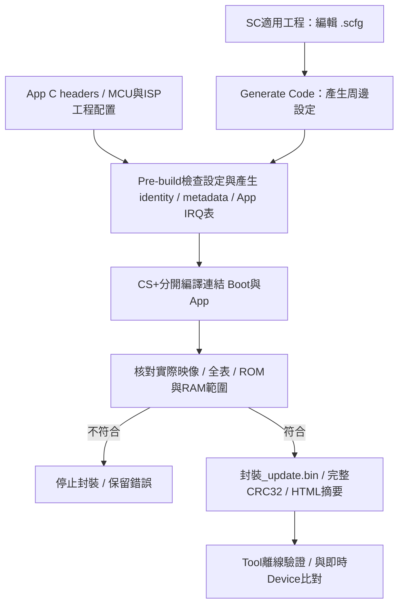

[知識庫首頁](https://released.github.io/) · [RL78 Bootloader](index.html)

<a id="article_top"></a>

# UART／Xmodem／I2C device 工程

四系列獨立串列工程的 Flash、Metadata、IRQ 與通訊契約。

<!-- BOOTLOADER_TOPICS_BEGIN -->
## 本頁主題

| 章節／規格 | 本頁 | 另一平台 |
| --- | --- | --- |
| 配置與資料來源 | [閱讀](#guide-serial-device-1) | [RH850](../slide_boot_loader_for_RH850/serial-device.html#guide-serial-device-1) |
| 編輯、產生與建置 | [閱讀](#guide-serial-device-2) | [RH850](../slide_boot_loader_for_RH850/serial-device.html#guide-serial-device-2) |
| Metadata offset與協定配置 | [閱讀](#guide-serial-device-3) | [RH850](../slide_boot_loader_for_RH850/serial-device.html#guide-serial-device-3) |
| SC設定與重新產生 | [閱讀](#guide-serial-device-4) | [RH850](../slide_boot_loader_for_RH850/serial-device.html#guide-serial-device-4) |
| Framed control與INFO | [閱讀](#guide-serial-device-5) | [RH850](../slide_boot_loader_for_RH850/serial-device.html#guide-serial-device-5) |
| UART診斷格式 | [閱讀](#guide-serial-device-6) | [RH850](../slide_boot_loader_for_RH850/serial-device.html#guide-serial-device-6) |
| I2C mailbox | [閱讀](#guide-serial-device-7) | [RH850](../slide_boot_loader_for_RH850/serial-device.html#guide-serial-device-7) |
| XMODEM-CRC128資料與診斷 | [閱讀](#guide-serial-device-8) | [RH850](../slide_boot_loader_for_RH850/serial-device.html#guide-serial-device-8) |
| 驗證範圍 | [閱讀](#guide-serial-device-9) | [RH850](../slide_boot_loader_for_RH850/serial-device.html#guide-serial-device-9) |
<!-- BOOTLOADER_TOPICS_END -->

<!-- SERIAL_DEVICE_GUIDE_BEGIN -->
<a id="serial-device-engineering"></a>

## MCU 串列 ISP 工程配置

F13、F24、G16、G22 分別提供 UART、Xmodem、I2C 的獨立 Boot／App／Transfer。
每份 Device Boot 只編入所選的一種更新介面／協定；UART0保留診斷文字。
Tool操作與接線見 [串列 device 操作](https://released.github.io/slide_simple_renesas_isp_tool/#uart-device-operation)，本節集中於工程編輯與資料契約。
Tool選取值、Boot／App初始化、live INFO與BIN需對應的項目集中於[通訊設定與更新必要條件](https://released.github.io/slide_simple_renesas_isp_tool/#serial-update-requirements)。

<a id="guide-serial-device-1"></a>

### 配置與資料來源

| MCU | CPU／時鐘 | Code Flash／RAM | App最大完整BIN | 尾端保護區 |
| --- | --- | --- | --- | --- |
| F13 | 32MHz／X1 4MHz | 128KiB／8KiB | 119KiB | 0x1FC00..0x1FFFF |
| F24 | 40MHz／X1 4MHz | 256KiB／24KiB | 247KiB | 0x3FC00..0x3FFFF |
| G16 | 16MHz／HOCO | 32KiB／2KiB | 23KiB | 0x07C00..0x07FFF |
| G22 | 32MHz／HOCO | 64KiB／4KiB | 55KiB | 0x0FC00..0x0FFFF |

各工程Boot為0x0000..0x1FFF（8KiB），建置檢查至少512-byte餘裕。
App表為0x2000..0x20FF，metadata為0x2100..0x21FF，程式從0x2200開始；完整BIN含上述內容、padding及末端4-byte CRC32。
尾端保護與安裝方式見 [Flash尾端與debug monitor](https://released.github.io/slide_boot_loader_for_RL78/#device-debug-monitor)。

| MCU | 更新UART RX向量 | IICA0向量 | 1-ms timer向量 | Flash實作 |
| --- | --- | --- | --- | --- |
| F13 | 0x40 | 0x28 | 0x1E | FSL Type01，Flash busy鏈位於RAM |
| F24 | 0x40 | 0x28 | 0x2E | RFD Type02，Flash busy鏈位於RAM |
| G16 | 0x20 | 0x2C | 0x1C | RFSP Type01，Code Flash操作期間CPU停止執行 |
| G22 | 0x26 | 0x2A | 0x2E | RFD Type01，startup複製Flash driver到RAM |

向量值是MCU實體vector的byte address，來源為對應硬體手冊的向量表及工程iodefine.h。
G16／G22 UART1使用SAU0 channels2／3；實際pin與PIOR值由各board adapter管理。
Flash函式的ROM儲存與RAM執行概念見 [Flash執行位置](https://released.github.io/slide_boot_loader_for_RL78/#flash-ram-execution)。

UART速率由 `isp_transport_config.h` 宣告；INFO、metadata及周邊分頻需一致。
`isp_bus_contract.h` 檢查各宣告值；SAU adapter依目前選定的UART source clock產生SDR，
`isp_uart_timing.h` 拒絕無法表示或誤差超過2%的組合。UART0 Log維持獨立分頻。
若速率需要不同的SPS時脈來源，先調整board adapter與其source clock，再重建配對Boot／App；
設定檢查通過不代替實際電氣與通訊時序驗證。

<a id="guide-serial-device-2"></a>

### 編輯、產生與建置

| 輸入／來源 | 用途與編輯時機 |
| --- | --- |
| App app_image_config.h | 發行version、build、target、DEVICE_APP、update transport、version control；每個define附註解 |
| App app_irq_handlers.h | 實體vector與global ISR mapping；新增中斷時編輯 |
| App custom_func.c | hardware_init／loop 入口、業務功能、APP_LOG_TAG與counter觀察；[入口與產碼說明](https://released.github.io/slide_boot_loader_for_RL78/#device-project-entry) |
| 各工程 image_metadata_config.h | MCU／Flash、App起點／容量、格式、IRQ ABI、Boot identity |
| 各工程 isp_transport_config.h | UART／I2C／Xmodem的編譯契約、速率、位址、timeout |
| 各工程 boot_app_handoff.h | owner與RAM保留區、ENTER／更新完成marker |
| 工程同名 .scfg | SC適用工程的MCU、時脈、UART／IICA與腳位配置，見[SC設定與重新產生](#serial-scfg-workflow) |
| image_metadata.c/.h、image_metadata_profile.c | 中性parser與expected profile；不操作UART／I2C／Flash |
| 產生的INC／identity／vectors | Pre-build輸出；由上述C headers產生，不另行手改 |

Boot／App／Transfer 各自包含 API、設定 header 與建置工具，不依賴相鄰工程。
目錄分工見 [工程目錄與程式入口](https://released.github.io/slide_boot_loader_for_RL78/#device-project-entry)。
在所選工程根目錄執行：

```powershell
powershell -NoProfile -ExecutionPolicy Bypass -File .\build.ps1
```

使用CS+／CC-RL與Windows PowerShell，不增加Python或JSON authoring前提。
`build.ps1` 只建置所在工程；`-Compiler` 可指定既有 CubeSuite+.exe 位置。

Pre-build產生完整表與metadata；post-build核對實際linked image、ISR返回方式、CRC、ROM／RAM範圍後產生_update.bin與app_build_report.html。
HTML列出實際BIN的metadata bytes、IRQ、CRC與雜湊；它是編譯報告，不是板上更新結果。



Boot持有完整實體vector；AA選Boot，55經App表轉送。
App ISR為global、無vect=的interrupt pragma，並列於app_irq_handlers.h。
同一專案不能重複定義同名ISR；分開連結的Boot／App可以同名。
新增IRQ亦包含C來源註冊、周邊初始化與旗標清除；完整流程見 [App IRQ編輯](https://released.github.io/slide_boot_loader_for_RL78/#device-irq-ownership)。

<a id="guide-serial-device-3"></a>

### Metadata offset與協定配置

總長256bytes，core128bytes、其餘128為FF。除ASCII與byte欄位外，多byte整數採little-endian。
下列offset相對於metadata起點0x2100；例如version在0x2110，policy在0x2174。

| Offset | Bytes | 內容／來源 |
| --- | --- | --- |
| 00 | 4 | 49 53 50 00，ISP加NUL；不是周邊名稱 |
| 04 | 4 | 0x00038006：format6、core128、flags3 |
| 08 | 4 | 0x01010055 UART、0x01010049 I2C、0x01010058 Xmodem |
| 0C | 4 | MCU target：F13B／F24B／016B／022B |
| 10／14 | 各4 | App version／build，來自App header |
| 18 | 4 | 完整BIN實際長度，由post-build產生 |
| 1C／20／24／28／2C | 各4 | App起點／容量／Code Flash／Boot／erase bytes |
| 30／34／38／3C | 各4 | I2C為編譯Hz／7-bit address／0／0，範例100000／20h／0／0；UART與Xmodem皆0 |
| 40..4F／50..5B | 16／12 | MCU part／family，ASCII與NUL padding |
| 5C | 4 | 最小完整BIN516bytes |
| 60 | 4 | UPD1 policy magic |
| 64 | 4 | UART／Xmodem=04012003h，I2C=02012003h；policy3、32bytes、DEVICE_APP與允許transport |
| 68／6C | 各4 | MCU IRQ ABI／最低Boot版本 |
| 70 | 4 | UART／Xmodem編譯baud，範例115200；I2C=0 |
| 74 | 4 | version control：0任意版本、1同版／新版 |
| 78..7F／80..FF | 8／128 | 零／FF |

版本號採00MMmmpp，build分開回報；最低Boot不是App／Boot版號相等要求。
只有完整驗證通過的installed App提供版本下限；FORCE_START只略過該交易版本排序，其他格式、identity、layout、IRQ與CRC檢查不變。

<a id="serial-scfg-workflow"></a>

<a id="guide-serial-device-4"></a>

### SC設定與重新產生

F24、G16、G22 的 UART／Xmodem／I2C Boot、App、Transfer各自帶有同名 `.scfg`。
F13使用工程內的Code Generator與board設定，沿用相同的metadata與App IRQ編輯方式。

| 配置 | SC元件 | Runtime負責 |
| --- | --- | --- |
| UART／Xmodem | UART0 Log、UART1更新、TAU0_1一毫秒tick、r_bsp時脈資料 | 有界RX queue、協定處理與傳送完成判斷 |
| I2C | UART0 Log、IICA0 Slave、TAU0_1一毫秒tick、r_bsp時脈資料 | Mailbox、STOP／NACK與回覆完成後的reset條件 |

Xmodem與UART使用相同周邊配置；XMODEM-CRC128的資料處理由協定程式負責。
各MCU的腳位見工程README；G16的16MHz時脈依據[原廠器件規格](https://www.renesas.com/en/products/rl78-g16/part-details/r5f121bcana-40)。

1. 在CS+開啟所選工程，進入Smart Configurator節點，開啟工程同名 `.scfg`。
2. 修改通訊設定時，同步核對配對Boot的 `isp_transport_config.h`，以及Boot／App／Transfer各自的SC設定。
   UART1 baud與編譯契約一致；UART0保留獨立Log設定。
3. I2C契約與Tool使用7-bit位址。SC的address欄位對應SVA暫存器值：`SVA = 7-bit address << 1`。
   例如7-bit `0x20` 對應SVA `0x40`，SC十進位輸入值為 `64`；7-bit `0x42` 對應SVA `0x84`，十進位值為 `132`。
4. 在SC執行 **Generate Code**，再於CS+執行 **Rebuild**，或使用上方PowerShell建置命令。
5. 核對建置輸出的 `PASS SC MCU/pins/clocks/serial/timer and actual generated registers`。
   App建置完成後，再開啟 `DefaultBuild/app_build_report.html` 檢查實際BIN的metadata與IRQ內容。

Pre-build會對照 `.scfg`、實際 `src/smc_gen` 產物與C header契約，
將核對過的時脈、UART0分頻、timer及IICA timing輸出至工程自己的 `sc_peripheral_config.generated.h`，供runtime初始化使用。
此header是產物，不另行編輯；修改設定後，透過SC重新產生及Rebuild更新。

若出現 `SC consistency` 或 `Regenerate SC`，建置會在產表與封裝前停止。
訊息會指出MCU、腳位、時脈、速率、位址或尚未更新的產物；調整對應輸入後再產生。
目前board adapter固定管理所列的clock與pin路由；若改用其他腳位或clock來源，也需修改adapter及其檢查條件。

工程保留自己的startup與IRQ入口。SC的周邊設定透過上述header接入；
UART／IICA預設callback ISR不另外加入連結，App也不產生第二套實體vector。
App新增中斷仍由[App IRQ編輯流程](https://released.github.io/slide_boot_loader_for_RL78/#device-irq-ownership)處理。
SC重新產生與建置檢查不代表已完成板上通訊、動態stack或Flash操作驗證。

<!-- SERIAL_WIRE_REFERENCE_BEGIN -->
<a id="guide-serial-device-5"></a>

### Framed control與INFO

| Frame byte | Bytes | 意義 |
| --- | --- | --- |
| 0..1 | 2 | 49 53 marker |
| 2／3 | 各1 | framing version1／request0或response1 |
| 4..5 | 2 | sequence LE16，1..65535 |
| 6／7 | 各1 | command／status，request status0 |
| 8..9 | 2 | payload長度LE16，0..96 |
| 10.. | 0..96 | payload |
| payload之後 | 4 | header與payload的CRC32，LE32 |

CRC32/ISO-HDLC：reflected polynomial EDB88320，initial／final XOR FFFFFFFF；123456789=CBF43926。
Frame最長110bytes；UART partial frame200ms逾時。相同sequence僅允許完全相同request重播。

| Command | 作用 |
| --- | --- |
| 01 INFO | 88-byte live contract／mode／MCU／geometry／installed App／capabilities |
| 02 ENTER | 回覆完成後reset到Boot；Boot直接ACK |
| 03 METADATA | LE16 offset加4..64bytes，依序stage256，不擦Flash |
| 04 START／0E FORCE_START | LE32完整size加LE32末端CRC；先驗證metadata與policy |
| 05 WRITE／06 END | UART／I2C：ordered64-byte write與完整映像驗證；Xmodem Boot拒絕，改由raw block／EOT處理 |
| 07 ABORT | 清session／staging，不復原已擦寫內容 |
| 08 READ_METADATA／09 VERIFY | 有效App metadata讀回／Boot唯讀重算完整映像 |
| 20 PING／21 ECHO | App／Transfer回傳0..96bytes |
| 22 STATS／23 CLEAR_STATS | App／Transfer四個LE32：requests、replays、errors、written |
| 24 STREAM_TEST | Xmodem App／Transfer宣告size1..65536與CRC32，轉到RAM診斷sink |
| 25 DIAGNOSTICS | 宣告能力的UART／Xmodem App／Transfer，回覆唯讀24-byte UART快照 |

INFO bytes0..7依序為contract、mode、transport、max-write、LE16target、valid、active。
Bytes8..39為八個LE32：App start、capacity、Flash、Boot、erase、Boot version、Boot build、bus rate。
Bytes40..51為installed version／build／size；52..55為policy／ready／LE16capabilities。
Bytes56..71為part16，72..83為family12，84..87為IRQ ABI。
Boot能力0F、App3C、Transfer10；Transfer不回報installed App／Boot分區與IRQ ABI，其對應值為零。
提供UART診斷callback的App／Transfer另加能力bit6（0x40）；Boot不加此位元。

<a id="serial-uart-diagnostics"></a>

<a id="guide-serial-device-6"></a>

### UART診斷格式

Command0x25不帶payload。只有INFO宣告bit6時才查詢；回覆是下表24bytes，多byte整數採little-endian。
回覆使用相同sequence快取規則；重播同一request不重新讀取硬體。

| Offset | Bytes | 內容與範例 |
| --- | --- | --- |
| 00 | 1 | 格式1 |
| 01 | 1 | 診斷種類1：Device UART |
| 02..03 | 2 | 欄位mask0x000F，代表本表四組計數／queue欄位均提供 |
| 04..07 | 4 | RX硬體錯誤次數 |
| 08..0B | 4 | RX queue丟棄新資料次數 |
| 0C..0F | 4 | 本機TX timeout次數 |
| 10..13 | 4 | RX queue最高使用bytes |
| 14..17 | 4 | 快照當下RX queue待處理bytes |

RL78硬體錯誤／丟棄／TX計數飽和於65535，RH850飽和於0xFFFFFFFF；欄位仍統一序列化為32bits。
最高量與待處理量是bytes，不是CAN frame數；reset後重新起算，不宣告跨重啟的累積量。
快照只短暫保留並還原對應IRQ遮罩，不清空接收queue或重設周邊。
`CLEAR_STATS`只清除協定計數，不清除此硬體診斷快照的累積量。
Tool保留支援／未提供／讀取失敗的區別；畫面與報告的用途見[Device串列診斷](https://released.github.io/slide_simple_renesas_isp_tool/serial-isp.html#serial-device-diagnostics)。

<a id="guide-serial-device-7"></a>

### I2C mailbox

I2C先寫一個STOP-delimited request，最長110bytes，再讀固定111bytes。
Byte0為00 busy或A5 ready；ready後接完整framed reply，其餘FF。
Tool只寫入一次request，再以唯讀poll等候；不因busy重送Flash request。

IICA ISR只處理有界Start／Receive／Next／NACK／STOP。
Main loop才解析／執行Flash並發布不可變reply；ENTER／END需等完整ready read、最終NACK及STOP後才reset。
Short read保留reply，mailbox有2秒lease；buffer overflow、busy時寫入及錯誤交易不授權更新。

<a id="guide-serial-device-8"></a>

### XMODEM-CRC128資料與診斷

| Byte／控制 | 意義 |
| --- | --- |
| 0 | SOH01 |
| 1／2 | 8-bit block number／ones complement，可wrap |
| 3..130 | 128-byte payload，末塊unused positions填1A |
| 131／132 | CRC16/XMODEM high／low byte，poly1021、init0 |
| C／ACK／NAK／CAN | 43／06／15／18；兩個CAN取消 |
| EOT04 | 完整映像或診斷CRC32 finalization，只送一次 |

Metadata與START仍使用framed ISP control。Receiver以宣告size排除1A padding，CRC16保護各block；CRC32保護完整useful data。
重送只允許相同block及完整相同128-byte內容；Tool最多三次相同block嘗試，不重送EOT。
Partial block200ms逾時NAK，idle10秒取消；完成／錯誤／取消後恢復framed parser。
本機無法送出C、ACK或NAK時，接收器取消串流並清除待重啟動作。
Boot只有完整映像驗證通過且最終ACK已由本機傳送完成後才reset；對端是否收到仍由Tool後續確認。

App／Transfer的0x24使用RAM CRC32 sink，沒有Flash erase／write／reset；Boot更新路徑才寫Flash並驗證映像。
Tool的389-byte診斷涵蓋短末塊，模型亦涵蓋65536-byte block-number wrap、CRC錯誤、duplicate、cancel及timeout。
<!-- SERIAL_WIRE_REFERENCE_END -->

<a id="guide-serial-device-9"></a>

### 驗證範圍

離線檢查包含實際App BIN、production PC client、C engine、transport loop／receiver、四系列IICA register模型，以及CS+ linked metadata／vector／ROM／RAM guards。
App-only建置會比對Boot來源與產物雜湊，確認未被改寫。
這些檢查不代替實板電氣、Flash timing、中斷、動態stack、重啟與斷電測試。
<!-- SERIAL_DEVICE_GUIDE_END -->

---

[上一主題：App Metadata、IRQ 與更新耗時](app-development.html) · [指南入口](index.html) · [下一主題：Boot／App 移植與 Flash](porting.html)
