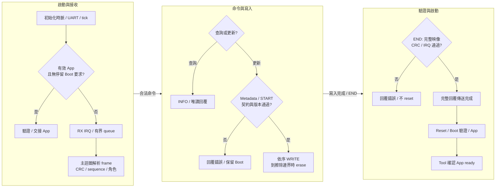

[知識庫首頁](https://released.github.io/) · [RL78 Bootloader](index.html)

<a id="article_top"></a>

# UART Bootloader 與協定格式

資料 UART、接收中斷、framed ISP 更新、封包範例與診斷。

<!-- BOOTLOADER_TOPICS_BEGIN -->
## 本頁主題

| 章節／規格 | 本頁 | 另一平台 |
| --- | --- | --- |
| 工程與接線 | [閱讀](#guide-uart-device-1) | [RH850](../slide_boot_loader_for_RH850/uart-device.html#guide-uart-device-1) |
| 通訊設定 | [閱讀](#guide-uart-device-2) | [RH850](../slide_boot_loader_for_RH850/uart-device.html#guide-uart-device-2) |
| Boot 執行流程 | [閱讀](#guide-uart-device-3) | [RH850](../slide_boot_loader_for_RH850/uart-device.html#guide-uart-device-3) |
| Protocol Format | [閱讀](#guide-uart-device-4) | [RH850](../slide_boot_loader_for_RH850/uart-device.html#guide-uart-device-4) |
| 異常與完成條件 | [閱讀](#guide-uart-device-5) | [RH850](../slide_boot_loader_for_RH850/uart-device.html#guide-uart-device-5) |
| 程式對照與診斷 | [閱讀](#guide-uart-device-6) | [RH850](../slide_boot_loader_for_RH850/uart-device.html#guide-uart-device-6) |
<!-- BOOTLOADER_TOPICS_END -->

<!-- UART_DEVICE_BEGIN -->
<a id="uart-bootloader"></a>


本章使用 framed UART ISP；每份 Boot、App、Transfer 各自是獨立工程。
UART 資料與診斷 Log 分開接線；Tool 的 Host Baud 與 Device baud 也分別設定。

<a id="guide-uart-device-1"></a>

### 工程與接線

| 用途 | 工程或連線 | 詳細說明 |
| --- | --- | --- |
| Boot／App／Transfer | 選擇名稱含 UART 的對應工程；各自包含來源與建置工具 | [平台工程與周邊](serial-device.html#guide-serial-device-1) |
| ISP 資料 | Bridge 資料 UART TX 接 device RX，RX 接 TX；共地並核對電壓 | [Tool 接線與操作](https://released.github.io/slide_simple_renesas_isp_tool/serial-isp.html#uart-device-operation) |
| 診斷文字 | Device 的獨立 Log UART 接 terminal | [平台工程與周邊](serial-device.html#guide-serial-device-1) |
| 建置與下載檔 | 在所選工程執行 PowerShell 建置；Boot 安裝檔與 App 更新 BIN 分別使用 | [編輯、產生與建置](serial-device.html#guide-serial-device-2) |

App-only 建置使用 App 自己的契約與工具；安裝到板上的 Boot 仍需與 App 相容。
Custom Transfer 是獨立通訊診斷映像，不擦寫 App Flash。

<a id="guide-uart-device-2"></a>

### 通訊設定

| 修改來源 | 作用 | 同步核對 |
| --- | --- | --- |
| `isp_transport_config.h` 的 `ISP_UART_BAUD` | Device 資料 UART 速率，範例為 115200 bit/s、8-N-1 | 配對 Boot／App 的周邊分頻、INFO、BIN Metadata 與 Tool Device baud |
| `ISP_POLICY_UART_BAUD` | 映像契約宣告的 UART baud | 與實際初始化及上述速率相符 |
| `.scfg` 或各工程 board adapter | 周邊、腳位、來源時脈與分頻 | [SC 設定與重新產生](serial-device.html#guide-serial-device-4) |
| `ISP_INTERBYTE_TIMEOUT_MS` | 未完成封包的接收閒置期限，範例 200 ms | 與實際傳輸及接收處理相符 |
| `ISP_BOOT_IDLE_TIMEOUT_MS` | 有效 App 進入 Boot 後、更新尚未開始時的閒置返回期限，範例 30000 ms | 已開始的更新不套用此閒置返回 |

變更 baud 時重建配對 Boot／App，並安裝更新後的 Boot。
可選速率與必要條件集中於 [通訊設定與更新必要條件](https://released.github.io/slide_simple_renesas_isp_tool/serial-isp.html#serial-update-requirements)。
Metadata 欄位位置見 [Metadata offset 與協定配置](serial-device.html#guide-serial-device-3)。

<a id="guide-uart-device-3"></a>
<a id="uart-boot-flow"></a>

### Boot 執行流程



INFO 等唯讀命令也由主迴圈回覆；ISR 只處理接收資料與錯誤狀態。
Metadata staging 與 START 不擦除 Flash；第一個合法 WRITE 才依擦除邊界啟動 Flash 操作。

<a id="guide-uart-device-4"></a>
<a id="uart-protocol"></a>

### Protocol Format

UART 依 byte stream 傳送共用 ISP frame。接收端依 header 的 payload length 找到 CRC32 尾碼，
不以 UART idle、換行或 terminal 文字作為命令結尾。

| 層級 | 內容與長度 | 參考 |
| --- | --- | --- |
| Frame | 10-byte header ＋ 0..96-byte payload ＋ 4-byte CRC32，最長 110 bytes | [逐 byte 封包與命令表](serial-device.html#guide-serial-device-5) |
| METADATA `03` | LE16 Metadata offset ＋ 4..64 bytes；依序暫存全部 256 bytes | Offset 基準是 Metadata 起點 |
| START `04` | LE32 完整 BIN bytes ＋ LE32 映像末端 CRC32 | 驗證已暫存 Metadata、配置與版本政策 |
| WRITE `05` | LE32 BIN offset ＋最多 64 bytes；非末塊為 64 bytes | Offset 基準是 BIN 起點，實體位址＝App 起點＋offset |
| END `06` | 空 payload | 重新驗證完整已寫入映像，再回覆結果 |

CRC32 有兩個用途：frame 尾碼保護本次 header／payload；BIN 末端 4 bytes 保護映像中尾碼之前的內容。
兩者分別計算，不能以封包 CRC 正確推定 Flash 映像有效。

#### 完整封包範例

以下 INFO request 為 sequence＝1、command＝01、空 payload；可以送給 Boot、App 或 Transfer。
最後四個 bytes 是前十個 bytes 的 CRC32，採 little-endian。

```text
49 53 01 00 01 00 01 00 00 00 F1 8D B0 75
```

具體回覆的 88-byte INFO payload 取決於板上角色、MCU、分區與 installed App；欄位定義見共用契約。

#### 成功與錯誤回覆範例

下列為依格式計算的封包範例，不是板端擷取記錄。以Transfer角色為例，PING將payload原樣回覆；未知命令回覆`BAD_COMMAND=1`，兩者的sequence／command都對應request。

```text
PING request: 49 53 01 00 02 00 20 00 03 00 12 34 56 1F 91 6C 3F
PING reply:   49 53 01 01 02 00 20 00 03 00 12 34 56 21 FA AE D0
Unknown request: 49 53 01 00 03 00 7F 00 00 00 55 FB 98 B3
Error reply:     49 53 01 01 03 00 7F 01 00 00 D6 9A 2D 14
```

Header的response byte由00改為01；status為00成功、01未知命令。

每列最後4bytes分別對該列header與payload計算CRC32；錯誤回覆也有自己的有效CRC。


<a id="guide-uart-device-5"></a>

### 異常與完成條件

| 觀察 | Device／Tool 行為 | 核對方向 |
| --- | --- | --- |
| Frame 未收齊或 CRC 錯誤 | 不執行該命令；partial frame 超過設定期限後清除 | baud、接線、queue／硬體錯誤、封包長度 |
| 同一 sequence 重送 | 只接受完整相同 request，重播快取回覆 | 不把重播當作第二次寫入 |
| START／WRITE 被拒絕 | 回覆對應 status，不以錯誤 request 授權 Flash 操作 | [狀態碼與命令條件](serial-device.html#serial-status-codes) |
| END 驗證成功 | 完整回覆傳送完成後才 reset | Device 傳送完成與 Tool 收到回覆分別判斷 |
| App 確認尚未成功 | 保留報告並讀取即時狀態 | 不自動重複 erase／END／RUN 來推定結果 |

實際操作與報告判讀見 [Tool 串列操作](https://released.github.io/slide_simple_renesas_isp_tool/serial-isp.html)。
平台與實板驗證範圍見 [驗證範圍](serial-device.html#guide-serial-device-9)。

<a id="guide-uart-device-6"></a>

### 程式對照與診斷

| 程式位置 | 入口或 API | 責任 |
| --- | --- | --- |
| `custom_func.c` | `hardware_init()`／`loop()` | 平台初始化、封包處理及回覆完成後的交接順序 |
| `hal/isp/isp_protocol.c` | `IspStreamFeed()`／`IspEncode()` | 串流組包、長度與 frame CRC32 |
| `hal/isp/isp_device.c` | `IspDeviceProcess()`／`IspDeviceWrite()`／`IspDeviceFinish()` | 命令、角色、版本、範圍及更新狀態 |
| `hal/device` | 各平台 UART RX／Error ISR、board API | 有界 queue、周邊初始化與傳送完成 |
| `hal/image`／`hal/flash` | 映像驗證與 Flash API | Metadata、完整 CRC、IRQ 與實際擦寫 |

<a id="serial-uart-diagnostics"></a>

<a id="guide-serial-device-6"></a>

#### UART診斷格式

Command0x25不帶payload。只有INFO宣告bit6時才查詢；回覆是下表24bytes，多byte整數採little-endian。
回覆使用相同sequence快取規則；重播同一request不重新讀取硬體。

| Offset | Bytes | 內容與範例 |
| --- | --- | --- |
| 00 | 1 | 格式1 |
| 01 | 1 | 診斷種類1：Device UART |
| 02..03 | 2 | 欄位mask0x000F，代表本表四組計數／queue欄位均提供 |
| 04..07 | 4 | RX硬體錯誤次數 |
| 08..0B | 4 | RX queue丟棄新資料次數 |
| 0C..0F | 4 | 本機TX timeout次數 |
| 10..13 | 4 | RX queue最高使用bytes |
| 14..17 | 4 | 快照當下RX queue待處理bytes |

RL78 硬體錯誤／丟棄／TX 計數飽和於 65535，欄位統一序列化為 32 bits。
最高量與待處理量是bytes，不是CAN frame數；reset後重新起算，不宣告跨重啟的累積量。
快照只短暫保留並還原對應IRQ遮罩，不清空接收queue或重設周邊。
`CLEAR_STATS`只清除協定計數，不清除此硬體診斷快照的累積量。
Tool保留支援／未提供／讀取失敗的區別；畫面與報告的用途見[Device串列診斷](https://released.github.io/slide_simple_renesas_isp_tool/serial-isp.html#serial-device-diagnostics)。
<!-- UART_DEVICE_END -->

---

[上一主題：串列 ISP 共用工程與協定契約](serial-device.html) · [指南入口](index.html) · [下一主題：I2C Bootloader 與協定格式](i2c-device.html)
