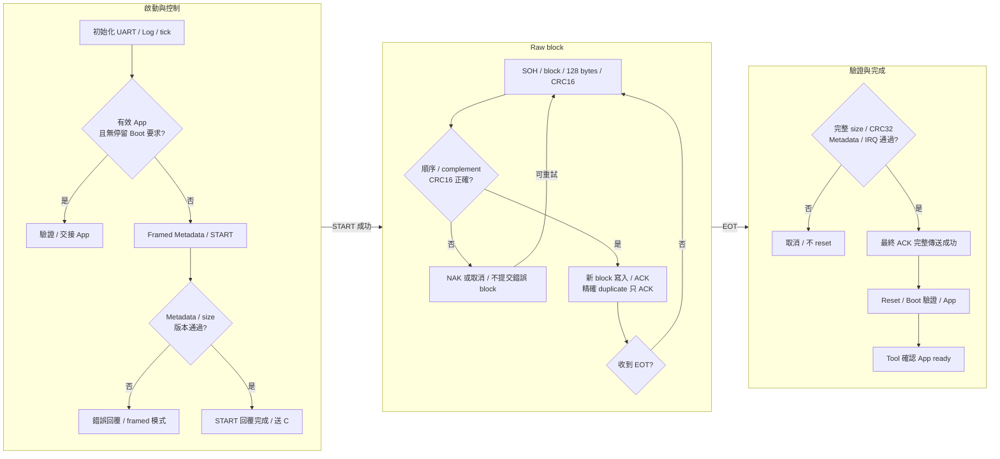

[知識庫首頁](https://released.github.io/) · [RL78 Bootloader](index.html)

<a id="article_top"></a>

# Xmodem Bootloader 與協定格式

Framed control、XMODEM-CRC128、串流寫入、重送與最終 ACK。

<!-- BOOTLOADER_TOPICS_BEGIN -->
## 本頁主題

| 章節／規格 | 本頁 | 另一平台 |
| --- | --- | --- |
| 工程與接線 | [閱讀](#guide-xmodem-device-1) | [RH850](../slide_boot_loader_for_RH850/xmodem-device.html#guide-xmodem-device-1) |
| 通訊設定 | [閱讀](#guide-xmodem-device-2) | [RH850](../slide_boot_loader_for_RH850/xmodem-device.html#guide-xmodem-device-2) |
| Boot 執行流程 | [閱讀](#guide-xmodem-device-3) | [RH850](../slide_boot_loader_for_RH850/xmodem-device.html#guide-xmodem-device-3) |
| Protocol Format | [閱讀](#guide-xmodem-device-4) | [RH850](../slide_boot_loader_for_RH850/xmodem-device.html#guide-xmodem-device-4) |
| 異常與完成條件 | [閱讀](#guide-xmodem-device-5) | [RH850](../slide_boot_loader_for_RH850/xmodem-device.html#guide-xmodem-device-5) |
| 程式對照與診斷 | [閱讀](#guide-xmodem-device-6) | [RH850](../slide_boot_loader_for_RH850/xmodem-device.html#guide-xmodem-device-6) |
<!-- BOOTLOADER_TOPICS_END -->

<!-- XMODEM_DEVICE_BEGIN -->
<a id="xmodem-bootloader"></a>


本章使用 framed ISP control 搭配 XMODEM-CRC／128-byte block。
Tool 在 **UART / Xmodem → Workflow** 選擇對應功能；Device 使用獨立 Xmodem 工程，另保留 Log UART。

<a id="guide-xmodem-device-1"></a>

### 工程與接線

| 用途 | 工程或連線 | 詳細說明 |
| --- | --- | --- |
| Boot／App／Transfer | 選擇名稱含 Xmodem 的對應工程，各自可獨立建置 | [平台工程與周邊](serial-device.html#guide-serial-device-1) |
| 資料與文字 | 資料 UART 與獨立 Log UART 分別接線 | [Tool 接線與操作](https://released.github.io/slide_simple_renesas_isp_tool/serial-isp.html#uart-device-operation) |
| App 更新 | Tool 載入封裝的 `_update.bin`，以 XMODEM-CRC Workflow 更新 | [建置產物](serial-device.html#guide-serial-device-2) |
| Transfer 診斷 | 使用 STREAM_TEST 接收 RAM CRC32 sink | 不擦 Flash；不回報已安裝 App 的成功更新 |

<a id="guide-xmodem-device-2"></a>

### 通訊設定

| 修改來源或條件 | 作用 | 同步核對 |
| --- | --- | --- |
| `ISP_UART_BAUD`／`ISP_POLICY_UART_BAUD` | 資料 UART 速率，範例 115200 bit/s、8-N-1 | 配對 Boot／App 分頻、INFO、Metadata 與 Tool Device baud |
| `.scfg` 或 board adapter | UART、pin、clock 與接收中斷 | [SC 設定與重新產生](serial-device.html#guide-serial-device-4) |
| XMODEM-CRC128 | 固定 128-byte block，加 CRC16/XMODEM | 與 Tool 的 XMODEM-CRC Workflow 相符 |
| `ISP_BOOT_IDLE_TIMEOUT_MS` | 更新尚未開始時、有效 App 的 Boot 閒置窗口 | 範例 30000 ms；raw streaming 另有接收期限 |

Metadata 的 protocol 為 Xmodem；其 update transport 為 UART。
資料腳位相同不代表 UART framed WRITE 可取代 Xmodem raw block。
設定條件見 [通訊設定與更新必要條件](https://released.github.io/slide_simple_renesas_isp_tool/serial-isp.html#serial-update-requirements)。

<a id="guide-xmodem-device-3"></a>
<a id="xmodem-boot-flow"></a>

### Boot 執行流程



Boot 更新以 staged Metadata 與完整 BIN size 綁定串流，排除末塊 padding。
App／Transfer 的 STREAM_TEST 使用同一 block 接收方式，但資料只送入 RAM CRC32 sink。

<a id="guide-xmodem-device-4"></a>
<a id="xmodem-protocol"></a>
<a id="guide-serial-device-8"></a>

### Protocol Format

| Byte／控制 | 意義 |
| --- | --- |
| 0 | SOH01 |
| 1／2 | 8-bit block number／ones complement，可wrap |
| 3..130 | 128-byte payload，末塊unused positions填1A |
| 131／132 | CRC16/XMODEM high／low byte，poly1021、init0 |
| C／ACK／NAK／CAN | 43／06／15／18；兩個CAN取消 |
| EOT04 | 完整映像或診斷CRC32 finalization，只送一次 |

| 階段 | 線上格式 | 判斷依據 |
| --- | --- | --- |
| 準備 | 共用 ISP framed INFO／ENTER／METADATA／START | [共用 header、命令與 INFO](serial-device.html#guide-serial-device-5) |
| Raw data | SOH、block number、complement、128 bytes、CRC16，共 133 bytes | CRC16 只覆蓋 128-byte payload，尾碼 high byte 先送 |
| 末塊 | 不足 128 bytes 的位置填 1A | 只提交 START 宣告的 useful bytes |
| 結束 | EOT 與最終 ACK | Boot 完整 BIN CRC32／Metadata／IRQ 驗證通過後才完成 |

CRC16/XMODEM 使用 polynomial 1021h、initial 0000h、無反射、無 final XOR；`123456789` 的結果為 31C3h。
它保護單一 block；共用控制 frame 與完整映像仍各自使用 CRC32。

#### Block 範例

```text
01 01 FE [payload: 00 01 02 ... 7F，共 128 bytes] E8 0A
```

第一個 01 是 SOH，第二個 01 是 block number，FE 是其 ones complement。
E8 0A 為這組 128 bytes 的 CRC16 high／low byte；block number 以 8-bit wrap，從 FF 接到 00。

#### 成功與錯誤回覆範例

| Request／狀態 | Device回覆 | 意義 |
| --- | --- | --- |
| 上述block通過CRC、順序與寫入 | `06` ACK | 可以送下一block；完整映像仍待EOT驗證 |
| CRC錯誤或partial block超時 | `15` NAK | 重送相同block；不跳到下一block |
| 完整相同duplicate | `06` ACK | 重播接受結果，不再次寫入 |
| EOT且完整映像驗證通過 | `06`最終ACK，傳送完成後reset | Tool另行確認App ready |
| 取消或完整映像驗證失敗 | `18 18` CAN CAN | 不以ACK或重啟推定成功；保存結果後查詢狀態 |

ACK／NAK是raw單byte控制，不含ISP frame CRC；framed錯誤回覆只在framed控制階段使用。


<a id="guide-xmodem-device-5"></a>

### 異常與完成條件

| 條件 | 處理 | 完成判斷 |
| --- | --- | --- |
| Block CRC16／順序錯誤 | NAK；Tool 對相同 block 最多三次嘗試 | 尚未提交錯誤 block |
| 精確 duplicate block | 全部 128-byte 內容相同才重播 ACK | 不重複寫入 Flash |
| Partial block 閒置 200 ms | NAK 並清除 partial block | 等待合法 block |
| Streaming idle 10 秒或收到兩個 CAN | 取消串流，返回 framed parser | 不執行 pending reset |
| 本機 C／ACK／NAK 傳送失敗 | 取消串流並清除 pending reset | 不以未完成回覆授權重啟 |
| EOT 完整驗證成功 | 最終 ACK 完整傳送後才 reset | Tool 另行確認重連與 App ready |

EOT 只送一次；最終 ACK 遺失時保留映像與報告，再查詢即時狀態，不以重送 EOT 或重燒推定結果。
平台與實板驗證範圍見 [驗證範圍](serial-device.html#guide-serial-device-9)。

<a id="guide-xmodem-device-6"></a>

### 程式對照與診斷

| 程式位置 | 入口或 API | 責任 |
| --- | --- | --- |
| `custom_func.c` | `hardware_init()`／`loop()`、串流 callback | framed／raw 模式切換、sink 與回覆完成後動作 |
| `hal/isp/isp_protocol.c`／`isp_device.c` | `IspStreamFeed()`／`IspDeviceProcess()` | Metadata、START、版本與角色契約 |
| `hal/isp/isp_xmodem.c` | `IspXmodemInit()`／`IspXmodemFeed()`／`IspXmodemPoll()` | block、CRC16、duplicate、cancel 與接收期限 |
| 同一 Xmodem 模組 | `IspXmodemCrc()` | CRC16/XMODEM |
| `hal/image`／`hal/flash` | 映像驗證與 Flash API | Boot 寫入及完整 BIN 驗證；診斷 sink 不使用 Flash |

Tool 的 Xmodem Transfer 使用 389 useful bytes，涵蓋末塊填充及 CRC32。
UART queue 與硬體錯誤欄位沿用 [UART 診斷格式](uart-device.html#serial-uart-diagnostics)。
Tool 操作與報告集中於 [串列操作](https://released.github.io/slide_simple_renesas_isp_tool/serial-isp.html)。
<!-- XMODEM_DEVICE_END -->

---

[上一主題：I2C Bootloader 與協定格式](i2c-device.html) · [指南入口](index.html) · [下一主題：Boot／App 移植與 Flash](porting.html)
